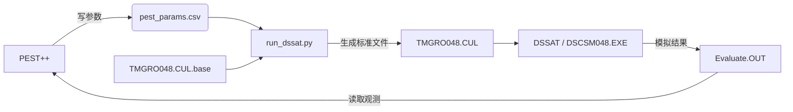

# DSSAT-PEST 自动化率定系统开发指南

本文档专为后续开发人员编写，旨在解释系统架构、代码逻辑以及如何扩展功能（例如增加土壤参数率定、并行化计算等）。

## 1. 系统架构原理

本系统通过 **"模板-注入"** 模式实现 PEST 优化引擎与 DSSAT 作物模型的松耦合集成。

### 核心工作流
1.  **PEST (主控)**: 负责生成新的参数组合，写入 `pest_params.csv`。
2.  **接口脚本 (`run_dssat.py`)**: 
    *   读取 `pest_params.csv`。
    *   读取参数基准文件 (`.base`)。
    *   **关键步骤**: 将新参数动态注入到基准文件，生成 DSSAT 可识别的输入文件（如 `.CUL`）。
    *   调用 DSSAT 主程序 (`DSCSM048.EXE`)。
3.  **模型反馈**: DSSAT 生成 `Evaluate.OUT`。
4.  **PEST (回收)**: 根据 `.ins` 指令文件读取 `Evaluate.OUT` 中的模拟值，计算目标函数 (Phi)，决定下一步迭代方向。



## 2. 核心代码解析

### 2.1 `build_pest.py` (构建器)
此脚本是一次性工具，用于初始化 PEST 环境。
*   **`parse_cul_file()`**: 解析 `.CUL.base` 文件，识别带有 `!Calibration` 标记的参数行，提取参数名、初始值及范围 (MIN/MAX)。
*   **`create_pst_file()`**: 利用 `pyemu` 库自动生成 PEST 控制文件 (`.pst`)。它会自动匹配参数和观测数据。
*   **观测数据处理**:
    *   自动读取 `Evaluate.OUT` 生成 `.ins` 指令文件。
    *   **关键逻辑**: `CRITICAL_OBS` 列表定义了即使缺失（值为 -99）也要强制追踪的指标（如开花期 `ADAPM`），权重设为 0。
    *   **偏移校正**: `PEST_TOKEN_OFFSET` 处理了 PEST 读取定长格式文件时的列偏移问题。

### 2.2 `run_dssat.py` (运行器)
此脚本是 PEST 每次迭代调用的"黑盒"函数。
*   **`format_val()`**: **至关重要**。DSSAT 的 `.CUL` 文件对格式极其敏感（固定列宽）。此函数确保浮点数、整数、小数值（如 `0.0040`）都能被正确格式化为 6 字符宽度的字符串。
*   **`update_cul_file()`**: 读取 `.base` 模板，用 `pest_params.csv` 中的新值替换旧值，生成最终 `.CUL` 文件。

## 3. 功能扩展指南

### 3.1 扩展：增加土壤参数率定
目前系统仅支持品种参数 (`.CUL`)。若要率定土壤水力学参数（如 `SLDR`, `SLRO` 等），请遵循以下步骤：

**步骤 1: 准备模板**
1.  复制 `SOIL.SOL` 为 `SOIL.SOL.base`。
2.  在需要率定的土壤层行末尾添加注释标记，例如：
    ```text
    94010101 05  10  160  1.32  0.076  0.170  0.280  1.00   0.00   0.00 !Calibrate_Layer1
    ```

**步骤 2: 修改 `build_pest.py`**
1.  编写 `parse_soil_file()` 函数，逻辑类似于 `parse_cul_file`，但需适配 `SOIL.SOL` 的格式。
2.  在 `main()` 中调用该函数，将土壤参数加入 `params` 列表。
    *   *注意*: 土壤参数通常分层，建议参数命名携带层号，如 `SLDR_L1`, `SLDR_L2`。

**步骤 3: 修改 `run_dssat.py`**
1.  新增 `update_soil_file()` 函数。
2.  读取 `pest_params.csv` 中的土壤参数。
3.  读取 `SOIL.SOL.base`，根据层号替换对应数值。
4.  写入新的 `SOIL.SOL`。
5.  在 `main()` 中调用此更新函数。

### 3.2 扩展：增加新的观测指标
若需增加新的输出变量（例如叶氮含量 `LN%`）：
1.  确保 DSSAT 的 `FileX` 实验文件中已开启相关输出（如 `PlantN.OUT`）。
2.  修改 `Evaluate.OUT` 的生成逻辑（DSSAT 默认会将主要结果汇总至此，若未包含需检查 `DSSATPRO.v48` 配置）。
3.  修改 `build_pest.py`:
    *   在 `CRITICAL_OBS` 中添加新变量名（如果需要强制追踪）。
    *   如果新变量导致列偏移变化，需调整 `get_pest_offset()` 函数。

### 3.3 扩展：并行化计算 (Parallelization)
当前项目规模较小，使用了串行模式。若扩展到多点、多年份模拟，需启用并行：
1.  **Worker 准备**: 确保 `run_dssat.py` 是线程安全的（当前已满足，因为 PEST++ 会为每个 Worker 创建独立目录）。
2.  **启动命令**:
    *   启动 Master:
        ```powershell
        pestpp-ies.exe tomato_cal.pst /H :4004
        ```
    *   启动 Worker (在其他终端或机器):
        ```powershell
        pestpp-ies.exe tomato_cal.pst /H localhost:4004
        ```

## 4. 常见问题与调试 (Troubleshooting)

*   **DSSAT 运行报错 (Exit Code 99/59)**:
    *   通常是 `.CUL` 或 `.SOL` 文件格式错乱导致。
    *   *检查*: 打开生成的 `TMGRO048.CUL`，开启编辑器的"显示隐藏字符"功能，检查列是否对齐。
    *   *修复*: 调整 `run_dssat.py` 中的 `format_val()` 逻辑。

*   **PEST 报错 "Error reading observation"**:
    *   说明 `.ins` 文件与 `Evaluate.OUT` 不匹配。
    *   *检查*: 可能是 `Evaluate.OUT` 中的列数发生了变化（例如实验代码长度变了）。
    *   *修复*: 在 `build_pest.py` 中调整 `PEST_TOKEN_OFFSET`。

*   **参数不收敛**:
    *   检查参数范围 (`MINIMA`/`MAXIMA`) 是否过窄。
    *   检查观测数据权重是否合理（`build_pest.py` 中默认有效值为 1.0）。
    *   **重要**: 为了满足顶级期刊对不确定性分析的要求，建议在正式运行时将 `build_pest.py` 中的 `ies_num_reals` 至少设为 **100**。

## 5. 项目维护与结果管理

### 5.1 目录结构
为了保持工作区整洁，系统会自动将生成的文件归档：
*   **`Calibration_Results/`**: 存放参数率定的所有中间结果 (`.par`, `.obs.csv`) 和最终分析报告 (`best_parameters.csv`).
*   **`Sensitivity_Results/`**: 存放敏感性分析的图表和数据报告。

### 5.2 清理工作区
运行 DSSAT 和 PEST 会产生大量临时文件（如 `.OUT`, `.rec`, `.log`）。
使用提供的清理脚本可以一键还原整洁的工作区（不会删除核心代码或结果数据）：

```powershell
python clean_workspace.py
```

---
**致谢**: 感谢您使用本系统。愿这个工具能为您的作物模型研究带来便利！
