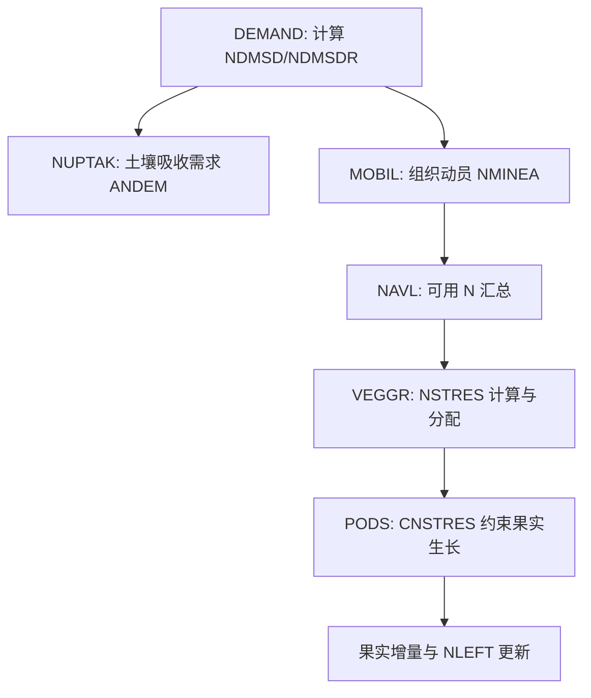
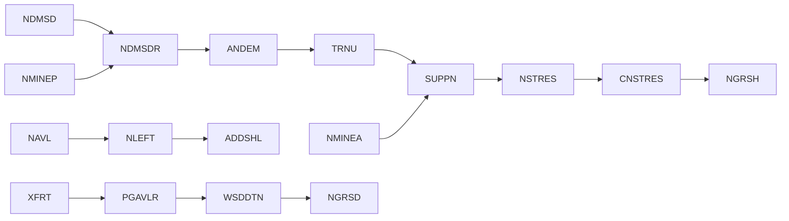
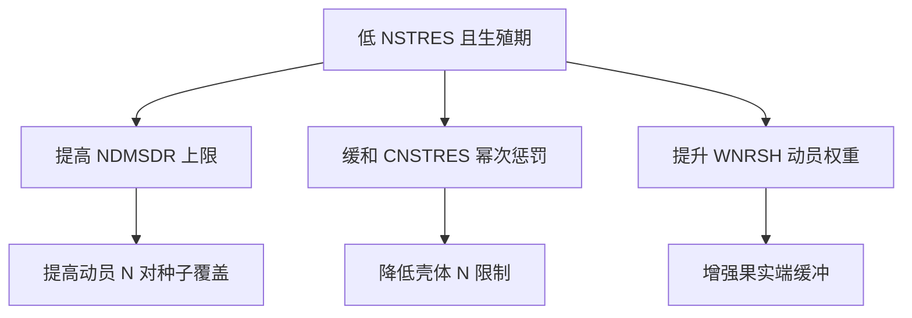
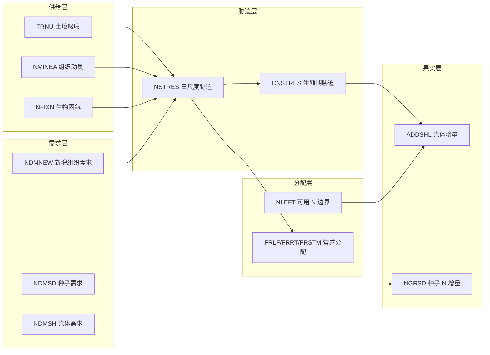
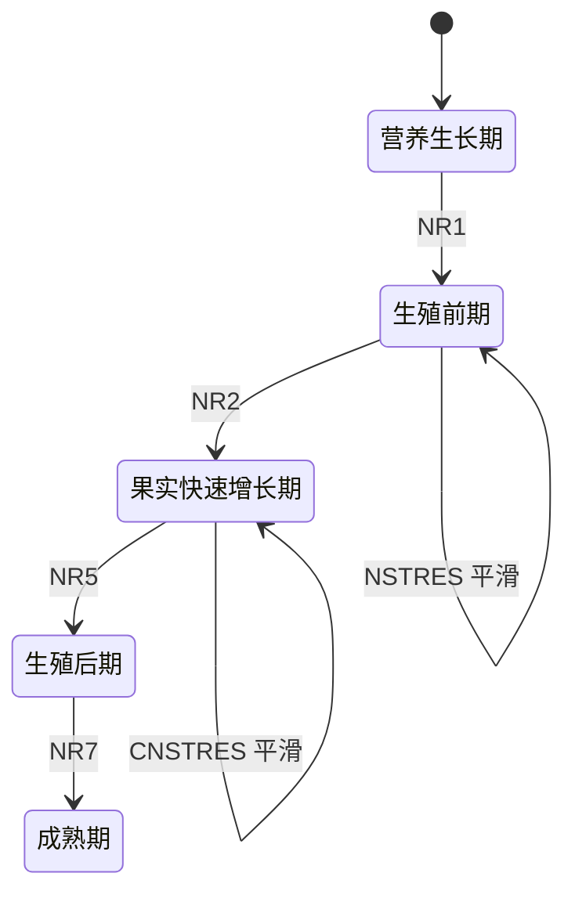
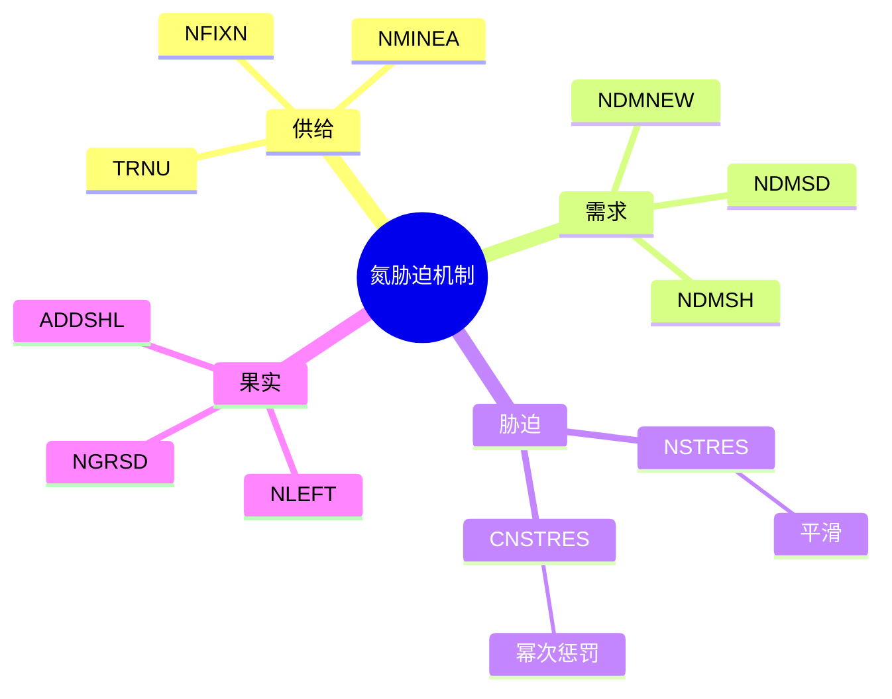
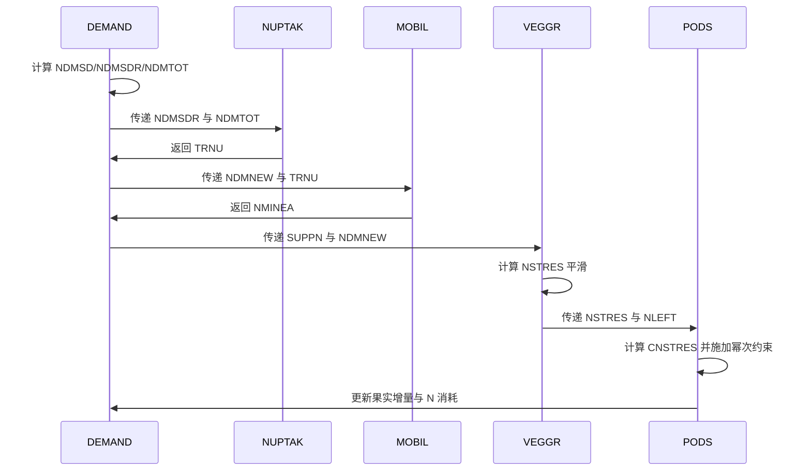

# 流程图与变量依赖图

## 1. 氮分配主流程图

## 2. 变量依赖图（关键变量）

## 3. 低氮果实氮分配调节点示意

## 4. 分层机制框架图（论文概念图）

## 5. 生育期状态-阶段图（机制窗口）

## 6. 论文用公式化表达（核心机制方程）

- 供给汇总

\[
SUPPN = NFIXN + TRNU + NMINEA
\]

- 氮胁迫形成与平滑

\[
NSTRES_t = \begin{cases}
\min\left(1, \frac{SUPPN}{NDMNEW \cdot NSTFAC}\right), & SUPPN < NDMNEW \cdot NSTFAC \\
1, & \text{otherwise}
\end{cases}
\]

\[
NSTRES_t = 0.5 \cdot NSTRES_t + 0.5 \cdot NSTRES_{t-1}
\]

\[
CNSTRES_t = 0.875 \cdot CNSTRES_{t-1} + 0.125 \cdot NSTRES_t
\]

- 果实氮需求与动员上限

\[
NDMSD = FNINSD \cdot GDMSD
\]

\[
NDMSDR = \min(NDMSD, NMINEP)
\]

\[
ANDEM = (NDMTOT - NDMSDR) \times 10
\]

- 壳体增长的氮约束

\[
ADDSHL \le \frac{NLEFT}{FNINSH \cdot CNSTRES^{0.5}}
\]

## 7. 机制-参数-观测对照矩阵（论文表格）

| 机制 | 关键变量 | 作用位置 | 论文可解释观测指标 |
|---|---|---|---|
| 氮胁迫形成 | SUPPN, NDMNEW, NSTFAC, NSTRES | VEGGR | 低氮处理下的生长速率下降 |
| 生殖期记忆 | CNSTRES | PODS | 果实增长期的持续抑制 |
| 动员上限 | NMINEP, NDMSDR | DEMAND | 低氮下种子 N 供给上限 |
| 土壤吸收反馈 | ANDEM, TRNU | NUPTAK | 吸收强度随动员上升而下降 |
| 果实 N 约束 | NLEFT, FNINSH, CNSTRES | PODS | 果实增长边界与延迟 |
| 组织分配响应 | FRLF, FRRT, FRSTM | VEGGR | 叶/根/茎分配比例变化 |

## 8. 机制逻辑树（因果路径表达）

## 9. UML 表达（过程协作图）

