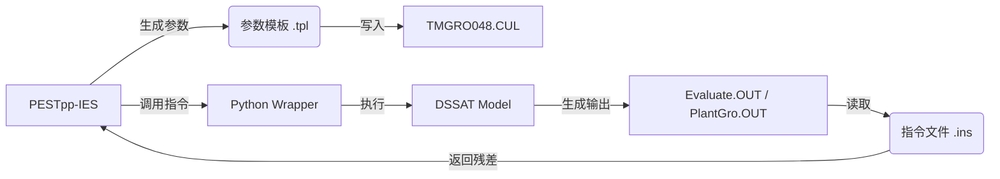

# DSSAT模型参数自动化率定项目设计文档 (Based on PESTpp-IES)

## 1. 项目概述 (Project Overview)

### 1.1 背景
本项目旨在利用 **PESTpp-IES** (Iterative Ensemble Smoother) 算法，建立一套自动化的 DSSAT CROPGRO-Tomato 模型参数率定系统。通过集合平滑方法，解决传统“试错法”效率低、主观性强的问题，同时有效处理作物模型的高度非线性和异参同效性，量化参数的不确定性。

### 1.2 目标
1.  **构建自动化接口**：实现 PEST 与 DSSAT v4.8 的无缝耦合。
2.  **参数反演**：针对番茄品种（如 TM0001），准确估算物候、光合及产量分配相关的遗传参数。
3.  **不确定性分析**：输出参数的后验分布，评估模拟结果的可信度。

## 2. 系统环境与架构 (System Environment & Architecture)

### 2.1 运行环境
*   **操作系统**: Windows 10/11
*   **DSSAT路径**: `c:\DSSAT48` (主程序: `DSCSM048.EXE`)
*   **项目根目录**: `c:\DSSAT48\Tomato_Cal`
*   **PEST引擎**: `c:\DSSAT48\Tomato_Cal\pestpp-5.2.16-win\bin\pestpp-ies.exe`
*   **脚本语言**: Python 3.8+ (依赖库: `pandas`, `pyemu`, `shutil`)

### 2.2 耦合架构
系统采用“非侵入式”耦合模式，数据流如下：



## 3. 详细实施方案 (Detailed Implementation Plan)

### 3.1 阶段一：工作空间搭建 (Workspace Setup)
在 `c:\DSSAT48\Tomato_Cal` 下建立以下标准目录结构，确保文件隔离，避免污染原始 DSSAT 目录。

```text
c:\DSSAT48\Tomato_Cal\
├── pestpp-5.2.16-win\       # PEST引擎
├── Workspace\               # [核心] 实际运行目录
│   ├── DSCSM048.EXE         # (已复制) DSSAT主程序
│   ├── DSSBatch.v48         # 批处理文件
│   ├── DSSATPRO.v48         # 路径配置文件
│   ├── TMGRO048.CUL         # 初始品种文件
│   ├── TMGRO048.SPE         # 物种文件
│   ├── TMGRO048.ECO         # 生态型文件
│   ├── SOIL.SOL             # 土壤数据文件 (含 FL/GA 站点数据)
│   ├── UFBR9401.TMX         # 试验管理文件 (Bradenton 1994)
│   ├── UFBR9401.WTH         # 气象文件 (Bradenton 1994)
│   ├── UFGA0602.TMX         # 试验管理文件 (Citra 2006)
│   ├── UFGA0601.WTH         # 气象文件 (Citra 2006)
│   ├── UFGA0701.TMX         # 试验管理文件 (Citra 2007)
│   ├── UFGA0701.WTH         # 气象文件 (Citra 2007)
│   ├── run_dssat.py         # 接口脚本
│   └── ... (其他关联 TMT/TMA 文件)
└── Backup\                  # 原始文件备份
```

### 3.2 阶段二：AgMIP 标准化率定流程 (AgMIP Standardized Protocol)
遵循 Daniel Wallach 等人提出的 AgMIP Calibration Protocol，实施严格的分步率定与参数筛选。

#### 3.2.1 参数选择 (AICc Selection)
不要凭经验全选参数。使用 **校正赤池信息准则 (AICc)** 客观筛选待率定参数。
*   **原则**: 在模型拟合度提升与参数数量之间取得平衡，防止过拟合。
*   **方法**: 从候选参数集中逐步增加参数，计算 AICc 值，选择 AICc 最小的参数组合。

#### 3.2.2 三步法率定 (Two-Step Calibration)
1.  **第一步：物候 (Phenology)**
    *   **目标**: 准确模拟开花期 (ADAT) 和成熟期 (MDAT)。
    *   **涉及参数**: `EM-FL`, `FL-SH`, `FL-SD`, `SD-PM`。
    *   **冻结**: 此步骤完成后，物候参数固定，不参与后续率定。
2.  **第二步：生长与产量 (Growth & Yield)**
    *   **目标**: 拟合生物量 (CWAD)、叶面积 (LAID)、产量 (HWAM)。
    *   **涉及参数**: `LFMAX`, `SLAVR`, `XFRUIT`, `WTPSD`, `SFDUR`。
3.  **第三步：加权最小二乘法（WLS）联合估算** 
    *   **目标**: 使用第一步的结果作为初值，对所有参数进行同时优化。关键在于使用加权，权重应与各观测变量误差方差的倒数成正比，以平衡不同量纲（如天数 vs. kg/ha）的影响。


### 3.3 阶段三：接口脚本开发 (Interface Development)
已完成 `run_dssat.py` 的开发，该脚本作为 PEST 调用的直接对象，具备以下特性：

1.  **自动清理**: 每次运行前清除 `PlantGro.OUT`, `Evaluate.OUT` 等输出文件。
2.  **健壮性**: 捕获 DSSAT 崩溃 (Non-zero exit code) 和 输出文件缺失 两种错误模式。
3.  **错误处理**: 当模型失败时，自动生成包含错误标记的 `Evaluate.OUT`，防止 PEST 挂起。
4.  **执行命令**: `python run_dssat.py` (无需参数，脚本内部调用 `DSCSM048.EXE B DSSBatch.v48`)。

### 3.4 阶段四：PEST 文件构建 (PEST Configuration)
已完成 `build_pest.py` 脚本开发，该脚本利用 `pyemu` 库自动化生成 PEST 所需的配置文件。

#### 3.4.1 自动化构建流程
脚本 `build_pest.py` 执行以下逻辑：
1.  **参数解析**: 读取 `TMGRO048.CUL`，解析 `!Calibration` 行确定待率定参数 (Flag = P/G)，并从 `MINIMA`/`MAXIMA` 行提取参数上下界。
    *   **动态调整**: 脚本会自动识别 `MIN=MAX` 的参数并将其设为 `fixed` (固定)，避免 PEST 报错。
    *   **初始值**: 读取 `TM0001` 行作为初始值。
2.  **模板生成**: 生成 `TMGRO048.CUL.tpl`，保持严格的固定列宽格式，确保 DSSAT 能正确读取。
3.  **观测提取**: 读取 `Evaluate.OUT`，自动识别非空观测值 (Value != -99) 的列 (如 `HWAMM`, `CWAMM`)，并生成对应的指令文件 `Evaluate.OUT.ins` 以读取模拟值 (如 `HWAMS`, `CWAMS`)。
4.  **控制文件**: 生成 `tomato_cal.pst`，自动配置参数组、观测组及 `python run_dssat.py` 调用命令。

#### 3.4.2 待率定参数 (Parameters)
脚本根据 `TMGRO048.CUL` (Lines 39-46) 自动提取的参数如下 (示例)：

| 参数名 | 说明 | 变换 (Transform) | 状态 | 来源 |
| :--- | :--- | :--- | :--- | :--- |
| **CSDL** | 临界日长 | Fixed | 固定 | Min=Max=12.33 |
| **PPSEN** | 光周期敏感性 | None | 固定 | Min=Max=0.0 |
| **EM-FL** | 出苗-开花热时 | Log | 可调 | 24.4 - 31.0 |
| **FL-SH** | 开花-坐果热时 | Log | 可调 | 2.2 - 4.6 |
| **FL-SD** | 开花-结籽热时 | Log | 可调 | 19.0 - 21.0 |
| **SD-PM** | 结籽-成熟热时 | Log | 可调 | 45.0 - 47.0 |
| **LFMAX** | 最大光合速率 | Fixed | 固定 | Min=Max=1.36 |
| **SLAVR** | 比叶面积 | Fixed | 固定 | Min=Max=300.0 |
| **SIZLF** | 最大叶面积 | Fixed | 固定 | Min=Max=0.78 |
| **XFRT** | 果实分配系数 | Log | 可调 | 0.73 - 0.78 |
| **WTPSD** | 种子重 | Fixed | 固定 | Min=Max=0.004 |
| **SFDUR** | 灌浆期 | Log | 可调 | 26.0 - 27.0 |
| **PODUR** | 荚果期 | Log | 可调 | 54.0 - 58.0 |

*注：若需开启固定参数的率定，请直接修改 `TMGRO048.CUL` 中的 `MINIMA`/`MAXIMA` 行，脚本将自动识别并更新 PST 文件。*

#### 3.4.3 观测数据 (Observations)
脚本自动从 `Evaluate.OUT` 中提取以下有效观测 (Value != -99)：
*   **HWAMS**: 产量 (Harvest Weight)
*   **CWAMS**: 地上部生物量 (Canopy Weight)
*   **LAIXS**: 叶面积指数 (LAI)
*   **PWAMS**: 荚果重 (Pod Weight)

此外，即使观测值为缺失 (-99)，脚本也会强制追踪以下关键物候指标（权重设为0，用于验证模拟准确性）：
*   **ADAPM**: 开花期 (Anthesis Date)
*   **MDAPM**: 成熟期 (Maturity Date)
*   **PD1PM**: 结荚期 (First Pod Date)

#### 3.4.4 控制参数 (Control Data - IES)
默认配置生成的 `tomato_cal.pst` 使用 `pyemu` 默认设置。建议后续手动调整：
*   `++ies_num_reals = 50`
*   `++ies_parameter_ensemble = prior.jcb` (使用高斯分布生成的先验集合)
*   `++ies_reg_factor = 0.05` (正则化因子)
*   `noptmax = 5` (最大迭代次数)

### 3.5 阶段五：执行流程 (Execution)

1.  **生成先验集合**：使用 `pyemu` 生成 50 组随机参数组合。
2.  **启动 PEST**：
    ```powershell
    cd c:\DSSAT48\Tomato_Cal\Workspace
    ..\pestpp-5.2.16-win\bin\pestpp-ies.exe tomato_cal.pst
    ```
3.  **并行加速** (可选):
    如果不使用 MPI，可在单机开启多个 Worker：
    *   Master: `pestpp-ies.exe tomato_cal.pst /h :4004`
    *   Agent 1: `pestpp-ies.exe tomato_cal.pst /h localhost:4004`
    *   Agent 2: `...`

## 4. 风险管理与应对 (Risk Management)

| 风险点 | 现象 | 应对措施 |
| :--- | :--- | :--- |
| **模型崩溃** | DSSAT 报错 "Floating point error" | 在 `run_dssat.py` 中捕获异常，写入惩罚值；检查参数下界是否物理上不合理（如负值）。 |
| **不收敛** | Phi 值不下降 | 检查观测权重是否矛盾（如同时要求高生物量和低产量）；增大 `ies_num_reals`；检查模板文件对齐。 |
| **过拟合** | 拟合极好但参数离谱 | 增大正则化因子 `ies_reg_factor`；收紧参数边界。 |
| **格式错误** | DSSAT 读错参数 | 严格检查 `.tpl` 文件生成的 `.CUL` 文件列宽（必须右对齐且保留特定小数位）。 |

## 5. 交付物 (Deliverables)

1.  **`run_dssat.py`**: 经过测试的健壮接口脚本。
2.  **`build_pest.py`**: 基于 `pyemu` 的 PEST 文件构建脚本（可重复生成配置）。
3.  **`tomato_cal.pst`**: 最终的 PEST 控制文件。
4.  **`result_analysis.ipynb`**: 用于可视化后验分布和拟合效果的 Jupyter Notebook。

## 6. 参考资料 (References)
1.  *DSSAT番茄模型参数率定方案.md* (本地文件)
2.  *pestpp_users_manual.md* (PEST++ 官方手册)
