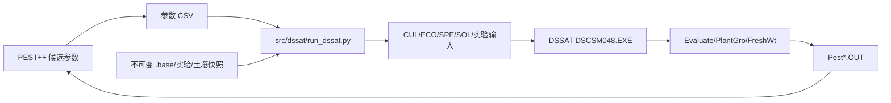

# DSSAT–PEST++ 科研率定系统开发指南

> 文档状态：当前实现规范
> 更新日期：2026-07-15
> 实施状态：P0 已实施，待用户验收

本文档面向本项目的开发和维护人员，说明当前架构、科学质量约束、模块边界和变更验收方式。用户操作入口见根目录 `README.md`，产品与长期路线见 `项目重构规划.md`，P0 历史证据见 `docs/archive/development_records/P0_verification_report.md`。

## 1. 产品目标与开发原则

本项目不是只把 DSSAT 和 PEST++ “跑通”的脚本集合，而是面向科学研究与论文产出的参数推断工作流。正式功能必须同时满足：

1. **输入真实生效**：参数候选值写入正确 DSSAT 文件、正确品种/生态型/土层和正确字段；
2. **模型响应可检测**：合理参数扰动应使至少一个相关模型输出发生超过数值容差的变化；
3. **统计口径明确**：观测误差、权重、变换、Phi、先验和后验集合的定义可以复核；
4. **失败显式化**：全零、全缺失、集合零方差、陈旧输出和参数未更新必须使任务失败或标记为不可用于研究；
5. **结果可复现**：正式结果绑定运行清单、输入快照、随机种子、软件版本和生成脚本；
6. **结论不过度**：PEST++ IES ensemble 表述为 IES 近似后验集合；良好拟合不等同于参数唯一或生理真实。

开发优先级遵循“科学正确性 > 可复现性 > 自动化便利 > 运行速度 > 视觉装饰”。

## 2. 当前架构

### 2.1 模板注入与反馈闭环



PEST++ 只负责提出候选参数和读取残差；DSSAT runner 负责参数注入、运行、输出同步和失败处理。任何一个环节使用了错误目录、错误模板或陈旧输出，都可能表现为“进程成功但所有 realization 完全相同”，因此不能以退出码作为唯一成功条件。

### 2.2 正式模块

| 路径 | 职责 |
|---|---|
| `src/common/param_registry.py` | 物理硬边界、参数分组、注册表读写和默认边界 |
| `src/common/experiment_inputs.py` | 用户输入包、FileX/批处理/观测/土壤/气象跨文件门禁 |
| `src/calibration/build_pest.py` | 读取冻结边界和观测，生成 PST/TPL/INS 与运行清单 |
| `src/calibration/weight_scheme.py` | 观测误差、变换和权重策略；P0 中进行数学审计 |
| `src/dssat/run_dssat.py` | CUL/ECO/SPE/SOL/IC 注入、DSSAT 执行和 Pest 输出生成 |
| `src/sensitivity/` | Morris/Sobol 案例构建、运行和后处理 |
| `tools/parallel/` | manager/agent 隔离运行与状态管理 |
| `src/reporting/` | 参数、预测、指标、后验和图表输出 |

`workspace/` 只承载运行目录、产物和兼容入口。新业务逻辑不得继续写入一次性 workspace 脚本。

正式实验输入存放在 `data/user/experiments/<bundle_id>/`，通过 `--input-dir` 显式选择。每个包必须含 `input_manifest.json` 和内容哈希；禁止覆盖既有 bundle ID，禁止从 `Workspace` 静默回退。FileX/FileA/FileT 分别为 `.TMX/.TMA/.TMT`，CUL/ECO/SPE 基线模板只存放在 `data/templates/genotype/*.base`；完整约定见 [目录与输入资产规范](目录与输入资产规范.md)。

staged builder 必须直接从版本化 FileA 生成物候和季末实测列，从 FileT 生成时序与采收实测列。`Evaluate.OUT`、`PestEval.OUT` 和 `PestJoint.OUT` 是候选前向运行的模拟输出，不得作为构建 PST/INS 时的观测来源或结构探测文件。

## 3. 科研质量门禁

### 3.1 参数与输入门禁

构建任务前至少校验：

- `lower <= init <= upper`；
- fixed 参数满足 `lower == init == upper`；
- 参数位于 `PHYSICAL_BOUNDS` 内；
- 参数位于数值安全包络，同时科研候选域来自获批 proposal/frozen；`FL-VS` 不再硬编码为 100；
- `XMAGE < XFPHT` 及 `TB < TO1 < TO2 < TM` 必须由参数域保证，不能依赖采样后裁剪；
- 各阶段温度基点满足项目定义的顺序关系；
- 参数 location、目标文件、品种、生态型和层号可唯一定位；
- 校准只能读取 `bounds_frozen`，不能直接消费 SA proposal；
- 原始观测和模板不可被运行时覆写。

发现非法冻结边界时必须中止构建。工具不得自动交换上下界或静默截断后继续正式运行。

### 3.2 前向模型门禁

每类受支持位置至少有一个参数注入测试：CUL、ECO、SPE、SOIL、IC。测试分为两层：

- 文件级：确认只修改目标字段，固定宽度和精度正确；
- 模型级：基线/低值/高值配对运行后，相关 DSSAT 输出存在非零响应。

运行前后记录关键输入和输出哈希/时间戳，禁止把上次运行遗留文件当作本次输出。

### 3.3 敏感性分析门禁

Morris/Sobol 完成后必须生成机器可读质量报告，并检查：

- 有效运行数、失败率和超时率；
- 每个指标的有效值比例、唯一值数量、方差和缺失比例；
- 是否所有 elementary effects 或 Sobol 指数均为零；
- Morris 重复种子下的排名稳定性；
- Sobol 的样本规模收敛、置信区间和异常指数；
- 多输出综合排名是否先消除单位和量级支配。

单个指标可以因模型结构而恒定，但“全部指标恒定”必须判为失败。

### 3.4 率定门禁

IES 每轮至少检查：

- 参数 ensemble 中可调参数具有非零先验离散度；
- 模拟观测 ensemble 具有非零离散度；
- realization 之间不是同一输出的重复副本；
- Phi 具有可检测的 ensemble 差异和迭代变化；
- 参数 ensemble 确实更新；
- 失败/剔除 realization 数量在允许范围；
- 分组 Phi 不被单一观测组异常支配；
- 最佳参数确定性复跑能复现相应 realization 的输出。

若 Phi 恒定或模拟集合零方差，不得生成“收敛成功”结论。

### 3.5 权重数学约束

PEST 类目标函数的基本口径应显式写为：

```text
Phi = sum((w_i * (obs_i - sim_i))^2)
```

若 `sigma_i` 表示观测标准差，通常对应 `w_i = 1 / sigma_i`。任何使用 `1 / sigma_i^2`、归一化、log 变换或组间平衡的实现，都必须用手算案例验证最终 Phi，而不能只检查函数返回了正数。

log 变换必须对观测值和模拟值使用同一变换后再构造残差；仅根据 log range 修改权重不等同于 log 残差。累积采收点存在时间相关和重复计数风险，默认优先使用采收增量，或显式定义误差协方差/降采样策略。

显式 log 只能通过 `--observation-policy-csv` 启用。FileA/FileT 与常规 DSSAT 输出保持物理尺度；`.pst` 观测和 PEST 专用 tagged 输出使用 `ln((y+offset)/reference)` 的同一配置。非正平移值、缺少原尺度 sigma 或同一模拟 token 的配置冲突必须失败。全局 `--apply-log-transform` 和动态 Min–Max 不得恢复。

## 4. 参数、观测与验证策略

### 4.1 参数生命周期

允许的继承链为：

```text
baseline -> bounds proposal -> user-approved frozen bounds -> run snapshot
```

SA 只能产生 proposal 和筛选证据，不能自动批准进入率定。正式率定使用的 active/fixed 状态和边界必须由冻结文件决定。

土壤和初始条件默认按实测输入固定。只有存在相应土壤水分、氮素或其他独立约束时，才允许作为 nuisance 参数小范围释放，并单独报告其偏离实测值的幅度。

### 4.2 观测与权重

观测注册表至少保存变量、单位、时间/处理键、误差来源、sigma、变换、相关结构、率定/验证用途和缺失值规则。参数构建器不应在代码中散落不可追踪的经验 sigma。

FileA/FileT 当前以处理均值作为 DSSAT 观测。重复原始记录应保存在独立长表，不得把同一处理的重复作为独立 PEST 观测与同一个 DSSAT 模拟配对。均值 sigma 使用 `sqrt(SD²/n_eff + sigma_model² + sigma_floor²)`；只有均值而无重复统计时必须标记假设来源，不能从均值反推 SD。

建议观测组覆盖：物候、冠层/生物量、连续采收增量与累积量、季末综合指标，以及水氮处理间关系约束。

### 4.3 验证划分

当前茄子数据主要来自单季水氮试验。不能随机拆分同一处理的时序行作为训练/验证，因为这会造成信息泄漏。应按完整处理块留出，并保存 `validation_split` 配置；获得新季节数据后优先采用跨季外部验证。

validation 处理不能参与参数数目、参数组合、权重、停止轮次或 S4 survivor 的选择。正式参数和运行规则冻结后，才首次计算 validation 指标；若据此调整设计，原 validation 必须降级为 tuning，并另找独立验证证据。单季数据无法再划出可靠新集合时，应如实报告内部验证局限，不把调参后的同一处理继续称为独立验证。

## 5. 后验与异参同效开发规范

后验诊断至少包括：

- prior/posterior 分布、均值、中位数、95% 区间和 IQR；
- 方差/IQR 收缩率；
- 上下界邻近比例；
- 多峰提示；
- 参数与总 Phi、分组 Phi、验证误差的关系。

异参同效不能只依赖一张 PCA 图。正式证据链包括：

1. Pearson/Spearman 相关矩阵；
2. VIF、条件数和跨生理组相关网络；
3. 标准化参数空间 PCA，统一使用 `sqrt(lambda1 / lambda2)` 作为椭圆轴比；
4. 功能异参同效：寻找率定 Phi 相近但参数距离较远的解，比较其在留出处理或新情景中的预测分化。

## 6. 图表开发规范

图表代码应从统一 style/profile 读取尺寸、字体、颜色和输出格式，禁止每个脚本单独硬编码风格。默认要求：

- 数据图优先输出 PDF/SVG 矢量源文件；投稿时按目标期刊导出 EPS/PDF/TIFF；
- 同时支持单栏和双栏尺寸；
- 字体嵌入，最终排版尺寸下仍可读；
- 色盲安全且灰度可辨识，颜色之外同时使用线型或点型；
- 面板标签、单位、线宽、图例和留白统一；
- 图题和完整图注不写入图内；
- 每张图保存源数据、配置、生成脚本版本和 caption registry；
- 自动检查 DPI、物理尺寸、字体、裁切、文件大小和面板完整性。

未来可能进入论文、补充材料或正式科研报告的图必须使用 R，并统一调用 `paper/R/common.R` 与 `configs/figures/publication.json`；不得在各脚本重复定义字体、颜色和尺寸。Python 只允许生成 `diagnostic_*` 运行诊断或通过 `export_paper_data.py` 冻结数据，不得生成 Fig/FigS。绘图函数只消费结构化数据，不得启动 DSSAT/PEST、猜测迭代号或推断处理映射。历史适配器写入 `legacy_unvalidated`，且 Python 导出和 R 绘图两端都必须显式启用 demo。

核心接口与 Fig. 1–6/Fig. S1–S8 注册表见 [科研图表设计与开发计划](科研图表设计与开发计划.md)。`src/reporting/plot_results.py` 只维持 Python 诊断兼容；`Rscript paper/R/make_all.R` 写入 source CSV、metrics CSV 和 `figure_manifest.json`，PDF/SVG 为母版，PNG 仅作审阅。

具体目标期刊规范优先于通用 profile。

## 7. 测试分层

| 层级 | 是否需要 DSSAT | 目标 |
|---|---|---|
| 单元测试 | 否 | 解析、格式化、边界、权重手算、指标计算 |
| 文件集成测试 | 否 | 参数精确注入、模板不变性、PST/INS/TPL 一致性 |
| DSSAT 冒烟测试 | 是 | 参数扰动产生模型响应、输出非陈旧 |
| PEST++ 小案例 | 是 | Morris 非退化、IES ensemble 非退化 |
| 正式回归测试 | 是 | 冻结小数据集上的关键统计量和排名稳定性 |

纯 Python 测试可进入常规 CI；依赖本地 DSSAT/PEST++ 的测试单独标记，并在正式运行前强制执行。禁止用“18 tests passed”替代端到端数值验收。

## 8. 变更工作流

1. 修改前记录工作区状态，保留用户已有未提交改动；
2. 先写失败测试或最小复现，再修改实现；
3. 只改当前工作包授权的文件；
4. 运行单元、文件集成和必要的外部程序冒烟测试；
5. 输出变更说明、测试证据和仍未解决的科学风险；
6. 未经批准不修改原始观测、不替换正式冻结边界、不删除历史结果；
7. 每个阶段通过用户验收后再进入下一阶段。

历史 P1 工程证据仍绑定 `eggplant_p1_xxql2501_v3_20260716`、`xxql2501_20260716` 和 `xxql2501_sa_counterfactual_v1_20260716`，不得把其哈希或结果迁移到新正式试验。新多季候选为 `eggplant_formal_multiseason_candidate_v1_20260719`，实际候选输入为 `xxql2501_symbi_n_candidate_20260719`，SA 专用反事实输入为 `xxql2501_sa_counterfactual_symbi_n_candidate_20260719`；该候选仍是 `proposed/ready_for_formal_run=false`，第二季春季和秋季输入齐全并经用户批准后才能创建新的 frozen ID。实际输入与 SA 反事实输入继续禁止混用。协作者或程序写入的 `review_status: approved`/`approved_by` 不构成用户批准；不得静默改写既有 bundle、frozen 或审批 CSV。

并行 `pestpp-sen` 完成后必须根据 `.pst` 的实际 `gsa_method` 路由审计：Morris检查轨迹/elementary effects，Sobol检查完整Saltelli矩阵、失败标志、响应与参数契约、基础方差及S1/ST文件。Sobol正式结果还必须由原始A/B/混合矩阵复算点估计并产生bootstrap区间；预检案例无论质量门是否通过都不得进入正式排名。
