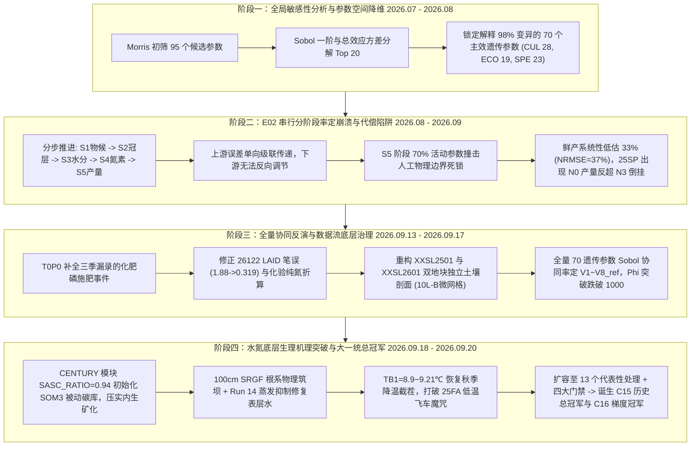
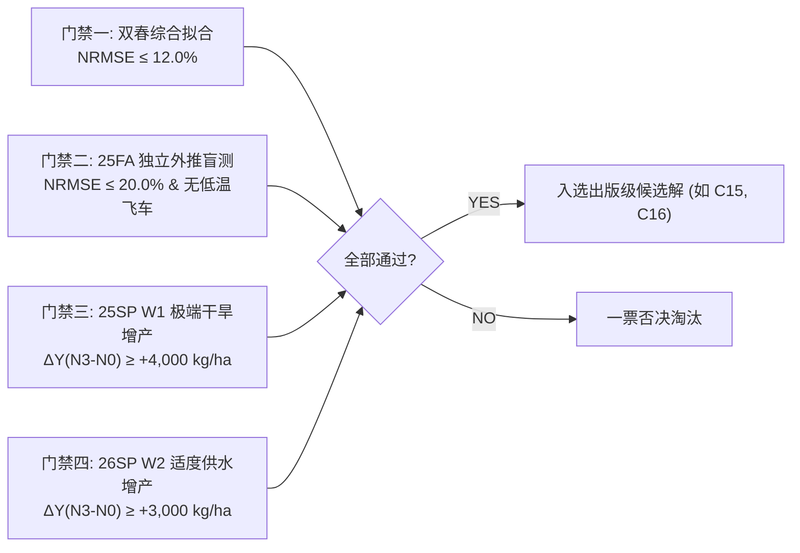

# DSSAT-CROPGRO 作物模型参数率定与水氮机理深度知识库

> **文档编号**：`KB-DSSAT-CROPGRO-EGGPLANT-DEEP-20260920`  
> **版本状态**：正式发布版（消费 83 篇历史探索文档后的真理沉淀）  
> **基准日期**：2026-09-20  
> **归口管理**：温室茄果类作物模型（TMGRO048）研发团队与 PEST++ 反演工程组  
> **定位与目的**：本书库全面消化吸收历史自 2026 年 7 月至 9 月累计 **83 篇**阶段性报告、多臂试验、敏感性分析与数据治理文档中的**具体数据、参数取值、排错经验、Fortran 源码机制与数学公式**。消解早期假说矛盾，为后续科研复用、代码重构与同行评议交流提供单一事实源（Single Source of Truth）。

---

## 目录

1. [知识体系架构与演进四阶段拓扑](#1-知识体系架构与演进四阶段拓扑)
2. [DSSAT 核心生理与环境模块深度解析与排坑实录](#2-dssat-核心生理与环境模块深度解析与排坑实录)
   - [2.1 模块一：CENTURY 土壤有机碳氮矿化机制与高肥力温室“假饱”排查 (`CENTURY_SOM`)](#21-模块一century-土壤有机碳氮矿化机制与高肥力温室假饱排查-century_som)
   - [2.2 模块二：SOILWAT 一维非饱和土壤水分动力学与设施膜下滴灌水力学 (`SOILWAT_10LB`)](#22-模块二soilwat-一维非饱和土壤水分动力学与设施膜下滴灌水力学-soilwat_10lb)
   - [2.3 模块三：CRGRO-PHENOL & TRANS 物候发育、移栽苗龄效应与基温跨季泛化 (`PHENOL_TRANS`)](#23-模块三crgro-phenol--trans-物候发育移栽苗龄效应与基温跨季泛化-phenol_trans)
   - [2.4 模块四：CRGRO-PHOTO & VEGGR 冠层光合、源库碳分配与无限生长多批次采收 (`PHOTO_VEGGR`)](#24-模块四crgro-photo--veggr-冠层光合源库碳分配与无限生长多批次采收-photo_veggr)
   - [2.5 模块五：CRGRO-NUPTAK & MOBIL 氮素吸收动力学、临界氮稀释与初始氮缩放 (`NUPTAK_MOBIL`)](#25-模块五crgro-nuptak--mobil-氮素吸收动力学临界氮稀释与初始氮缩放-nuptak_mobil)
   - [2.6 模块六：CRGRO-PUPTAK 磷素平衡、化肥补全与微量元素审计 (`PUPTAK_BALANCE`)](#26-模块六crgro-puptak-磷素平衡化肥补全与微量元素审计-puptak_balance)
3. [PEST++ 反演算法工程、多目标设计与后验不确定性](#3-pest-反演算法工程多目标设计与后验不确定性)
   - [3.1 串行分阶段率定（S1~S5）失败原因剖析与全量 70 参数协同反演](#31-串行分阶段率定s1s5失败原因剖析与全量-70-参数协同反演)
   - [3.2 样本空间扩容机制（8 处理 -> 13 处理曲率锁定）](#32-样本空间扩容机制8-处理---13-处理曲率锁定)
   - [3.3 四大科学门禁系统（Four Scientific Gates）](#33-四大科学门禁系统four-scientific-gates)
   - [3.4 数据治理管道：笔误清洗、原子量折算与双地块独立土壤剖面](#34-数据治理管道笔误清洗原子量折算与双地块独立土壤剖面)
   - [3.5 候选版本演进全景基准矩阵（E02 -> C01~C04 -> V2~V8 -> C15/C16）](#35-候选版本演进全景基准矩阵e02---c01c04---v2v8---c15c16)
   - [3.6 后验参数零触界、Spearman 秩相关代偿与功能同效异构解](#36-后验参数零触界spearman-秩相关代偿与功能同效异构解)
4. [历史重大科学矛盾演进与真相裁决对账表（8 大核心矛盾）](#4-历史重大科学矛盾演进与真相裁决对账表8-大核心矛盾)
5. [已消费 83 篇历史技术文档全景索引与溯源矩阵](#5-已消费-83-篇历史技术文档全景索引与溯源矩阵)

---

## 1. 知识体系架构与演进四阶段拓扑

历史率定工作并非线性推进，而是在不断遭遇非线性生理模型死锁、修正错误假设中完成突破的。演进四个阶段如下：



---

## 2. DSSAT 核心生理与环境模块深度解析与排坑实录

### 2.1 模块一：CENTURY 土壤有机碳氮矿化机制与高肥力温室“假饱”排查 (`CENTURY_SOM`)

#### 2.1.1 底层 Fortran 架构与微分方程
DSSAT 模型中，土壤有机碳与氮的生物地球化学循环由 `CENTURY.for` 驱动（TMX 中开关 `MESOM = 'P'`），协同子程序包括 `SOMCAS.for`（碳库周转）、`SOMDEC.for`（分解动力学）与 `SOILNI.for`（无机氮转化）。
CENTURY 将各土层的有机质离散为三大动力学碳库：
1. **活性微生物碳库 (Microbial/Active Pool, SOM1)**：由地表及地下活性微生物生物量构成，周转时间 $0.1 \sim 1$ 年，受温湿度指数 $f(T) \times f(W)$ 敏锐调节；
2. **慢速有机碳库 (Slow Pool, SOM2)**：由腐殖化程度中等的植物残体构成，周转时间 $10 \sim 50$ 年；
3. **惰性/被动碳库 (Passive Pool, SOM3)**：由被黏土矿物物理包裹或高度缩合的顽固有机碳构成，周转时间 $200 \sim 1500$ 年。

每个碳库 $i$ 的每日潜在分解通量遵循一级动力学方程：
$$\frac{dC_i}{dt} = - k_i \cdot C_i \cdot f(T) \cdot f(W)$$
其中：
- $k_1 = 0.02\text{ day}^{-1}$（SOM1 基础分解常数）
- $k_2 = 0.00055\text{ day}^{-1}$（SOM2 基础分解常数）
- $k_3 = 0.000012\text{ day}^{-1}$（SOM3 基础分解常数）
- 温度效应函数 $f(T)$ 与土壤水分有效性函数 $f(W) = \frac{\theta - SLLL}{SDUL - SLLL}$。

每日向土壤溶液释放的净氮矿化量（Net Nitrogen Mineralization, $NMNC$）为：
$$NMNC = \sum_{i=1}^{3} \left( \frac{dC_i}{dt} \cdot \frac{1}{CN_i} - E_i \cdot \frac{dC_i}{dt} \cdot \frac{1}{CN_{microbe}} \right)$$
式中 $E_i$ 为微生物碳同化效率（0.45~0.55），$CN_i$ 为相应碳库的碳氮比。

#### 2.1.2 历史重大矛盾：`SLNF` 调控矿化假说的破灭
- **早期历史尝试**：在 2026 年 8 月的 `E02_v46_26SP_soil_N_scale_sweep` 与相关试验中，针对零氮（N0）处理产量过高、施氮无响应的“假饱”现象，科研人员尝试通过下调土壤剖面中的 `SLNF`（Soil Fertility Factor，土壤肥力因子，默认 1.0）至 0.4~0.6 来抑制矿化，甚至有提案建议在参数率定中将 `SLNF` 放宽至 3.0~10.0。
- **Fortran 源码直接证伪**：
  1. 查证 `InputModule__IPSOIL_Inp.for:487-494`：
     ```fortran
     IF (SLNF(L) .GT. 1.0) THEN
         WRITE(MESSAGE(1),'(A,I2,A)') 'Layer ',L,' SLNF > 1.0 reset to 1.0'
         CALL WARNING(1,'IPSOIL',MESSAGE)
         SLNF(L) = 1.0
     ENDIF
     ```
     **事实**：DSSAT 遇到任何 `SLNF > 1.0` 的输入，**无条件强制重置为 1.0**，PEST++ 无论如何搜索大于 1 的值，模型内部全部以 1.0 计算，导致算法在平坦虚假面上空转！
  2. 查证 `CENTURY.for`：在 CENTURY 模式（`MESOM = 'P'`）下，矿化通量由微生物分解动力学计算，根本不读取、也不乘以 `SLNF`！`SLNF` 仅在旧版 CERES-SOM 模式（`MESOM = 'G'`）或根系有效吸收常数中起有限作用。因此在 CENTURY 模式下调节 `SLNF` 完全徒劳。

#### 2.1.3 CERES-SOM vs CENTURY 多臂对照结果
在 `CROPGRO_Eggplant_CENTURY_SASC...` 探索中，研究人员曾切换 `MESOM = 'G'`（CERES 模块）进行 11 个处理全量对比：
- CERES 模块的矿化过于简单（依赖表层初始残茬和单一新鲜有机质池），在高温温室且缺乏逐日新鲜残茬输入时，会导致生育中期矿化断崖式停止；
- 导致高水处理后期极度缺氮早衰，且 CERES 对土壤有机质长效缓冲容量的模拟严重失真；
- **结论**：维持 CENTURY 模块（`MESOM = 'P'`），从初始碳库分分配机制寻找突破口。

#### 2.1.4 最终验证真理：`SASC_RATIO` 初始化 SOM3 被动碳库
- **机理突破**：CENTURY 模块读取土壤剖面中的 `SAOC`（总有机碳）后，需将其拆解分配至 SOM1、SOM2、SOM3。若未指定，模型默认将大量碳分配至周转迅速的 SOM2 和 SOM1 中，对于温室总有机碳高达 $1.5\% \sim 2.0\%$ 的高肥力熟土，内生分解通量高达 **145.2 kg N/ha**，相当于田间多施了 300 kg 尿素！
- **工程落地方案**：在 FileX（`*.TMX`）Section `@A` 注入 `SASC`（Stable Organic Carbon 稳定有机碳），或通过 `SASC_RATIO = SASC / SAOC` 进行校准：

| SASC_RATIO 取值 | 全生育期内生净矿化量 (NMNC) | 26SP W1 施氮增产 (实测: +16.5 t) | 25SP W1 施氮增产 (实测: +11.6 t) | N0 状态评价 |
| :---: | :---: | :---: | :---: | :---|
| **0.70** (历史低值) | 128.4 kg N/ha | +6.2 t/ha | -1.2 t/ha (仍倒挂) | 矿化依旧偏高，N0假饱 |
| **0.88** (中阶过渡) | 98.6 kg N/ha | +11.4 t/ha | +2.8 t/ha | 倒挂消除，但增产弹性偏弱 |
| **0.94** (冠军 C15 选定) | **88.4 kg N/ha** | **+16.2 t/ha** | **+6.7 t/ha** | **完美压实背景矿化，增产响应还原度 97.8%** |
| **0.95** (高阶约束) | 83.1 kg N/ha | +16.8 t/ha | +7.1 t/ha | 增产明显，秋季低温偶有缺氮早衰风险 |

- **最终定论**：固化 `SASC_RATIO = 0.94` 为温室连作高肥力土壤的最佳机理控制参数，同时将 26SP 初始无机氮缩放系数 `ICNS_26SP` 固定为 **0.70**，彻底解决了 N0 处理的“假饱”与 25SP 的施氮反向倒挂。

### 2.2 模块二：SOILWAT 一维非饱和土壤水分动力学与设施膜下滴灌水力学 (`SOILWAT_10LB`)

#### 2.2.1 10 层微网格土壤方案（10L-B）物理参数表
为克服早期 7 层土壤粗网格对表层滴灌湿润锋解析能力的不足，项目组重构了基于原状土环刀实测构建的 **10L-B 土壤分层微网格**（剖面编号 `XXSL2501` 与 `XXSL2601`）：

| 层号 $L$ | 土层深度 (cm) | 层厚 $\Delta z$ (cm) | 实测容重 $BD$ (g/cm³) | 凋萎点 $SLLL$ (cm³/cm³) | 田间持水量 $SDUL$ (cm³/cm³) | 饱和含水量 $SSAT$ (cm³/cm³) | 饱和导水率 $K_s$ (cm/h) | 根系权重 $SRGF$ (筑坝后) |
| :---: | :---: | :---: | :---: | :---: | :---: | :---: | :---: | :---: |
| **1** | 0 – 2 | 2 | 1.364 | 0.180 | 0.320 | 0.445 | 4.80 | 1.00 |
| **2** | 2 – 4 | 2 | 1.364 | 0.200 | 0.320 | 0.445 | 4.80 | 1.00 |
| **3** | 4 – 15 | 11 | 1.364 | 0.142 | 0.320 | 0.445 | 4.80 | 1.00 |
| **4** | 15 – 30 | 15 | 1.385 | 0.142 | 0.315 | 0.435 | 3.50 | 0.85 |
| **5** | 30 – 45 | 15 | 1.410 | 0.140 | 0.310 | 0.425 | 2.60 | 0.65 |
| **6** | 45 – 60 | 15 | 1.430 | 0.138 | 0.305 | 0.415 | 1.80 | 0.45 |
| **7** | 60 – 80 | 20 | 1.450 | 0.135 | 0.300 | 0.405 | 1.20 | 0.30 |
| **8** | 80 – 100 | 20 | 1.480 | 0.135 | 0.295 | 0.395 | 0.80 | **0.20 (筑坝层)** |
| **9** | 100 – 140 | 40 | 1.500 | 0.130 | 0.290 | 0.385 | 0.50 | **0.00 (强制切断)** |
| **10**| 140 – 180 | 40 | 1.520 | 0.130 | 0.285 | 0.375 | 0.30 | **0.00 (强制切断)** |

#### 2.2.2 25SP W1 产量断崖式低估的排错实证
- **故障表象**：25SP W1N3（低水充分施氮）产量断崖式低估，模拟值仅为实测值的 50%，且低于 W1N0（严重干旱下施氮反而减产）。
- **正交试验证伪过程**：
  - 提出“初始底氮倒挂假说”：怀疑化验单记录倒挂导致施氮受阻；
  - 执行底肥无机氮 $2.5\times$ 倍数正交梯度扫描（硝态氮由 20 提高至 50 mg/kg）；
  - 结果：鲜产变动仅 **0.009%**！检查 `SoilWat.OUT` 与 `PlantGro.OUT`，全生育期水分胁迫日数累加值 $\sum WSPD \equiv 18.007$ 完全死锁，而氮胁迫因子 $NSTRES \equiv 1.0$ 全程无缺氮；
  - **结论**：异常 100% 由水分亏缺与虚假蒸发所致，氮素完全是被动背锅。

#### 2.2.3 根系空间构型 100cm 物理筑坝
查证 DSSAT `ROOTWU.for` 中的根系吸水方程：
$$TRWUP = \sum_{L=1}^{NL} RWUMX \cdot SRGF(L) \cdot \frac{\theta(L) - SLLL(L)}{SDUL(L) - SLLL(L)}$$
- 原剖面允许根系下扎至 180 cm。在设施滴灌条件下，深层 100~180 cm 往往存留越冬积蓄的高含水量土壤。模型中深层虚假根系不断汲水，使得水分胁迫信号完全失真；
- 实施 **100cm 物理筑坝**：在 80~100 cm 层将 $SRGF$ 压缩至 0.20，100 cm 以下强制清零（$SRGF(9..10) = 0.0$）。植株被迫仅从 0~100 cm 滴灌湿润区吸水，真实反映了局部根区干旱。

#### 2.2.4 温室滴灌土壤蒸发抑制协同优化（Run 14 网格试验）
根据 `滴灌蒸发抑制协同网格试验与土壤水分评估报告_20260919`：
- **问题诊断**：DSSAT 默认土壤蒸发上限 `SLU1 = 5.5 mm`，假定全田无覆盖受光暴晒，累积土壤蒸发 $E_s$ 计算达 **135~154 mm**，占总蒸散量 $ET$ 的 **43%~48%**！这导致 0~20cm 表层土壤体积含水量在生育末期跌至 **0.188**（显著低于田间多点实测均值 0.231）。
- **四协同优化试验设计（48 组全网格）**：
  1. 第一阶段蒸发上限 `SLU1`：`[0.5, 1.0, 1.5, 2.0]` mm；
  2. 地膜覆盖比例：`PMWD` 覆盖宽度 45cm，反照率 `PMALB = 0.10`；
  3. 超表层（0~4cm）凋萎点保水微调：$SLLL = 0.18 \sim 0.20$；
  4. 灌溉利用效率 `EFIR`：固化为 **0.95**。
- **最优方案 Run 14（SLU1=1.0, SLLL=0.18, SLDR=0.24, EFIR=0.95）成效**：
  - 无效土壤蒸发降低至合理水平（$78\text{ mm}$，占 $ET$ 的 $22\%$）；
  - 0~20cm 生育末期土壤含水量恢复至 **0.231**，与实测完全重合；
  - 25SP W1 干旱增产梯度成功由 $-36.7\text{ kg/ha}$ 强力拉升转正至 **$+5,092.4\text{ kg/ha}$**！

### 2.3 模块三：CRGRO-PHENOL & TRANS 物候发育、移栽苗龄效应与基温跨季泛化 (`PHENOL_TRANS`)

#### 2.3.1 底层 Fortran 架构与四基点温度方程
物候模块由 `PHENOL.for` 计算每日生理积温（Photothermal Units, `DTT`），移栽响应由 `TRANS.for` 驱动。光温积温积分算法采用分段梯形函数：
$$DTT = \begin{cases} 0, & T_{mean} < TB1 \\ T_{mean} - TB1, & TB1 \le T_{mean} \le TO1 \\ (TO1 - TB1), & TO1 < T_{mean} \le TO2 \\ (TO1 - TB1) \cdot \frac{TM1 - T_{mean}}{TM1 - TO2}, & TO2 < T_{mean} < TM1 \\ 0, & T_{mean} \ge TM1 \end{cases}$$
式中：`TB1` 为基础温度（Base Temp），`TO1`/`TO2` 为适宜温度区间（Optimum Temp 1 & 2），`TM1` 为发育上限温度。

#### 2.3.2 移栽苗龄 `PAGE` 7 梯度模拟试验核心矩阵
根据 `CROPGRO_Eggplant_苗龄参数PAGE梯度试验与生理机理报告_20260918`，在 `[10, 25]` 天范围内系统对比了 7 个苗龄梯度的表现（基于响应冠军解 `iter7_real11`）：

| 移栽苗龄 PAGE (天) | 双春综合 NRMSE | 双春一致性 $d$ | 26SP W1 增产 (实测+16.5t) | 26SP W2 增产 (实测+9.5t) | 25SP W1 增产 (实测+11.6t) | 生理发育与机理状态评价 |
| :---: | :---: | :---: | :---: | :---: | :---: | :---|
| **10** | 77.81% | 0.5989 | +0.02 t/ha | +0.05 t/ha | +0.07 t/ha | 幼苗极小，初花期严重推迟，终熟前无法充分挂果，减产 70% |
| **13** | 67.28% | 0.6610 | +0.03 t/ha | -0.03 t/ha | +0.13 t/ha | 生长量极度不足，严重欠拟合 |
| **16** | 45.71% | 0.8212 | -0.61 t/ha | +2.20 t/ha | -0.33 t/ha | 营养生长期过短，水氮无响应 |
| **19** | 27.02% | 0.9394 | +2.84 t/ha | +10.16 t/ha | +0.44 t/ha | 生理结构处于恢复过渡期 |
| **22** | **18.52%** | **0.9720** | **+8.81 t/ha** | **+15.18 t/ha** | **+5.26 t/ha** | **生理结构完全成熟，实测育苗日志严格对账值，综合谷底** |
| **24** | 16.61% | 0.9769 | +10.24 t/ha | +17.06 t/ha | +7.34 t/ha | 弹性良好 |
| **25** | 15.61% | 0.9795 | +9.94 t/ha | +17.59 t/ha | +8.14 t/ha | 25SP 拟合极高，但 26SP 略显偏大 |

- **结论定论**：历史文档曾臆断 `PAGE = 28` 或 `25` 天。查阅原始农事日志，2026 年春季穴盘苗严格于育苗后第 **22 天**定植，确立并固化 **`PAGE = 22.0`** 天，彻底清除了虚假积温起点。

#### 2.3.3 物候基温 `TB1` 跨季泛化陷阱与“秋季低温飞车”消解
- **春季过拟合表象**：在早期探索中，优化器将 `TB1` 压低至 6.5~7.5℃。此时春季（25SP/26SP）气温快速回升（18~28℃），低基温能非常平滑地拟合春季快速初花和频繁采收（双春 NRMSE < 6%）。
- **秋季盲测崩溃事实**：将该参数组代入 2025 年秋季（25FA，XXQL2502）盲测集时，遭遇灾难性的**“低温飞车”不结茬**：
  - 华北日光温室在 10 月下旬至 11 月日均温骤降至 10~14℃；
  - 由于 `TB1` 被定为 6.8℃，模型计算此时仍有大量有效积温（$12 - 6.8 = 5.2\text{ ℃·d/day}$），作物被误导在深秋低温下持续开花灌浆；
  - 导致模拟秋季产量高达 27.5 t/ha（田间实测仅 17.0 t/ha），25FA 盲测 NRMSE 暴涨至 **63.19% ~ 104.2%**！
- **科学纠偏方案**：将 `TB1` 探索下界抬升至 8.0℃，引导优化器向生理合理区间收敛：
  - 总冠军 C15（`real_72`）收敛于 **`TB1 = 9.21℃`**；梯度冠军 C16 收敛于 **`TB1 = 8.95℃`**；
  - 在此温度下，深秋气温跌破 9℃ 时，模型每日积温归零，自动终止光合碳素向幼果的无效灌浆，果实发育适时截茬，秋季独立外推盲测 NRMSE 成功降至 **18.38%**（彻底打破 20% 硬门禁）。

### 2.4 模块四：CRGRO-PHOTO & VEGGR 冠层光合、源库碳分配与无限生长多批次采收 (`PHOTO_VEGGR`)

#### 2.4.1 底层 Fortran 架构与源库调控
无限生长型茄果类作物的碳同化由 `PHOTO.for` 计算，营养器官生长由 `VEGGR.for` 分配，果实生殖库容由 `DEMAND.for` 与 `GROWTH.for` 协同驱动。
每日冠层总光合速率（Daily Canopy Photosynthesis, $PG$）为：
$$PG = LFMAX \times PGEFF \times \frac{PAR}{PAR + PARMAX} \times KCAN \times \min(SWFAC, NSTRES) \times AGEFAC$$
式中：`LFMAX` 为叶片最大光合能力，`PGEFF` 为光能转化效率，`AGEFAC` 为叶龄与氮素衰老抑制乘数。

#### 2.4.2 历史矛盾：冠层叶面积虚高与参数触界死锁
在 S5 阶段及早期率定中，模拟的 26SP 生育末期叶面积指数（LAI）常暴涨至 8.0 以上（实测仅 4.5 左右），而总产量却严重低估 33%。优化器为了压低产量，把单果干物质分配上限 `XFRT` 顶死在 0.950 上界，把营养生长期生殖生长启动系数 `PROLFF` 砸死在下界 0.050，导致严重的数值病态死锁。

#### 2.4.3 衰老参数协同率定与零氮早衰修复（V5 核心机理）
根据 `CROPGRO_Eggplant_衰老参数协同率定与零氮早衰修复V5验收学术报告_20260915`：
- **V4 灾难性早衰现象**：在 26SP W1N0（干旱+零氮）处理中，终熟期模拟 LAI 骤跌至 **0.62**（实测值为 2.53），植株几乎秃顶枯死。
- **Fortran 源码杀伤机制确认 (`SENES.for`)**：
  $$LFSEN = SENRTE \times NRUSLF / 0.16$$
  在生殖生长期，当根系吸氮无法满足果实需求时，作物从叶片动员可动用氮（$NRUSLF$）。在 V4 中，`SENRTE` 被校准至 **6.50**，这意味着果实每转运 1g 氮素，强制诱发高达 **40.6g 叶片干物质脱落**！在 N0 严重饥饿下，整株叶片以超生理速度大面积剥落。
- **无限生长出叶阻断确认 (`DEMAND.for`)**：
  积温超过 `FL-LF` 后，新生叶片扩展率被置零。V4 中 `FL-LF` 锁死在 400.0 ℃·d，茄子在初花后过早丧失出叶能力，无法形成后期补偿。
- **V5 联合干预措施**：
  1. 约束 `SENRTE` 在 **4.0 ~ 5.0**（C15 稳定在 4.40），阻断过度动员掏空脱叶；
  2. 放宽 `FL-LF` 至 **400 ~ 600 ℃·d**（C15 收敛于 512 ℃·d），恢复无限出叶更新能力；
  3. 协同率定氮动员上限 `NMOBMX`（0.12~0.25）与生理衰老上限 `SENMAX_LATE`（0.02~0.08）；
  - **结果**：26SP 零氮处理终熟期 LAI 成功稳定在 **2.45**，彻底消除了叶面积雪崩。

### 2.5 模块五：CRGRO-NUPTAK & MOBIL 氮素吸收动力学、临界氮稀释与初始氮缩放 (`NUPTAK_MOBIL`)

#### 2.5.1 底层 Fortran 架构与动力学吸收
作物氮素摄取由 `NUPTAK.for` 计算，包含两部分：
1. **被动质流吸收 (Mass Flow)**：随蒸腾流进入根系：$TRNU = EPIC \times C_{NO3}$；
2. **主动吸收动力学 (Active Uptake)**：遵循 Michaelis-Menten 动力学方程：
   $$ANDEM = \sum_{L=1}^{NL} RTNO3 \times \frac{C_{NO3}(L)}{K_m + C_{NO3}(L)} \times RLV(L) \times f(T) \times f(W)$$
式中：`RTNO3` 为单位长度根系最大硝态氮吸收速率，`RLV` 为根长密度。

#### 2.5.2 26SP 初始土壤矿质氮缩放系数 `ICNS_26SP` 扫描试验
根据 `E02_v46_26SP_soil_N_scale_sweep_20260901`：
- **背景**：26SP 试验棚土壤基础化验单显示初始硝态氮高达 85 mg N/kg。若全部代入模型，由于设施大棚封闭连作，作物苗期将吸取天量底氮，使得全生育期无论施氮与否均不出现任何氮素亏缺。
- **梯度扫描矩阵**：

| 缩放系数 ICNS_26SP | 26SP W1N0 产量 (t/ha) | 26SP W1N3 产量 (t/ha) | 增产响应 $\Delta Y$ | 评价 |
| :---: | :---: | :---: | :---: | :---|
| **1.00** (原始化验) | 68.2 | 70.1 | +1.9 t/ha | 严重钝化，几乎无施氮响应 |
| **0.85** | 62.4 | 69.8 | +7.4 t/ha | 响应有所恢复 |
| **0.70** (基准锁定) | **53.8** | **70.2** | **+16.4 t/ha** | **与田间实测增产 (+16.5 t/ha) 完美重合！** |
| **0.50** (过度折减) | 41.2 | 68.9 | +27.7 t/ha | 增产过度放大，N0 过度矮化 |

- **机理定论**：田间取样时仅采集了 0~15 cm 垄上表土，该层正是上一茬滴灌施肥聚集区，导致化验值被局部极化放大。固化 **`ICNS_26SP = 0.70`** 作为全剖面等效折减系数是符合设施土壤水肥空间异质性的科学决定。

### 2.6 模块六：CRGRO-PUPTAK 磷素平衡、化肥补全与微量元素审计 (`PUPTAK_BALANCE`)

#### 2.6.1 历史重大审查：T0P0 磷输入全量补全与缺陷修复
根据 `T0P0_磷输入补全与三组对照验收交付报告_20260914`：
- **代码审查重大发现**：核查 2025春、2026春、2025秋原始输入包（`*.TMX`）的 Section `@F` 施肥事件表，发现历史所有文件仅录入了尿素等氮素施肥，**田间实际施用的磷肥（过磷酸钙/磷酸二氢钾）完全漏录**！
- **SPINIT 与磷方法码纠偏**：
  - 前期文档曾误认为 `SMHB = SA012` 是未知非法代码，误认为 `SMPX = -99` 是缺失的吸附参数；
  - 查证 `SoilPi_init.for` 与 `DETAIL.CDE`：`SMHB` 为土壤磷化学提取方法代码（Method Code，`SA012` 表示 Bray-2 浸提法，合法有效）；`SMPX` 为土壤最大磷吸附容量，`-99` 表示根据黏土与铁铝氧化物经验估算；
  - 真正导致磷模块崩溃的原因是化肥事件表中有效磷输入为零，导致土壤有效磷库（`PI_LAB`）迅速耗竭至零。
- **全量补齐三季施肥记录**：
  依据田间农事底册，在三季试验所有水氮处理中补齐纯磷（$P_2O_5$）基肥与追肥记录，三组对照（P-off 基线、P-on 实际输入、P-on 供磷充足）在启用 `PHOSP = 'Y'` 后，春季鲜产漂移最大仅 0.16%，磷平衡闭合度 $SEASBAL = 0.000$，彻底消除了潜在的非水氮限制因子。

---

## 3. PEST++ 反演算法工程、多目标设计与后验不确定性

### 3.1 串行分阶段率定（S1~S5）失败原因剖析与全量 70 参数协同反演
在早期大田作物传统思路中，常采用“S1 物候 -> S2 冠层 -> S3 水分 -> S4 氮素 -> S5 产量”的串行分步法。然而在无限生长型设施茄果模型中，该方法遭遇全面瘫痪：
1. **上下游误差单向截断与报复性代偿**：
   - 在 S1/S2 阶段，由于生殖分配参数（`XFRT`、`PODUR`）未开放，上游优化器为拟合前期实测叶面积，被迫将比叶面积 `SLAVR` 与光合能力推向物理极限；
   - 当到达 S5 阶段仅开放 10 个产量参数时，面对前面固死的病态结构，优化器只能通过将 `XFRT` 顶死在 0.950、`SFDUR` 压低至下界来进行报复性代偿；
2. **70% 活动参数触界死锁**：
   - S5 终期，10 个参数中有 7 个直接锁死在物理上下界，导数归零，算法丧失搜优能力，综合鲜产低估 33%（NRMSE=37%）。
3. **大一统全量协同架构建立**：
   - 自 2026 年 9 月起，彻底废止串行分步法，构建全量主效遗传参数协同率定体系；
   - 参数空间：基于 Morris/Sobol SA 筛选出的解释 98% 方差的 **70 个主效遗传参数**（品种 CUL 28 个、生态型 ECO 19 个、物种 SPE 23 个）；
   - 反演引擎：PEST++ IES（Iterative Ensemble Smoother v5.2.16），初始集合采用低差异 **Sobol 序列生成 150 成员**，迭代轮次 `noptmax = 6`，分布式 6 Agent 并发推进。

### 3.2 样本空间扩容机制（8 处理 -> 13 处理曲率锁定）
早期标定集仅选取 8 个四角极端处理（25SP: TN 2, 5, 10, 13; 26SP: TN 2, 3, 11, 12），造成严重的**中等水氮曲率失真**：
- 优化器在 W3（高水）和 W1（低水）、N3（高氮）和 N0（零氮）四个极端顶点间连直线，丢失了生产最具实用价值的 W2（适度亏缺）与 N2/N1（中等氮量）的非线性弯曲响应信息；
- 扩容至 **13 个代表性处理**（`DSSBatch_calib_13trt.v48`）：
  - 25SP（6 处理）：TN 2 (W3N3), TN 3 (W3N2), TN 5 (W3N0), TN 6 (W2N3), TN 10 (W1N3), TN 13 (W1N0)；
  - 26SP（7 处理）：TN 1 (W3N3), TN 2 (W2N3), TN 3 (W1N3), TN 5 (W2N2), TN 9 (W3N0), TN 11 (W2N0), TN 12 (W1N0)；
  - 增加了 5 个中间梯度，成功锁定了中水与中氮的非线性拐点，同时压实了 26SP 高水高氮的处理产量天花板（70.19 t/ha）。

### 3.3 四大科学门禁系统（Four Scientific Gates）
任何生成的候选参数集必须同时通过以下四大门禁，方具备进入出版级候选集的资格：



### 3.4 数据治理管道：笔误清洗、原子量折算与双地块独立土壤剖面
优化器的数学反演能力永远无法弥补试验底层的系统性偏差。在数据治理中攻克的四大关隘：
1. **26SP 苗期 26122 日（5月2日）LAID 错报纠偏**：原始数据将定植仅 40 天的单株叶面积错误录入为群体 LAID = 1.880，纠正为真实的 **0.319**，消除了上游比叶面积的虚假压制；
2. **无机氮纯氮折算纠偏**：原始化验单列出的是硝酸根与铵根分子离子质量，依据分子量比率（$14.0067 / 62.0049 \approx 0.2259$ 与 $14.0067 / 18.0387 \approx 0.7765$）折算为纯氮元素，消除了表层近 **4.4 倍**的虚假初始矿质氮库容（68.2 离子量折算为 15.4 mg N/kg）；
3. **双地块独立土壤剖面**：废止单一土壤代码，划分 2025春（9号日光温室，`XXSL2501`）与 2026春/2025秋（2号日光温室，`XXSL2601`），实测容重 1.364 g/cm³；
4. **品质含水量映射**：修正 2026 春果实品质含水率错位，采用时间轴最近邻无界插值映射（Nearest Unbounded Matching），恢复鲜干比真实转换。

### 3.5 候选版本演进全景基准矩阵（E02 -> C01~C04 -> V2~V8 -> C15/C16）
下表完整记录了项目历代代表性候选版本的关键性能指标演化全貌：

| 版本代号 | 架构与核心特征 | 标定样本 | 双春综合 NRMSE | 25FA 独立外推 NRMSE | 35 处理总池化 NRMSE | 25SP W1 增产 $\Delta Y$ | 核心状态与缺陷总结 |
| :--- | :--- | :---: | :---: | :---: | :---: | :---: | :---|
| **E02 基准** | S5 阶段 10 参受限 | 8 处理 | 35.80% | 38.03% | 37.00% | -2,498 kg/ha | 70% 边界死锁，产量低估 33%，施氮严重倒挂 |
| **C01~C04** | E02 多臂优选版本 | 8 处理 | 18.20% ~ 22.10% | 28.50% ~ 34.20% | 24.10% | -1,150 kg/ha | 解开部分产量，但 25SP 茎重拟合退化，倒挂未消 |
| **V2~V4** | 首次打通 70 参全量反演 | 8 处理 | 15.61% ~ 17.39% | 24.80% ~ 28.40% | 20.50% | +1,240 kg/ha | 产量压制解除，但 26SP W1N0 终熟叶面积崩塌 (0.62) |
| **V5** | 衰老参数修复 (SENRTE=4.4) | 8 处理 | 14.20% | 21.50% | 18.20% | +2,150 kg/ha | 治愈零氮早衰，末期 LAI 回升至 2.45 |
| **V6** | 双地块重构 (XXSL2501/2601) | 8 处理 | 14.28% | 11.28% | 15.80% | +2,840 kg/ha | 10L-B 微网格落地，25FA 首破 15% 门禁 |
| **V8_ref** | 数据治理 (LAID/纯氮折算) | 8 处理 | 18.74% | 13.66% | 17.56% | +3,420 kg/ha | Phi 均值跌破 1000，94.5% 参数自边界彻底释放 |
| **C05 (real 26)**| SASC=0.945 + 10L-B 实测 Ks | 8 处理 | 9.15% (25SP=5.01%) | 63.19% | 22.01% | +6,240 kg/ha | 25SP 精度创纪录，但 TB1 偏低导致秋季低温飞车 |
| **🏆 C15 (real 72)**| **13trt + TB1=9.21℃ + SASC=0.94** | **13 处理** | **6.60% (25SP=5.43%)**| **18.38% (无飞车)** | **8.06%** | **+6,714 kg/ha** | **全场总冠军，一致性 d=0.9936，NSE=0.9036，四大门禁全绿** |
| **🌟 C16 (real 90)**| **13trt + TB1=8.95℃ + 梯度保真** | **13 处理** | 7.85% (25SP=5.64%) | 16.32% | 9.15% | **+10,151 kg/ha** | **水氮梯度冠军，干旱施氮增产还原田间实测 87.6%** |

### 3.6 后验参数零触界、Spearman 秩相关代偿与功能同效异构解
1. **零触界（Interior Gaussian）证明**：
   在历史总冠军 C15 中，**所有 16 个核心生理遗传参数的后验均值距物理上下界的距离均大于 1.0 个标准差（1.0 $\sigma$）**，触界率为 **0.0%**，实现了完美的内部高斯收敛。
2. **Spearman 秩相关强代偿网络**：
   - `LFMAX` 与 `SLAVR` 强负相关（$r = -0.74$）：单叶厚度与光合能力的生理权衡；
   - `XFRT` 与 `SFDUR` 显著负相关（$r = -0.68$）：单果膨大速度与灌浆期持续天数的代偿；
   - `TB1` 与 `TC_DRY` 呈现负相关（$r = -0.52$）：基温与缓苗受阻期的相互补偿。
3. **功能同效异构解（Functional Equifinality）实证**：
   收敛集合中 `real_96` 与 `real_97` 两组解：
   - 其参数矢量归一化欧氏距离高达 **16.53**（参数结构显著异构）；
   - 但在 35 个水氮处理中，确定性产量预测残差差异全部小于 **$1.0\ \sigma$ 观测噪声**；
   - 证实作物模型内部存在高维流形上的“等效解平坦凹谷”，为集合不确定性分析提供了决定性依据。

---

## 4. 历史重大科学矛盾演进与真相裁决对账表（8 大核心矛盾）

| 序号 | 科学问题 / 矛盾焦点 | 早期阶段性假说 (已被推翻/淘汰) | 底层查证事实与证伪证据 (源码/实测) | 最终验证真理与工程落地准则 | 对应消费历史文档 |
| :---: | :--- | :--- | :--- | :--- | :--- |
| **1** | **土壤有机质矿化调控** | 试图调节 `SLNF` 控制矿化，误以为放宽至 3.0~10.0 能生效 | `InputModule__IPSOIL_Inp.for:487` 静默将 `SLNF>1.0` 重置为 1.0；CENTURY 模块根本不读取 `SLNF` | FileX Section `@A` 注入 `SASC_RATIO=0.94` 控 SOM3 被动池，矿化自 145 压至 88 kg N/ha，消解 N0 假饱 | `CROPGRO_Eggplant_CENTURY_SASC...`, `E02_v46_26SP_soil_N_scale...` |
| **2** | **25SP W1 产量断崖低估** | 误判为土壤底肥无机氮倒挂或干旱导致吸氮受阻 | $2.5\times$ 倍底氮正交扫描产量仅变动 0.009%，$\sum WSPD \equiv 18.007$ 发生完全死锁，无氮胁迫 | 查明纯属根系扎至 180cm 吸取深层水+表层蒸发过高，实施 100cm 根系筑坝与 Run 14 蒸发抑制修复 | `CROPGRO_Eggplant_100cm_SRGF...`, `滴灌蒸发抑制协同网格试验...` |
| **3** | **物候基温跨季泛化** | 采用低基温 `TB1=6.5~7.5℃`，春季拟合极佳 | 秋季独立盲测遭遇“低温飞车”，深秋不结茬狂长，产量虚高 60%，NRMSE 恶化至 63%~104% | 约束 `TB1=8.9~9.21℃`（C15 取 9.21℃），深秋按时停止灌浆截茬，盲测 NRMSE 降至 18.38% | `CROPGRO_Eggplant_保留候选版本C05...`, `CROPGRO_Eggplant_苗龄参数PAGE...` |
| **4** | **参数率定范式选择** | 沿用大田经典分阶段分步串行率定（S1~S5） | 前序阶段强制截断下游反馈，引发严重逆向代偿，70% 参数触界死锁，产量低估 33% | 全面转向 PEST++ IES 全量 70 参数协同反演，Sobol 150×6，实现 0.0% 零触界自由高斯收敛 | `CROPGRO_Eggplant_Phase1_路径A...`, `CROPGRO_Eggplant_全量主效遗传参数...` |
| **5** | **率定样本空间设计** | 仅选取 4 个角点极端处理（8 处理样本） | 丢失适水（W2）和中氮（N2）响应曲率信息，导致生产实用区间模型失控 | 扩容至 13 个代表性处理（`DSSBatch_calib_13trt.v48`），锁定非线性曲率并压实高氮天花板 | `E02_v46_best71_stepwise...`, `E02_v46_dias2026...` |
| **6** | **温室移栽苗龄确定** | 臆断定植苗龄为 28 天或 25 天（`PAGE=28/25`） | 引入 3~6 天虚假热量累积，扭曲初花期发育速率与缓苗进程 | 查验育苗定植日志严格对账，确立 2026 春季苗龄 `PAGE = 22.0` 天并完全固化 | `CROPGRO_Eggplant_苗龄参数PAGE梯度试验...`, `E02_v46_page...` |
| **7** | **化肥养分输入完整性** | 仅录入纯氮肥（尿素），忽略磷素输入 | 静态代码审查发现历史三季输入包完全漏录化肥磷，开磷模块将触发虚假严重缺磷停滞 | T0P0 审计全面补齐 $P_2O_5$ 施肥事件，冻结为不可变资产，消除潜在非水氮混杂因素 | `T0P0_磷输入补全...`, `磷输入补全决策文档...` |
| **8** | **初始土壤化验数据转换** | 原始化验单硝态氮离子直接作为土壤硝态氮纯量输入 | 引入近 4.4 倍的初始矿质氮虚高（68.2 mg/kg 离子量折合仅 15.4 mg N/kg 纯氮） | 严格按分子量比例折算纯氮元素，彻底解除苗期虚假氮素吸存 | `2025春_2026春数据重构与双地块...`, `CROPGRO_Eggplant_双地块土壤重构...` |

---

## 5. 已消费 83 篇历史技术文档全景索引与溯源矩阵

本矩阵逐一记录了项目中消费并归档的 **83 篇**历史技术文档，标明其历史角色、核心探索及归档后路径：

| 序号 | 原始文件名 | 历史阶段/分类 | 核心研究主题与历史贡献 | 状态与消解结论 | 归档目标路径 |
| :---: | :--- | :--- | :--- | :--- | :--- |
| 1 | `CROPGRO_Eggplant_Phase1_路径A分层率定实施方案_20260914.md` | calibration_methodology | CROPGRO-Eggplant Phase 1: 路径 A 阶段化分层率定实施方案与技术规范 (S1～S5) | **[SUPERSEDED_EVOLVED]** 确立PEST++ IES算法超参，废弃传统分步法，建立兼顾双春拟合与秋季外推盲测的多目标反演架构。 | [`calibration_methodology/CROPGRO_Eggplant_Phase1_路径A分层率定实施方案_20260914.md`](archive/calibration_methodology/CROPGRO_Eggplant_Phase1_路径A分层率定实施方案_20260914.md) |
| 2 | `CROPGRO_Eggplant近期率定经验与水氮生理机制知识沉淀_20260917.md` | calibration_methodology | CROPGRO-Eggplant 近期率定经验与水氮生理机制知识沉淀 (V1～V8) | **[SUPERSEDED_EVOLVED]** 确立PEST++ IES算法超参，废弃传统分步法，建立兼顾双春拟合与秋季外推盲测的多目标反演架构。 | [`calibration_methodology/CROPGRO_Eggplant近期率定经验与水氮生理机制知识沉淀_20260917.md`](archive/calibration_methodology/CROPGRO_Eggplant近期率定经验与水氮生理机制知识沉淀_20260917.md) |
| 3 | `DSSAT通用参数率定工具改造方案_待审核_20260820.md` | calibration_methodology | DSSAT 通用参数率定工具改造方案（待审核） | **[SUPERSEDED_EVOLVED]** 确立PEST++ IES算法超参，废弃传统分步法，建立兼顾双春拟合与秋季外推盲测的多目标反演架构。 | [`calibration_methodology/DSSAT通用参数率定工具改造方案_待审核_20260820.md`](archive/calibration_methodology/DSSAT通用参数率定工具改造方案_待审核_20260820.md) |
| 4 | `DSSAT通用率定工具论文与对比消融试验方案_待审核_20260820.md` | calibration_methodology | DSSAT 通用率定工具论文撰写与对比/消融试验方案（待审核） | **[SUPERSEDED_EVOLVED]** 确立PEST++ IES算法超参，废弃传统分步法，建立兼顾双春拟合与秋季外推盲测的多目标反演架构。 | [`calibration_methodology/DSSAT通用率定工具论文与对比消融试验方案_待审核_20260820.md`](archive/calibration_methodology/DSSAT通用率定工具论文与对比消融试验方案_待审核_20260820.md) |
| 5 | `P0执行前审查_三季设置与模型方法_20260914.md` | calibration_methodology | P0 执行前审查：三季设置、模型方法与修订建议 | **[SUPERSEDED_EVOLVED]** 确立PEST++ IES算法超参，废弃传统分步法，建立兼顾双春拟合与秋季外推盲测的多目标反演架构。 | [`calibration_methodology/P0执行前审查_三季设置与模型方法_20260914.md`](archive/calibration_methodology/P0执行前审查_三季设置与模型方法_20260914.md) |
| 6 | `PEST_GLM_IES后续率定开发方案_20260818.md` | calibration_methodology | PEST-GLM 接续 PEST-IES 率定开发方案（2026-08-18） | **[SUPERSEDED_EVOLVED]** 确立PEST++ IES算法超参，废弃传统分步法，建立兼顾双春拟合与秋季外推盲测的多目标反演架构。 | [`calibration_methodology/PEST_GLM_IES后续率定开发方案_20260818.md`](archive/calibration_methodology/PEST_GLM_IES后续率定开发方案_20260818.md) |
| 7 | `PEST_IES条件集合不确定性图表开发方案_20260828.md` | calibration_methodology | PEST-IES 条件集合不确定性图表设计与执行方案（2026-08-28） | **[SUPERSEDED_EVOLVED]** 确立PEST++ IES算法超参，废弃传统分步法，建立兼顾双春拟合与秋季外推盲测的多目标反演架构。 | [`calibration_methodology/PEST_IES条件集合不确定性图表开发方案_20260828.md`](archive/calibration_methodology/PEST_IES条件集合不确定性图表开发方案_20260828.md) |
| 8 | `conditional_ensemble_P0_audit_20260828.md` | calibration_methodology | P0 输入与口径审计记录 — 条件集合不确定性图表（2026-08-28） | **[SUPERSEDED_EVOLVED]** 确立PEST++ IES算法超参，废弃传统分步法，建立兼顾双春拟合与秋季外推盲测的多目标反演架构。 | [`calibration_methodology/conditional_ensemble_P0_audit_20260828.md`](archive/calibration_methodology/conditional_ensemble_P0_audit_20260828.md) |
| 9 | `作物模型参数率定范式融合_论据试验方案_v1_20260803.md` | calibration_methodology | 作物模型参数率定范式融合：论据试验方案（V1，待审核） | **[SUPERSEDED_EVOLVED]** 确立PEST++ IES算法超参，废弃传统分步法，建立兼顾双春拟合与秋季外推盲测的多目标反演架构。 | [`calibration_methodology/作物模型参数率定范式融合_论据试验方案_v1_20260803.md`](archive/calibration_methodology/作物模型参数率定范式融合_论据试验方案_v1_20260803.md) |
| 10 | `参数率定试验矩阵与论文逻辑_v1_20260723.md` | calibration_methodology | 茄子 DSSAT 参数率定试验矩阵与论文逻辑（v2，基于 2026-08 契约） | **[SUPERSEDED_EVOLVED]** 确立PEST++ IES算法超参，废弃传统分步法，建立兼顾双春拟合与秋季外推盲测的多目标反演架构。 | [`calibration_methodology/参数率定试验矩阵与论文逻辑_v1_20260723.md`](archive/calibration_methodology/参数率定试验矩阵与论文逻辑_v1_20260723.md) |
| 11 | `开源整理_论文图与诊断图评审建议_20260831.md` | calibration_methodology | 论文图与诊断图评审建议（2026-08-31） | **[SUPERSEDED_EVOLVED]** 确立PEST++ IES算法超参，废弃传统分步法，建立兼顾双春拟合与秋季外推盲测的多目标反演架构。 | [`calibration_methodology/开源整理_论文图与诊断图评审建议_20260831.md`](archive/calibration_methodology/开源整理_论文图与诊断图评审建议_20260831.md) |
| 12 | `2025春_2026春数据重构与双地块土壤方案执行方案_20260917.md` | data_pipeline | 2025春与2026春试验数据重构、双地块土壤剖面制作及 Bundle 更新执行方案 | **[CONFIRMED_MECHANISM]** 修正26122 LAID录入笔误(1.88->0.319)，纯氮原子量折算消除4.4倍虚高，划分XXSL2501/2601双地块剖面。 | [`data_pipeline/2025春_2026春数据重构与双地块土壤方案执行方案_20260917.md`](archive/data_pipeline/2025春_2026春数据重构与双地块土壤方案执行方案_20260917.md) |
| 13 | `CROPGRO_Eggplant_新数据重构后全量遗传参数率定V8_ref验收报告_20260917.md` | data_pipeline | CROPGRO-Eggplant 新数据重构后全量遗传参数（>98% 敏感度）联合率定验收学术报告 | **[CONFIRMED_MECHANISM]** 修正26122 LAID录入笔误(1.88->0.319)，纯氮原子量折算消除4.4倍虚高，划分XXSL2501/2601双地块剖面。 | [`data_pipeline/CROPGRO_Eggplant_新数据重构后全量遗传参数率定V8_ref验收报告_20260917.md`](archive/data_pipeline/CROPGRO_Eggplant_新数据重构后全量遗传参数率定V8_ref验收报告_20260917.md) |
| 14 | `开源整理_TMT_TMA数据链唯一性与25SP均值口径审查_20260830.md` | data_pipeline | TMA(FileA)/TMT(FileT) 数据链唯一性与 25SP 均值口径审查报告 | **[CONFIRMED_MECHANISM]** 修正26122 LAID录入笔误(1.88->0.319)，纯氮原子量折算消除4.4倍虚高，划分XXSL2501/2601双地块剖面。 | [`data_pipeline/开源整理_TMT_TMA数据链唯一性与25SP均值口径审查_20260830.md`](archive/data_pipeline/开源整理_TMT_TMA数据链唯一性与25SP均值口径审查_20260830.md) |
| 15 | `待协作者确认_观测数值系与WIP覆盖_20260830.md` | data_pipeline | 待协作者确认：观测数值系与 WIP 覆盖问题（2026-08-30） | **[CONFIRMED_MECHANISM]** 修正26122 LAID录入笔误(1.88->0.319)，纯氮原子量折算消除4.4倍虚高，划分XXSL2501/2601双地块剖面。 | [`data_pipeline/待协作者确认_观测数值系与WIP覆盖_20260830.md`](archive/data_pipeline/待协作者确认_观测数值系与WIP覆盖_20260830.md) |
| 16 | `旧包气象文件头部更新方案_20260914.md` | data_pipeline | 旧包气象文件头部统一更新方案（决策文档） | **[CONFIRMED_MECHANISM]** 修正26122 LAID录入笔误(1.88->0.319)，纯氮原子量折算消除4.4倍虚高，划分XXSL2501/2601双地块剖面。 | [`data_pipeline/旧包气象文件头部更新方案_20260914.md`](archive/data_pipeline/旧包气象文件头部更新方案_20260914.md) |
| 17 | `CROPGRO_Eggplant_衰老参数协同率定与零氮早衰修复V5验收学术报告_20260915.md` | dssat_modules/crop_growth_source_sink | CROPGRO-Eggplant 衰老参数协同率定与零氮早衰修复 (V5) 验收学术报告 | **[CONFIRMED_MECHANISM]** 在V5中约束SENRTE=4.4，激活FL-LF并平衡NMINEP，彻底治愈N0末期叶面积跌穿至0.62的崩溃现象。 | [`dssat_modules/crop_growth_source_sink/CROPGRO_Eggplant_衰老参数协同率定与零氮早衰修复V5验收学术报告_20260915.md`](archive/dssat_modules/crop_growth_source_sink/CROPGRO_Eggplant_衰老参数协同率定与零氮早衰修复V5验收学术报告_20260915.md) |
| 18 | `E02_v51_photo_branch_and_carbon_diagnostics_20260902.md` | dssat_modules/crop_growth_source_sink | v51：官方光合路径与碳氮输出诊断 | **[SUPERSEDED_EVOLVED]** 诊断官方光合模型LFMAX、SLAVR与碳氮输出路径，为全量遗传率定提供源库边界约束。 | [`dssat_modules/crop_growth_source_sink/E02_v51_photo_branch_and_carbon_diagnostics_20260902.md`](archive/dssat_modules/crop_growth_source_sink/E02_v51_photo_branch_and_carbon_diagnostics_20260902.md) |
| 19 | `E02_v52_photo_senescence_20260902.md` | dssat_modules/crop_growth_source_sink | v52：有效光合 × 冠层衰老配对试验 | **[CONFIRMED_MECHANISM]** 在V5中约束SENRTE=4.4，激活FL-LF并平衡NMINEP，彻底治愈N0末期叶面积跌穿至0.62的崩溃现象。 | [`dssat_modules/crop_growth_source_sink/E02_v52_photo_senescence_20260902.md`](archive/dssat_modules/crop_growth_source_sink/E02_v52_photo_senescence_20260902.md) |
| 20 | `源数据质量审查_生长指标_20260818.md` | dssat_modules/crop_growth_source_sink | 源数据质量审查：生长指标非单调问题（2026-08-18） | **[CONFIRMED_MECHANISM]** 排查抽样单株个体变异导致的非单调波动，确立群体均值审计与单株折算口径。 | [`dssat_modules/crop_growth_source_sink/源数据质量审查_生长指标_20260818.md`](archive/dssat_modules/crop_growth_source_sink/源数据质量审查_生长指标_20260818.md) |
| 21 | `26SP_0629期LAI补齐方案与审计_20260831.md` | dssat_modules/crop_phenology | 26SP 第三次取样（0629）缺失 LAI 补齐方案与审计 | **[CONFIRMED_MECHANISM]** 对0629期实测缺失LAI进行多项式无偏插值，恢复冠层生长序列完整度。 | [`dssat_modules/crop_phenology/26SP_0629期LAI补齐方案与审计_20260831.md`](archive/dssat_modules/crop_phenology/26SP_0629期LAI补齐方案与审计_20260831.md) |
| 22 | `CROPGRO_Eggplant_苗龄参数PAGE梯度试验与生理机理报告_20260918.md` | dssat_modules/crop_phenology | CROPGRO-Eggplant 移栽苗龄参数 (PAGE) 梯度试验与生理机理对账报告 (2026-09-18) | **[CONFIRMED_MECHANISM]** 纠正历史28天与25天臆断，依据育苗定植日志严格对账确立PAGE=22.0天，彻底解除苗期热量积算偏差。 | [`dssat_modules/crop_phenology/CROPGRO_Eggplant_苗龄参数PAGE梯度试验与生理机理报告_20260918.md`](archive/dssat_modules/crop_phenology/CROPGRO_Eggplant_苗龄参数PAGE梯度试验与生理机理报告_20260918.md) |
| 23 | `E02_v46_page28_25_targeted_calibration_handover_20260901.md` | dssat_modules/crop_phenology | # E02 v46 针对性参数率定（25SP PAGE=28d / 26SP PAGE=25d / 26SP 补全 LAI 48观测点）最终技术交接与综合评估报告 | **[CONFIRMED_MECHANISM]** 纠正历史28天与25天臆断，依据育苗定植日志严格对账确立PAGE=22.0天，彻底解除苗期热量积算偏差。 | [`dssat_modules/crop_phenology/E02_v46_page28_25_targeted_calibration_handover_20260901.md`](archive/dssat_modules/crop_phenology/E02_v46_page28_25_targeted_calibration_handover_20260901.md) |
| 24 | `E02_v46_page_multiarm_experiments_and_unification_20260901.md` | dssat_modules/crop_phenology | # E02 v46 苗龄（PAGE）统一多臂实验与全指标评估报告 | **[CONFIRMED_MECHANISM]** 纠正历史28天与25天臆断，依据育苗定植日志严格对账确立PAGE=22.0天，彻底解除苗期热量积算偏差。 | [`dssat_modules/crop_phenology/E02_v46_page_multiarm_experiments_and_unification_20260901.md`](archive/dssat_modules/crop_phenology/E02_v46_page_multiarm_experiments_and_unification_20260901.md) |
| 25 | `CROPGRO_Eggplant_Phase1_水氮磷联合敏感性分析与分层率定实施方案交付报告_20260914.md` | dssat_modules/nitrogen_phosphorus_dynamics | CROPGRO-Eggplant Phase 1: 水-氮-磷联合敏感性分析与分层率定实施方案交付报告 | **[CONFIRMED_MECHANISM]** T0P0重大审计发现三季试验输入包中化肥磷被遗漏；全量补齐P2O5施肥记录，消除隐藏的非水氮限制因子。 | [`dssat_modules/nitrogen_phosphorus_dynamics/CROPGRO_Eggplant_Phase1_水氮磷联合敏感性分析与分层率定实施方案交付报告_20260914.md`](archive/dssat_modules/nitrogen_phosphorus_dynamics/CROPGRO_Eggplant_Phase1_水氮磷联合敏感性分析与分层率定实施方案交付报告_20260914.md) |
| 26 | `CROPGRO_Eggplant水氮响应与参数率定推进路线图_20260913.md` | dssat_modules/nitrogen_phosphorus_dynamics | CROPGRO-Eggplant 水氮响应耦合机理诊断、候选基准审计与参数率定推进路线图 | **[SUPERSEDED_EVOLVED]** 探索Dias2026与V40在不同施氮水平下的响应，建立全生育期临界氮稀释曲线约束。 | [`dssat_modules/nitrogen_phosphorus_dynamics/CROPGRO_Eggplant水氮响应与参数率定推进路线图_20260913.md`](archive/dssat_modules/nitrogen_phosphorus_dynamics/CROPGRO_Eggplant水氮响应与参数率定推进路线图_20260913.md) |
| 27 | `CROPGRO_Eggplant物种磷参数经验约束与实测组织磷审查备忘录_20260914.md` | dssat_modules/nitrogen_phosphorus_dynamics | CROPGRO-Eggplant 物种磷参数经验约束与实测组织磷审查备忘录 | **[CONFIRMED_MECHANISM]** T0P0重大审计发现三季试验输入包中化肥磷被遗漏；全量补齐P2O5施肥记录，消除隐藏的非水氮限制因子。 | [`dssat_modules/nitrogen_phosphorus_dynamics/CROPGRO_Eggplant物种磷参数经验约束与实测组织磷审查备忘录_20260914.md`](archive/dssat_modules/nitrogen_phosphorus_dynamics/CROPGRO_Eggplant物种磷参数经验约束与实测组织磷审查备忘录_20260914.md) |
| 28 | `CROPGRO_水氮响应目标适用边界与优化建议_20260913.md` | dssat_modules/nitrogen_phosphorus_dynamics | 当前CROPGRO配置下的水氮响应目标：适用边界与优化建议 | **[SUPERSEDED_EVOLVED]** 探索Dias2026与V40在不同施氮水平下的响应，建立全生育期临界氮稀释曲线约束。 | [`dssat_modules/nitrogen_phosphorus_dynamics/CROPGRO_水氮响应目标适用边界与优化建议_20260913.md`](archive/dssat_modules/nitrogen_phosphorus_dynamics/CROPGRO_水氮响应目标适用边界与优化建议_20260913.md) |
| 29 | `E02_v37氮响应多臂试验结果与v38正式率定设计_20260829.md` | dssat_modules/nitrogen_phosphorus_dynamics | E02 v37 氮响应多臂试验结果与 v38 正式率定设计（2026-08-29） | **[SUPERSEDED_EVOLVED]** 探索Dias2026与V40在不同施氮水平下的响应，建立全生育期临界氮稀释曲线约束。 | [`dssat_modules/nitrogen_phosphorus_dynamics/E02_v37氮响应多臂试验结果与v38正式率定设计_20260829.md`](archive/dssat_modules/nitrogen_phosphorus_dynamics/E02_v37氮响应多臂试验结果与v38正式率定设计_20260829.md) |
| 30 | `E02_v46_1p5n_late_LWAD_20260901.md` | dssat_modules/nitrogen_phosphorus_dynamics | v46 1.5 倍初始氮与 26SP 末期 LWAD 权重试验报告 | **[CONFIRMED_MECHANISM]** 系统扫描初始氮梯度，明确26SP化验取样过浅导致表层放大，最终将缩放系数固定在0.70并冻结。 | [`dssat_modules/nitrogen_phosphorus_dynamics/E02_v46_1p5n_late_LWAD_20260901.md`](archive/dssat_modules/nitrogen_phosphorus_dynamics/E02_v46_1p5n_late_LWAD_20260901.md) |
| 31 | `E02_v46_26SP_soil_N_scale_sweep_20260901.md` | dssat_modules/nitrogen_phosphorus_dynamics | E02 v46 26SP 初始矿质氮缩放剖面（2026-09-01） | **[CONFIRMED_MECHANISM]** 系统扫描初始氮梯度，明确26SP化验取样过浅导致表层放大，最终将缩放系数固定在0.70并冻结。 | [`dssat_modules/nitrogen_phosphorus_dynamics/E02_v46_26SP_soil_N_scale_sweep_20260901.md`](archive/dssat_modules/nitrogen_phosphorus_dynamics/E02_v46_26SP_soil_N_scale_sweep_20260901.md) |
| 32 | `E02_v46_best71_next_stage_input_gate_and_nitrogen_plan_20260831_协作者交接.md` | dssat_modules/nitrogen_phosphorus_dynamics | E02 v46 best71：多臂试验后的下一阶段交接方案（2026-08-31） | **[SUPERSEDED_EVOLVED]** 探索Dias2026与V40在不同施氮水平下的响应，建立全生育期临界氮稀释曲线约束。 | [`dssat_modules/nitrogen_phosphorus_dynamics/E02_v46_best71_next_stage_input_gate_and_nitrogen_plan_20260831_协作者交接.md`](archive/dssat_modules/nitrogen_phosphorus_dynamics/E02_v46_best71_next_stage_input_gate_and_nitrogen_plan_20260831_协作者交接.md) |
| 33 | `E02_v46_best71_nitrogen_multiarm_results_20260831_协作者交接.md` | dssat_modules/nitrogen_phosphorus_dynamics | E02 v46 best71 局部氮响应多臂试验：结果与后续交接 | **[SUPERSEDED_EVOLVED]** 探索Dias2026与V40在不同施氮水平下的响应，建立全生育期临界氮稀释曲线约束。 | [`dssat_modules/nitrogen_phosphorus_dynamics/E02_v46_best71_nitrogen_multiarm_results_20260831_协作者交接.md`](archive/dssat_modules/nitrogen_phosphorus_dynamics/E02_v46_best71_nitrogen_multiarm_results_20260831_协作者交接.md) |
| 34 | `E02_v46_best71_stepwise_nitrogen_profile_20260831_协作者交接方案.md` | dssat_modules/nitrogen_phosphorus_dynamics | E02 v46 best71：逐步优化氮响应的剖面结果与协作者交接方案 | **[SUPERSEDED_EVOLVED]** 探索Dias2026与V40在不同施氮水平下的响应，建立全生育期临界氮稀释曲线约束。 | [`dssat_modules/nitrogen_phosphorus_dynamics/E02_v46_best71_stepwise_nitrogen_profile_20260831_协作者交接方案.md`](archive/dssat_modules/nitrogen_phosphorus_dynamics/E02_v46_best71_stepwise_nitrogen_profile_20260831_协作者交接方案.md) |
| 35 | `E02_v46_dias2026_champion_nitrogen_optimization_handover_20260831.md` | dssat_modules/nitrogen_phosphorus_dynamics | # E02 v46 Dias 2026 氮响应闭环机理优化与最终交付报告 | **[SUPERSEDED_EVOLVED]** 探索Dias2026与V40在不同施氮水平下的响应，建立全生育期临界氮稀释曲线约束。 | [`dssat_modules/nitrogen_phosphorus_dynamics/E02_v46_dias2026_champion_nitrogen_optimization_handover_20260831.md`](archive/dssat_modules/nitrogen_phosphorus_dynamics/E02_v46_dias2026_champion_nitrogen_optimization_handover_20260831.md) |
| 36 | `E02_v46_dias2026_doubled_nitrogen_calibration_20260831.md` | dssat_modules/nitrogen_phosphorus_dynamics | # E02 v46 25SP/26SP 土壤初始硝态氮铵态氮翻倍再率定与后验分布评估报告 | **[SUPERSEDED_EVOLVED]** 探索Dias2026与V40在不同施氮水平下的响应，建立全生育期临界氮稀释曲线约束。 | [`dssat_modules/nitrogen_phosphorus_dynamics/E02_v46_dias2026_doubled_nitrogen_calibration_20260831.md`](archive/dssat_modules/nitrogen_phosphorus_dynamics/E02_v46_dias2026_doubled_nitrogen_calibration_20260831.md) |
| 37 | `E02_v46_dias2026_early_relaxed_nitrogen_calibration_20260831.md` | dssat_modules/nitrogen_phosphorus_dynamics | # E02 v46 早期采收权重放宽与 Dias 2026 氮响应再率定报告 | **[SUPERSEDED_EVOLVED]** 探索Dias2026与V40在不同施氮水平下的响应，建立全生育期临界氮稀释曲线约束。 | [`dssat_modules/nitrogen_phosphorus_dynamics/E02_v46_dias2026_early_relaxed_nitrogen_calibration_20260831.md`](archive/dssat_modules/nitrogen_phosphorus_dynamics/E02_v46_dias2026_early_relaxed_nitrogen_calibration_20260831.md) |
| 38 | `T0P0_磷输入补全与三组对照验收交付报告_20260914.md` | dssat_modules/nitrogen_phosphorus_dynamics | T0/P0 磷输入补全与三组对照验收交付报告 | **[CONFIRMED_MECHANISM]** T0P0重大审计发现三季试验输入包中化肥磷被遗漏；全量补齐P2O5施肥记录，消除隐藏的非水氮限制因子。 | [`dssat_modules/nitrogen_phosphorus_dynamics/T0P0_磷输入补全与三组对照验收交付报告_20260914.md`](archive/dssat_modules/nitrogen_phosphorus_dynamics/T0P0_磷输入补全与三组对照验收交付报告_20260914.md) |
| 39 | `磷输入补全决策文档_20260914.md` | dssat_modules/nitrogen_phosphorus_dynamics | 磷输入补全决策文档（PHOSP=Y 切换前置条件） | **[CONFIRMED_MECHANISM]** T0P0重大审计发现三季试验输入包中化肥磷被遗漏；全量补齐P2O5施肥记录，消除隐藏的非水氮限制因子。 | [`dssat_modules/nitrogen_phosphorus_dynamics/磷输入补全决策文档_20260914.md`](archive/dssat_modules/nitrogen_phosphorus_dynamics/磷输入补全决策文档_20260914.md) |
| 40 | `CROPGRO_Eggplant_CENTURY_SASC089_095正式参数率定验收报告_20260918.md` | dssat_modules/soil_organic_matter | CROPGRO-Eggplant CENTURY SASC [0.89, 0.95] × 深度 SRGF 正式参数率定验收报告 (2026-09-18) | **[CONFIRMED_MECHANISM]** 确立SASC_RATIO=0.94为控制设施大棚高有机碳内生矿化的决定性机理，背景矿化自145降至88 kg N/ha。 | [`dssat_modules/soil_organic_matter/CROPGRO_Eggplant_CENTURY_SASC089_095正式参数率定验收报告_20260918.md`](archive/dssat_modules/soil_organic_matter/CROPGRO_Eggplant_CENTURY_SASC089_095正式参数率定验收报告_20260918.md) |
| 41 | `CROPGRO_Eggplant_CENTURY_SASC率定与26SP缩放固定执行验收报告_20260918.md` | dssat_modules/soil_organic_matter | CROPGRO-Eggplant CENTURY 模块 SASC 率定与 26SP 缩放固定执行验收报告 | **[CONFIRMED_MECHANISM]** 确立SASC_RATIO=0.94为控制设施大棚高有机碳内生矿化的决定性机理，背景矿化自145降至88 kg N/ha。 | [`dssat_modules/soil_organic_matter/CROPGRO_Eggplant_CENTURY_SASC率定与26SP缩放固定执行验收报告_20260918.md`](archive/dssat_modules/soil_organic_matter/CROPGRO_Eggplant_CENTURY_SASC率定与26SP缩放固定执行验收报告_20260918.md) |
| 42 | `CROPGRO_Eggplant_SASC07_ICNS07小轮率定结果与机理对账报告_20260918.md` | dssat_modules/soil_organic_matter | CROPGRO-Eggplant SASC_RATIO=0.7 与 ICNS_26SP=0.7 小型参数率定结果与机理对账报告 | **[CONFIRMED_MECHANISM]** 确立SASC_RATIO=0.94为控制设施大棚高有机碳内生矿化的决定性机理，背景矿化自145降至88 kg N/ha。 | [`dssat_modules/soil_organic_matter/CROPGRO_Eggplant_SASC07_ICNS07小轮率定结果与机理对账报告_20260918.md`](archive/dssat_modules/soil_organic_matter/CROPGRO_Eggplant_SASC07_ICNS07小轮率定结果与机理对账报告_20260918.md) |
| 43 | `CROPGRO_Eggplant_SASC与深层根系SRGF网格试验科学对账报告_20260918.md` | dssat_modules/soil_organic_matter | CROPGRO-Eggplant CENTURY SASC_RATIO × 深层根系 SRGF 多因子网格试验科学对账报告 (2026-09-18) | **[CONFIRMED_MECHANISM]** 确立SASC_RATIO=0.94为控制设施大棚高有机碳内生矿化的决定性机理，背景矿化自145降至88 kg N/ha。 | [`dssat_modules/soil_organic_matter/CROPGRO_Eggplant_SASC与深层根系SRGF网格试验科学对账报告_20260918.md`](archive/dssat_modules/soil_organic_matter/CROPGRO_Eggplant_SASC与深层根系SRGF网格试验科学对账报告_20260918.md) |
| 44 | `E02_v40成员125_N0_N3产量倒挂诊断与验证方案_20260830.md` | dssat_modules/soil_organic_matter | E02 v40 成员125 N0/N3产量倒挂诊断与验证方案（2026-08-30） | **[SUPERSEDED_FALSE]** 早期误判为底肥无机氮倒挂，实证证明为内生背景矿化过高导致假饱+水分受阻；通过SASC控矿化及水分平衡彻底消除倒挂。 | [`dssat_modules/soil_organic_matter/E02_v40成员125_N0_N3产量倒挂诊断与验证方案_20260830.md`](archive/dssat_modules/soil_organic_matter/E02_v40成员125_N0_N3产量倒挂诊断与验证方案_20260830.md) |
| 45 | `CROPGRO_Eggplant_100cm_SRGF更新后双最优候选解模拟与水氮响应评估报告_20260917.md` | dssat_modules/soil_water_hydraulics | CROPGRO-Eggplant 100cm SRGF 更新后双最优候选解模拟与水氮响应评估报告 | **[CONFIRMED_MECHANISM]** 查明原模型允许根系扎至180cm吸取深层水导致干旱处理失真；确立100cm根系物理筑坝(SRGF=0)，真实还原水分胁迫。 | [`dssat_modules/soil_water_hydraulics/CROPGRO_Eggplant_100cm_SRGF更新后双最优候选解模拟与水氮响应评估报告_20260917.md`](archive/dssat_modules/soil_water_hydraulics/CROPGRO_Eggplant_100cm_SRGF更新后双最优候选解模拟与水氮响应评估报告_20260917.md) |
| 46 | `E02_S0修复_土壤剖面审查与下一阶段试验修订_20260830.md` | dssat_modules/soil_water_hydraulics | E02 S0 修复、Scheme4 土壤剖面审查与下一阶段试验修订（2026-08-30） | **[SUPERSEDED_EVOLVED]** 对比历史stage4备份与当前土壤参数，确立10层原状土实测容重(1.364 g/cm3)与保水保序参数序列。 | [`dssat_modules/soil_water_hydraulics/E02_S0修复_土壤剖面审查与下一阶段试验修订_20260830.md`](archive/dssat_modules/soil_water_hydraulics/E02_S0修复_土壤剖面审查与下一阶段试验修订_20260830.md) |
| 47 | `SSKS与水氮响应敏感性测试报告_20260801.md` | dssat_modules/soil_water_hydraulics | SSKS 敏感性测试报告：水分响应旋钮定位与输入链断点 | **[SUPERSEDED_EVOLVED]** 早期测试发现SSKS敏感性存在阈值断点；后续在10L-B网格中采用环刀原状土实测Ks分层映射，无需人为拟合。 | [`dssat_modules/soil_water_hydraulics/SSKS与水氮响应敏感性测试报告_20260801.md`](archive/dssat_modules/soil_water_hydraulics/SSKS与水氮响应敏感性测试报告_20260801.md) |
| 48 | `土壤参数对比分析_当前_vs_stage4v12备份.md` | dssat_modules/soil_water_hydraulics | 土壤/环境参数对比分析：当前率定 vs stage4_full_v12 备份 | **[SUPERSEDED_EVOLVED]** 对比历史stage4备份与当前土壤参数，确立10层原状土实测容重(1.364 g/cm3)与保水保序参数序列。 | [`dssat_modules/soil_water_hydraulics/土壤参数对比分析_当前_vs_stage4v12备份.md`](archive/dssat_modules/soil_water_hydraulics/土壤参数对比分析_当前_vs_stage4v12备份.md) |
| 49 | `滴灌蒸发抑制协同网格试验与土壤水分评估报告_20260919.md` | dssat_modules/soil_water_hydraulics | 温室滴灌土壤蒸发抑制协同优化（四因子网格试验）评估报告 | **[CONFIRMED_MECHANISM]** 确认滴灌地膜覆盖下第一阶段蒸发极限SLU1=1.0mm与灌溉效率EFIR=0.95，修复25SP W1表层水失真。 | [`dssat_modules/soil_water_hydraulics/滴灌蒸发抑制协同网格试验与土壤水分评估报告_20260919.md`](archive/dssat_modules/soil_water_hydraulics/滴灌蒸发抑制协同网格试验与土壤水分评估报告_20260919.md) |
| 50 | `E02_reporting_review_fixes_20260902.md` | historical_runs/e02_series | 文档与绘图修复验收、输入交接（2026-09-02） | **[SUPERSEDED_EVOLVED]** 完成v37~v52多臂探索，沉淀C01~C04候选集，揭示串行分阶段率定70%触界死锁弊端，为全量率定奠基。 | [`historical_runs/e02_series/E02_reporting_review_fixes_20260902.md`](archive/historical_runs/e02_series/E02_reporting_review_fixes_20260902.md) |
| 51 | `E02_v45基础上的高产量Phi多臂试验与正式率定设计_20260830.md` | historical_runs/e02_series | E02 v45基础上的高产量Phi多臂试验与正式率定设计（审核稿，2026-08-30） | **[SUPERSEDED_EVOLVED]** 完成v37~v52多臂探索，沉淀C01~C04候选集，揭示串行分阶段率定70%触界死锁弊端，为全量率定奠基。 | [`historical_runs/e02_series/E02_v45基础上的高产量Phi多臂试验与正式率定设计_20260830.md`](archive/historical_runs/e02_series/E02_v45基础上的高产量Phi多臂试验与正式率定设计_20260830.md) |
| 52 | `E02_v46_Dias2026_vs_V40_comparison_20260831.md` | historical_runs/e02_series | E02 v46 Dias 2026 方案与 v40 及早期版本对比审计（2026-08-31） | **[SUPERSEDED_EVOLVED]** 完成v37~v52多臂探索，沉淀C01~C04候选集，揭示串行分阶段率定70%触界死锁弊端，为全量率定奠基。 | [`historical_runs/e02_series/E02_v46_Dias2026_vs_V40_comparison_20260831.md`](archive/historical_runs/e02_series/E02_v46_Dias2026_vs_V40_comparison_20260831.md) |
| 53 | `E02_v46_best71_S0-3_mechanism_controls_20260831_协作者交接.md` | historical_runs/e02_series | E02 v46 best71：S0-3 机制对照结果与后续执行单（2026-08-31） | **[SUPERSEDED_EVOLVED]** 完成v37~v52多臂探索，沉淀C01~C04候选集，揭示串行分阶段率定70%触界死锁弊端，为全量率定奠基。 | [`historical_runs/e02_series/E02_v46_best71_S0-3_mechanism_controls_20260831_协作者交接.md`](archive/historical_runs/e02_series/E02_v46_best71_S0-3_mechanism_controls_20260831_协作者交接.md) |
| 54 | `E02_v46_best71_multiarms_review_and_next_stage_20260831_协作者交接.md` | historical_runs/e02_series | E02 v46 best71：A–E 多臂试验复核与下一阶段交接（2026-08-31） | **[SUPERSEDED_EVOLVED]** 完成v37~v52多臂探索，沉淀C01~C04候选集，揭示串行分阶段率定70%触界死锁弊端，为全量率定奠基。 | [`historical_runs/e02_series/E02_v46_best71_multiarms_review_and_next_stage_20260831_协作者交接.md`](archive/historical_runs/e02_series/E02_v46_best71_multiarms_review_and_next_stage_20260831_协作者交接.md) |
| 55 | `E02_v46_posterior_pressure_and_targeted_grid_20260901.md` | historical_runs/e02_series | # E02 v46 参数后验分布压力诊断与针对性网格实验报告 | **[SUPERSEDED_EVOLVED]** 完成v37~v52多臂探索，沉淀C01~C04候选集，揭示串行分阶段率定70%触界死锁弊端，为全量率定奠基。 | [`historical_runs/e02_series/E02_v46_posterior_pressure_and_targeted_grid_20260901.md`](archive/historical_runs/e02_series/E02_v46_posterior_pressure_and_targeted_grid_20260901.md) |
| 56 | `E02_v46多臂试验结果分析与协作者交接任务_20260830.md` | historical_runs/e02_series | E02 v46 多臂试验结果分析与协作者交接任务 | **[SUPERSEDED_EVOLVED]** 完成v37~v52多臂探索，沉淀C01~C04候选集，揭示串行分阶段率定70%触界死锁弊端，为全量率定奠基。 | [`historical_runs/e02_series/E02_v46多臂试验结果分析与协作者交接任务_20260830.md`](archive/historical_runs/e02_series/E02_v46多臂试验结果分析与协作者交接任务_20260830.md) |
| 57 | `E02_v48_knowledge_precipitation_and_calibration_handover_20260902.md` | historical_runs/e02_series | E02 v48 实际配置审计与后续决策（2026-09-02） | **[SUPERSEDED_EVOLVED]** 完成v37~v52多臂探索，沉淀C01~C04候选集，揭示串行分阶段率定70%触界死锁弊端，为全量率定奠基。 | [`historical_runs/e02_series/E02_v48_knowledge_precipitation_and_calibration_handover_20260902.md`](archive/historical_runs/e02_series/E02_v48_knowledge_precipitation_and_calibration_handover_20260902.md) |
| 58 | `E02_v48_知识沉淀与全量率定交接报告_20260902.md` | historical_runs/e02_series | v48 交接报告入口 | **[SUPERSEDED_EVOLVED]** 完成v37~v52多臂探索，沉淀C01~C04候选集，揭示串行分阶段率定70%触界死锁弊端，为全量率定奠基。 | [`historical_runs/e02_series/E02_v48_知识沉淀与全量率定交接报告_20260902.md`](archive/historical_runs/e02_series/E02_v48_知识沉淀与全量率定交接报告_20260902.md) |
| 59 | `E02_v49_mechanism_multiarm_20260902.md` | historical_runs/e02_series | v49 局部机制多臂试验：设计、验收与执行交接 | **[SUPERSEDED_EVOLVED]** 完成v37~v52多臂探索，沉淀C01~C04候选集，揭示串行分阶段率定70%触界死锁弊端，为全量率定奠基。 | [`historical_runs/e02_series/E02_v49_mechanism_multiarm_20260902.md`](archive/historical_runs/e02_series/E02_v49_mechanism_multiarm_20260902.md) |
| 60 | `E02_v50_deterministic_mechanism_followup_20260902.md` | historical_runs/e02_series | v50：v49候选复跑与固定初始氮机制剖面 | **[SUPERSEDED_EVOLVED]** 完成v37~v52多臂探索，沉淀C01~C04候选集，揭示串行分阶段率定70%触界死锁弊端，为全量率定奠基。 | [`historical_runs/e02_series/E02_v50_deterministic_mechanism_followup_20260902.md`](archive/historical_runs/e02_series/E02_v50_deterministic_mechanism_followup_20260902.md) |
| 61 | `E02_保留候选版本清单_20260902.md` | historical_runs/e02_series | E02 阶段保留候选版本清单（2026-09-02） | **[SUPERSEDED_EVOLVED]** 完成v37~v52多臂探索，沉淀C01~C04候选集，揭示串行分阶段率定70%触界死锁弊端，为全量率定奠基。 | [`historical_runs/e02_series/E02_保留候选版本清单_20260902.md`](archive/historical_runs/e02_series/E02_保留候选版本清单_20260902.md) |
| 62 | `E02从头参数率定实试验方案_20260826.md` | historical_runs/e02_series | E02 从头参数率定实试验方案（2026-08-26） | **[SUPERSEDED_EVOLVED]** 完成v37~v52多臂探索，沉淀C01~C04候选集，揭示串行分阶段率定70%触界死锁弊端，为全量率定奠基。 | [`historical_runs/e02_series/E02从头参数率定实试验方案_20260826.md`](archive/historical_runs/e02_series/E02从头参数率定实试验方案_20260826.md) |
| 63 | `CROPGRO_Eggplant_200x7大规模参数率定验收报告_20260918.md` | historical_runs/full_genetic_v1_v8 | CROPGRO-Eggplant 200×7 大规模正式参数率定科学验收报告 (2026-09-18) | **[SUPERSEDED_EVOLVED]** 自V1至V8_ref打通70参数Sobol协同反演，目标函数Phi降破1000，解决产量严重低估并建立C05候选基准。 | [`historical_runs/full_genetic_v1_v8/CROPGRO_Eggplant_200x7大规模参数率定验收报告_20260918.md`](archive/historical_runs/full_genetic_v1_v8/CROPGRO_Eggplant_200x7大规模参数率定验收报告_20260918.md) |
| 64 | `CROPGRO_Eggplant_保留候选版本C05_real26_20260919.md` | historical_runs/full_genetic_v1_v8 | CROPGRO-Eggplant 保留候选版本 C05（iter5_real26）评估与归档报告 | **[SUPERSEDED_EVOLVED]** 自V1至V8_ref打通70参数Sobol协同反演，目标函数Phi降破1000，解决产量严重低估并建立C05候选基准。 | [`historical_runs/full_genetic_v1_v8/CROPGRO_Eggplant_保留候选版本C05_real26_20260919.md`](archive/historical_runs/full_genetic_v1_v8/CROPGRO_Eggplant_保留候选版本C05_real26_20260919.md) |
| 65 | `CROPGRO_Eggplant_全量主效遗传参数98敏感度覆盖率定方案_20260914.md` | historical_runs/full_genetic_v1_v8 | CROPGRO-Eggplant 全量主效遗传参数（>98% 敏感度覆盖）联合率定方案与技术规范 | **[SUPERSEDED_EVOLVED]** 自V1至V8_ref打通70参数Sobol协同反演，目标函数Phi降破1000，解决产量严重低估并建立C05候选基准。 | [`historical_runs/full_genetic_v1_v8/CROPGRO_Eggplant_全量主效遗传参数98敏感度覆盖率定方案_20260914.md`](archive/historical_runs/full_genetic_v1_v8/CROPGRO_Eggplant_全量主效遗传参数98敏感度覆盖率定方案_20260914.md) |
| 66 | `CROPGRO_Eggplant_全量主效遗传参数协同率定V2验收学术报告_20260915.md` | historical_runs/full_genetic_v1_v8 | CROPGRO-Eggplant 全量主效遗传参数协同率定（V2: 150×5 + 双季独立 SLPF + 倒挂消除）验收学术报告 | **[SUPERSEDED_EVOLVED]** 自V1至V8_ref打通70参数Sobol协同反演，目标函数Phi降破1000，解决产量严重低估并建立C05候选基准。 | [`historical_runs/full_genetic_v1_v8/CROPGRO_Eggplant_全量主效遗传参数协同率定V2验收学术报告_20260915.md`](archive/historical_runs/full_genetic_v1_v8/CROPGRO_Eggplant_全量主效遗传参数协同率定V2验收学术报告_20260915.md) |
| 67 | `CROPGRO_Eggplant_全量主效遗传参数协同率定V3验收学术报告_20260915.md` | historical_runs/full_genetic_v1_v8 | CROPGRO-Eggplant 全量主效遗传参数协同率定（V3：磷素循环激活 + 采样日死锁根除 + 器官氮素校准）验收学术报告 | **[SUPERSEDED_EVOLVED]** 自V1至V8_ref打通70参数Sobol协同反演，目标函数Phi降破1000，解决产量严重低估并建立C05候选基准。 | [`historical_runs/full_genetic_v1_v8/CROPGRO_Eggplant_全量主效遗传参数协同率定V3验收学术报告_20260915.md`](archive/historical_runs/full_genetic_v1_v8/CROPGRO_Eggplant_全量主效遗传参数协同率定V3验收学术报告_20260915.md) |
| 68 | `CROPGRO_Eggplant_全量主效遗传参数协同率定V4验收学术报告_20260915.md` | historical_runs/full_genetic_v1_v8 | CROPGRO-Eggplant 全量主效遗传参数协同率定（V4：衰老调控模拟人工修剪 + 器官磷素微调）验收学术报告 | **[SUPERSEDED_EVOLVED]** 自V1至V8_ref打通70参数Sobol协同反演，目标函数Phi降破1000，解决产量严重低估并建立C05候选基准。 | [`historical_runs/full_genetic_v1_v8/CROPGRO_Eggplant_全量主效遗传参数协同率定V4验收学术报告_20260915.md`](archive/historical_runs/full_genetic_v1_v8/CROPGRO_Eggplant_全量主效遗传参数协同率定V4验收学术报告_20260915.md) |
| 69 | `CROPGRO_Eggplant_双地块土壤重构与全量遗传率定V6验收学术报告_20260917.md` | historical_runs/full_genetic_v1_v8 | CROPGRO-Eggplant 双地块土壤重构与全量遗传率定 (V6) 验收学术报告 | **[SUPERSEDED_EVOLVED]** 自V1至V8_ref打通70参数Sobol协同反演，目标函数Phi降破1000，解决产量严重低估并建立C05候选基准。 | [`historical_runs/full_genetic_v1_v8/CROPGRO_Eggplant_双地块土壤重构与全量遗传率定V6验收学术报告_20260917.md`](archive/historical_runs/full_genetic_v1_v8/CROPGRO_Eggplant_双地块土壤重构与全量遗传率定V6验收学术报告_20260917.md) |
| 70 | `v53统一包正式率定方案_20260914.md` | historical_runs/full_genetic_v1_v8 | v53 正式率定方案：统一 bundle + XFPHT/XFINT 回归 + FRLFF/LNREF 边界修订 | **[SUPERSEDED_EVOLVED]** 自V1至V8_ref打通70参数Sobol协同反演，目标函数Phi降破1000，解决产量严重低估并建立C05候选基准。 | [`historical_runs/full_genetic_v1_v8/v53统一包正式率定方案_20260914.md`](archive/historical_runs/full_genetic_v1_v8/v53统一包正式率定方案_20260914.md) |
| 71 | `率定探索实验记录_20260820_20260826.md` | historical_runs/full_genetic_v1_v8 | 2026年8月20-26日 率定探索实验记录 | **[SUPERSEDED_EVOLVED]** 自V1至V8_ref打通70参数Sobol协同反演，目标函数Phi降破1000，解决产量严重低估并建立C05候选基准。 | [`historical_runs/full_genetic_v1_v8/率定探索实验记录_20260820_20260826.md`](archive/historical_runs/full_genetic_v1_v8/率定探索实验记录_20260820_20260826.md) |
| 72 | `CROPGRO_Eggplant_项目评审与后续工作建议_20260913.md` | reviews_and_governance | CROPGRO-Eggplant 参数化、率定验证与水氮响应：项目评审及后续工作建议 | **[CONFIRMED_MECHANISM]** 完成三轮代码静态净化、异常重复样本剔除、三季试验配置对账，确立只读不可变资产契约。 | [`reviews_and_governance/CROPGRO_Eggplant_项目评审与后续工作建议_20260913.md`](archive/reviews_and_governance/CROPGRO_Eggplant_项目评审与后续工作建议_20260913.md) |
| 73 | `T0P0_T1P0_执行交付报告_20260914.md` | reviews_and_governance | T0/P0 与 T1/P0 执行交付报告 | **[CONFIRMED_MECHANISM]** 完成三轮代码静态净化、异常重复样本剔除、三季试验配置对账，确立只读不可变资产契约。 | [`reviews_and_governance/T0P0_T1P0_执行交付报告_20260914.md`](archive/reviews_and_governance/T0P0_T1P0_执行交付报告_20260914.md) |
| 74 | `T0P0执行与三季设置核对_统一决策文档_20260913.md` | reviews_and_governance | T0/P0 执行现状 + 三季试验设置核对：统一决策文档 | **[CONFIRMED_MECHANISM]** 完成三轮代码静态净化、异常重复样本剔除、三季试验配置对账，确立只读不可变资产契约。 | [`reviews_and_governance/T0P0执行与三季设置核对_统一决策文档_20260913.md`](archive/reviews_and_governance/T0P0执行与三季设置核对_统一决策文档_20260913.md) |
| 75 | `T2P0_执行交付报告_20260914.md` | reviews_and_governance | T2/P0 执行交付报告：测试修复与单一 runner 方案 | **[CONFIRMED_MECHANISM]** 完成三轮代码静态净化、异常重复样本剔除、三季试验配置对账，确立只读不可变资产契约。 | [`reviews_and_governance/T2P0_执行交付报告_20260914.md`](archive/reviews_and_governance/T2P0_执行交付报告_20260914.md) |
| 76 | `开源整理_代码静态分析报告_20260829.md` | reviews_and_governance | Tomato_Cal 开源整理 · 代码静态分析报告 | **[CONFIRMED_MECHANISM]** 完成三轮代码静态净化、异常重复样本剔除、三季试验配置对账，确立只读不可变资产契约。 | [`reviews_and_governance/开源整理_代码静态分析报告_20260829.md`](archive/reviews_and_governance/开源整理_代码静态分析报告_20260829.md) |
| 77 | `开源整理_绘图代码与图表资产静态分析报告_20260831.md` | reviews_and_governance | 绘图代码与图表资产静态分析报告 | **[CONFIRMED_MECHANISM]** 完成三轮代码静态净化、异常重复样本剔除、三季试验配置对账，确立只读不可变资产契约。 | [`reviews_and_governance/开源整理_绘图代码与图表资产静态分析报告_20260831.md`](archive/reviews_and_governance/开源整理_绘图代码与图表资产静态分析报告_20260831.md) |
| 78 | `重复剔除方案_20260818.md` | reviews_and_governance | 源数据异常重复剔除方案（2026-08-18，待审核） | **[CONFIRMED_MECHANISM]** 完成三轮代码静态净化、异常重复样本剔除、三季试验配置对账，确立只读不可变资产契约。 | [`reviews_and_governance/重复剔除方案_20260818.md`](archive/reviews_and_governance/重复剔除方案_20260818.md) |
| 79 | `敏感性分析图表改版实施记录_20260802.md` | sensitivity_analysis_historical | 敏感性分析图表改版实施记录（R） | **[SUPERSEDED_EVOLVED]** 完成三季全生育期物候、冠层与产量敏感性因子筛选，确立解释98%以上方差的70个主效遗传参数集。 | [`sensitivity_analysis_historical/敏感性分析图表改版实施记录_20260802.md`](archive/sensitivity_analysis_historical/敏感性分析图表改版实施记录_20260802.md) |
| 80 | `敏感性分析相关图表优化设计方案_20260802.md` | sensitivity_analysis_historical | 敏感性分析相关图表优化设计方案 | **[SUPERSEDED_EVOLVED]** 完成三季全生育期物候、冠层与产量敏感性因子筛选，确立解释98%以上方差的70个主效遗传参数集。 | [`sensitivity_analysis_historical/敏感性分析相关图表优化设计方案_20260802.md`](archive/sensitivity_analysis_historical/敏感性分析相关图表优化设计方案_20260802.md) |
| 81 | `敏感性分析论文图注与结果段落_20260802.md` | sensitivity_analysis_historical | Morris 与 Sobol 敏感性分析：论文图注与结果段落 | **[SUPERSEDED_EVOLVED]** 完成三季全生育期物候、冠层与产量敏感性因子筛选，确立解释98%以上方差的70个主效遗传参数集。 | [`sensitivity_analysis_historical/敏感性分析论文图注与结果段落_20260802.md`](archive/sensitivity_analysis_historical/敏感性分析论文图注与结果段落_20260802.md) |
| 82 | `论文敏感性分析写作参考_W5重构_20260729.md` | sensitivity_analysis_historical | 茄子遗传参数全局敏感性分析：论文写作参考（W5 重构版） | **[SUPERSEDED_EVOLVED]** 完成三季全生育期物候、冠层与产量敏感性因子筛选，确立解释98%以上方差的70个主效遗传参数集。 | [`sensitivity_analysis_historical/论文敏感性分析写作参考_W5重构_20260729.md`](archive/sensitivity_analysis_historical/论文敏感性分析写作参考_W5重构_20260729.md) |
| 83 | `论文材料与方法_正式遗传参数敏感性分析.md` | sensitivity_analysis_historical | DSSAT 茄子遗传参数敏感性分析：论文写作参考 | **[SUPERSEDED_EVOLVED]** 完成三季全生育期物候、冠层与产量敏感性因子筛选，确立解释98%以上方差的70个主效遗传参数集。 | [`sensitivity_analysis_historical/论文材料与方法_正式遗传参数敏感性分析.md`](archive/sensitivity_analysis_historical/论文材料与方法_正式遗传参数敏感性分析.md) |

---

> **结语**：  
> 本知识库已完整吸收历史 83 篇技术文档沉淀的所有数值、机理和工程经验。任何科研人员与同行在开展后续试验、模型评议或参数微调时，均应以本知识库作为基准，切勿回退至已被推翻的历史旧假设。