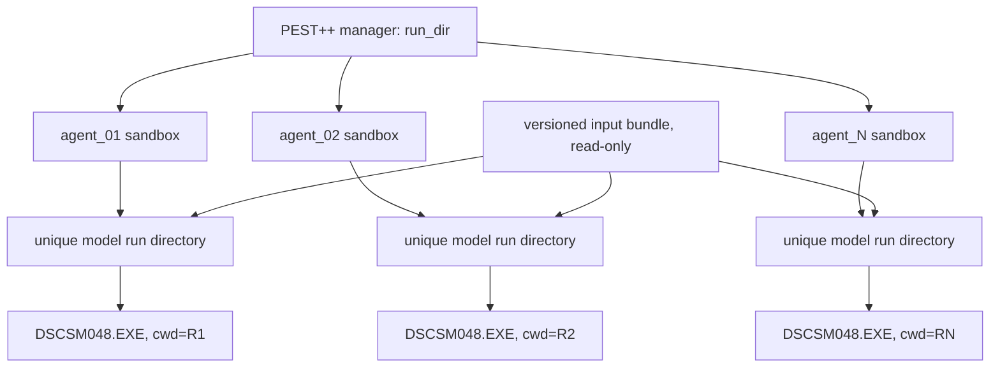

# DSSAT 并行隔离与输入路径规范（SA → 参数率定）

> 状态：当前实现说明 + P2 率定并行的强制设计约束
> 更新：2026-07-16
> 适用范围：Morris、Sobol、PEST++-IES 参数率定及其确定性复跑

## 1. 结论

当前敏感性分析能够让多个 agent 并行而互不干扰，依赖三层隔离：

1. 每个 PEST++ agent 拥有完整的 `workspace/runs/<run_id>/_agents/agent_XX/` 副本；
2. 每次 SA 模型调用在该 agent 内创建唯一的 `_sa_tmp_runs/run_*` 临时目录；
3. DSSAT 在该临时目录中运行，所有可写输入、DSSAT 配置和输出均为本次调用的副本。

用户输入包只作为只读来源。FileX、FileA、FileT、SOIL、品种文件和输出应在本地模型目录中使用；天气的完全本地化目前仍有模板目录遗留（第 4.1 节），P2 必须修复并以集成测试证明，而不能假定已经隔离。

未来 PEST++-IES 率定必须保留至少第一层 agent 隔离；建议复用 SA 的第三层“每次模型调用唯一临时目录”，使重试、失败存档和未来一个 agent 内的并发扩展也不会覆盖文件。



## 2. 当前 SA 的并行实现

### 2.1 PEST++ manager / agent 层

入口为 `tools/parallel/run_parallel.py`。

- manager 在 `workspace/runs/<run_id>/` 启动；其 `.pst`、运行存储（`.rns` 等）和汇总输出只由 manager 使用；
- 启动前，脚本将 run directory 复制到 `_agents/agent_01`、`agent_02`……；复制时排除其他 agent 目录、`manager/`、`state/`、停止文件和 PEST++ 运行存储；
- 每个 worker 以自己的 agent 目录为工作目录启动 `pestpp-sen.exe` 或 `pestpp-ies.exe`，并通过独立端口连接 manager；
- agent 的 PID、最后任务和 stdout/stderr 分别写入本 agent 的 `state/` 和日志目录；
- `--resume` 只由 manager 使用同一 run directory 的 `.rns` 恢复，agent 副本不会共享该二进制运行存储。

因此，不同 agent 不会同时写同一个 `sa_params.csv`、CUL/ECO/SPE、SOIL、DSSAT 输出或 PEST 指令输出文件。

### 2.2 SA 的“每次模型调用”层

SA 的 `.pst` model command 由 `src/sensitivity/sa_build_sen_case.py::build_case()` 写入，工作区为当前 agent 的 `.`。每次 PEST++ 下发一组参数时：

1. PEST++ 在 agent 目录内用模板写入该 agent 专属的 `sa_params.csv`；
2. `src/sensitivity/sa_model.py::compute_indicators()` 立即把它复制为临时目录内的 `sa_params.snapshot.csv`；
3. 该函数在 `<agent>/_sa_tmp_runs/run_*` 创建唯一目录，并以此作为 `src/calibration/run_dssat.py` 的当前工作目录；
4. calibration stub 在该目录复制输入文件，随后调用 `python -m src.dssat.run_dssat`；
5. DSSAT 输出留在临时目录；SA 仅将按固定顺序生成的 `SA_Indicators.OUT` 原子替换写回 agent 目录，供 PEST++ 读取；
6. 成功后删除临时目录；失败时可把临时目录整体复制到指定的 failure artifact 目录。

这里的参数快照与原子写出很重要：即使 PEST++、Windows 文件系统或失败重试在时间上接近，也不会把半写入的参数文件或半写入的指标文件当作有效结果。

### 2.3 当前 IES 率定的隔离边界

率定同样通过 `tools/parallel/run_parallel.py` 获取独立 agent 目录。`src/calibration/run_dssat.py` 在每个 agent 的当前工作目录准备输入并运行 DSSAT。PEST++ 的一个 worker 在自己的工作目录中串行执行模型命令，因此多个 agent 间不会相互覆盖。

这已经满足“多 agent 互不写入”的基本要求，但不如 SA 的临时目录层严格：同一 agent 的重试、人工中断后的检查和未来 worker 内并发扩展仍会复用 agent 根目录。因此 P2 应把率定 runner 改为与 SA 相同的“每次模型调用唯一目录 + 参数快照 + 原子结果回传”模式。

## 3. 输入来源优先级：项目代码的实际规则

以下是 `src/calibration/run_dssat.py::prepare_run_directory()` 的复制优先级。这里的“优先级”是项目在启动 DSSAT 前选择源文件的规则，不是对 DSSAT 内部搜索机制的猜测。

| 文件类别 | 源文件选择顺序 | 实际运行位置 | 说明 |
|---|---|---|---|
| Batch | `--batch` 指向的现有绝对/本地文件 → `--input-dir/<batch basename>` → `data/templates/batch/` → `workspace/` | `<model-run>/DSSBatch.v48` | SA 正式运行传入用户输入包中的绝对 batch 路径，因此优先使用该包。 |
| FileX (`.TMX`) | 由 batch 首列的 experiment stem 决定；`--input-dir` → `data/raw/experiments/` | `<model-run>/<stem>.TMX` | batch 在本地被改写为仅引用本地 FileX 文件名。 |
| FileA (`.TMA`) | 与 FileX 同 stem、同一来源目录 | `<model-run>/<stem>.TMA` | 复制为本地配置/观测文件，不允许读取其他 agent 的同名文件。 |
| FileT (`.TMT`) | 与 FileX 同 stem、同一来源目录 | `<model-run>/<stem>.TMT` | 除 DSSAT 文件配置外，项目还用它读取过程观测和采收事件。 |
| `SOIL.SOL` | `--input-dir/SOIL.SOL` → `data/raw/soil/SOIL.SOL` | `<model-run>/SOIL.SOL` 与 `.base` | 参数注入从本地 `.base` 生成本地 `SOIL.SOL`。 |
| 天气 (`*.WTH`) | `--input-dir/*.WTH` → `data/raw/weather/*.WTH` | `<model-run>/*.WTH` | 代码会复制来源目录中的全部天气文件，FileX 的 `WSTA` 决定站点；但当前 INP/INH 的 `WDIR` 仍可能使 DSSAT 搜索安装目录，见第 4.1 节。 |
| CUL/ECO/SPE | `data/templates/genotype/*.base` | `<model-run>/TMGRO048.CUL/.ECO/.SPE` 与 `.base` | 当前 `--input-dir` 不覆盖基因型模板；遗传模板属于项目版本化资产。 |
| DSSAT 配置/可执行文件 | `data/templates/DSSATPRO.v48`、`.INH`、`.INP`；可执行文件来自 `DSSAT48_HOME`（默认 `C:\DSSAT48`）或 `workspace/` | `<model-run>/` | EXE 与配置被复制到运行目录。 |

`--input-dir` 是一个完整、版本化的用户输入包，不是“与 `data/raw` 混合查找”的附加目录：指定它后，runner 的复制来源为该包；未指定时才使用项目的 `data/raw` 默认输入。该规则不自动消除 DSSAT 模板中写死的外部搜索目录。

## 4. DSSAT 实际运行时的路径与文件角色

### 4.1 工作目录优先

stub 完成复制后，实际命令等价于：

```text
cwd = <model-run>
DSCSM048.EXE B DSSBatch.v48
```

`src/dssat/run_dssat.py` 把本地 `DSSATPRO.v48` 的 `CRD` 改写为 `<model-run>`，这是 FileX、FileA、FileT、SOIL、品种和输出本地化的主机制。`C:\DSSAT48` 主要提供可执行文件、模型程序和 DSSAT 数据库。

但当前 `data/templates/DSSAT48.INP` 与 `DSSAT48.INH` 的天气条目仍含 `C:\DSSAT48\Weather`。runner 复制 `.WTH` 到本地，却没有重写该 `WDIR`；DSSAT 对“当前目录同名天气文件”和该显式目录的最终搜索顺序不能只由本项目 Python 代码证明。因此当前天气来源是**已复制但未完成来源门禁**，不得在 P2 中声称为完全隔离。P2 必须将 `WDIR` 重写为本地模型目录（或清空为仅当前目录），并使用内容不同的 marker WTH 进行真实 DSSAT 集成测试。

对于其余本地文件，如果缺失，正确行为应是运行失败并留下诊断，而不是静默回退到 `C:\DSSAT48` 或其他旧工作目录。当前 runner 已对 `Evaluate.OUT` 做存在、非空和新鲜度检查；P2 应把同样的来源/新鲜度检查扩展到所有关键输入和率定输出。

### 4.2 FileX、FileA、FileT 的不同职责

| 文件 | 对本项目的职责 | 必须在本地运行目录中 |
|---|---|---|
| FileX (`.TMX`) | batch 指定的试验/管理、处理、初始条件、土壤 ID、天气站点和采收安排的主入口 | 是 |
| FileA (`.TMA`) | DSSAT 配置中以 `AFILE/FILEA` 引用的季末观测文件；也作为率定观测定义的来源 | 是 |
| FileT (`.TMT`) | DSSAT 配置中以 `FILET` 引用；项目后处理用其生成过程点与多次采收观测 | 是 |
| `SOIL.SOL` | 由 FileX 的土壤 ID 选择具体剖面；本项目可在本地副本中注入 soil 参数 | 是 |
| `*.WTH` | 由 FileX 中的天气站点代码选择 | 是 |

不要把 FileA/FileT 当成“只供率定、与模型无关”的外部表：当前 `DSSAT48.INP/INH` 已显式写入 `FILEA`、`FILET` 和 `SOILS`。同时，也不要把它们当成唯一的模拟输入来源：项目的 PEST 输出写入器会在 DSSAT 运行后再次读取本地 `.TMT`，把观测日期/采收事件与 `PlantGro.OUT`、`FreshWt.OUT` 对齐。

### 4.3 当前必须注意的文件名耦合

模板 `data/templates/DSSAT48.INP` 与 `DSSAT48.INH` 当前含有 `XXQL2501.TMX/.TMA/.TMT` 等固定文件名。对当前 XXQL2501 输入包这是一致的；切换 experiment stem 前，P2 必须把 INP/INH 生成为与本地 batch/FileX 一致的版本，或在 preflight 中明确拒绝不一致的组合。仅复制新文件而不更新 INP/INH 不应被视为安全。

## 5. P2 率定并行的强制接口

P2 的率定 case 必须遵守下列契约。

1. **只读输入包。** 不得在 `data/user/experiments/<bundle>/`、`data/raw/` 或 `data/templates/` 原地写入文件。
2. **每个 agent 独立。** 继续由 `run_parallel.py` 复制整套 case；agent 的 model command 只能使用相对本地文件或明确的只读绝对输入包。
3. **每次调用独立。** 新建 `run_<uuid>/`，在其中复制输入、快照参数、运行 DSSAT；不得复用上一次调用的 `Evaluate.OUT`、`PlantGro.OUT`、`FreshWt.OUT` 或 Pest 输出。
4. **本地 batch。** model runner 必须把 batch 改写为本地 FileX basename，禁止 batch 保留指向用户输入包或别的 agent 的绝对 FileX 路径。
5. **重写本地配置路径。** 除 `CRD` 外，必须把 INP/INH 中的 FILEX/FILEA/FILET/SOILS/WFILE/WDIR 等文件名与目录重写为本地已复制文件；尤其禁止 `WDIR=C:\DSSAT48\Weather` 作为正式率定的隐式回退。
6. **单一输出回传点。** 仅在模型成功、所有必需输出新鲜且完整后，原子写入 PEST `.ins` 读取的文件；失败必须输出明确 penalty/失败标识，不能回收旧结果。
7. **可追溯来源。** 每次 case manifest 记录输入 bundle ID、每个输入文件 SHA-256、DSSAT 可执行文件路径/哈希、agent ID、临时目录 ID、参数快照哈希和输出哈希。
8. **无隐式 fallback。** 找不到本地 FileX、FileA、FileT、SOIL、天气、CUL/ECO/SPE 或 INP/INH 一律失败；不能用同名旧文件补齐。
9. **可审计恢复。** `--resume` 只恢复 PEST++ 的 run storage；恢复后仍须重新执行完成/新鲜度/科研质量门，不能把残留输出直接认定为本次模型结果。

## 6. P2 实施前的回归测试

以下测试应先写再改率定 runner。

| 测试 | 通过条件 |
|---|---|
| 双 agent 隔离 | 两个 agent 使用不同的参数和输入 marker；各自产生的 CUL/ECO/SPE/SOIL/FileX 与输出哈希不同，源输入包哈希不变。 |
| 同 agent 连续调用 | 前一次输出残留后，第二次调用仍只能读取第二次新生成输出。 |
| 输入来源优先级 | 有 `--input-dir` 时，runner 复制的 SOIL、TMX/TMA/TMT、WTH 与 batch 均来自该包；无该参数时才允许 `data/raw`。同时以不同内容的 WTH marker 验证 DSSAT 未使用 `C:\DSSAT48\Weather`。 |
| INP/INH 一致性 | INP/INH 指向的 FileX/A/T、SOIL、天气名均存在于本地运行目录，且与 batch/FileX 一致。 |
| 参数快照 | 在 runner 启动后修改 agent 根目录参数文件，不影响当前模型调用。 |
| 失败无污染 | 故意使 DSSAT 失败时，PEST 输出不能来自旧文件，run status 必须为 `not_assessable` 或科学门禁失败。 |
| 并行小型集成 | 至少 2 agents、至少 2 个候选参数集，确认输出 run_id 与参数快照一一对应。 |

## 7. 运维检查清单

运行前确认：

- 输入包包含 batch、同 stem 的 TMX/TMA/TMT、`SOIL.SOL`、所需全部 WTH；
- batch 的 FileX 名称、INP/INH 的 FILEX/FILEA/FILET 与输入包一致；
- 运行目录是新目录，或已按审计流程从 `.rns` 恢复；
- `DSSAT48_HOME` 指向目标 DSSAT 4.8 安装，且 agent 可读取 EXE；
- 并发数未超过机器可承受的 DSSAT 进程数；
- 不把 `C:\DSSAT48` 的旧 `Evaluate.OUT` 或项目根目录输出作为结果来源。

运行后确认：

- manager、agent、每次模型调用的日志和状态均存在；
- 本地输出的修改时间晚于该次调用开始时间；
- 关键输入/参数快照/输出哈希可从 manifest 或失败工件追溯；
- 质量报告通过后，才允许进入率定更新、后验分析或论文图表数据冻结。

## 8. 代码依据

- `tools/parallel/run_parallel.py`：case 复制、agent 生命周期、端口、状态、恢复；
- `src/sensitivity/sa_build_sen_case.py`：SA 的 PEST++ model command 和 manifest；
- `src/sensitivity/sa_model.py`：参数快照、唯一临时目录、原子指标输出；
- `src/calibration/run_dssat.py`：输入包复制与本地 batch；
- `src/dssat/run_dssat.py`：DSSATPRO 的本地 `CRD`、参数注入、DSSAT 启动、输出同步和新鲜度检查。

本规范描述的是当前仓库实现，不替代 DSSAT 官方手册。若更新 DSSAT 版本、修改 `DSSATPRO.v48` 或引入新的实验文件命名规则，必须先重新执行第 6 节的输入来源与并行隔离集成测试。
