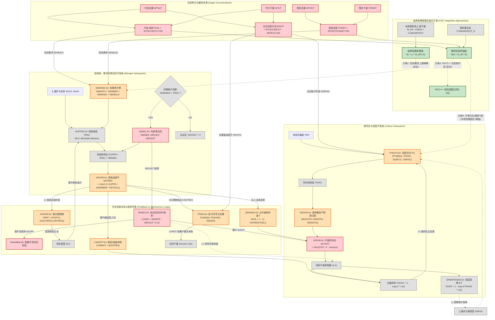

# 碳氮耦合反馈网络与下游次生冲击风险矩阵

**文档标识**: `ARCH-N-02`  
**版本**: v1.0.0 (Publication-Grade Specification)  
**作者**: Technical Documentation Architecture Team  
**审核基准**: DSSAT CSM v4.8.2 / v4.8.6.0 (`Plant/CROPGRO/`, `SPAM/`, `Soil/`)  
**目标作物/模型**: 温室茄子 (依托番茄模型 `TMGRO048.CUL` / `TMGRO048.SPE` / `TMGRO048.ECO`)  
**状态**: 冻结生效 (Frozen Architectural Standard)

---

## 1. 拓扑背景与核心双节点定义 (Topological Context & Core Dual Nodes)

在 CROPGRO 模型中，叶片氮浓度（`PCNL`）与茎秆氮浓度（`PCNST`）并非末端诊断报表的“被动输出变量”，而是处于作物生长引擎动力学拓扑中央的关键状态节点。

在状态积分程序 `GROW.for` 中，这两个变量由组织积累状态变量严格除法定义：
- **叶片全氮质量百分比**:
  $$\text{PCNL} = \frac{\text{WTNLF}}{\text{WTLF}} \times 100.0 \quad (\text{GROW.for:929})$$
- **茎秆全氮质量百分比**:
  $$\text{PCNST} = \frac{\text{WTNST}}{\text{STMWT}} \times 100.0 \quad (\text{GROW.for:935})$$
- **光合活性真叶氮浓度 (去除非结构性碳储备)**:
  $$\text{RNITP} = \frac{\text{WTNLF}}{\text{WTLF} - \text{WCRLF}} \times 100.0 \quad (\text{GROW.for:968, 444})$$

由于 `PCNL` / `RNITP` 的分母直接包含现存叶干重 $\text{WTLF}$，任何光合碳同化变动、衰老落叶或呼吸消耗都会在分子 $\text{WTNLF}$ 未变的情况下瞬间扰动氮浓度；反过来，氮浓度又通过一系列生理通道反作用于碳同化、异速分配与器官脱落，形成了高度非线性的双向强耦合闭环。

---

## 2. 碳氮反馈网络拓扑图 (Mermaid Topology Diagram)



---

## 3. 8 大下游消费环节深度剖析 (Deep Dive: 8 Downstream Consumers)

`PCNL`、`PCNST`、`RNITP` 与 `NSTRES` 直接驱动或调控作物生长模型的 8 个独立生理环节：

### 3.1 环节一：大叶日间冠层毛光合生产 (`PHOTO.for:132-180`)
在标准日同化模式（`MEPHO = 'C'`）下，结构叶氮百分比 `RNITP` 是决定光合活性的直接驱动力：
```fortran
AGEFAC = CURV(TYPPGN, FNPGN(1), FNPGN(2), FNPGN(3), FNPGN(4), RNITP)
AGEREF = CURV(TYPPGN, FNPGN(1), FNPGN(2), FNPGN(3), FNPGN(4), LNREF)
AGEFAC = AGEFAC / AGEREF
AGEFCC = (1.0 - EXP(-2.0 * AGEFAC)) / (1.0 - EXP(-2.0 * 1.0))
IF (AGEFCC .GE. 1.0) THEN
  E_FAC = AGEFCC * PStres1
ELSE
  E_FAC = MIN(AGEFCC, PStres1)
ENDIF
PG = PTSMAX * SLPF * PGFAC * TPGFAC * E_FAC * PGSLW * PRATIO * PGLFMX * SWFAC
```
- **机理解析**：`CURV` 采用 4 控制点非线性插值函数。当 `RNITP` 跌落至基准浓度 `LNREF`（温室茄子通常为 $4.0\%$）以下时，`AGEFAC < 1.0`，经指数递减转换为 `AGEFCC`，使得单叶光合因子 `E_FAC` 呈 S 型加速跳水，直接削减冠层毛光合总量 $\text{PG}$。

### 3.2 环节二：冠层纵向受光垂直梯度光合 (`SPAM/ETPHR.for:348-349`)
在小时级树篱冠层光合模式（`MEPHO = 'L'`）下，模型模拟群落内部自遮阴与氮素空间异速分配：
```fortran
PCNLSL = RNITP + 0.5 * NSLOPE * LAISH
PCNLSH = RNITP - 0.5 * NSLOPE * LAISL
```
- **机理解析**：物种参数 `NSLOPE`（$\text{\%/LAI}$）决定受光层（阳叶 `LAISL`）与弱光层（阴叶 `LAISH`）的氮浓度差。当基准 `RNITP` 变动时，群落下层叶片的计算氮浓度 `PCNLSH` 极易跌破维持呼吸门槛，诱发群体内部严重的假性下部黄化。

### 3.3 环节三：老组织复充需氮量扩增 (`DEMAND.for:638-660`)
`PCNL` 和 `PCNST` 直接决定老组织在受到前期干旱或脱肥后，向根系申请的“复充回填”氮需求量：
```fortran
FRNLFT = (NRCVR + (1. - NRCVR) * (1. - DXR57**2))
NVSTL = PROLFF*0.16 + (FNINL - PROLFF*0.16) * FRNLFT
NVSTS = PROSTF*0.16 + (FNINS - PROSTF*0.16) * FRNLFT

NDMOLD = (WTLF  - WCRLF) * MAX(0.0, (NVSTL - PCNL /100.))
     + (STMWT - WCRST) * MAX(0.0, (NVSTS - PCNST/100.))
     + (RTWT  - WCRRT) * MAX(0.0, (NVSTR - PCNRT/100.))
IF (NDMOLD .GT. (CNOLD/RNO3C*0.16)) NDMOLD = CNOLD/RNO3C*0.16
NDMTOT = NDMREP + NDMVEG + NDMOLD
```
- **机理解析**：当现存组织氮浓度低于目标基准（`PCNL/100 < NVSTL`）时，系统产生庞大的回充需求 `NDMOLD`，使植株总需氮量 `NDMTOT` 急剧放大，进而在 `NUPTAK.for` 中催生极大的 `ANDEM`。若外部土壤供氮充足，植株将产生强烈的“报复性吸收”；反之若土壤缺氮，庞大的需求赤字将加剧内源再动员。

### 3.4 环节四：氮胁迫对营养分配的功能平衡调节 (`VEGGR.for:238-310`)
通量型氮胁迫指数 `NSTRES` 直接干预根冠生物量分配（Functional Balance）：
```fortran
FRRT = ATOP * (1.0 - (MIN(TURFAC, NSTRES, PStres2))) * (1.0 - FRRT) + FRRT
FRLF = (1.0 + 0.6*(1.0-CUMTUR))*(1.-FRRT)*FRLF/(FRLF + FRSTM)
FRSTM = 1.0 - FRRT - FRLF
```
- **机理解析**：一旦 `NSTRES < 1.0`，分配至根系的干物质比例 `FRRT` 被强制放大（放大上限受物种参数 `ATOP` 约束），地上部叶片分配 `FRLF` 和茎秆分配 `FRSTM` 遭遇机械压缩。在 Case C 极端供氮不足时，组织扩张更被乘以 `NRATIO = NAVL / NGRVGG < 1.0`，叶片新生完全停滞。

### 3.5 环节五：比叶面积 (SLA) 动态硬化与变厚 (`DEMAND.for:560-575`)
氮亏缺显著改变新生叶片形态解剖结构：
```fortran
IF (NSLA .GT. 1.2) NSLA = 1.2
NFSL   = MAX(0.1, (1.0 - (1.0 - NSTRES)*NSLA))
CUMNSF = 0.75*CUMNSF + 0.25*NFSL
FFVEG  = FVEG * TPHFAC * PARSLA * TURFSL * CUMNSF
F      = FFVEG
```
- **机理解析**：`NSTRES < 1.0` 使得新生叶片比叶面积系数 `F`（$\text{cm}^2/\text{g}$）大幅缩水。新生成的绿叶单位干重扩展出的叶面积变小（叶肉细胞紧密变厚），严重拖累全株冠层截光面积的扩张速度。

### 3.6 环节六：氮再动员破坏性诱发叶片脱落 (`MOBIL.for:65-75`, `SENES.for:175-215`)
内源再动员直接触发不可逆的叶片死亡：
```fortran
NMINEA = MIN(NDMNEW - TRNU, NMINEP)
NRUSLF = (NMINEA / NMINEP) * NMOBR * WNRLF
LFSEN  = SENRTE * NRUSLF / 0.16
SLDOT  = SLDOT + LFSEN
SSDOT  = SLDOT * PORPT
```
- **机理解析**：`SENRTE` 是“氮动员杀伤叶系数”。从功能叶片抽出的动员氮通量 `NRUSLF` 经除以 $0.16$ 换算为蛋白质后，乘以 `SENRTE` 直接转化为死亡叶重 `LFSEN` 并累加进落叶速率 `SLDOT`。叶片脱落同时诱发叶柄与附属侧枝脱落（`SSDOT = SLDOT * PORPT`）。

### 3.7 环节七：生殖批次分化与花果添加抑制 (`PODS.for:343-777`)
茄果类无限生长多批次坐果受氮素平滑指数严格门控：
```fortran
CNSTRES = 0.875 * CNSTRES + 0.125 * NSTRES
RNITPD = (RNITP * 0.01 - PROLFF * 0.16) / (FNINL - PROLFF * 0.16)
RNITPD = MIN(1.1, MAX(0.1, RNITPD))
PODADD = PMAX * TEMPOD * (DRPP**1.3) * MIN(SWADD1, SWADD2, RNITPD) * MAX((1.0 - ACCAGE), 0.0)
FLWADD = 2.0 * PMAX * TEMPOD * (DRPP**1.3) * MIN(SWADD1, SWADD2, CNSTRES**0.5)
ADDSHL = MIN(PGLEFT/AGRSH1, GRRAT1 * SHELN, NLEFT / (FNINSH * CNSTRES**0.5))
```
- **机理解析**：真叶氮浓度 `RNITP` 直接决定单日成荚能力 `RNITPD`，而 8 天平滑胁迫 `CNSTRES` 直接控制花芽添加量 `FLWADD` 与幼果壳膨大 `ADDSHL`。氮浓度下滑将瞬间阻断下一批次花芽分化，导致田间采收时出现严重的“空枝断茬”。

### 3.8 环节八：冠层几何株高、株宽与截光率抑制 (`CANOPY.for:220-250`)
氮胁迫压制冠层几何空间立体扩展：
```fortran
HNHGT = MAX(0.1, 1.0 - (1.0 - NSTRES) * NHGT)
CUMNHT = 0.75 * CUMNHT + 0.25 * HNHGT
RCANHT = ... * CUMNHT
RCANWH = ... * CUMNHT
SPACNG = CANWH / ROWSPC
KCANR = KCAN - (1. - SPACNG) * KC_SLOPE
```
- **机理解析**：株高与冠幅的横向扩展直接改变行距利用率 `SPACNG`，进而动态修正冠层消光系数 `KCANR`，间接改变每日冠层总截光率 $\text{PGFAC} = 1 - \exp(-\text{KCANR} \cdot \text{LAI})$。

---

## 4. 四大反馈环路机理推导与失稳边界 (The 4 Feedback Loops)

基于上述 8 大消费环节，CROPGRO 内部演化出 4 个至关重要的反馈环路：

### 4.1 环路一：光合-衰老雪崩正反馈环路 (Loop 1: Senescence Avalanche Positive Feedback)
- **因果链**:
  $$\text{轻微缺氮} \to \text{RNITP} \downarrow \to \text{AGEFAC} \downarrow \to \text{PG} \downarrow \to \text{WLDOTN} \downarrow \to \text{NDMNEW} > \text{TRNU} \to \text{NRUSLF} \uparrow \to \text{LFSEN} \uparrow \to \text{LAI} \downarrow \to \text{PGFAC} \downarrow \to \text{PG} \downarrow\downarrow$$
- **失稳与雪崩边界**:
  在正常生长阶段，新生叶面积增长速率大于衰老脱落速率（$ALFDOT > 0$）。
  但在果实迅速膨大期，当且仅当满足临界条件：
  $$\text{LFSEN} > \text{WLDOTN} \iff \text{SENRTE} \times \frac{\text{NRUSLF}}{0.16} > \text{WLDOTN}$$
  净叶面积扩张率 $ALFDOT$ 发生变号转为负值。此时，光合产物减少使得无法生成新叶，而现有叶片因持续被迫动员而加速脱落，系统进入**不可逆的雪崩早衰死锁**，叶面积在 7~10 天内迅速归零。

- **方案 B (Scheme B) 下的雪崩诱发加剧机制**:
  在方案 B 中，当引入内源光合门控 $\mathcal{S}(NNI)$ 时，在氮素亏缺（例如 $NNI = 0.40$）下，$\mathcal{S}(NNI) \to 0.311$，使得光合毛碳 $PG$ 及叶片新生干重 $WLDOTN$ 直接缩减约 $70\%$（如从 $1.80\text{ g/m}^2\text{/d}$ 暴跌至 $0.56\text{ g/m}^2\text{/d}$）。
  然而，生殖器官（果实）对氮的强力虹吸维持不变（$\text{NDMREP}$ 强劲），叶片实际抽调通量 $\text{NRUSLF}$ 居高不下，维持 $\text{LFSEN} = 1.75\text{ g/m}^2\text{/d}$。
  净叶生长率从原生的存活状态（$+0.05\text{ g/m}^2\text{/d}$）瞬间崩塌为深度负值（$-1.19\text{ g/m}^2\text{/d}$），雪崩比值 $\frac{LFSEN}{WLDOTN}$ 被放大了 $\frac{1}{\mathcal{S}(NNI)} \approx 3.12\times$！

- **方案 B 强制日落叶限幅器 (Defoliation Avalanche Limiter)**:
  为从数学上杜绝这一致命雪崩死锁，在方案 B 实施时必须在 `SENES.for` 中强制引入**日落叶动态限幅器**：
  $$LFSEN_{\text{actual}} = \min(LFSEN_{\text{native}}, \; \gamma \cdot WLDOTN) \quad (\gamma \le 1.0)$$
  工程推荐采用结合现存绿叶生物量的复合平滑限幅公式：
  $$LFSEN_{\text{governed}} = \min\left(LFSEN_{\text{native}}, \; 0.85 \cdot WLDOTN + 0.015 \cdot WTLF\right)$$
  该限幅器保证每日净生长率满足：
  $$ALFDOT_{\text{net}} = WLDOTN - LFSEN_{\text{actual}} \ge (1 - \gamma) \cdot WLDOTN \ge 0$$
  从微分方程结构上彻底杜绝了氮亏缺与光合下调导致的不可逆落叶暴毙。

### 4.2 环路二：功能平衡根冠比负反馈自愈环路 (Loop 2: Functional Balance Negative Feedback)
- **因果链**:
  $$\text{土壤缺氮} \to \text{TRNU} \downarrow \to \text{NSTRES} \downarrow \to \text{FRRT} \uparrow \to \text{WRDOTN} \uparrow \to \text{RLV} \uparrow \to \text{TRNU} \uparrow \to \text{NSTRES} \to 1.0$$
- **生物学自愈机制**:
  植物通过将更多光合产物分配至地下根系，增大剖面根长密度 $\text{RLV}$，扩展土壤吸氮接触面，使根系能够从更深土层汲取残留无机氮，从而负向拉升 $\text{NSTRES}$，抑制胁迫扩散。
- **失效边界**:
  若全土壤剖面无机氮库彻底耗尽（$\sum_L (\text{SNO3}_L + \text{SNH4}_L) \approx 0$），增大根系亦无法吸得额外氮素。此时环路二完全失效，所有未满足的需求瞬间击穿至环路一，引发极端早衰。

### 4.3 环路三：生态水文气孔间接缓冲负反馈环路 (Loop 3: Ecohydrological Buffering Negative Feedback)
- **因果链**:
  $$\text{氮亏缺} \to \text{LAI 扩张受抑} \to \text{FDINT} = 1 - \exp(-\text{KTRANS} \cdot \text{LAI}) \downarrow \to \text{EP} \downarrow \to \text{土壤蒸发蒸腾脱水减缓} \to \text{SW 维持较高} \to \text{SWFAC} \approx 1.0 \to \text{延缓水分胁迫}$$
- **机理解析**:
  CROPGRO 中氮素虽不直接控制气孔导度阻抗，但低氮造成的小叶面积显著降低了群落日蒸腾耗水量 $\text{EP}$，使得低氮小区的土壤水分耗竭速度显著慢于高氮茂密小区。在田间表现为低氮植株“看似更抗旱”，掩盖了水分胁迫的显现。

### 4.4 环路四：生殖库败育断流负反馈保护环路 (Loop 4: Reproductive Abortion Negative Feedback)
- **因果链**:
  $$\text{深度缺氮} \to \text{RNITP} \downarrow, \text{CNSTRES} \downarrow \to \text{FLWADD} \to 0, \text{PODADD} \to 0 \to \text{新果实负载断流} \to \text{NDMREP} \to 0 \to \text{解除对营养体氮素掠夺} \to \text{保全营养体存活}$$
- **生物学适应机制**:
  植株通过放弃下一批果实的发育（落花落果），彻底掐断生殖库对氮的饥饿虹吸，使有限的氮素留在功能叶和茎秆中，保全生命中枢以等待后续环境改善。

---

## 5. 引入临界氮稀释公式 ($N_c = a W^{-b}$) 的四大非线性扰动风险

若未经架构隔离，直接将 Greenwood-Lemaire 临界氮稀释定律 $N_c = a W^{-b}$ 硬编码代入 CROPGRO 的组织浓度中，将触发以下毁灭性非线性风险：

### 5.1 风险一：双向发散的正反馈失控 (Runaway Positive/Negative Feedback)
- **失控机理**:
  若将光合直接挂钩至全株氮营养指数 $\text{NNI} = N_{\text{act}} / N_c(W)$：
  - **正向发散 (爆长失控)**:
    $$W \uparrow \implies N_c(W) = a W^{-b} \downarrow \implies \text{NNI} \uparrow \implies \text{光合 } \text{PG} \uparrow \implies W \uparrow\uparrow$$
    只要初期干物质轻微偏大，稀释效应使得临界需求迅速降低，模型误判植株极度“富氮”，刺激同化量爆炸式虚假飙升；
  - **负向发散 (停滞僵化)**:
    若育苗期遭遇一次短暂降温导致初期生物量 $W$ 偏低，则 $N_c(W)$ 计算值异常偏高，导致 $\text{NNI} \ll 1.0$，模型误判为严重亏氮，剧烈下调光合，使作物陷入“永远长不大”的僵苗死循环。

### 5.2 风险二：叶面积崩塌与假性脱叶雪崩 (LAI Collapse Avalanche)
- **失控机理**:
  若依据 $N_c(W)$ 下调老叶目标氮浓度 $NVSTL$，将直接阻断 `DEMAND.for:650` 的老组织复充 `NDMOLD`。老叶片在自然稀释过程中被判定为“不需要维持高氮”，进而诱发系统错误调用 `MOBIL.for` 抽调氮素。一旦 `NRUSLF` 激发，`SENES.for:198` 立即按照每克动员蛋白杀死 `SENRTE` 克绿叶的比例处决叶面积，使健康的异速稀释蜕变为灾难性的提早落叶。

### 5.3 风险三：质量平衡破缺与求解器崩溃 (`PlantNBal.for` Violation)
- **失控机理**:
  `PlantNBal.for` 在每天日落前核算微克级质量闭合：
  $$\text{WTNALL} + \text{TNLEAK} \equiv \text{SEEDNI} + \text{WTNFX} + \text{WTNUP}$$
  若为了迁就 $N_c(W)$ 曲线而在状态层代数覆写 `WTNLF` 或 `PCNL`，破坏了积分连续性微分方程：
  $$\frac{d\text{WTNLF}}{dt} = \text{NGRLF} - \text{NLOFF} - \text{NRUSLF}$$
  DSSAT 内部记账残差瞬间超标，触发致命浮点溢出或质量不守恒报错中止模拟。

### 5.4 风险四：多批次采收断茬与鲜果产量失真 (`CHPDT` Disruption)
- **失控机理与实测锯齿阶跃**:
  温室茄子属于典型的无限生长多批次采收作物（单季通常包含 6 次分批采收）。若采用瞬时现存地上干重 $CWAD(t)$ 计算稀释曲线，每次采收摘除鲜果会导致 $CWAD$ 和 $CNAD$ 发生阶段性阶跃跌落。
  实测仿真数据表明（以 25SP XXQL2501 采收节点为例，`PlantGro.OUT` DOY 169 $\to$ 170）：
  - DOY 169 (采收前): $CWAD = 3802\text{ kg/ha}$ ($3.802\text{ t/ha}$), $CNAD = 173.6\text{ kg N/ha}$, $N_{\text{act}} = 4.566\%$, $N_c = 2.926\%$, $NNI = 1.560$；
  - DOY 170 (采收后摘除果实 $563\text{ kg DM/ha}$, 果氮 $10.0\text{ kg N/ha}$): $CWAD = 3239\text{ kg/ha}$ (干重骤跌 $14.8\%$), $CNAD = 163.6\text{ kg N/ha}$。
  - **病态跳变表象**: 摘除低氮果实（果实氮含量仅 $1.78\%$）后，现存地上部营养体 $N_{\text{act}}$ 假性跳增 $+0.485\%$（至 $5.051\%$），$N_c$ 跳增 $+0.171\%$（至 $3.097\%$），$NNI$ 假性跳升 $+0.071$ ($+4.5\%$)！
  若将瞬时 $CWAD$ 代入方案 A 或方案 B，采收事件将在单日产生非生理性的人工阶跃冲击波，直接破坏 `PODS.for` 的批次坐果节律，使单次采收鲜重 `CHPDT` 产生假波动与优化误判。

- **累积有效生物量彻底解耦方案 (Cumulative Effective Biomass Formulation)**:
  为彻底消除多批次采收引起的锯齿状跳变，必须在无限生长型作物的稀释曲线中引入**累积有效生物量（Cumulative Effective Biomass）**与**累积全氮量**：
  $$W_{\text{eff}}(t) = \frac{CWAD(t) + \text{CUMHARVEST}(t)}{1000.0} \quad (\text{t DM/ha})$$
  $$N_{\text{eff}}(t) = 100.0 \times \frac{CNAD(t) + \text{CUMHARVEST\_N}(t)}{CWAD(t) + \text{CUMHARVEST}(t)} \quad (\%)$$
  $$N_c(t) = a \cdot [\max(W_0, W_{\text{eff}}(t))]^{-b}$$
  $$NNI(t) = \frac{N_{\text{eff}}(t)}{N_c(t)}$$
  其中，$\text{CUMHARVEST}(t) = \sum_{k=1}^{m(t)} \text{HARVEST\_DRY}_k$ 为截至第 $t$ 日历史采收下树的果实干重总和，$\text{CUMHARVEST\_N}(t) = \sum_{k=1}^{m(t)} \text{HARVEST\_N}_k$ 为下树果实带走的氮量总和。
  **数学连续性证明**: 在采收当日，果实干物质从树上 $CWAD$ 转移至下树累积量 $\text{CUMHARVEST}$，满足转移恒等式 $\Delta CWAD + \Delta \text{CUMHARVEST} \equiv 0$。因此：
  $$\Delta W_{\text{eff}} \equiv 0, \quad \Delta N_{\text{eff}} \equiv 0 \implies \Delta N_c \equiv 0, \quad \Delta NNI \equiv 0$$
  该公式在数学上严格保证了异速稀释基准 $W_{\text{eff}}(t)$ 在全生育期内单调非减，彻底清除了分批采收引发的数值震荡与假性断茬。

---

## 6. 下游敏感度与三级风险分类矩阵 (Sensitivity & Risk Classification Matrix)

针对上述次生冲击通道，构建以下权威三级风险分类矩阵，并为各区域制定强制性的阻尼与物理隔离规范：

| 风险等级 (Tier) | 影响组件 / 核心变量 | 源码位置与行号 | 敏感度等级 | 核心致灾机理 (Failure Mechanism) | 强制防御与绝缘机制 (Mandatory Protection) |
|---|---|---|---|---|---|
| **Tier 1: 高风险强关联区** (High-Risk Linked Zone) | `WLDOT`, `ALFDOT`, `WTNLF`, `NLDOT` | `GROW.for:470, 712, 800` | **Extreme (极高)** | 核心状态积分层；直接代数篡改必破全局质量守恒，引发 `PlantNBal.for` 严重报错发散。 | **绝对只读隔离 (Read-Only Isolation)**：严禁在外部直接覆写器官干重与组织氮质量状态变量。 |
| **Tier 1: 高风险强关联区** (High-Risk Linked Zone) | `LFSEN = SENRTE * NRUSLF / 0.16`, `SLDOT` | `SENES.for:198-202, 209` | **Extreme (极高)** | 动员致衰正反馈死锁（$LFSEN > WLDOTN$），在方案 B 光合下调时雪崩比放大 $3.12\times$，引发叶面积指数断崖暴跌。 | **衰老阻尼隔离与日落叶限幅器**：方案 B 必须强制施加日落叶限幅器 $LFSEN_{\text{actual}} = \min(LFSEN, \gamma \cdot WLDOTN)$（$\gamma \le 1.0$，推荐 $0.85 WLDOTN + 0.015 WTLF$），阻断雪崩。 |
| **Tier 1: 高风险强关联区** (High-Risk Linked Zone) | `NMINEA`, `NRUSLF` | `MOBIL.for:65-75` | **Extreme (极高)** | 动员通量对氮浓度梯度的超敏反应，掏空叶片维持蛋白。 | **动员变率限幅器 (Mobilization Rate Limiter)**：保持原生命中赤字门槛，禁止将瞬时稀释压差作为动员驱动源。 |
| **Tier 2: 中风险传导区** (Medium-Risk Transmission Zone) | `AGEFAC`, `AGEFCC`, `E_FAC`, `PG` | `PHOTO.for:132-180` | **High (高)** | 生物量稀释与光合速率之间的双向发散闭环正反馈（爆长或矮化）。 | **有界平滑耦合门控 (Bounded Sigmoid Gate)**：采用饱和 Sigmoid 映射 $NNI$，强制施加 $[0.20, 1.05]$ 硬饱和区间与 3 日平滑。 |
| **Tier 2: 中风险传导区** (Medium-Risk Transmission Zone) | `NSTRES`, `FRRT`, `FRLF` | `VEGGR.for:238-272` | **High (高)** | 根冠分配比例剧烈振荡，引发冠层截光与根系吸水构型失真。 | **滑动平均阻尼器 (MA Damping)**：保留原生的 2 日滑动平均体系，并锁定根系分配上限 `FRRT <= 0.70`。 |
| **Tier 2: 中风险传导区** (Medium-Risk Transmission Zone) | `F` (动态比叶面积 SLA) | `DEMAND.for:563-568` | **Medium (中)** | 叶片过度硬化或变薄，使相同生物量下的 LAI 轨迹发生异速畸变。 | **SLA 包络线硬截断**：限制 `CUMNSF` 的浮动窗口在 $[0.70, 1.20]$ 物理真实区间内。 |
| **Tier 2: 中风险传导区** (Medium-Risk Transmission Zone) | `RNITPD`, `PODADD`, `FLWADD` | `PODS.for:747-777` | **Medium (中)** | 多批次坐果门控频繁关断；果实采收若导致 $W$ 骤降会引发锯齿假跳变。 | **花果平滑门禁与累积生物量**：锁定 `RNITPD >= 0.10` 底线，并强制采用 $W_{\text{eff}} = CWAD + \text{CUMHARVEST}$ 累积生物量，消解采收锯齿波。 |
| **Tier 2: 中风险传导区** (Medium-Risk Transmission Zone) | `CANHT`, `CANWH`, `KCANR` | `CANOPY.for:220-250` | **Low-Medium (低中)**| 株型几何畸变干扰树篱冠层消光系数。 | **几何拓扑保真**：保留株高与冠幅的基础几何查表逻辑不变。 |
| **Tier 3: 安全隔离修改区** (Safe Isolation Zone) | `NDMOLD` (老组织奢侈充填需求) | `DEMAND.for:650-655` | **Low (低)** | 仅调节向土壤申请的最大吸氮潜力，不触动植株体内现有蛋白质。 | **需求上限软调节**：使用 $N_c(W)$ 动态替代固定的常数 `FNINL` 作为老组织复充天花板，平抑奢侈吸收。 |
| **Tier 3: 安全隔离修改区** (Safe Isolation Zone) | PEST++ 目标函数多目标软约束 | 外部管道 (`build_pest.py`) | **Zero (绝对安全)** | 不侵入 Fortran 求解器内部运行步长，纯数学正则化优化解空间。 | **后验贝叶斯软约束正则化**：在 PEST++ 中将 $NNI$ 设为虚拟观测组进行惩罚约束（方案 A）。 |
| **Tier 3: 安全隔离修改区** (Safe Isolation Zone) | 逐日输出诊断外挂 (`Opgrow.for`) | `Opgrow.for:263` | **Zero (绝对安全)** | 纯只读数据记录，供科研作图与后处理评估使用。 | **观察者模式 (Observer Pattern)**：在输出文件中新增 $N_c$ 与 $NNI$ 字段，零生理反馈。 |

---

## 7. 结论与工程架构裁决 (Architectural Verdict)

1. **严禁在 Tier 1 区域实施代数式侵入**:
   任何试图在 `GROW.for` 或 `SENES.for` 中通过强行重设 `PCNL = Nc` 或直接增大 `SLDOT` 来强行贴合稀释曲线的做法，在物理机理上属于致命错误，必然导致质量不守恒崩溃或毁灭性早衰死锁。
2. **Tier 2 区域必须配套动态阻尼与限幅保护**:
   若实施内源光合挂钩（方案 B），必须在 `PHOTO.for` 中配备经过严格数学证明的有界非线性平滑门控，同时在 `SENES.for` 中强制配对日落叶限幅器 $LFSEN_{\text{actual}} = \min(LFSEN, \gamma \cdot WLDOTN)$，消除爆长、矮化与 $3.12\times$ 放大雪崩发散奇点。在多批次采收中统一强制采用累积生物量公式 $W_{\text{eff}} = CWAD + \text{CUMHARVEST}$。
3. **优先在 Tier 3 区域构建工程落地解决方案**:
   方案 A（PEST++ 目标函数软约束）位于绝对安全的 Tier 3 区域，既能够强力约束参数空间并纠正生理失真，又对 DSSAT CSM 底层正向推演保持 100% 物理守恒与零侵入隔离，为当前工程部署的首选基石。
