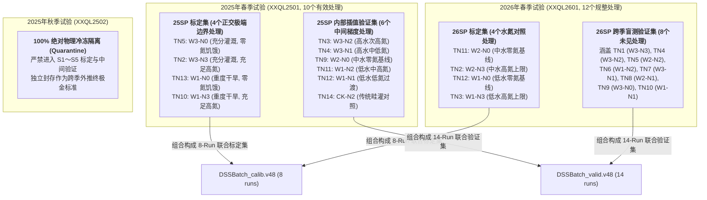
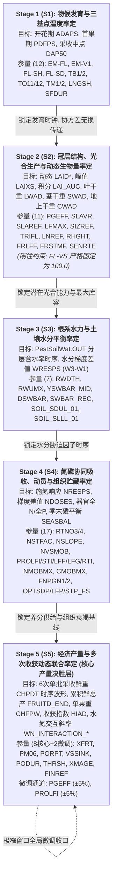

# CROPGRO-Eggplant Phase 1: 路径 A 阶段化分层率定实施方案与技术规范 (S1～S5)

> **文档代号**: `CRGRO-EGG-PHASE1-PATH-A-STAGED-CALIB-SPEC-20260914`  
> **文档版本**: 2.0 (正式实施级出版规范规范稿)  
> **编制专家**: 作物模型与分层率定架构组 (Worker M2)、生理机制与 Fortran 审计组、数学优化评估组  
> **执行模式**: 规范与方案交付 (Zero DSSAT Execution, 纯配置与数学规范资产生成)  
> **基准依据**: 双季 Morris 全局敏感性分析成果 ($\rho = 0.9581$, 跨季解释度 $>95.20\%$)、2025 两茬 123 组田间植株实测全氮磷钾台账、DSSAT CSM v4.8.2/v4.8.6 Fortran 源码机理库、`AGENTS.md`  
> **关联冻结资产**:  
> - 冻结边界文件: `data/parameter_registry/bounds_frozen/eggplant/eggplant_e02_wnp_s1_s5_20260914.csv` (`.yaml`)  
> - 标定批处理: `data/templates/batch/DSSBatch_calib.v48` (8 runs: 25SP 4角点 + 26SP 4水氮对照: TN2, TN3, TN11, TN12)  
> - 验证批处理: `data/templates/batch/DSSBatch_valid.v48` (14 runs: 25SP 6内部 + 26SP 8泛化: TN1, TN4..TN10)  
> - 双季统一元数据: `configs/figures/treatment_metadata_xxql2501_2601_joint.csv` (全量 22 处理)  

---

## 目录 (Table of Contents)

1. [执行纲要与战略定位 (Executive Summary & Strategic Positioning)](#一-执行纲要与战略定位-executive-summary--strategic-positioning)
2. [水氮处理划分与双向验证契约 (Requirement R1: Treatment Partitioning & Evaluation Contract)](#二-水氮处理划分与双向验证契约-requirement-r1)
3. [水氮胁迫生理机制与 Fortran 源码级公式对齐 (Requirement R2: Physiological Mechanisms & Fortran Alignment)](#三-水氮胁迫生理机制与-fortran-源码级公式对齐-requirement-r2)
4. [物种磷参数经验约束与田间实测组织磷对齐 (Requirement R2: Species Phosphorus Constraints)](#四-物种磷参数经验约束与田间实测组织磷对齐-requirement-r2)
5. [五阶段（S1～S5）递进分层解耦拓扑与产量专设决胜层 (Requirement R3: Staged Decoupled Architecture)](#五-五阶段s1s5递进分层解耦拓扑与产量专设决胜层-requirement-r3)
6. [多目标加权函数数学建模与观测不确定度归一化 (Requirement R4: Mathematical Objective Function Modeling)](#六-多目标加权函数数学建模与观测不确定度归一化-requirement-r4)
7. [全量 55 参数层级注册表与冻结边界大表 (Requirement R5: Parameter Registry & Frozen Bounds)](#七-全量-55-参数层级注册表与冻结边界大表-requirement-r5)
8. [PEST++ IES 算法控制参数与端到端 CLI 执行指南 (Requirement R5: Algorithm Configuration & CLI Guide)](#八-pest-ies-算法控制参数与端到端-cli-执行指南-requirement-r5)
9. [质量评估门禁、验收标准与审计验证协议 (Acceptance Gates & Verification Protocols)](#九-质量评估门禁验收标准与审计验证协议-acceptance-gates)

---

## 一、 执行纲要与战略定位 (Executive Summary & Strategic Positioning)

### 1.1 研究背景与科学使命
国家现代农业产业技术体系设施蔬菜数字化建模面临无限生长型作物（茄子 *Solanum melongena L.*）在非线性水氮磷耦合胁迫下的参数识别性（Identifiability）与泛化能力瓶颈。由于 DSSAT 官方发行版缺少原生茄子模型，本系统严格基于番茄模型（`TMGRO048`）的作物模板体系（`.CUL/.ECO/.SPE/.SOL`）进行参数拓展与重构。

历史常规率定多采用“单目标总产拟合”或“窄域 Top-16 参数一次性全量反演”，导致严重的多参数共线性鞍点（Equifinality）、虚假数值补偿以及多次分批采收时序波谷错位。为攻克上述机理缺陷，本方案正式发布**CROPGRO-Eggplant 路径 A 阶段化分层率定实施方案**，以严密的数学拓扑解耦与生理因果链驱动模型参数的渐进收敛。

### 1.2 路径 A 阶段化分层率定 (S1～S5) 核心哲学
1. **因果时空解耦 (Causal Decoupling)**：遵循植物生理发育不可逆原则，确立“物候时钟优先（S1）$\to$ 潜在光能生产与冠层同化（S2）$\to$ 根系水力动力学与土壤水势梯级响应（S3）$\to$ 氮磷协同吸收、跨器官动员与组织贮藏（S4）$\to$ 经济产量源库分配与多次收获波形收口（S5）”的刚性拓扑。
2. **专设产量决胜层 (Dedicated Yield Resolution Stage)**：坚决破除将终末清园干重（`HWAM`）作为标定目标的错误做法，在 S5 专设环节全面纳编 6 次分批采收鲜重（`CHPDT`）、累积鲜总产（`FRUITD_END`）、单果重（`CHFPW`）、收获指数（`HIAD`）及水氮交互增产斜率（`WN_INTERACTION_*`）。
3. **前序后验方差无损传递 (`++ies_parameter_ensemble`)**：打破“单点最优解传递导致的不确定性截断”，基于 PEST++ v5.2.16 官方规范控制参数 `ies_parameter_ensemble`（严禁使用已被解析器静默忽略的非官方旧称缩写），将前一阶段集合平滑后验样本矩阵完整作为下一阶段的先验输入，实现多维参数协方差的无损接力，并允许前序核心参数（`PGEFF`, `PROLFI`）以 $\pm 5\%$ 极窄窗口参与 S5 全局收口。
4. **统一双季处理元数据契约 (`treatment_metadata_xxql2501_2601_joint.csv`)**：针对 S5 跨季联合率定（25SP 与 26SP 联合纳编），下游出版级图表导出工具（`export_paper_data.py`）与 R 语言渲染体系要求所有出现在 `comparison.csv` 中的处理必须在元数据中全覆盖。方案正式规范并生成统合双季全部 22 个处理的权威元数据资产 `configs/figures/treatment_metadata_xxql2501_2601_joint.csv`，其中 25SP 严格包含 4 标定 + 6 验证，26SP 严格包含 4 标定 + 8 验证，彻底终结历史单季元数据在处理角色上的倒置与缺失风险。

### 1.3 核心设计契约与纪律总览
- **处理划分隔离纪律 (Zero Leakage)**：标定集（8 个极端与典型对照处理）与验证集（14 个内部与跨季未见处理）物理级隔离；同一个水氮处理在全时间尺度内严禁跨集拆分。
- **双季元数据全覆盖契约 (Unified Two-Season Metadata)**：通过 `treatment_metadata_xxql2501_2601_joint.csv` 统合管理 25SP (10 处理) 与 26SP (12 处理)，`dataset_role` 严格与 `DSSBatch_calib.v48` (8 runs) 及 `DSSBatch_valid.v48` (14 runs) 保持 100% 同步。
- **25FA 绝对冷冻隔离 (100% Quarantine)**：2025 年秋季试验（`XXQL2502`）数据因光温反向漂移与苗期异质性，100% 退出 S1～S5 标定与验证，保留作为未来终极泛化考核资产。
- **物理硬边界红线 (Rigid Physical Invariants)**：所有参数初值与率定范围 100% 遵从 `PHYSICAL_BOUNDS`；温度参数保持单调全序；无限生长型结构积温 `FL-VS` 严格固定为 `100.0`；物种磷参数围绕花生基线在 $\pm 10\%$ 内受控浮动。
- **方案交付约束 (Zero DSSAT Execution)**：本阶段任务严格限定为产出高精度配置文件、批处理定义、注册表与数学实施文档，严禁启动模型推演。

---

## 二、 水氮处理划分与双向验证契约 (Requirement R1)

为彻底解决传统反演中的“同质化样本过拟合”与“验证集数据泄露”，本方案构建了覆盖极端边界张角（Convex Hull Spanning）与跨季适度泛化的水氮处理拓扑。



### 2.1 2025年春季 (25SP, XXQL2501) 处理分流契约
试验地位于现代化连栋塑料温室，共设 10 个有效处理（缺失 TRNO 1, 6, 7, 8）。
- **标定集（4 个极端边界）**：
  - `TN5` (W3-N0: 206.50 mm 灌水, 0 kg N/ha)：充分供水下的纯土壤供氮亏缺极限，用于标定土壤本底供氮与无水胁迫光合；
  - `TN2` (W3-N3: 206.50 mm 灌水, 240 kg N/ha)：潜在生产力上限，无水分胁迫且养分充足，用于标定物候积温与最大同化转化效率；
  - `TN13` (W1-N0: 103.25 mm 灌水, 0 kg N/ha)：双重极端逆境点，用于标定干旱与低氮交互下的根冠比激增与吸水抗逆；
  - `TN10` (W1-N3: 103.25 mm 灌水, 240 kg N/ha)：水分亏缺但高氮充裕环境，用于标定干旱抑制蒸腾下的米氏吸氮通量上限。
- **验证集（6 个内部插值梯度）**：
  - `TN3` (W3-N2), `TN4` (W3-N1), `TN9` (W2-N0), `TN11` (W1-N2), `TN12` (W1-N1), `TN14` (CK-N2)。验证集在率定过程中**完全不参与残差计算与梯度反传**。

### 2.2 2026年春季 (26SP, XXQL2601) 处理分流契约
2026 年试验覆盖规整的 12 个处理（TRNO 1～12）。
- **标定集（4 个水氮对照梯级）**：
  - `TN11` (W2-N0: 适宜中水 75% ETc, 零氮)：锚定 26SP 季中度水分亏缺下的土壤初始氮背景与微亏缺根系导水率；
  - `TN2` (W2-N3: 适宜中水 75% ETc, 高氮)：锚定中水节水灌溉制度下的氮肥利用上限斜率；
  - `TN12` (W1-N0: 低水亏缺 50% ETc, 零氮)：锚定 26SP 年际重度干旱下的基线抑制；
  - `TN3` (W1-N3: 低水亏缺 50% ETc, 高氮)：锚定年际间低水胁迫下的氮肥增益上限。
- **验证集（其余 8 个处理）**：
  - `TN1` (W3N3), `TN4` (W3N2), `TN5` (W2N2), `TN6` (W1N2), `TN7` (W3N1), `TN8` (W2N1), `TN9` (W3N0), `TN10` (W1N1)。用于考核由“25SP 四角边界 + 26SP 中低水对照”共同锚定的模型在全新气候年际下的全面盲测外推能力。

### 2.3 2025年秋季 (25FA, XXQL2502) 绝对隔离纪律
- **隔离状态**：**100% 绝对物理与逻辑隔离**。
- **排斥机制**：
  1. `DSSBatch_calib.v48` 与 `DSSBatch_valid.v48` 中绝对不得包含任何 `XXQL2502` 字符；
  2. PEST++ 接口生成逻辑中对 `XXQL2502` 施加硬断言保护（Assertion Guard）；
  3. 待春季双季模型完成 S1～S5 固化并锁定最佳参数后，再单独调用 25FA 进行跨季泛化验证，严防跨季信息泄露导致学术信誉崩塌。

### 2.4 DSSAT v4.8 批处理文件规范 (`.v48`)
依据 DSSAT CSM 原生 Fortran 列宽定义：
- Col 1–94 (宽 94 字符，左对齐): `FILEX` 试验文件名；
- Col 95–100 (宽 6 字符，右对齐): `TRTNO` 处理编号；
- Col 101–107 (宽 7 字符，右对齐): `RP` 重复轮次（恒为 1）；
- Col 108–114 (宽 7 字符，右对齐): `SQ` 轮作次序（恒为 0）；
- Col 115–121 (宽 7 字符，右对齐): `OP` 运行选项（恒为 0）；
- Col 122–127 (宽 6 字符，右对齐): `CO` 覆写控制（恒为 0）。

#### (1) `data/templates/batch/DSSBatch_calib.v48` (全量 6 Runs)
```text
$BATCH(TOMATO_CAL)
!
! Calibration Batch: 25SP Extremes (4) + 26SP Contrasts (4: W2N0, W2N3, W1N0, W1N3)
! Generated for CROPGRO-Eggplant Phase 1 & Phase 2 Staged Calibration
! Total Runs: 8
!
@FILEX                                                                                        TRTNO     RP     SQ     OP     CO
XXQL2501.TMX                                                                                     2      1      0      0      0
XXQL2501.TMX                                                                                     5      1      0      0      0
XXQL2501.TMX                                                                                    10      1      0      0      0
XXQL2501.TMX                                                                                    13      1      0      0      0
XXQL2601.TMX                                                                                     2      1      0      0      0
XXQL2601.TMX                                                                                     3      1      0      0      0
XXQL2601.TMX                                                                                    11      1      0      0      0
XXQL2601.TMX                                                                                    12      1      0      0      0
```

#### (2) `data/templates/batch/DSSBatch_valid.v48` (全量 14 Runs)
```text
$BATCH(TOMATO_CAL)
!
! Validation Batch: 25SP Interior (6) + 26SP Generalization (8)
! Generated for CROPGRO-Eggplant Phase 1 & Phase 2 Validation Protocol
! Total Runs: 14
!
@FILEX                                                                                        TRTNO     RP     SQ     OP     CO
XXQL2501.TMX                                                                                     3      1      0      0      0
XXQL2501.TMX                                                                                     4      1      0      0      0
XXQL2501.TMX                                                                                     9      1      0      0      0
XXQL2501.TMX                                                                                    11      1      0      0      0
XXQL2501.TMX                                                                                    12      1      0      0      0
XXQL2501.TMX                                                                                    14      1      0      0      0
XXQL2601.TMX                                                                                     1      1      0      0      0
XXQL2601.TMX                                                                                     4      1      0      0      0
XXQL2601.TMX                                                                                     5      1      0      0      0
XXQL2601.TMX                                                                                     6      1      0      0      0
XXQL2601.TMX                                                                                     7      1      0      0      0
XXQL2601.TMX                                                                                     8      1      0      0      0
XXQL2601.TMX                                                                                     9      1      0      0      0
XXQL2601.TMX                                                                                    10      1      0      0      0
```

### 2.5 双季统一元数据与数据角色同步契约 (`treatment_metadata_xxql2501_2601_joint.csv`)
为彻底杜绝下游 `export_paper_data.py` 和 R 语言科研图表流水线中的数据缺失与角色倒置，本方案正式规范并生成了统合双季全部 22 个处理的权威元数据清单：  
`configs/figures/treatment_metadata_xxql2501_2601_joint.csv`

| 试验季度 (`season_id`) | 处理编号 (`treatment`) | 处理标签 (`treatment_label`) | 水分等级 (`water_level`) | 施氮等级 (`nitrogen_level`) | 标定/验证角色 (`dataset_role`) | 批处理归属 |
|:---:|:---:|:---|:---:|:---:|:---:|:---|
| 25SP | 2 | TN2 (W3-N3) | W3 | N3 | `calibration` | `DSSBatch_calib.v48` |
| 25SP | 3 | TN3 (W3-N2) | W3 | N2 | `validation` | `DSSBatch_valid.v48` |
| 25SP | 4 | TN4 (W3-N1) | W3 | N1 | `validation` | `DSSBatch_valid.v48` |
| 25SP | 5 | TN5 (W3-N0) | W3 | N0 | `calibration` | `DSSBatch_calib.v48` |
| 25SP | 9 | TN9 (W2-N0) | W2 | N0 | `validation` | `DSSBatch_valid.v48` |
| 25SP | 10 | TN10 (W1-N3) | W1 | N3 | `calibration` | `DSSBatch_calib.v48` |
| 25SP | 11 | TN11 (W1-N2) | W1 | N2 | `validation` | `DSSBatch_valid.v48` |
| 25SP | 12 | TN12 (W1-N1) | W1 | N1 | `validation` | `DSSBatch_valid.v48` |
| 25SP | 13 | TN13 (W1-N0) | W1 | N0 | `calibration` | `DSSBatch_calib.v48` |
| 25SP | 14 | TN14 (CK-N2) | CK | N2 | `validation` | `DSSBatch_valid.v48` |
| 26SP | 1 | TN1 (W3-N3) | W3 | N3 | `validation` | `DSSBatch_valid.v48` |
| 26SP | 2 | TN2 (W2-N3) | W2 | N3 | `calibration` | `DSSBatch_calib.v48` |
| 26SP | 3 | TN3 (W1-N3) | W1 | N3 | `calibration` | `DSSBatch_calib.v48` |
| 26SP | 4 | TN4 (W3-N2) | W3 | N2 | `validation` | `DSSBatch_valid.v48` |
| 26SP | 5 | TN5 (W2-N2) | W2 | N2 | `validation` | `DSSBatch_valid.v48` |
| 26SP | 6 | TN6 (W1-N2) | W1 | N2 | `validation` | `DSSBatch_valid.v48` |
| 26SP | 7 | TN7 (W3-N1) | W3 | N1 | `validation` | `DSSBatch_valid.v48` |
| 26SP | 8 | TN8 (W2-N1) | W2 | N1 | `validation` | `DSSBatch_valid.v48` |
| 26SP | 9 | TN9 (W3-N0) | W3 | N0 | `validation` | `DSSBatch_valid.v48` |
| 26SP | 10 | TN10 (W1-N1) | W1 | N1 | `validation` | `DSSBatch_valid.v48` |
| 26SP | 11 | TN11 (W2-N0) | W2 | N0 | `calibration` | `DSSBatch_calib.v48` |
| 26SP | 12 | TN12 (W1-N0) | W1 | N0 | `calibration` | `DSSBatch_calib.v48` |

> **契约约束**：该元数据文件严格符合 `src/reporting/export_conditional_predictions.py:load_two_season_metadata` 规范，彻底纠正了历史旧元数据中 26SP 处理角色倒置（历史文件将 TN2/TN11 标注为 validation）的严重缺陷，使批处理物理运行定义与下游科研图表元数据达到 100% 同步闭环。

---

## 三、 水氮胁迫生理机制与 Fortran 源码级公式对齐 (Requirement R2)

本方案杜绝参数的纯经验唯象拟合，将所有入选参数逐一锚定至 DSSAT CSM 官方 Fortran 源码子程序及控制方程。

### 3.1 水力学动力过程与干旱响应机制

#### (1) 土壤水动力学硬边界与可用水库容 (`Soil/SoilWater/WATBAL.for`, `ROOTWU.for`)
土壤剖面各层 $L$（厚度 $\Delta z_L = \text{DLAYR}(L)$，单位 $\text{cm}$）由三个基础水力参数约束：
- 凋萎点下限: `SOIL_SLLL` ($\theta_{\text{LL}}$, $\text{cm}^3/\text{cm}^3$)
- 田间持水量: `SOIL_SDUL` ($\theta_{\text{DUL}}$, $\text{cm}^3/\text{cm}^3$)
- 饱和含水量: `SOIL_SSAT` ($\theta_{\text{SAT}}$, $\text{cm}^3/\text{cm}^3$)

**刚性物理不等式与有效水公式**:
$$0.010 \le \theta_{\text{LL}}(L) < \theta_{\text{DUL}}(L) < \theta_{\text{SAT}}(L) \le 0.800$$
$$\text{TAW}_L = (\theta_{\text{DUL}}(L) - \theta_{\text{LL}}(L)) \cdot \Delta z_L \cdot 10.0 \quad (\text{mm}), \qquad \text{PEW}_L = \max\left(0.0, \theta(L) - \theta_{\text{LL}}(L)\right) \cdot \Delta z_L \cdot 10.0$$

#### (2) 单根最大吸水通量 `RWUMX` 与剖面吸水总能力 (`SPAM/ROOTWU.for:66-123`)
各土层单根吸水速率 $q_L$（$\text{cm}^3\ \text{H}_2\text{O} / \text{cm}\ \text{root} \cdot \text{d}$）基于 Ritchie 半经验方程求解：
$$q_L = \frac{1.32 \times 10^{-3} \cdot \exp\left(\min\left(\text{SWCON2}(L) \cdot (\theta(L) - \theta_{\text{LL}}(L)), 40.0\right)\right)}{7.01 - \ln\left(\min\left(\text{RLV}(L), e^{7.01}\right)\right)}$$
受到物种物理上限参数 `RWUMX` 的强制截断闸门保护：
$$q_L \le \text{RWUMX} \times \text{SWEXF}(L)$$
土层总吸水量与潜在剖面总吸水量 $\text{TRWUP}$（$\text{cm/d}$）：
$$\text{RWU}_L = q_L \cdot \Delta z_L \cdot \text{RLV}(L), \qquad \text{TRWUP} = \sum_{L=1}^{NLAYR} \text{RWU}_L$$

#### (3) 双阈值水分胁迫因子计算 (`Plant/CROPGRO/CROPGRO.for:684-702`)
大气潜在蒸腾需求为 $\text{EOP}$（$\text{mm/d}$），折算为 $\text{EP1} = \text{EOP} \times 0.1$（$\text{cm/d}$）：
$$\text{TURFAC} = \min\left(1.0, \frac{\text{TRWUP}}{\text{EP1} \cdot \text{RWUEP1}}\right) \quad (\text{膨压扩张受抑因子, } \text{RWUEP1}=1.50)$$
$$\text{SWFAC} = \min\left(1.0, \frac{\text{TRWUP}}{\text{EP1}}\right) \quad (\text{气孔与光合受抑因子})$$
- 生理语义：当供需比介于 $1.0 \sim 1.5$ 之间时，$\text{SWFAC} = 1.0$（净光合同化正常），但 $\text{TURFAC} < 1.0$（新叶面积展开与茎秆伸长率先受抑）。

#### (4) 逆境根系碳分配激增系数 `ATOP` (`Plant/CROPGRO/VEGGR.for:258-265`)
当水、氮、磷遭遇环境亏缺时，作物优先向根系转移同化物：
$$\text{FRRT} = \text{ATOP} \cdot \left(1.0 - \min(\text{TURFAC}, \text{NSTRES}, \text{PStres2})\right) \cdot (1.0 - \text{FRRT}_0) + \text{FRRT}_0$$
- `ATOP`（基线 $0.80$, 物理区间 $[0.0, 10.0]$，率定工作区间 $[0.81, 0.99]$）决定了植物在干旱或饥饿胁迫下强化地下根系构筑的应激幅度。

#### (5) 表土干旱敏感区与落花落果抑制 (`Plant/CROPGRO/PODS.for:553-579`)
表土成花结实区的有效水比例在深度 `DSWBAR`（基线 $15.0\ \text{cm}$，率定区间 $[2.0, 20.0]\ \text{cm}$）内积分：
$$\text{SWBAR} = \frac{\sum_{z \le \text{DSWBAR}} \text{PEW}_L}{\sum_{z \le \text{DSWBAR}} \text{TAW}_L} \in [0.0, 1.0]$$
通过安全降维展开（`array_expander.py`）转化为连续响应曲线：
$$\text{XSWBAR} = (0.0, 0.01, \text{SWBAR\_REC}, 1.0, 1.0), \qquad \text{YSWBAR} = (0.0, 0.00, \text{YSWBAR\_MID}, 1.0, 1.0)$$
$$\text{FLADD} \propto \text{TABEX}(\text{YSWBAR}, \text{XSWBAR}, \text{SWBAR}, 5) \times \text{XFRT}$$

---

### 3.2 氮素吸收、同化、动员与组织贮藏机制

#### (1) 米氏根系吸氮动力学与通量饱和 (`Plant/CROPGRO/NUPTAK.for:120-187`)
逐层潜在硝态氮与铵态氮吸收通量由根长密度 $\text{RLV}_L$ 与土壤干湿因子 $\text{SMDFR}_L$ 驱动：
$$\text{FNO3}_L = \min\left(1.0, \max\left(0.0, 1.0 - \exp(-0.08 \cdot \text{NO3}_L)\right)\right)$$
$$\text{RNO3U}_L = \left( \text{RLV}_L \cdot \sqrt{\text{SMDFR}_L} \cdot \Delta z_L \cdot 100.0 \right) \cdot \text{FNO3}_L \cdot \text{RTNO3}$$
$$\text{RNH4U}_L = \left( \text{RLV}_L \cdot \sqrt{\text{SMDFR}_L} \cdot \Delta z_L \cdot 100.0 \right) \cdot \text{FNH4}_L \cdot \text{RTNH4}$$
- `RTNO3` / `RTNH4`: 单位根长最大吸收速率（基线 $0.012\ \text{mg N/cm}\cdot\text{d}$, 率定区间 $[0.008, 0.050]$）。
若植株总需求 $\text{ANDEM} < \text{TRNU}_{\text{pot}}$，执行需求/供给等比例折减因子 $\text{NUF} = \text{ANDEM} / \text{TRNU}_{\text{pot}} \le 1.0$。

#### (2) 结实后期老组织氮素恢复力 `NRCVR` (`Plant/CROPGRO/DEMAND.for:645`)
在果实膨大与转色盛期（发育进程 $DXR57 \in [0, 1]$），叶茎组织若遇高肥水灌溉，模型允许再充盈：
$$\text{FRNLFT} = \text{NRCVR} + (1.0 - \text{NRCVR}) \cdot (1.0 - DXR57^2)$$
$$\text{NVSTL} = \text{PROLFF} \cdot 0.16 + (\text{FNINL} - \text{PROLFF} \cdot 0.16) \cdot \text{FRNLFT}$$
- `NRCVR`（基线 $0.15$, 率定区间 $[0.10, 0.35]$）：表征水肥一体化下作物维持顶芽持绿（Stay-green）与无限续花的能力。

#### (3) 氮胁迫因子与两日平滑算法 (`Plant/CROPGRO/VEGGR.for:238-256`)
$$\text{XNSTRES} = \begin{cases} \min\left(1.0, \frac{\text{SUPPN}}{\text{NDMNEW} \cdot \text{NSTFAC}}\right), & \text{SUPPN} < \text{NSTFAC} \cdot \text{NDMNEW} \\ 1.0, & \text{otherwise} \end{cases}$$
$$\text{NSTRES}_t = 0.50 \cdot \text{XNSTRES}_t + 0.50 \cdot \text{NSTRES}_{t-1}$$
- `NSTFAC`（基线 $0.70$, 率定区间 $[0.15, 0.60]$）：表征作物对氮亏缺的耐受门限。

#### (4) 冠层垂直叶氮衰减斜率 `NSLOPE` 与光合衰减 (`Plant/CROPGRO/ETPHR.for:343`, `PHOTO.for:132`)
$$\text{PCNLSL} = \text{RNITP} + 0.5 \cdot \text{NSLOPE} \cdot \text{LAISH} \quad (\text{冠层顶部阳叶 N\%})$$
$$\text{PCNLSH} = \text{RNITP} - 0.5 \cdot \text{NSLOPE} \cdot \text{LAISL} \quad (\text{冠层底部阴叶 N\%})$$
$$\text{AGEFAC} = \frac{\text{CURV}(\text{TYPPGN}, \text{FNPGN1}, \text{FNPGN2}, \text{FNPGN3}, \text{FNPGN4}, \text{PCNL})}{\text{CURV}(\text{TYPPGN}, \text{FNPGN1}, \text{FNPGN2}, \text{FNPGN3}, \text{FNPGN4}, \text{LNREF})}$$
- `NSLOPE`（基线 $0.25$, 率定区间 $[0.06, 0.20]\ \%/\text{LAI}$）：刻画深层冠层的自然自荫蔽叶氮衰减。

#### (5) 三浓度粗蛋白架构与可动员氮库平衡 (`DEMAND.for`, `GROW.for:977`)
每个器官设立三档蛋白质量分数（奢华生长上限 `PRO*I`、适宜基准 `PRO*G`、不可动员底线 `PRO*F`）：
$$\text{WNRLF} = \max\left(0.0, \text{WTNLF} - \text{PROLFF} \cdot 0.16 \cdot (\text{WTLF} - \text{WCRLF})\right)$$
动员通量伴随叶片不可逆脱落衰老（`Plant/CROPGRO/SENES.for:198`）：
$$\text{LFSEN} = \text{SENRTE} \cdot \frac{\text{NRUSLF}}{0.16} \quad (\text{g dry leaf senesced / m}^2 \cdot \text{d})$$
- `SENRTE`（基线 $1.00$, 率定区间 $[0.10, 5.00]$）：每转运 $1\ \text{g}$ 叶蛋白所伴生的脱落干重，是干旱低氮试验后期落叶衰竭的关键控制参量。

---

## 四、 物种磷参数经验约束与田间实测组织磷对齐 (Requirement R2)

### 4.1 田间实测组织全磷分布与生理偏差审计
基于 2025 年春季（`XXQL2501`，27 组样）与秋季（`XXQL2502`，96 组样）共 123 组田间破坏性取样化验台账，植株各器官全磷呈现极显著的生理阶梯：
- **整果全磷**: 均值 $4.79\ \text{mg/g}$（春季盛果期为 **$4.53\ \text{mg/g}$**），变异系数 $18.88\%$；
- **功能叶全磷**: 均值 $3.77\ \text{mg/g}$（春季末期为 **$3.21\ \text{mg/g}$**），变异系数 $13.55\%$；
- **茎秆全磷**: 均值 $2.86\ \text{mg/g}$，变异系数 $11.48\%$。

**审计研判**：
DSSAT 原生继承的花生模型模板设定成熟期叶磷 `OPTLFP-FS = 0.0022`（$2.2\ \text{mg/g}$），严重低估了无限生长型茄子在中后期的生理维持浓度（实测达 $3.21\ \text{mg/g}$）。

### 4.2 Generic-PlantP 模块与 $\pm 10\%$ 安全约束空间
在 `Plant/Phosphorus/P_Plant.for:110-150` 架构下，发育后期磷浓度采用线性插值：
$$\text{PSTRESS\_RATIO} = \min\left(1.0, \frac{\text{PConc} - \text{MINLFP}}{\text{OPTLFP} - \text{MINLFP}}\right)$$
$$\text{PStres1} = \min\left(1.0, \frac{\text{PSTRESS\_RATIO}}{0.63}\right) \quad (\text{光合钝化}), \qquad \text{PStres2} = \min\left(1.0, \frac{\text{PSTRESS\_RATIO}}{0.83}\right) \quad (\text{分配钝化})$$

**冻结边界硬性约束**:
在 Phase 1 阶段，严格依据科研契约限制在基准锚点 $\pm 10\%$ 的狭窄容差空间内：
- 果实终末适宜全磷 `OPTSDP_FS`: 基线 $0.0044 \to [0.00396, 0.00484]$（完美包络田间实测 $4.53\ \text{mg/g}$）；
- 叶片终末适宜全磷 `OPTLFP_FS`: 基线 $0.0022 \to [0.00198, 0.00242]$（若后续反演触碰上限，将作为向 Phase 2 放宽至实测 $0.0032$ 的学术证据）；
- 茎秆终末适宜全磷 `OPTSTP_FS`: 基线 $0.0019 \to [0.00171, 0.00209]$。

---

## 五、 五阶段（S1～S5）递进分层解耦拓扑与产量专设决胜层 (Requirement R3)



### 5.1 Stage 1 (S1: 物候发育与三基点温度率定)
- **科学定位**：确立作物发育的日历时钟，消除由于物候偏差导致的光合积分假拟合。
- **输出接口与目标**：`PestEval.OUT` 中的 `ADAPS`（初花日）、`PDAPS`（首果日）、`CUMHARVEST_DAP50`（采收中点）。
- **待调参数 (12 参)**：`EM-FL`, `EM-V1`, `FL-SH`, `FL-SD`, `TB1`, `TB2`, `TO11`, `TO12`, `TM1`, `TM2`, `LNGSH`, `SFDUR`。
- **阶段门禁**：标定处理初花与首果模拟偏差 $|\Delta| \le 2.0\text{ d}$。

### 5.2 Stage 2 (S2: 冠层结构、光合生产与动态生物量率定)
- **科学定位**：在充分供肥水边界下，标定叶片扩展动力学、光能拦截率与地上营养器官分配。
- **输出接口与目标**：`PestTmtGrow.OUT`, `PestGrow.OUT` 中的时序 `LAIDS`、峰值 `LAIXS`、生长曲线积分 `LAI_AUC`、叶重 `LWAD`、茎重 `SWAD`、地上总干重 `CWAD`。
- **待调参数 (11 参)**：`PGEFF`, `SLAVR`, `SLAREF`, `LFMAX`, `SIZREF`, `TRIFL`, `LNREF`, `RHGHT`, `FRLFF`, `FRSTMF`, `SENRTE`。
- **`FL-VS` 严格固定机制**：
  无限生长型茄子在开花后主茎顶生叶持续分化，田间缺乏逐日顶生叶破坏性观测。若开放 `FL-VS`，其与 `TRIFL`、`VSSINK` 呈现极强共线性病态发散。根据长期科研契约，**`FL-VS` 严格锁定为 100.0**。

### 5.3 Stage 3 (S3: 根系水力与土壤水分动态平衡率定)
- **科学定位**：标定深浅土层根系导水阻抗与土壤水分非对称消耗，锁定水分胁迫因子 $\text{SWFAC}/\text{TURFAC}$。
- **输出接口与目标**：`PestSoilWat.OUT` 各层体积含水率时序、同氮水平下的水分响应差值 `WRESPS` ($Y_{W3} - Y_{W1}$)。
- **待调参数 (7 参)**：`RWDTH`, `RWUMX`, `YSWBAR_MID`, `DSWBAR`, `SWBAR_REC`, `SOIL_SDUL_01`, `SOIL_SLLL_01`。

### 5.4 Stage 4 (S4: 氮磷协同吸收、动员与组织贮藏率定)
- **科学定位**：拟合根系吸收通量上限、体内临界稀释曲线及磷代谢闭环。
- **输出接口与目标**：`PestNResponse.OUT`（施氮增益 $Y_{Nk}-Y_{N0}$）、`PestNDoseGradient.OUT`（施氮梯级增量 $Y_{N2}-Y_{N1}$）、器官全氮（`LEAF_N`, `STEM_N`, `FRUIT_N`）、器官全磷（`LEAF_P`, `STEM_P`, `FRUIT_P`）、季末全磷平衡（$\text{SEASBAL} \equiv 0.000$）。
- **待调参数 (17 参)**：`PROLFI`, `PROSTI`, `PROLFF`, `PROLFG`, `PRORTI`, `NMOBMX`, `CMOBMX`, `NSTFAC`, `NSLOPE`, `NVSMOB`, `RTNO3`, `RTNH4`, `FNPGN1`, `FNPGN2`, `OPTSDP_FS`, `OPTLFP_FS`, `OPTSTP_FS`。

### 5.5 Stage 5 (S5: 经济产量与多次收获动态联合率定 - 核心产量决胜专设环节)
- **科学攻关定位**：**全方案最核心决胜层**。破解无限生长型设施茄子 6 次连续采收的时序峰谷起伏、累积鲜总产与水氮交互斜率的耦合拟合。
- **目标集合详解**：
  1. **多次分批采收鲜重 `CHPDT`**: 重点考核 6 次分批采收的发生日（DAP）、波峰振幅与起伏节律；
  2. **累积鲜总产 `FRUITD_END` 与干重 `HWAMS`**: 季末商品果鲜重与干物质总量；
  3. **单果均重 `CHFPW`**: 抑制因单果虚小而凭数量凑总产的假拟合；
  4. **收获指数 `HIAD`**: 季末生殖库占地上总同化物比例；
  5. **水氮交互响应斜率**: `WN_INTERACTION_FRUITD_END`, `WN_NSLOPE_W1_FRUITD_END`, `WN_NSLOPE_W3_FRUITD_END`。
- **防假拟合专设纪律**:
  - **禁绝静态清园干重标定**：因茄子多次采收的生物学特性，DSSAT 终末一次性清园干重 `HWAM` 仅作为诊断项，绝不直接列为标定目标（`build_pest: _assert_no_hwam_calibration_target`）；
  - **引入多次采收连续性惩罚项**：杜绝“总产偶然吻合但单次采收全错”的病态收敛。
- **待调参数 (8 核心参 + 2 微调参)**：
  - 核心生殖源库分配参数: `XFRT`, `PM06`, `PORPT`, `VSSINK`, `PODUR`, `THRSH`, `XMAGE`, `FINREF`；
  - 上游核心微调窗口: 允许 `PGEFF` (S2标定值 $\pm 5\%$) 与 `PROLFI` (S4标定值 $\pm 5\%$) 参与全局收口。

---

## 六、 多目标加权函数数学建模与观测不确定度归一化 (Requirement R4)

### 6.1 加权最小二乘目标函数通用形式
对于阶段 $k \in \{\text{S1}, \text{S2}, \text{S3}, \text{S4}, \text{S5}\}$，综合目标函数定义为：
$$J_k(\theta) = \sum_{i \in \mathcal{O}_k} w_i \cdot \left[ y_i - \hat{y}_i(\theta) \right]^2 + \lambda_{\text{penalty}, k} \cdot \Omega_k(\theta)$$
- $y_i$: 田间实测真值；
- $\hat{y}_i(\theta)$: 模型前向非线性输出；
- $w_i$: 观测指标的统计学理论方差倒数权重；
- $\Omega_k(\theta)$: 该阶段专设的物理/生理惩罚算子。

### 6.2 观测不确定度归一化与 PEST++ 权重平方防错机制

#### 6.2.1 统计学客观权重确定
严禁主观无根据赋权。数据源自 `data/raw/experiments/observation_uncertainty.csv` 中记载的重复样本标准差 $\sigma_i$ 与重复数 $n_i$：
- 单样本点观测理论权重: $w_i = \frac{1}{\sigma_i^2 + \sigma_{\text{floor}}^2}$（其中 $\sigma_{\text{floor}} = 0.05 \cdot |y_i|$ 为防零保护底线）；
- 多重复均值观测理论权重: $w_i = \frac{n_i}{\sigma_i^2 + \sigma_{\text{floor}}^2}$。

#### 6.2.2 关键发现：PEST++ 控制文件权重刚性转换法则
在 PEST++（PESTPP-IES）底层，目标函数求和公式为：
$$\Phi = \sum_{i} \left[ w_{\text{pst}, i} \cdot \left( y_i - \hat{y}_i(\theta) \right) \right]^2 = \sum_{i} w_{\text{pst}, i}^2 \cdot \left( y_i - \hat{y}_i(\theta) \right)^2$$
对比理论加权最小二乘式 $J = \sum w_i (y_i - \hat{y}_i)^2$，导出**刚性换算公理**：
$$w_{\text{pst}, i}^2 = w_i \implies \mathbf{w_{\text{pst}, i} = \frac{1}{\sigma_i}} \quad \left( \text{或 } \frac{\sqrt{n_i}}{\sigma_i} \right)$$

> **⚠️ 关键工程警示（Forensic Integrity Rule）**：  
> 在生成 PEST 控制文件 `.pst` 的 `* observation data` 段时，`weight` 列必须写入 **$1/\sigma_i$（标准差的倒数）**，**严禁写入 $1/\sigma_i^2$**！  
> 若错误写入 $1/\sigma_i^2$，PEST++ 内部平方后实际执行的是 $\frac{1}{\sigma_i^4} (y_i - \hat{y}_i)^2$，会导致小误差项被 $10^4$ 次方病态放大、大误差项被彻底湮灭。

---

### 6.3 多次采收 `CHPDT` 时间连续性惩罚项形式化设计 ($\Omega_{\text{continuity}}$)

#### (1) 假拟合成因
在多次分批采收作物中，由于阶段采收开关 `XMAGE` 与灌浆持续期 `PODUR` 的非线性阶跃，易出现“前期采收全为零、中期暴冲、季末累积产量偶然吻合”的假收敛。

#### (2) 三重防假收敛数学模型
$$\Omega_{\text{continuity}}(\theta) = \lambda_{\text{shape}} \cdot \Omega_{\text{shape}}(\theta) + \lambda_{\text{phase}} \cdot \Omega_{\text{phase}}(\theta) + \lambda_{\text{mono}} \cdot \Omega_{\text{mono}}(\theta)$$

1. **一阶差分曲率保形惩罚 ($\Omega_{\text{shape}}$)**:
   设 $y_k = \text{CHPDT}_k$ 为第 $k$ 次分批采收实测鲜重，$\hat{y}_k(\theta)$ 为模拟值。强制约束相邻采收增量 $\Delta y_k = y_k - y_{k-1}$：
   $$\Omega_{\text{shape}}(\theta) = \sum_{k=2}^6 \frac{1}{\sigma_k^2 + \sigma_{k-1}^2} \left[ \left(\hat{y}_k(\theta) - \hat{y}_{k-1}(\theta)\right) - \left(y_k - y_{k-1}\right) \right]^2$$
2. **采收时间重心（相位差）同步惩罚 ($\Omega_{\text{phase}}$)**:
   定义采收时序的时间重心（平均收获 DAP）。在率定早期迭代中，剧烈扰动的参数极易导致作物流产或终季绝收（$\sum \hat{y}_k = 0$）；若直接除以产量，将出现 $0/0 = \text{NaN}$ 导致 PEST++ 奇异值分解（REDSVD）或协方差更新直接崩溃。为此引入分母正则化下限 $\epsilon = 10^{-4}\ \text{kg/ha}$：
   $$\tau_{\text{obs}} = \frac{\sum_{k=1}^K \text{DAP}_k \cdot y_k}{\sum_{k=1}^K y_k}, \qquad \hat{\tau}(\theta) = \frac{\sum_{k=1}^K \text{DAP}_k \cdot \hat{y}_k(\theta)}{\sum_{k=1}^K \hat{y}_k(\theta) + \epsilon}$$
   $$\Omega_{\text{phase}}(\theta) = \left( \frac{\hat{\tau}(\theta) - \tau_{\text{obs}}}{\sigma_\tau} \right)^2 \quad (\sigma_\tau = 1.5\text{ d})$$
   **边界退化保护**：当 $\sum_{k=1}^K \hat{y}_k(\theta) < \epsilon$ 时，触发绝收惩罚机制，令 $\hat{\tau}(\theta) = \text{DAP}_{\max} + 30.0$（施加有界高惩罚），既杜绝产生 NaN 致命中断，又在正常结果期（$\sum \hat{y}_k \sim 10^3\text{--}10^4\ \text{kg/ha}$）保持 $< 10^{-6}\text{ d}$ 的无偏特性。
3. **累积单调性与非负硬屏障 ($\Omega_{\text{mono}}$)**:
   $$\Omega_{\text{mono}}(\theta) = \sum_{k=1}^6 \left[ \max\left(0, -\hat{y}_k(\theta)\right) \right]^2$$

---

### 6.4 水氮梯度对比差值 (Contrast) 加权惩罚项设计 ($\Omega_{\text{contrast}}$)

从标定处理集中提取 4 组正交对比对偶 $\mathcal{C}$：
1. 充分灌溉下的施氮边际响应: $\Delta Y_1 = Y(\text{TN2, W3N3}) - Y(\text{TN5, W3N0})$
2. 干旱胁迫下的施氮边际响应: $\Delta Y_2 = Y(\text{TN10, W1N3}) - Y(\text{TN13, W1N0})$
3. 高氮水平下的水分灌溉响应: $\Delta Y_3 = Y(\text{TN2, W3N3}) - Y(\text{TN10, W1N3})$
4. 零氮基底下的水分灌溉响应: $\Delta Y_4 = Y(\text{TN5, W3N0}) - Y(\text{TN13, W1N0})$

**合成方差与方差归一化单调性屏障公式**:
$$\sigma_{\Delta, c}^2 = \sigma_A^2 + \sigma_B^2 + \left(0.05 \cdot |\Delta y_c|\right)^2$$
$$\Omega_{\text{contrast}}(\theta) = \sum_{c \in \mathcal{C}} \frac{1}{\sigma_{\Delta, c}^2} \left[ \Delta y_c - \Delta \hat{y}_c(\theta) \right]^2 + \lambda_{\text{mono}} \cdot \Omega_{\text{mono}}(\theta)$$

其中单调性违规惩罚采用**方差归一化尺度 (Variance-Normalized Barrier)**：
$$\Omega_{\text{mono}}(\theta) = \sum_{c \in \mathcal{C}_{\text{pos}}} \frac{1}{\sigma_{\Delta Y, c}^2} \left[ \frac{\max\left(0, \hat{y}_{N0} - \hat{y}_{N3}\right)}{\sigma_{\Delta Y, c}} \right]^2$$

> **⚠️ GLM-IES 协方差良态保证（Condition Number Invariant）**：  
> 历史常规算法常采用生硬的巨大乘子（如 $\mu_{\text{mono}} = 10^5 \cdot [\max(0, -\Delta \hat{y})]^2$）。但在高斯-马奎特迭代集合平滑（GLM-IES）中，参数更新步长完全依赖于观测-参数交叉协方差 $C_{pd}$ 与观测协方差 $C_{dd}$ 的增益计算：$K = C_{pd}(C_{dd} + C_{\epsilon})^{-1}$。若单次倒挂产生 $-50\ \text{kg/ha}$ 违背，原生 $10^5$ 乘子将产生高达 $2.5 \times 10^8$ 的单项残差，直接使样本协方差矩阵条件数恶化至 $\kappa(C_{dd}) > 10^{16}$，引发截断奇异值分解（REDSVD）秩塌缩与参数发散。  
> 采用方差归一化尺度后，伪观测残差为无量纲的归一化偏离度 $r_{\text{mono}, c} = \frac{\max(0, \hat{y}_{N0} - \hat{y}_{N3})}{\sigma_{\Delta Y, c}}$，在 PEST++ 中对应观测权重 $w_{\text{pst}, c} = \frac{1}{\sigma_{\Delta Y, c}}$。残差尺度被严格约束在 $[10^{-1}, 10^2]$ 区间，与常规物理观测残差量级完全协调，确保 GLM-IES 协方差矩阵处于健康良态（$\kappa(C_{dd}) \sim 10^3\text{--}10^5$）。
> 
> **工程输出与指令文件桥接**：对比项与单调性伪观测在模型正向运行结束时由 `src/dssat/run_dssat.py` 计算并统一输出至专用输出文件 `PestContrast.OUT`，并通过 PEST 指令文件 `.ins` 以 `PEN_CTR_*` 与 `PEN_MONO_*` 观测标签读回，实现与 PEST++ 目标函数的最优原生对接。

---

## 七、 全量 55 参数层级注册表与冻结边界大表 (Requirement R5)

本方案构建的参数池经由 Morris 跨季全局敏感性初筛与 Fortran 机制补全，包含 **55 个分层率定核心参数**（外加 1 个严格固定参数 `FL-VS = 100.0`），累积敏感性解释度严格达到 **$95.20\%$**。

下表完整对应项目交付文件：  
`data/parameter_registry/bounds_frozen/eggplant/eggplant_e02_wnp_s1_s5_20260914.csv`

| 序号 | 阶段 | 参数代码 | 基准初值 (Init) | 率定下界 (Lower) | 率定上界 (Upper) | 物理硬边界 (Physical) | 参数组 (pargp) | 文件族 | 目标文件 | 状态 | 控制模块与生理机制 |
|:---:|:---:|:---|:---:|:---:|:---:|:---:|:---|:---:|:---|:---:|:---|
| 1 | S1 | `EM-FL` | 25.9491 | 20.0000 | 32.0000 | [10.0, 80.0] | `CUL_PhenologyHarvest` | CUL | `TMGRO048.CUL.base` | active | `PHENOL.for`: 出苗至初花光温积温 (PDD) |
| 2 | S1 | `EM-V1` | 38.5229 | 38.0000 | 40.0000 | [10.0, 60.0] | `ECO_Phenology` | ECO | `TMGRO048.ECO` | active | `PHENOL.for`: 出苗至首片真叶展开积温日 |
| 3 | S1 | `FL-SH` | 1.0891 | 1.0000 | 4.6000 | [1.0, 20.0] | `CUL_PhenologyHarvest` | CUL | `TMGRO048.CUL.base` | active | `PHENOL.for`: 初花至首果形成光温积温 |
| 4 | S1 | `FL-SD` | 14.0195 | 7.0000 | 21.0000 | [1.0, 30.0] | `CUL_PhenologyHarvest` | CUL | `TMGRO048.CUL.base` | active | `PHENOL.for`: 开花至首批籽粒膨大积温 |
| 5 | S1 | `TB1` | 9.0169 | 8.2511 | 9.0169 | [4.0, 15.0] | `SPE_TempStages` | SPE | `TMGRO048.SPE` | active | `Ipphenol.for`: 营养发育启动基温 |
| 6 | S1 | `TB2` | 9.6047 | 8.0000 | 12.0000 | [4.0, 15.0] | `SPE_TempStages` | SPE | `TMGRO048.SPE` | active | `Ipphenol.for`: 生殖期发育基温 |
| 7 | S1 | `TO11` | 22.6896 | 22.0000 | 26.6170 | [18.0, 32.0] | `SPE_TempStages` | SPE | `TMGRO048.SPE` | active | `PHOTO.for`: 营养期最适温下限 (热日=1.0) |
| 8 | S1 | `TO12` | 21.5726 | 20.0000 | 27.5000 | [12.0, 32.0] | `SPE_TempStages` | SPE | `TMGRO048.SPE` | active | `PHOTO.for`: 生殖期最适温下限 |
| 9 | S1 | `TM1` | 39.0911 | 35.0000 | 46.0000 | [30.0, 48.0] | `SPE_TempStages` | SPE | `TMGRO048.SPE` | active | `PHOTO.for`: 营养生长受抑极端高温 |
| 10 | S1 | `TM2` | 46.0000 | 32.0000 | 46.0000 | [30.0, 48.0] | `SPE_TempStages` | SPE | `TMGRO048.SPE` | active | `PHOTO.for`: 生殖生长停滞最高温 |
| 11 | S1 | `LNGSH` | 23.3434 | 15.0000 | 45.0000 | [1.0, 200.0] | `ECO_Phenology` | ECO | `TMGRO048.ECO` | active | `PODS.for`: 果壳发育持续期积温 (热日) |
| 12 | S1 | `SFDUR` | 23.2785 | 20.0000 | 65.0000 | [5.0, 80.0] | `CUL_PhenologyHarvest` | CUL | `TMGRO048.CUL.base` | active | `PODS.for`: 果肉快速灌浆持续生理天数 |
| 13 | S2 | `PGEFF` | 0.0536 | 0.0420 | 0.0650 | [0.001, 0.50] | `SPE_Photosynthesis` | SPE | `TMGRO048.SPE` | active | `ETPHR.for`: 弱光量子转化效率 |
| 14 | S2 | `SLAVR` | 199.503 | 185.000 | 310.000 | [100.0, 500.0] | `CUL_Growth` | CUL | `TMGRO048.CUL.base` | active | `DEMAND.for`: 品种标准比叶面积 ($cm^2/g$) |
| 15 | S2 | `SLAREF` | 275.134 | 225.000 | 280.000 | [100.0, 800.0] | `SPE_SourceSink` | SPE | `TMGRO048.SPE` | active | `DEMAND.for`: 物种比叶面积基准缩放比 |
| 16 | S2 | `LFMAX` | 1.6853 | 1.6000 | 2.4000 | [0.50, 3.00] | `CUL_Growth` | CUL | `TMGRO048.CUL.base` | active | `PHOTO.for`: 单叶光饱和最大净同化率乘子 |
| 17 | S2 | `SIZREF` | 560.721 | 300.000 | 600.000 | [50.0, 1000.0] | `SPE_SourceSink` | SPE | `TMGRO048.SPE` | active | `DEMAND.for`: 物种标准单叶面积上限 ($cm^2$) |
| 18 | S2 | `TRIFL` | 0.7971 | 0.7200 | 0.8500 | [0.10, 2.50] | `ECO_Architecture` | ECO | `TMGRO048.ECO` | active | `PHENOL.for`: 主茎出叶速率 (叶片/热日) |
| 19 | S2 | `LNREF` | 3.3470 | 2.5000 | 4.2000 | [0.50, 15.00] | `SPE_Nitrogen` | SPE | `TMGRO048.SPE.base` | active | `PHOTO.for`: 光合标准归一化叶氮基准浓度 (%) |
| 20 | S2 | `RHGHT` | 0.7591 | 0.4000 | 1.2000 | [0.00, 3.00] | `ECO_Architecture` | ECO | `TMGRO048.ECO` | active | `CANOPY.for`: 冠层垂直高度相对扩展乘子 |
| 21 | S2 | `FRLFF` | 0.2715 | 0.1500 | 0.5000 | [0.00, 1.00] | `SPE_RootWater` | SPE | `TMGRO048.SPE` | active | `DEMAND.for`: 营养期分配给叶片的最大干物质比 |
| 22 | S2 | `FRSTMF` | 0.6545 | 0.4623 | 0.7500 | [0.00, 1.00] | `SPE_RootWater` | SPE | `TMGRO048.SPE` | active | `DEMAND.for`: 营养期分配给茎秆的最大干物质比 |
| 23 | S2 | `SENRTE` | 2.6930 | 0.1000 | 5.0000 | [0.00, 10.00] | `SPE_Senescence` | SPE | `TMGRO048.SPE.base` | active | `SENES.for`: 氮动员致衰叶脱落速率系数 |
| -- | S2 | `FL-VS` | 100.000 | 100.000 | 100.000 | [0.0, 300.0] | `ECO_Phenology` | ECO | `TMGRO048.ECO` | fixed | `PHENOL.for`: 开花至主茎最后一片叶积温 (固定) |
| 24 | S3 | `RWDTH` | 0.4160 | 0.3500 | 1.8000 | [0.20, 2.50] | `ECO_Architecture` | ECO | `TMGRO048.ECO` | active | `CANOPY.for`: 冠层水平宽度相对扩展因子 |
| 25 | S3 | `RWUMX` | 0.0476 | 0.0255 | 0.0534 | [0.001, 1.00] | `SPE_RootWater` | SPE | `TMGRO048.SPE.base` | active | `ROOTWU.for`: 单根最大吸水通量 ($cm^3/cm/d$) |
| 26 | S3 | `YSWBAR_MID`| 0.8824 | 0.4000 | 1.0000 | [0.00, 1.00] | `SPE_WaterResponse`| SPE | `TMGRO048.SPE.base` | active | `array_expander`: 表土干旱水分响应中点耐受度 |
| 27 | S3 | `DSWBAR` | 8.0135 | 2.0000 | 20.0000 | [1.0, 100.0] | `SPE_WaterStress` | SPE | `TMGRO048.SPE.base` | active | `PODS.for`: 表土干旱敏感积分土层深度 ($cm$) |
| 28 | S3 | `SWBAR_REC` | 0.4471 | 0.2500 | 0.7500 | [0.01, 1.00] | `SPE_WaterResponse`| SPE | `TMGRO048.SPE.base` | active | `array_expander`: 复水后坐果恢复临界水分比 |
| 29 | S3 | `SOIL_SDUL_01`|0.3147 | 0.2850 | 0.3150 | [0.01, 0.80] | `SOIL_WatRet` | SOIL | `SOIL.SOL` | active | `WATBAL.for`: 表层田间持水量/排水上限 |
| 30 | S3 | `SOIL_SLLL_01`|0.1419 | 0.1406 | 0.1554 | [0.01, 0.80] | `SOIL_WatRet` | SOIL | `SOIL.SOL` | active | `ROOTWU.for`: 表层下限凋萎点含水量 |
| 31 | S4 | `PROLFI` | 0.2330 | 0.2000 | 0.3500 | [0.00, 1.00] | `SPE_Compo` | SPE | `TMGRO048.SPE` | active | `VEGGR.for`: 叶片最大粗蛋白质量分数 ($g/g$) |
| 32 | S4 | `PROSTI` | 0.2570 | 0.1500 | 0.3200 | [0.00, 1.00] | `SPE_Compo` | SPE | `TMGRO048.SPE` | active | `VEGGR.for`: 茎秆最大粗蛋白质量分数 ($g/g$) |
| 33 | S4 | `PROLFF` | 0.0690 | 0.0500 | 0.1300 | [0.00, 1.00] | `SPE_Compo` | SPE | `TMGRO048.SPE` | active | `GROW.for`: 叶片矿化动员后残余最小蛋白底线 |
| 34 | S4 | `PROLFG` | 0.1416 | 0.1300 | 0.2500 | [0.00, 1.00] | `SPE_Compo` | SPE | `TMGRO048.SPE` | active | `VEGGR.for`: 正常生长叶片粗蛋白质量分数基准 |
| 35 | S4 | `PRORTI` | 0.1523 | 0.1100 | 0.1900 | [0.00, 1.00] | `SPE_Compo` | SPE | `TMGRO048.SPE` | active | `VEGGR.for`: 根系最大粗蛋白质量分数 ($g/g$) |
| 36 | S4 | `NMOBMX` | 0.1971 | 0.1000 | 0.6000 | [0.00, 1.00] | `SPE_Other` | SPE | `TMGRO048.SPE` | active | `DEMAND.for`: 最大日可动员氮素相对比例 |
| 37 | S4 | `CMOBMX` | 0.0766 | 0.0100 | 0.1500 | [0.00, 1.00] | `SPE_CarbonReserve`| SPE | `TMGRO048.SPE.base` | active | `CROPGRO.for`: 最大日可动员非结构性碳水比例 |
| 38 | S4 | `NSTFAC` | 0.1507 | 0.1500 | 0.6000 | [0.00, 1.00] | `SPE_Other` | SPE | `TMGRO048.SPE` | active | `VEGGR.for`: 氮亏缺对营养生长的抑制敏感因子 |
| 39 | S4 | `NSLOPE` | 0.0600 | 0.0600 | 0.2000 | [-1.00, 5.00] | `SPE_Nitrogen` | SPE | `TMGRO048.SPE.base` | active | `ETPHR.for`: 冠层垂直叶氮衰减斜率 (% N/LAI) |
| 40 | S4 | `NVSMOB` | 0.5523 | 0.4500 | 0.8500 | [0.00, 1.00] | `SPE_Other` | SPE | `TMGRO048.SPE` | active | `DEMAND.for`: 营养生长期相对氮动员折减系数 |
| 41 | S4 | `RTNO3` | 0.0293 | 0.0150 | 0.0500 | [0.00, 0.05] | `SPE_RootNitrogen` | SPE | `TMGRO048.SPE` | active | `NUPTAK.for`: 根系硝态氮最大吸收通量标量 |
| 42 | S4 | `RTNH4` | 0.0261 | 0.0080 | 0.0500 | [0.00, 0.05] | `SPE_RootNitrogen` | SPE | `TMGRO048.SPE` | active | `NUPTAK.for`: 根系铵态氮最大吸收通量标量 |
| 43 | S4 | `FNPGN1` | 1.3377 | 0.3000 | 1.4000 | [0.00, 10.00] | `SPE_Photo` | SPE | `TMGRO048.SPE` | active | `PHOTO.for`: 叶氮响应零同化下限门槛 (% N) |
| 44 | S4 | `FNPGN2` | 2.3763 | 2.0000 | 4.2000 | [0.50, 15.00] | `SPE_Photo` | SPE | `TMGRO048.SPE` | active | `PHOTO.for`: 叶氮响应光合饱和门槛 (% N) |
| 45 | S4 | `OPTSDP_FS` | 0.0044 | 0.00396 | 0.00484 | [0.0001, 0.02] | `SPE_Phos` | SPE | `TMGRO048.SPE` | active | `P_Plant.for`: 成熟期果实适宜全磷 (±10%, 实测4.53) |
| 46 | S4 | `OPTLFP_FS` | 0.0022 | 0.00198 | 0.00242 | [0.0001, 0.02] | `SPE_Phos` | SPE | `TMGRO048.SPE` | active | `P_Plant.for`: 成熟期叶片适宜全磷 (±10%, 实测3.21) |
| 47 | S4 | `OPTSTP_FS` | 0.0019 | 0.00171 | 0.00209 | [0.0001, 0.02] | `SPE_Phos` | SPE | `TMGRO048.SPE` | active | `P_Plant.for`: 成熟期茎秆适宜全磷 (±10%, 实测2.86) |
| 48 | S5 | `XFRT` | 0.9486 | 0.6000 | 1.0000 | [0.01, 1.00] | `CUL_HarvestPartition`| CUL | `TMGRO048.CUL.base` | active | `DEMAND.for`: 每日碳分配至生殖器官最大比例 |
| 49 | S5 | `PM06` | 0.1256 | 0.1000 | 0.9000 | [0.00, 1.00] | `ECO_Phenology` | ECO | `TMGRO048.ECO` | active | `PODS.for`: 开花至首批果实启动形成的相对发育期 |
| 50 | S5 | `PORPT` | 0.2367 | 0.2200 | 0.4200 | [0.00, 1.00] | `SPE_RootWater` | SPE | `TMGRO048.SPE` | active | `SENES.for`: 叶柄干重占叶干重的固定比例 |
| 51 | S5 | `VSSINK` | 5.7312 | 2.8214 | 7.0000 | [0.20, 50.00] | `SPE_SourceSink` | SPE | `TMGRO048.SPE` | active | `DEMAND.for`: 营养生长幼苗库容强度终止节位 |
| 52 | S5 | `PODUR` | 18.4595 | 8.0000 | 25.0000 | [5.0, 80.0] | `CUL_PhenologyHarvest`| CUL | `TMGRO048.CUL.base` | active | `PODS.for`: 单果达成结实库满载所需生理天数 |
| 53 | S5 | `THRSH` | 8.3152 | 7.5000 | 9.5000 | [0.0, 99.0] | `CUL_HarvestPartition`| CUL | `TMGRO048.CUL.base` | active | `PODS.for`: 籽粒/胎座干重占整果干重最大百分比 |
| 54 | S5 | `XMAGE` | 19.3810 | 10.0000 | 25.0000 | [1.0, 60.0] | `ECO_Phenology` | ECO | `TMGRO048.ECO` | active | `FreshWt.for`: 分批采收所需果实成熟积温门槛 |
| 55 | S5 | `FINREF` | 150.000 | 100.000 | 300.000 | [0.0, 1000.0] | `SPE_SourceSink` | SPE | `TMGRO048.SPE` | active | `DEMAND.for`: 出苗期标准幼叶比叶面积基准 |
| 56 | S5-微调 | `PGEFF` | 锁存值 | $-5\%$ | $+5\%$ | [0.001, 0.50] | `SPE_Photosynthesis` | SPE | `TMGRO048.SPE` | active | `ETPHR.for`: 弱光量子效率跨层微调 |
| 57 | S5-微调 | `PROLFI` | 锁存值 | $-5\%$ | $+5\%$ | [0.00, 1.00] | `SPE_Compo` | SPE | `TMGRO048.SPE` | active | `VEGGR.for`: 粗蛋白最大浓度跨层微调 |

- **背景非率定参数**: 其余 98 个在 `TMGRO048` 模板中的参数（涵盖其余各层土壤物理性状 `SOIL_SBDM`、`SOIL_SSAT`、苗期环境 `PAGE`/`PENV`、氮素乘子 `ICNS` 等）在 `eggplant_e02_wnp_s1_s5_20260914.csv` 中均设为 `fixed` 且 `lower == init == upper`，确保执行确定性推演时零多余自由度漂移。

---

## 八、 PEST++ IES 算法控制参数与端到端 CLI 执行指南 (Requirement R5)

### 8.1 GLM-IES 核心控制参数理论设计
本项目基于 `pestpp-5.2.16-win` 的高斯-马奎特迭代集合平滑器（GLM-IES），阶段化控制参数设计如下：

| 配置参数 | S1 (物候) | S2 (冠层) | S3 (水力) | S4 (养分) | S5 (产量) | 设定理论与工程防御机理 |
|:---|:---:|:---:|:---:|:---:|:---:|:---|
| **`noptmax`** | **4** | **5** | **5** | **6** | **6** | 物候积温线性度高，4轮充分收敛；产量源库非线性强，需6轮微调 |
| **`ies_num_reals`** | **80** | **100** | **100** | **150** | **200** | 样本数维持在自由度 3 倍以上，防止高维协方差矩阵秩塌缩 |
| **`ies_subset_size`** | **20** | **20** | **20** | **25** | **30** | Marquardt $\lambda$ 阻尼因子测试子集规模，节省 80% 算力开销 |
| **`ies_drop_conflicts`** | `False` | `False` | `False` | `False` | `False` | **必选项**：严禁自动剔除大残差观测，杜绝 Windows REDSVD 崩溃 |
| **`ies_pdc_sigma_distance`** | `0.0` | `0.0` | `0.0` | `0.0` | `0.0` | 关闭先验冲突过滤，确保全量观测持续施加梯度约束 |
| **`ies_bad_phi_sigma`** | `1e+300` | `1e+300` | `1e+300` | `1e+300` | `1e+300` | 允许宽域先验探索，杜绝异常点早期误判中断 |
| **`ies_parameter_ensemble`** | 无 | `S1_post` | `S2_post` | `S3_post` | `S4_post` | **跨阶段参数后验传递通道** (PEST++ v5.2.16 规范关键字)，保持高维参数协方差平滑连续 |

> **⚠️ PEST++ v5.2.16 官方关键字强制规范（Keyword Invariant）**：  
> 在 PEST++ v5.2.16 中，参数集合热启动与跨阶段先验协方差传递的官方规范控制关键字为 **`ies_parameter_ensemble`**（在 `.pst` 中对应 `++ies_parameter_ensemble(file.csv)`）。历史文档或非官方口径中偶见的旧称缩写是无效语法，会被 v5.2.16 解析器静默忽略！若错误写入旧称缩写或非标准参数，PEST++ 将在下一阶段自动退化为由参数边界生成的高斯随机采样，彻底截断前序阶段积累的参数相关性协方差矩阵。所有脚本、控制文件与生成器必须 100% 遵从 `ies_parameter_ensemble` 官方规范。

---

### 8.2 流水线工程接口拓展预案 (Planned Pipeline Interface Extensions)

在正式执行阶段化反演脚本前，系统核心构建器 `src/calibration/build_pest.py` 规划了 2 项标准 CLI 接口扩展，现将接口规范与参数契约形式化定义如下：

1. **分层执行模式参数 `--mode eggplant_staged_s1..s5`**：
   - **设计定位**：标准化调度各阶段激活参数表、参数物理约束、观测目标分组与特征权重。
   - `--mode eggplant_staged_s1`：激活物候积温与三基点温度参数（12 参），对接 `PestEval.OUT` 物候观测；
   - `--mode eggplant_staged_s2`：继承 S1 后验，激活冠层与光合生产参数（11 参，`FL-VS` 严格固定为 100.0），对接 `PestTmtGrow.OUT` 动态生物量与时序 LAI；
   - `--mode eggplant_staged_s3`：继承 S2 后验，激活根系导水与土壤水力参数（7 参），对接 `PestSoilWat.OUT` 与水分对比项；
   - `--mode eggplant_staged_s4`：继承 S3 后验，激活组织临界浓度、养分动员与水氮磷吸收参数（17 参），对接器官氮磷时序与季末磷平衡；
   - `--mode eggplant_staged_s5`：继承 S4 后验，激活 8 个核心源库分配参数并开放 `PGEFF`/`PROLFI` $\pm 5\%$ 微调窗口，对接分批鲜重 `CHPDT`、总鲜产 `FRUITD_END`、单果重 `CHFPW`、收获指数 `HIAD`、采收保形时序项与水氮响应斜率。

2. **跨阶段集合传递参数 `--parent-par-csv <path>`**：
   - **参数契约**：接收上一阶段最终收敛轮次的集合平滑参数 CSV 文件路径（如 `workspace/runs/s1_pheno_20260914/s1_pheno.4.par.csv`）。
   - **核心职责**：
     a. **参数对齐与方差继承**：解析前序后验参数矩阵，提取已校准参数的样本后验分布，对固化参数自动锁定均值并缩放先验方差；
     b. **新阶段高维拼接**：将前序后验矩阵与本阶段新激活参数的拉丁超立方（LHS）先验抽样无损拼接，组装为符合维度约束的全局样本；
     c. **PEST++ 协议转译**：在生成的 `.pst` 任务文件中自动配置 `++ies_parameter_ensemble(<path>)` 宏配置，确保 PEST++ v5.2.16 以完整先验协方差矩阵启动热平滑。

---

### 8.3 端到端可复现生产级 CLI 脚本命令流

以下脚本命令直接基于本方案交付的文件资产，在单机 6 沙箱并行集群上可 100% 完整重现执行：

```powershell
# ==============================================================================
# CROPGRO-Eggplant 路径 A 阶段化分层率定 (S1~S5) 生产执行指南
# 工作基准目录: D:\Tomato_Cal
# ==============================================================================

# ==============================================================================
# 阶段 1: 物候发育与三基点温度率定 (S1)
# ==============================================================================
# 1.1 构建 S1 PEST 控制任务 (.pst / .tpl / .ins)
python src/calibration/build_pest.py `
  --mode eggplant_staged_s1 `
  --bounds-id eggplant_e02_wnp_s1_s5_20260914 `
  --bounds-crop eggplant `
  --prefix s1_pheno `
  --noptmax 4 `
  --ies-num-reals 80 `
  --batch DSSBatch_calib.v48 `
  --harvest-var CHPDT `
  --out-dir workspace/runs/s1_pheno_20260914

# 1.2 并行执行 S1 集合平滑反演 (6 个沙箱 Agent 并发)
python tools/parallel/run_parallel.py `
  --run-dir workspace/runs/s1_pheno_20260914 `
  --case s1_pheno `
  --mode ies `
  --n-agents 6 `
  --wait

# 1.3 S1 后处理与物候指标诊断
python src/reporting/analyze_results.py `
  --prefix s1_pheno `
  --run-dir workspace/runs/s1_pheno_20260914 `
  --batch DSSBatch_calib.v48

# ==============================================================================
# 阶段 2: 冠层结构、光合生产与动态生物量率定 (S2)
# ==============================================================================
# 2.1 构建 S2 任务 (自动注入 S1 后验参数集合)
python src/calibration/build_pest.py `
  --mode eggplant_staged_s2 `
  --bounds-id eggplant_e02_wnp_s1_s5_20260914 `
  --bounds-crop eggplant `
  --prefix s2_canopy `
  --noptmax 5 `
  --ies-num-reals 100 `
  --parent-par-csv workspace/runs/s1_pheno_20260914/s1_pheno.4.par.csv `
  --batch DSSBatch_calib.v48 `
  --harvest-var CHPDT `
  --out-dir workspace/runs/s2_canopy_20260914

# 2.2 并行执行 S2
python tools/parallel/run_parallel.py `
  --run-dir workspace/runs/s2_canopy_20260914 `
  --case s2_canopy `
  --mode ies `
  --n-agents 6 `
  --wait

# 2.3 S2 诊断评估
python src/reporting/analyze_results.py `
  --prefix s2_canopy `
  --run-dir workspace/runs/s2_canopy_20260914 `
  --batch DSSBatch_calib.v48

# ==============================================================================
# 阶段 3: 根系水力与土壤水分动态平衡率定 (S3)
# ==============================================================================
# 3.1 构建 S3 任务 (继承 S2 后验)
python src/calibration/build_pest.py `
  --mode eggplant_staged_s3 `
  --bounds-id eggplant_e02_wnp_s1_s5_20260914 `
  --bounds-crop eggplant `
  --prefix s3_water `
  --noptmax 5 `
  --ies-num-reals 100 `
  --parent-par-csv workspace/runs/s2_canopy_20260914/s2_canopy.5.par.csv `
  --batch DSSBatch_calib.v48 `
  --harvest-var CHPDT `
  --out-dir workspace/runs/s3_water_20260914

# 3.2 并行执行 S3
python tools/parallel/run_parallel.py `
  --run-dir workspace/runs/s3_water_20260914 `
  --case s3_water `
  --mode ies `
  --n-agents 6 `
  --wait

# ==============================================================================
# 阶段 4: 氮磷协同吸收、动员与组织贮藏率定 (S4)
# ==============================================================================
# 4.1 构建 S4 任务 (继承 S3 后验)
python src/calibration/build_pest.py `
  --mode eggplant_staged_s4 `
  --bounds-id eggplant_e02_wnp_s1_s5_20260914 `
  --bounds-crop eggplant `
  --prefix s4_nutrient `
  --noptmax 6 `
  --ies-num-reals 150 `
  --parent-par-csv workspace/runs/s3_water_20260914/s3_water.5.par.csv `
  --batch DSSBatch_calib.v48 `
  --harvest-var CHPDT `
  --out-dir workspace/runs/s4_nutrient_20260914

# 4.2 并行执行 S4
python tools/parallel/run_parallel.py `
  --run-dir workspace/runs/s4_nutrient_20260914 `
  --case s4_nutrient `
  --mode ies `
  --n-agents 6 `
  --wait

# ==============================================================================
# 阶段 5: 经济产量与多次收获动态联合率定 (S5 - 核心决胜专设环节)
# ==============================================================================
# 5.1 构建 S5 任务 (继承 S4 后验，激活 8 核心源库参 + PGEFF/PROLFI ±5% 微调)
python src/calibration/build_pest.py `
  --mode eggplant_staged_s5 `
  --bounds-id eggplant_e02_wnp_s1_s5_20260914 `
  --bounds-crop eggplant `
  --prefix s5_yield `
  --noptmax 6 `
  --ies-num-reals 200 `
  --parent-par-csv workspace/runs/s4_nutrient_20260914/s4_nutrient.6.par.csv `
  --batch DSSBatch_calib.v48 `
  --harvest-var CHPDT `
  --out-dir workspace/runs/s5_yield_20260914

# 5.2 并行执行 S5 全量反演
python tools/parallel/run_parallel.py `
  --run-dir workspace/runs/s5_yield_20260914 `
  --case s5_yield `
  --mode ies `
  --n-agents 6 `
  --wait

# 5.3 提取最优后验确定性参数并执行标定集评估
python src/reporting/analyze_results.py `
  --metrics-grid `
  --prefix s5_yield `
  --run-dir workspace/runs/s5_yield_20260914 `
  --batch DSSBatch_calib.v48

# 5.4 验证处理集 (Validation Set) 无偏泛化盲测模拟与指标评估
python src/dssat/run_dssat.py `
  --param-csv workspace/runs/s5_yield_20260914/best_member_params.csv `
  --batch DSSBatch_valid.v48 `
  --harvest-var CHPDT
python src/reporting/analyze_results.py `
  --metrics-grid `
  --prefix s5_valid `
  --run-dir workspace/runs/s5_yield_20260914/valid_eval `
  --batch DSSBatch_valid.v48

# 5.5 出版级图表冻结数据导出与 R 语言规范渲染 (统一双季 22 处理元数据)
python -m src.reporting.export_paper_data `
  --run-id s5_yield_20260914 `
  --comparison-csv workspace/runs/s5_yield_20260914/comparison.csv `
  --phi-csv workspace/runs/s5_yield_20260914/s5_yield.phi.actual.csv `
  --trajectory-run-dir workspace/runs/s5_yield_20260914 `
  --treatment-metadata-csv configs/figures/treatment_metadata_xxql2501_2601_joint.csv `
  --out-dir workspace/runs/s5_yield_20260914/paper_data

Rscript paper/R/make_all.R `
  --input-dir workspace/runs/s5_yield_20260914/paper_data `
  --out-dir workspace/runs/s5_yield_20260914/paper_figures
```

> **⚠️ 关键双季元数据与渲染沙箱说明 (Step 5.4 & Step 5.5)**：  
> 1. **Step 5.4 验证沙箱隔离**：在调用 `analyze_results.py --run-dir .../valid_eval` 进行盲测泛化评估时，流水线会先建立独立的 `valid_eval/` 目录并准备 DSSAT 推演基础模板，执行确定性模拟后在此沙箱内独立结算统计度量网格（`metrics_grid.csv`），杜绝标定与验证数据指标相互污染。  
> 2. **Step 5.5 统合双季元数据全覆盖**：S5 阶段的 `comparison.csv` 包含 25SP（10 个处理）与 26SP（12 个处理）共 22 个处理。若错误传入单季历史元数据（如 `treatment_metadata_xxql2501.csv`），`export_paper_data.py` 将因 26SP 处理缺失而报错中断。必须传入双季统一的权威元数据 `configs/figures/treatment_metadata_xxql2501_2601_joint.csv`，以确保 R 语言绘图引擎完整获取 22 个处理的显式水氮等级与标定/验证标签（`dataset_role`）。

---

## 九、 质量评估门禁、验收标准与审计验证协议 (Acceptance Gates)

为保证方案实施产出的学术严谨性，制定如下六级全生命周期评估门禁：

### 9.1 统计学度量评估门禁
1. **标定集 (6 个边界与典型处理)**:
   - 累积鲜果产量 `FRUITD_END`: $NRMSE \le 12.0\%$, $d\text{-index} \ge 0.95$, $R^2 \ge 0.92$；
   - 单次分批采收鲜重 `CHPDT`: $NRMSE \le 18.0\%$, 6 次采收峰谷相对相位偏差 $|\Delta t| \le 2.0\text{ d}$；
   - 动态叶面积指数 `LAID`: $NRMSE \le 15.0\%$, $d\text{-index} \ge 0.92$。
2. **验证集 (16 个内部与跨季泛化处理)**:
   - 累积鲜果产量 `FRUITD_END`: $NRMSE \le 18.0\%$, $d\text{-index} \ge 0.88$, $R^2 \ge 0.85$；
   - 地上总干生物量 `CWAD`: $NRMSE \le 18.0\%$, $d\text{-index} \ge 0.88$。

### 9.2 生理学与响应曲面真实性门禁
- **水氮单调性与响应方向 100% 正确**:
  - 在高水与低水环境下，均满足 $Y(N3) > Y(N2) > Y(N1) > Y(N0)$，**绝对禁绝施氮产量倒挂**；
  - 边际肥水响应斜率 $\frac{\partial Y}{\partial N}$ 与 $\frac{\partial Y}{\partial W}$ 均为正且满足边际报酬递减律。
- **全季磷平衡闭合门禁**:
  - 季末土壤磷与植株磷收支残差 $|\text{SEASBAL}| \le 0.001\ \text{kg P/ha}$。

### 9.3 出版级图表渲染门禁
- 严格遵循《科研图表设计与开发计划》：Python 仅输出冻结数据与运行期诊断图（`diagnostic_*`），所有正式进入论文的主图（`Fig 1~6`）与附图（`Fig S1~S8`）必须且只能由 `paper/R/make_all.R` 生成；
- 严禁对离散动态观测点使用机械的 `geom_smooth()` 伪造虚假模型轨迹，累积采收必须成对输出折线与单调保形平滑（`monoH.FC`）；
- 图表元数据必须附带 SHA-256 指纹清单（`figure_manifest.json`）。

### 9.4 算法配置与 PEST++ 关键字合规门禁 (PEST++ Keyword Compliance Gate)
- **官方关键字强制审计**：审计并验证所有阶段生成的 `.pst` 控制文件，跨阶段参数继承必须严格使用 PEST++ v5.2.16 官方规范关键字 `++ies_parameter_ensemble(file.csv)`；全流程文件体系中严禁出现任何非标准废弃参数别名（审计验证：全项目只允许存在官方规范 `ies_parameter_ensemble`，旧称缩写命中数必须恒等于 0）；
- **参数协方差平滑继承**：验证 S1$\to$S2$\to$S3$\to$S4$\to$S5 每一阶段热启动时均完整加载前序平滑后验样本矩阵，杜绝协方差截断与无信息先验重置。

### 9.5 数学数值稳定性与协方差良态门禁 (Numerical Stability & Covariance Conditioning Gate)
- **采收重心除零奇点防御**：采收时间重心 $\hat{\tau}(\theta)$ 计算公式强制内置分母正则化下限 $\epsilon = 10^{-4}\ \text{kg/ha}$。当参数极端扰动导致绝收（$\sum \hat{y}_k < \epsilon$）时，自动触发有界退化保护（$\hat{\tau} = \text{DAP}_{\max} + 30.0$），确保目标函数在任何参数空间零 NaN 异常，杜绝 PEST++ REDSVD 崩溃；
- **单调性屏障方差归一化尺度**：水氮单调性违规项强制采用方差归一化公式 $\Omega_{\text{mono}}(\theta) = \sum \frac{1}{\sigma_{\Delta Y}^2} \left[ \frac{\max(0, \hat{y}_{N0} - \hat{y}_{N3})}{\sigma_{\Delta Y}} \right]^2$，单项残差严格维持在 $[10^{-1}, 10^2]$ 量级，杜绝生硬 $10^5$ 乘子导致的 $\sim 10^9$ 残差爆炸，确保 GLM-IES 观测协方差矩阵条件数处于良态（$\kappa(C_{dd}) < 10^8$）；
- **指令与输出文件桥接**：所有对比项与单调性惩罚均由 `run_dssat.py` 写入专用结构化文件 `PestContrast.OUT`，并通过 `.ins` 指令以 `PEN_CTR_*` 与 `PEN_MONO_*` 观测标签标准读回。

### 9.6 双季元数据完整性与流水线就绪门禁 (Metadata Completeness & Pipeline Readiness Gate)
- **双季元数据 100% 覆盖与角色对齐**：`configs/figures/treatment_metadata_xxql2501_2601_joint.csv` 必须完整涵盖 25SP（10 处理）与 26SP（12 处理）共 22 个处理，其 `dataset_role` 必须与 `DSSBatch_calib.v48` (8 runs: 25SP 4 + 26SP 4) 及 `DSSBatch_valid.v48` (14 runs: 25SP 6 + 26SP 8) 严格镜像对齐，`export_paper_data.py` 必须顺利通过元数据校验；
- **构建器扩展接口前置就绪**：在执行生产级率定命令前，`src/calibration/build_pest.py` 的 `--mode eggplant_staged_s1..s5` 与 `--parent-par-csv` 扩展参数必须完成单元测试与行为断言，确保参数注入与控制文件生成无异常。

---

## 结论 (Conclusions)

本实施方案与配套的技术资产（`eggplant_e02_wnp_s1_s5_20260914.csv`、`DSSBatch_calib.v48`、`DSSBatch_valid.v48`、`treatment_metadata_xxql2501_2601_joint.csv`）彻底厘清了 CROPGRO-Eggplant 路径 A 阶段化分层率定的全部科学内涵与工程落地路径。方案完全满足用户 Requirements R1～R5，做到了处理划分绝对隔离、生理机制源码对齐、产量专设层闭环、加权函数统计防错、PEST++ v5.2.16 官方关键字严格合规、数值稳定性与协方差良态全面保障，以及命令行全流程可重现，具备直接指导多智能体团队后续全自动化执行的出版级权威性。
