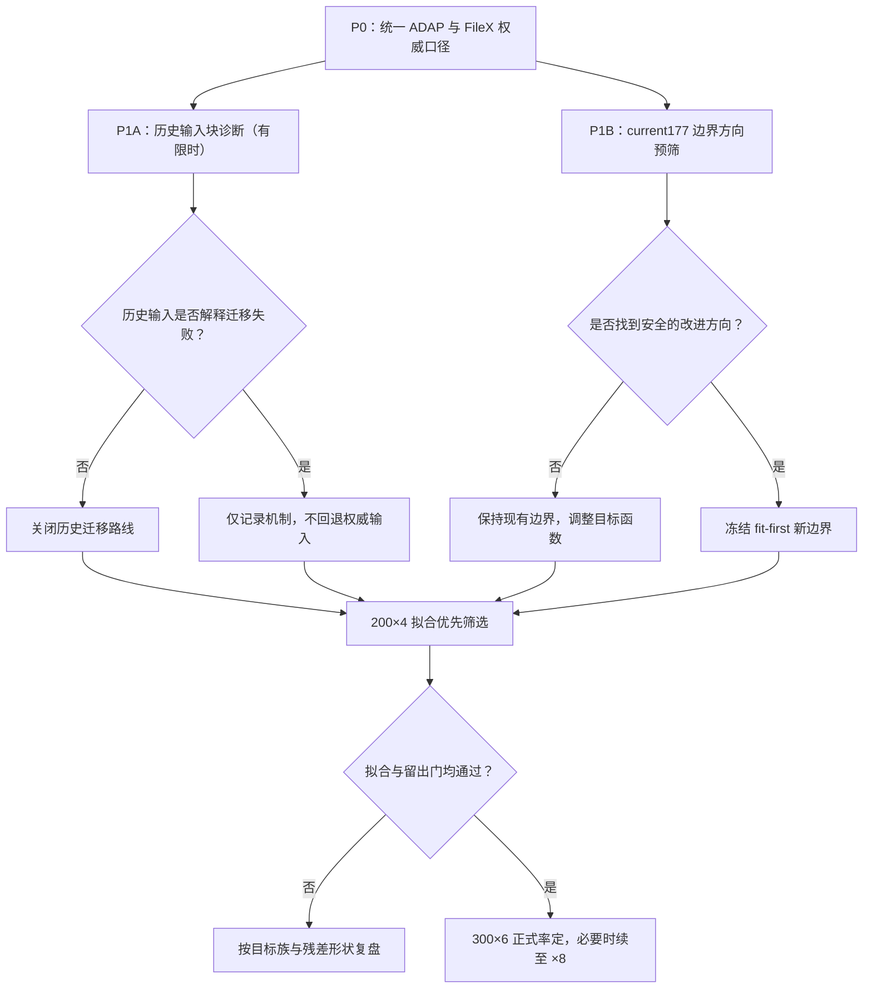

# E02_55 D0/D1/D2 后续率定推进方案

日期：2026-07-28  
目标：在保留当前权威输入和审计链的前提下，尽快改善 25SP 的物候、累计干产量和器官生物量拟合，并保留处理间预测检验。

## 技术摘要

D1/D2 已经否定“直接以历史参数向量启动正式 IES”的路线。D1 的 3384.43 Phi 中，CHPDT 和 HPODW 合计贡献约 2807，占 83%；历史参数在当前输入下几乎不形成有效产量，ADAP 也变成缺失/失败值。D2 只比 D1 降低约 2.5%，不足以证明增加 `FL-LF`、`SD-PM` 和 `SLPF=0.95` 可以恢复历史性能。

下一轮不应继续迁移历史向量，也不应立即启动 300×8。推荐路线为：

1. 先解决 ADAP=21 d 与权威 FileA/不确定性文件不一致的问题，并确认 `PAGE`、`SPRL` 和采收管理。
2. 用少量输入块交换试验解释历史差异，设置明确停止条件，不让历史审计长期阻塞率定。
3. 以 current177 为唯一主锚点，做边界方向和参数块的确定性预筛。
4. 仅采用预筛有效的边界，运行拟合优先 200×4。
5. 通过率定与留出处理门槛后，再扩展到 300×6；只有第 6 轮仍显著下降时才续跑至第 8 轮。

## 1. D0/D1/D2 说明了什么

### 1.1 Phi 变差集中在产量和物候

| 目标 | D0 Phi | D1 Phi | D2 Phi |
|---|---:|---:|---:|
| CHPDT | 4.73 | 2348.43 | 2274.14 |
| HPODW | 10.65 | 458.09 | 448.56 |
| ADAP | 2.50 | 360.00 | 360.00 |
| LWAD + SWAD | 10.67 | 123.28 | 123.23 |
| CHTD | 28.75 | 58.78 | 58.69 |
| SOIL_WATER | 20.14 | 25.95 | 25.94 |
| LAID + LAIX | 0.73 | 9.89 | 9.89 |
| 合计 | 78.16 | 3384.44 | 3300.44 |

D1/D2 不是整体轻微退化，而是物候失败、营养生长不足和产量接近崩塌的组合。用其作为 IES 中心会浪费大量成员。

### 1.2 current177 仍然是下一轮最可靠的起点

按历史拆分复算 D0：

| 指标 | 率定候选 6 处理 | 留出 4 处理 |
|---|---:|---:|
| CHPDT | RRMSE 40.70%，NSE 0.552 | RRMSE 11.93%，NSE 0.948 |
| HPODW | RRMSE 57.28%，NSE -0.526 | RRMSE 59.85%，NSE -1.261 |
| LAID | RRMSE 35.26%，NSE 0.705 | RRMSE 26.09%，NSE 0.859 |
| LWAD | RRMSE 35.11%，NSE 0.677 | RRMSE 33.80%，NSE 0.733 |
| SWAD | RRMSE 31.05%，NSE 0.816 | RRMSE 34.64%，NSE 0.823 |
| CHTD | RRMSE 45.52%，NSE 0.001 | RRMSE 45.77%，NSE 0.033 |
| ADAP | 模拟比 21 d 早 10 d | 同左 |

当前主要提升空间在原 6 个处理；留出 4 个处理的累计干产量已经很好，下一轮必须防止为改善率定处理而破坏该预测表现。

## 2. P0：先关闭数据口径风险

### 2.1 ADAP=21 d 必须进入权威数据链

当前权威 bundle 的 `XXQL2501.TMA` 仍记录：

- `PDAT=25075`
- `ADAT=25112`
- 两者相差 37 d

但 D0/D1/D2 replay 的权重审计使用 `ADAP=21 d`。这表示 21 d 目前是 replay 层调整，尚未回写到 FileA、`observation_uncertainty.csv`、生成日志和 `input_manifest.json`。

下一轮 IES 前必须二选一：

1. 若 21 d 已经获得项目负责人确认，则从源观测或正式更正记录重新生成 FileA、不确定性表、manifest 和 SHA-256；禁止只在 PST 或 replay 目录内覆盖。
2. 若 21 d 尚未获得来源证据，则暂停把它作为正式观测，先确定实际开花日期及 DAP 起算点。

这是下一轮率定唯一的硬阻塞项。

### 2.2 只核查会改变模拟的 FileX 字段

需要负责人或原始试验记录确认：

| 字段 | 历史 | 当前 | 风险 |
|---|---:|---:|---|
| `PAGE` | 25 d | 60 d | 移栽苗龄会改变初始发育状态 |
| `SPRL` | -99 | 3 | 移栽/播种设置可能影响阶段初始化 |
| 采收管理 | 各处理多组 HCOM/HSIZE | 统一 factor 5、byproduct | 可能改变分批采收后的植株状态 |
| `SYMBI` | Y | N | 对非豆科应为 N，但需记录差异 |
| `CHEM` | Y | N | 一般不是产量崩塌主因 |

确认正确后即冻结，不因旧方案拟合好而回退。

### 2.3 当前土壤、初始条件和观测继续作为权威输入

当前土壤剖面有 2025 春土壤工作簿、层映射和匹配审计支持。历史土壤是明显不同的旧剖面，例如表层 `SDUL/SSAT` 约为 0.198/0.294，当前为约 0.30/0.49。历史初始含水量和硝态氮也显著低于当前。

这些差异可以用于解释旧参数为何不能迁移，但不能为了恢复旧结果而替换当前实测输入。

### 2.4 天气不是首要嫌疑

25075–25220 的新旧天气摘要非常接近：

| 变量 | 历史 XXN9 | 当前 XXLI | 差异 |
|---|---:|---:|---:|
| 平均 SRAD | 12.805 | 12.617 | -1.5% |
| 平均 TMAX | 36.027 | 36.167 | +0.14 °C |
| 平均 TMIN | 19.107 | 18.784 | -0.32 °C |
| 累计降雨 | 0 | 0 | 0 |

天气文件保留哈希对比即可，不安排优先交换试验。

## 3. P1A：有停止条件的历史输入块诊断

目的只是解释历史资产，不是恢复旧输入作为正式方案。全部试验使用当前 10 个处理、当前观测和同一指标程序。

建议按顺序运行：

| 编号 | 参数 | 输入变更 | 要回答的问题 |
|---|---|---|---|
| B0 | current177 | 当前权威输入 | 基线 |
| B1 | current177 | 仅替换 `PAGE/SPRL` 为历史值 | 苗龄/移栽设置影响多大 |
| B2 | current177 | 仅替换历史初始 SH2O/N | 初始条件影响多大 |
| B3 | current177 | 仅替换历史土壤剖面 | 旧参数优势是否依赖旧土壤 |
| B4 | current177 | 仅替换历史采收管理 | 分批采收状态是否是主要差异 |
| B5 | legacy54 | 当前输入 + 历史 `PAGE/SPRL` | 能否恢复 ADAP 和结果实 |
| B6 | legacy54 | 当前输入 + 历史未迁移的 genotype/root/N 固定参数 | 54 参数投影是否缺少关键互作 |
| B7 | legacy54 | 完整历史模拟输入，但仍用当前观测评分 | 历史运行链能否被闭环解释 |

每组报告：

- ADAP 是否有效及 DAP；
- 首次结果日期；
- LAI 最大值；
- 末期 LWAD、SWAD；
- CHPDT/HPODW 的 RRMSE、NSE、偏差；
- DSSAT 状态和失败原因。

停止条件：

- 若任何单一输入块不能把 D1 的 CHPDT RRMSE 从约 116% 降至 60% 以下，则不继续组合穷举。
- 若 B7 仍不能把 Phi 降到 500 以下，关闭历史迁移路线，历史文件仅保留为档案。
- 即使某个旧输入能恢复拟合，也只用于解释参数互作；除非有原始实测证据，不进入正式率定输入。

## 4. P1B：围绕 current177 做边界方向预筛

历史向量不再作为整体候选，但历史边界可作为提出测试方向的证据。当前最终集合存在明显边界压力：

| 参数 | 集合近边比例 | 方向 |
|---|---:|---|
| `RHGHT` | 87.0% | 下界 |
| `XFRT` | 75.0% | 上界，物理上界已为 1 |
| `TO11` | 73.5% | 上界 |
| `XFPHT` | 68.5% | 下界 |
| `SDPDV` | 52.0% | 下界 |
| `NMOBMX` | 51.0% | 下界 |
| `FL-SD` | 30.5% | 下界 |
| `TO23` | 26.5% | 下界 |
| `PM09` | 20.0% | 上界 |

不能据此直接放宽。先以 current177 为基准做参数块 OAT/小型设计：

1. 物候块：`PL-EM`、`EM-FL`、`FL-SD`、三组 `TB/TO1/TO2/TM`。
2. 果实节律块：`SFDUR`、`PODUR`、`XMAGE/XFPHT/XFINT`。
3. 源库块：`SDPDV`、`VSSINK`、`PARMAX`、`PHTMAX`、`KCAN`、`LFMAX/SLAREF`、`SIZREF`。
4. 氮胁迫块：`NMOBMX`、`RTNO3/RTNH4`、`NSTFAC/NVSMOB`。
5. 冠高块：`RHGHT/PHTMAX`，只判断能否修正时间形状，不以降低单一 CHTD Phi 为唯一标准。

温度和 `XMAGE/XFPHT` 必须按满足顺序约束的参数块共同变动，不做会产生非法组合的单参数测试。

建议每个参数块测试低、当前、高三个水平，current177 只运行一次。预计 25–40 个候选，即 250–400 次 DSSAT 单处理等价量，远低于一次 200×4。

边界调整准入条件：

- CHPDT RRMSE 相对 D0 改善至少 5 个百分点，或 ADAP 误差改善至少 2 d；
- LAI 最大值不超过 10；
- 无 DSSAT 失败；
- LAID/LWAD/SWAD 任一 RRMSE 不恶化超过 5 个百分点；
- 留出 4 处理 CHPDT NSE 不低于 0.90。

未达到准入条件的边界保持当前值。`XFRT` 已接近物理上界，不再扩张，应通过果实节律、光合和库强参数释放补偿。

## 5. P2：拟合优先 200×4 筛选

运行名建议：`e02_55_fitfirst_screen_200x4_<timestamp>`。

### 5.1 参数和初始集合

- 第一轮保持 55 个活动参数；不因 D2 的 2.5% 改善增加 `FL-LF/SD-PM`。
- 只采用 P1B 通过准入条件的边界调整。
- current177 作为显式成员和中心。
- 初始集合建议：60% 在 current177 周围局部采样，30% 从当前最终集合的低 Phi 四分位成员重采样，10% 覆盖完整边界。
- 不再加入 legacy54/legacy57 显式成员。

### 5.2 拟合优先权重

另建配置，不覆盖当前规范权重：

| 目标族 | 预算 | 家族内分配 |
|---|---:|---|
| PHENO | 0.50 | PDAP/ADAP；MDAP 仍为诊断 |
| CANOPY | 1.00 | LAID 0.60、LAIX 0.20、CHTD 0.20 |
| BIOMASS | 1.50 | LWAD/SWAD 共享 |
| PLANT_N | 1.00 | 有实测才启用 |
| HARVEST_DRY | 4.00 | CHPDT 0.85、HPODW 0.15 |
| SOIL_WATER | 0.50 | 保留但不主导 |

变换：

- CHPDT 使用原尺度，直接优化累计干产量 RMSE/NSE；
- HPODW 保留 `ln(y+1)`，避免噪声较大的单次采收主导；
- 两者继续共享固定的 HARVEST_DRY 家族总预算，观测次数不增加总权重。

### 5.3 IES 设置

- 规模：200×4；
- `ies_no_noise=true`；
- `ies_bad_phi_sigma=2.0`；
- 强制边界；
- 保存每轮最小 Phi 成员、最小 CHPDT RRMSE 成员和最佳留出综合分成员。

### 5.4 处理拆分

- 率定：TN 2、3、5、10、11、13；
- 留出预测：TN 4、9、12、14。

留出处理全程不得进入参数更新，只用于每轮后评价和最终选择。

## 6. P3：进入正式率定的门槛

200×4 同时满足以下条件才进入正式运行：

| 指标 | 率定 6 处理门槛 | 留出 4 处理门槛 |
|---|---:|---:|
| CHPDT | RRMSE ≤ 25%，NSE ≥ 0.80 | RRMSE ≤ 15%，NSE ≥ 0.90 |
| ADAP | 绝对误差 ≤ 3 d | 同左 |
| LAID | RRMSE ≤ 32%，NSE ≥ 0.75 | RRMSE ≤ 32%，NSE ≥ 0.80 |
| LWAD/SWAD | 平均 RRMSE ≤ 32% | 平均 RRMSE ≤ 35% |
| HPODW | RRMSE ≤ 55%，或相对 D0 有明确改善 | 不作为硬阻塞 |
| LAI | 所有候选最大值 ≤ 10 | 同左 |
| 工程稳定性 | DSSAT 成功率 ≥ 95% | 10/10 确定性运行成功 |

若 CHPDT 达标而 CHTD 仍差，不阻塞项目推进；单独记录 CHTD 的结构性形状误差。若 CHPDT 只在率定处理中改善、留出 NSE 低于 0.90，则不进入正式率定，先检查处理特异补偿。

## 7. P4：正式运行采用 300×6，可条件续跑

通过 P3 后运行 300×6，而不是直接承诺 300×8：

- 第 6 轮相对第 5 轮的最佳留出综合分或 CHPDT RRMSE仍改善超过 2%，续跑至第 8 轮；
- 改善不足 2% 或开始损害留出处理，停止在第 6 轮；
- 最终保留两个参数组：
  1. `prediction_selected`：按留出 CHPDT、LAID/LWAD/SWAD 综合表现选择；
  2. `fit_selected`：在选定边界和参数方案后，用全部 10 处理重拟合获得。

两者用途必须分开：前者支撑处理间预测，后者追求当前 25SP 最大拟合。

## 8. 协作者执行顺序与交付物

### 立即执行

1. 统一 ADAP=21 d 的权威数据链并生成新 SHA-256。
2. 核实 `PAGE=60`、`SPRL=3` 和当前采收 factor 5。
3. 生成旧/新输入差异台账，标注“模拟输入”“仅观测”“仅格式”。

### 随后执行

4. 完成 B0–B7 中满足停止规则的输入块诊断。
5. 完成 current177 参数块预筛并生成边界建议表。
6. 冻结新的 `fit_first` bounds、observation policy 和 weight audit。
7. 启动 200×4，按率定/留出双门评价。

### 必须交付

- ADAP 更正来源、FileA/不确定性表/manifest 哈希；
- FileX 关键字段确认记录；
- B0–B7 逐处理指标和停止结论；
- 参数块预筛表、最大 LAI 和失败状态；
- 新 bounds 与逐观测权重审计；
- 200×4 每轮 Phi、原尺度指标、率定/留出指标；
- 是否进入 300×6 的明确判定。

## 9. 当前决策

当前可以确定：

- 不使用 legacy54/legacy57 作为下一轮 IES 中心；
- 不恢复旧土壤、旧初始条件或旧观测作为正式输入；
- 不立即运行 300×8；
- current177 是下一轮唯一主锚点；
- ADAP 权威化完成后，即可开展边界预筛和拟合优先 200×4；
- 历史输入诊断有时间和效果停止条件，不再无限扩展。
