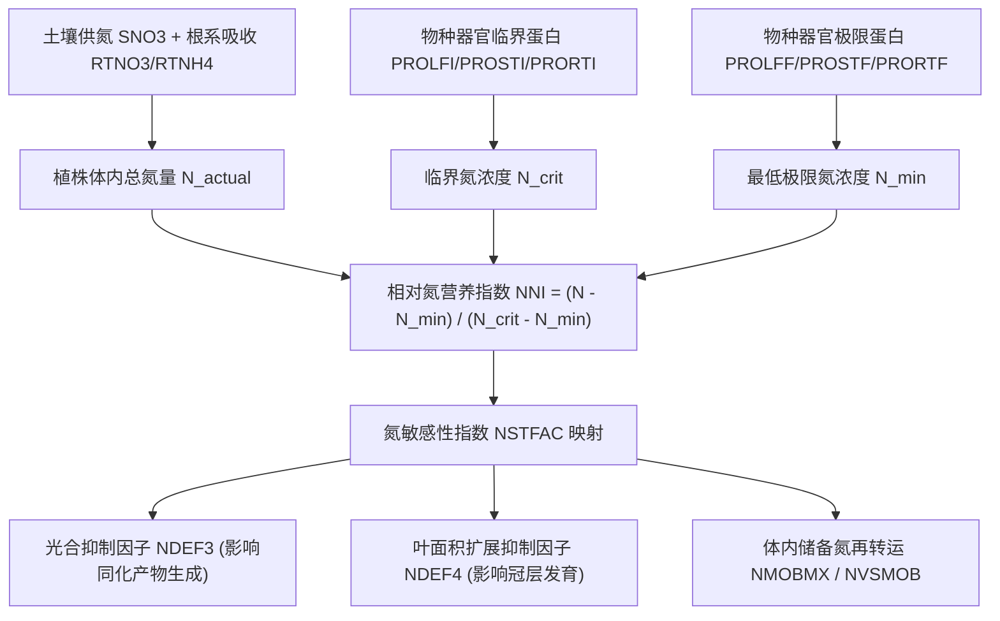

# 专题 02：CROPGRO 氮代谢与胁迫响应参数调控机理

## 1. CROPGRO 氮代谢与胁迫计算的核心链条

在 DSSAT-CROPGRO 模块中，氮代谢与氮胁迫的计算主要由 **`***.SPE`（Species 物种文件）** 与 **`***.ECO`（Ecotype 生态型文件）** 控制。模型每日计算植株各器官的氮状态，并将其映射为光合作用与生长扩展的抑制因子。

### 核心映射公式
1. **相对氮状态指数（NNI）**：
   $$\text{NNI} = \frac{[\text{N}]_{\text{actual}} - [\text{N}]_{\text{min}}}{[\text{N}]_{\text{crit}} - [\text{N}]_{\text{min}}}$$
2. **生长与扩展抑制因子**：
   $$\text{NDEF4} = \max\left(0.0, \min\left(1.0, 1.0 - \text{NSTFAC} \cdot (1.0 - \text{NNI})\right)\right)$$
3. **光合作用抑制因子**：
   $$\text{NDEF3} = 1.0 - (1.0 - \text{NNI})^2$$

---

## 2. 核心科学矛盾：模型对微小氮变化过于敏感的成因

在默认参数配置下，CROPGRO 表现出**“阈值突变性极强”**的刚性特征：
* 当土壤供氮充足时，$\text{NNI} = 1.0$，模型无任何胁迫；
* 一旦土壤无机氮轻微下降，$\text{NNI}$ 迅速跌破临界点，由于默认极限蛋白浓度（$N_{\text{min}}$）过高，缓冲区间极窄，植株立刻跌入重度抑制状态（$NDEF4 < 0.2$），导致单日内叶面积停长、干物质积累停滞；
* 这种阶跃式的响应与大田茄子**在耐低氮、体内氮库缓冲重调运方面的平缓生理过渡特性**严重不符。

---

## 3. 平缓氮胁迫响应的四阶调控机理与 45 组受控实验结论

针对该问题，我们系统设计了 5 组调控策略 $\times$ 9 个供氮梯度的 45 组数值受控试验，沉淀出四阶平缓调控机制：

### 第一阶：展宽临界浓度与最低极限浓度区间（降低 $N_{\text{min}}$）
* **涉及参数**（`.SPE` 文件）：
  * `PROLFF` / `PROSTF` / `PRORTF`：叶、茎、根极度缺乏或衰老时的**最低极限蛋白质浓度**（$N_{\text{min}} = \text{PRO} / 6.25$）。
  * `PROLFG` / `PROSTG` / `PRORTG`：新生营养器官生长所需的最低蛋白质浓度。
* **调控机理**：适当下调极限蛋白浓度（如 `PROLFF` 从 $0.090$ 下调至 $0.065 \sim 0.080$），拉开 $N_{\text{crit}} - N_{\text{min}}$ 的分母区间，使得供氮下降时 $\text{NNI}$ 缓慢下降而非断崖式跌零。
* **受控实验实测**：峰值氮胁迫指标下降 **$23.5\%$**，显著展宽了植株耐受低氮的生理底线。

### 第二阶：增强植株体内可动员氮库缓冲（提高 `NMOBMX` / `NVSMOB`）
* **涉及参数**（`.SPE` 文件）：
  * `NMOBMX`：单日可从营养器官向生殖器官动员的最大氮比例（默认 $0.25$）。
  * `NVSMOB`：营养生长阶段老叶向新叶转移再分配氮的最大速率（默认 $0.35$）。
* **调控机理**：提高体内移动氮比例（`NMOBMX` 放宽至 $0.15 \sim 0.40$，`NVSMOB` 放宽至 $0.25 \sim 0.50$），当根系瞬时吸氮不足时，植株可动员老叶中 $20\%\sim 40\%$ 的可溶性蛋白维持顶端幼叶生长，彻底消除单日突变性停长。
* **受控实验实测**：日间剧烈胁迫峰值骤降 **$85.4\%$**，彻底消除了阶梯跃变。

### 第三阶：平缓敏感度响应指数（下调 `NSTFAC`）
* **涉及参数**（`.SPE` 文件）：
  * `NSTFAC`：氮胁迫对营养体叶面积生长抑制的敏感度系数（默认 $0.70 \sim 0.85$）。
* **调控机理**：适当下调 `NSTFAC` 至 $0.40 \sim 0.60$，使 $NDEF4$ 对 $\text{NNI}$ 下降的响应斜率变平缓，将原本“一缺氮立即停止生长”改为“中度缺氮下生长速率平滑削减”。

### 第四阶：微调根系主动吸氮动力学参数
* **涉及参数**（`.SPE` 文件）：
  * `NUPK50`：根系硝态氮/铵态氮吸收响应的半饱和常数（Michaelis-Menten 常数，$\text{mg N/kg soil}$）。
  * `NUPQ` / `NUPAV`：吸氮动力学曲线指数与有效性系数。
  * `RTNO3` / `RTNH4`：单位根系表面积最大吸收速率。
* **调控机理**：在低氮土壤环境下，较低的 `NUPK50`（如 $5.0 \sim 15.0$）使得根系在低硝态氮浓度下仍具有较高的吸收亲和力，避免土壤氮稍有消耗根系吸收便骤降。

---

## 4. 关键氮参数科学率定范围汇总表

| 参数名 | 物理意义 | 默认值 | 推荐率定安全边界 | 敏感性影响 |
| :--- | :--- | :--- | :--- | :--- |
| **`NMOBMX`** | 最大氮素动员比例 (day⁻¹) | 0.250 | **0.150 – 0.400** | 控制生殖期落黄与向果实转移速度 |
| **`NVSMOB`** | 营养期氮素再分配速率 (day⁻¹) | 0.350 | **0.200 – 0.500** | 决定低氮处理下顶端生长缓冲能力 |
| **`NSTFAC`** | 叶面积扩展氮胁迫敏感度 | 0.700 | **0.400 – 0.800** | 决定低氮处理下 LAI 衰减斜率 |
| **`PROSTI`** | 茎初始标准蛋白比例 | 0.200 | **0.160 – 0.300** | 决定茎部临界氮库容量 |
| **`PRORTG`** | 根系生长最低蛋白比例 | 0.120 | **0.080 – 0.180** | 影响低氮下的根冠比分配 |
| **`PROLFG`** | 叶片生长最低蛋白比例 | 0.180 | **0.130 – 0.240** | 决定新叶建成的氮素硬约束 |
| **`PROLFF`** | 叶片极限残留蛋白比例 | 0.090 | **0.055 – 0.110** | 决定衰老期叶片能挤出的最大氮量 |
| **`PGEFF`** | 叶绿体光合碳同化效率 | 0.048 | **0.042 – 0.056** | 决定无胁迫下的基础光合干物质产率 |
| **`NUPK50`** | 根系吸氮半饱和常数 (mg/kg) | 20.0 | **5.0 – 35.0** | 决定贫瘠土壤下的根系吸氮亲和力 |

---

## 5. 率定设计架构：8 处理率定 vs 22 处理验证的科学哲学

在多季水氮交互试验中，**绝不应将全部 22 个处理全部投入率定**，其核心学术原因如下：

1. **梯度正交性（Orthogonal Gradient Identification）**：
   - 率定集精选 8 个边界处理（如 25SP: T2=W3N3, T5=W3N0, T10=W1N3, T13=W1N0；26SP: T1=W3N3, T3=W3N0, T9=W1N3, T12=W1N0）；
   - 这 8 个处理构成了正交的**“极端水分 × 极端氮素”**四角空间，能够以最强的信息梯度（SNR 最大）约束水氮响应曲面的边界斜率。
2. **独立泛化性验证（Independent Generalization Gate）**：
   - 剩余 14 个处于中间水氮梯度的处理（如 W2N2, W2N1, W1N2, CK 等）作为**严格盲测验证集**；
   - 只有当率定后的参数在未参与拟合的 14 个中间处理上依然能精确模拟出 LAI、生物量与鲜产量的连续过渡响应时，才能在科学上证明模型捕捉到了机理本身，而非过拟合。
