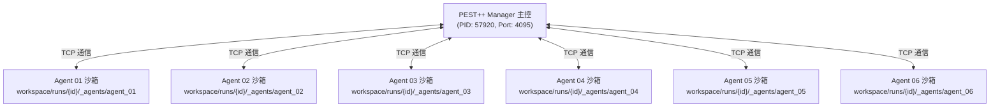

# 专题 03：PEST++ IES 算法调优与大规模并行工程实践

## 1. PEST++ GLM-IES 集合平滑器数学原理

本项目采用 **PEST++ 5.2.16** 中的 **GLM-IES（Gauss-Levenberg-Marquardt Iterative Ensemble Smoother）** 算法。相比于传统的单轨迹梯度下降（Gauss-Newton）或遗传算法（GA），IES 兼具**高维参数联合反演能力**与**后验不确定性量化（UQ）能力**。

### 1.1 核心状态更新方程
在第 $j$ 轮迭代中，参数集合 $\mathbf{P}_j \in \mathbb{R}^{N_{\text{par}} \times N_{\text{reals}}}$ 的更新方程为：

$$\mathbf{p}_{j+1, m} = \mathbf{p}_{j, m} + \mathbf{C}_{pp} \mathbf{H}^T \left( \mathbf{H} \mathbf{C}_{pp} \mathbf{H}^T + \lambda_j \mathbf{W}^{-1} + \mathbf{C}_{dd} \right)^{-1} \left( \mathbf{y}_{\text{obs}} + \mathbf{\epsilon}_m - \mathbf{M}(\mathbf{p}_{j, m}) \right)$$

其中：
* $\mathbf{C}_{pp} \approx \frac{1}{N_{\text{reals}}-1} \mathbf{P}'_j (\mathbf{P}'_j)^T$ 为当前参数集合的经验协方差矩阵；
* $\mathbf{H}$ 为隐式灵敏度矩阵（通过模型输出集合扰动 $\mathbf{Y}'_j$ 与参数扰动 $\mathbf{P}'_j$ 的交叉协方差投影隐式求解）；
* $\lambda_j$ 为 Marquardt 阻尼系数，控制更新步长在牛顿法（$\lambda \to 0$）与最速下降法（$\lambda \to \infty$）之间自适应平滑过渡；
* $\mathbf{\epsilon}_m \sim \mathcal{N}(\mathbf{0}, \mathbf{C}_{dd})$ 为每个样本对应的观测噪声（Observation Noise Ensemble）。

---

## 2. 集合规模与迭代轮次的收敛黄金法则

对于包含 $N_{\text{par}} \approx 114 \sim 158$ 个待定参数的复合生理模型，参数与集合规模的折中原则如下：

| 配置项 | 推荐值 | 理论依据与工程考量 |
| :--- | :--- | :--- |
| **集合样本数（`ies_num_reals`）** | **200** | 提供 $\text{Rank} \approx 199$ 的高维经验子空间，能够充分表征 150 维水氮与遗传参数的后验协方差，防止集合过早塌缩（Ensemble Collapse）。 |
| **最大迭代轮次（`noptmax`）** | **6** | GLM-IES 通常在 3~5 轮内完成 $80\%$ 以上的残差收敛。第 5~6 轮用于阻尼微调，超过 6 轮易诱发非物理过拟合。 |
| **阻尼因子搜索比例** | **20% 子集** | 每轮使用 $N=20$ 个代表性样本测试候选 $\lambda$（如 $0.1, 1.0, 10.0$），显著节约评估成本。 |
| **随机种子（`rand_seed`）** | **固定整数** | 保证参数先验拉丁超立方采样（LHS）与观测噪声采样的严格可复现性。 |

---

## 3. 先验-数据冲突（PDC）与 Windows SVD 崩溃避坑复盘

在实际调优中，若参数配置不当，PEST++ 会在特定平台（尤其是 Windows）发生隐蔽的进程崩溃。

### 3.1 故障机理深度分析
1. **PDC 自动调权机制**：PEST++ 默认开启 `ies_drop_conflicts=True`。当某些观测点（如鲜产）先验与初始模拟偏差超过 $3\sigma$ 时，PEST++ 判定其为“先验-数据冲突”，并在第 1 轮自动将其权重置零或写入 `*.adjusted.weights.csv`。
2. **权重失真与矩阵奇异**：部分观测权重被意外置零后，导致加权残差矩阵的列秩突变；
3. **Windows REDSVD 崩溃**：PEST++ 内部调用 `REDSVD`（随机截断 SVD）进行矩阵分解时，在零方差或非良态矩阵下触发了非法内存访问（`ntdll.dll` 错误代码 `0xc0000374` 或 `0xc0000005`），导致 Manager 主控进程静默退出。

### 3.2 彻底根治的最佳 PST 配置
在 `build_pest.py` 构建阶段，必须显式声明如下硬性安全参数：

```ini
++ies_drop_conflicts(False)
++ies_pdc_sigma_distance(0.0)
++ies_bad_phi_sigma(1e+300)
++ies_no_noise(False)
```

> **注意**：PEST++ 5.2.16 中不存在 `ies_autohold` 选项，若写入会导致主控启动解析错误（`control file parsing error: ++ args not accepted`）。

---

## 4. 沙箱并行架构与高可用运行保障

为确保多 Agent 并行运行时 DSSAT 临时文件完全隔离、互不污染，本项目采用**严格沙箱化（Sandboxed Worker）架构**：



### 4.1 工程守护规范
1. **完全文件隔离**：每个 Agent 拥有独立的 `C:\DSSAT48` 工作区与独立的文件读写句柄，严禁跨目录访问中间临时文件；
2. **动态端口仲裁**：并行管理器自适应从 `4010 ~ 4999` 扫描空闲 TCP 端口，并在 `run_status.json` 中登记主控 PID 与端口；
3. **僵尸进程拦截**：在每次启动新率定或中断异常任务时，通过工具链自动清理残留的 `pestpp-ies.exe` 和 `DSCSM048.EXE` 进程：
   ```powershell
   taskkill /F /IM pestpp-ies.exe
   taskkill /F /IM DSCSM048.EXE
   ```
4. **实时日志穿透**：通过 `panther_agent.stdout.log` 与 `panther_manager.stdout.log` 实时监控各 Agent 的单步执行耗时（正常单次 DSSAT 评估耗时约为 $6 \sim 10$ 秒）。
