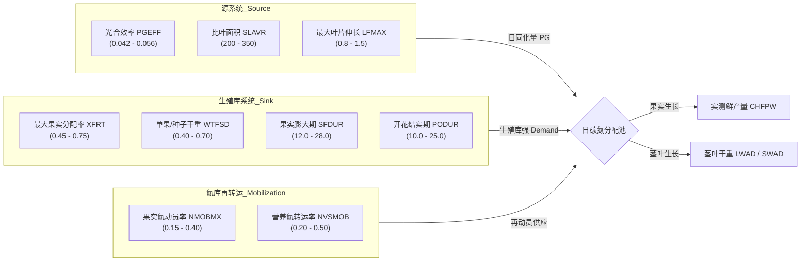

# 专题 04：生殖分配与源库平衡黄金参数域

## 1. 无限生长型茄果类作物的生理建模本质

由于 DSSAT 没有原生的茄子模型，学术界与工业界均采用番茄模型（**TMGRO048**）进行茄子生理模拟。

茄子与大田大豆/玉米等有限生长型作物有着本质的生理差异：
* **无限花序与连续多批次采收**：整个生育期内，植株顶端持续进行分枝、开花与坐果，呈现出多批次（5~10次）连续采收特征；
* **源-库强力动态竞争（Source-Sink Dynamic Competition）**：同化产物每天在营养器官（叶片、主茎）与生殖器官（花、果实）之间进行分配竞争。若果实库容过弱，同化产物全部分配给茎叶，导致“旺长减产”；若果实库容过强而叶面积不足，植株过早早衰。

---

## 2. 决定源库平衡与产量的关键参数族

在 CROPGRO 中，源库分配主要由 `.CUL`（品种参数）与 `.SPE`（物种参数）中的核心参数协同决定：

---

## 3. 为什么单纯调大光合效率（`PGEFF`）不能提高产量？

在早期率定探索中，常见的误区是：“模拟产量偏低，只需将光合效率 `PGEFF` 调高”。

### 生理机制复盘
1. **库限制（Sink-Limited Regime）**：如果品种参数中的果实最大分配比例 `XFRT`（默认约 $0.40 \sim 0.50$）或结实期库容参数偏小，模型内部的日生殖库需求（$\text{DEMAND}_{\text{fruit}}$）达到上限；
2. **碳富余转向营养体**：根据 CROPGRO 分配逻辑，多余的同化产物被强制溢流至茎秆与叶片（导致模拟的茎叶干重出现 $200\%\sim 300\%$ 的严重高估）；
3. **早衰反馈抑制**：过高的营养体生物量使得植株耗水耗氮量剧增，过早耗尽土壤水分与养分，引发严重的后半程水分/氮素胁迫，反而导致后期坐果停滞。

> **黄金法则**：产量的提升必须是 **“源库协同扩张”**。必须在适度放宽 `PGEFF`（$0.045 \sim 0.055$）的同时，显式放宽 `XFRT`（$0.55 \sim 0.72$）与果实膨大持续期 `SFDUR`（$16.0 \sim 25.0$），打通同化产物向采收果实的输送通道。

---

## 4. 后验触边（Edge-Touching）诊断与物理参数域防御体系

在 PEST++ IES 集合迭代中，样本参数的后验分布是否“触边”是评估参数边界合理性的最直观指标。

### 4.1 触边行为的物理诊断法则

| 触边现象 | 生理机理诊断 | 应对策略 |
| :--- | :--- | :--- |
| **`XFRT` 触及上限（如 0.65）** | 优化器极度渴望将同化产物注入果实以满足高产实测值，但当前上限限制了库容表达。 | 确认是否在物理真实区间内（茄果类果实收获指数可达 $0.65 \sim 0.75$），适当放宽上限至 $0.72$。 |
| **`NSTFAC` 触及下限（如 0.40）** | 模型试图通过抹杀氮敏感性来消除低氮处理下的剧烈突变停长。 | 检查是否未激活体内可动员氮库参数（`NMOBMX` / `NVSMOB`）。若已激活体内缓冲，则 `NSTFAC` 会自然回缩至 $0.50 \sim 0.65$ 的生理安全域。 |
| **`PROSTI` 触及上限（如 0.28）** | 植株需要更大的茎部临界氮库来缓冲前期吸氮与后期向果实供氮。 | 允许茎部在生殖前期作为临时氮储备器官，放宽至 $0.30$。 |

### 4.2 四层参数防护架构（Layered Bounds Architecture）

本项目严格杜绝任意随意修改参数边界，所有参数必须遵循以下四层继承与冻结链条：

1. **第一层：物理硬边界（Physical Hard Bounds）**：
   - 存储于 `src/common/param_registry.py:PHYSICAL_BOUNDS`；
   - 保证 DSSAT 内部 Fortran 求解器的绝对数值稳定性（例如 `XFINT` 必须在 $0.12 \sim 0.50$，`FL-VS` 恒定为 $100.0$）。
2. **第二层：基线建议边界（Baseline Bounds）**：
   - 存储于 `data/parameter_registry/baseline/`；
   - 提供番茄/茄子文献公认的标准生理取值范围。
3. **第三层：敏感性提议边界（SA Proposal Bounds）**：
   - 存储于 `data/parameter_registry/bounds_proposals/`；
   - 仅作为敏感性分析过程的临时输出，**严禁被正式率定直接读取**。
4. **第四层：正式冻结参数库（Frozen Calibration Bounds）**：
   - 存储于 `data/parameter_registry/bounds_frozen/{crop}/`；
   - **正式率定唯一允许消费的层级**。必须通过 `tools/freeze_bounds.py` 工具附带完整的 Git Commit、审核说明与 SHA-256 签名冻结入库。
