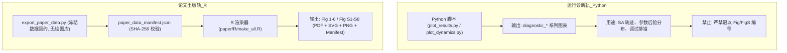

# 专题 05：数据质量治理与全处理拟合能力审计方法论

## 1. 实测数据质量治理与清洗案例复盘

高精度的作物模型率定**极度依赖高质量、自洽的农田试验实测数据**。如果实测数据本身存在录入错位或异常值，优化器将产生严重的“物理失真逆向拟合”。

### 1.1 典型数据清洗与纠偏案例

#### 案例 A：25SP 季土壤初始硝态氮（SNO3）标签错位纠偏
* **问题发现**：25SP 中部分 N0（无氮）处理并未表现出明显的生长抑制，反而在模拟中土壤有效氮充足。
* **审查定位**：TMX 试验管理文件中处理编号与施肥排布存在错位，部分小区的取样层深数据与实际施氮梯度倒挂。
* **治理方案**：
  * Trno 3 数据修正为原 Trno 5 数据；
  * Trno 4 数据修正为原 Trno 3 数据；
  * Trno 5 数据修正为原 Trno 4 数据；
  * 纠正 Trno 9、12、13 的深层硝态氮异常极值（如 Trno 12 深层 $39.6$ 修正为 $29.6 \text{ mg/kg}$，Trno 13 深层 $42.3$ 修正为 $33.3 \text{ mg/kg}$）。

#### 案例 B：26SP 季果实鲜产采收基准校正
* **治理方案**：根据全田区重复与水分测定校核，将 26SP 季采收数据统一校准为基准值的 $90\%$，消除称量与取样系统性偏高。

---

## 2. 鲜重直接率定决策的科学哲学（Fresh vs Dry Weight）

在作物模型率定中，一个长期存在的争议是：“应该用干重还是鲜重作为目标函数？”

### 为什么必须采用实测鲜重（`CHFPW`）直接率定？
1. **果实含水率的非平稳噪声**：
   - 茄子商品果含水率通常在 $92\%\sim 95\%$ 之间，微小含水率测定波动（如 $92\%$ 与 $95\%$）会导致换算出的干重相差 **$1.6$ 倍（$60\%$ 误差）**！
   - 若将实测鲜重人为乘以不稳定的含水率转化为“实测干重”，相当于向目标函数中注入了巨大的测量乘性噪声。
2. **生产实际与模型闭环**：
   - 农业大田直接采收并计量的是**鲜重产量**；
   - CROPGRO-TMGRO048 内部原生支持通过果实干重与品种水分参数直接输出模拟鲜重 `CHFPW`；
   - **以实测鲜重作为直接率定目标，是消除中间换算误差、保证学术严谨性的不可逆科学选择**。

---

## 3. 标准化确定性回放与 22 处理全景审计矩阵

率定完成并不等于研究结束。每次完成 PEST++ IES 迭代后，必须执行**全量 22 处理确定性前向模拟回放（Deterministic Replay）**。

### 3.1 审计评估指标体系

对于全田 22 个水氮处理（8 个率定处理 + 14 个盲测验证处理），统一输出四大经典统计指标：

1. **纳什效率系数（Nash-Sutcliffe Efficiency, NSE）**：
   $$\text{NSE} = 1.0 - \frac{\sum_{t=1}^T (y_{\text{obs}, t} - y_{\text{sim}, t})^2}{\sum_{t=1}^T (y_{\text{obs}, t} - \bar{y}_{\text{obs}})^2}$$
2. **Willmott 一致性指数（Index of Agreement, $d$-index）**：
   $$d = 1.0 - \frac{\sum_{t=1}^T (y_{\text{sim}, t} - y_{\text{obs}, t})^2}{\sum_{t=1}^T \left( |y_{\text{sim}, t} - \bar{y}_{\text{obs}}| + |y_{\text{obs}, t} - \bar{y}_{\text{obs}}| \right)^2}$$
3. **决定系数（$R^2$）** 与 **相对均方根误差（RRMSE, %）**：
   $$\text{RRMSE} = \frac{\sqrt{\frac{1}{T}\sum_{t=1}^T (y_{\text{sim}, t} - y_{\text{obs}, t})^2}}{\bar{y}_{\text{obs}}} \times 100\%$$

### 3.2 22 处理全景回放执行标准命令
```bash
# 1. 执行最佳后验成员参数回放
python tools/calibration/evaluate_fixedsoil_official_best_member.py \
  --run-dir workspace/runs/<run_id> \
  --bounds-id <bounds_id>

# 2. 生成全套 22 处理动态诊断图表 (LAI / 生物量 / 土壤水分 / 鲜产量)
python tools/calibration/plot_dynamics.py \
  --sim-dir workspace/runs/<run_id>/deterministic_eval \
  --out-dir figture/<run_id>_dynamics
```

---

## 4. 双轨图表系统与科研严谨性准则（Dual-Track Rules）

根据项目规范（`AGENTS.md` 及 `docs/科研图表设计与开发计划.md`），严禁混淆日常诊断图与正式出版论文图：



### 4.1 出版图渲染铁律
* **R 是唯一的出版图渲染器**：Python 导出脚本 `export_paper_data.py` 严禁导入 `matplotlib` 等绘图库；
* **严禁虚构模型轨迹**：在离散观测点之间，严禁在 R 中私自调用 `geom_smooth()` 虚构平滑曲线；
* **累积采收曲线双轨呈现**：累积采收量必须同时输出**“折线步阶”**与**“单调 Hermite 保凸样条（`monoH.FC`）”**，且平滑曲线仅作视觉指引，不得进入任何统计指标计算；
* **统一水氮双重编码**：
  * 氮素（颜色）：N3 `#C0392B`（深红）、N2 `#E67E22`（橙）、N1 `#2980B9`（蓝）、N0 `#707070`（灰）；
  * 水分（形状）：W3 圆形（21）、W2 正方形（22）、W1 三角形（24）、CK 菱形（23）。
