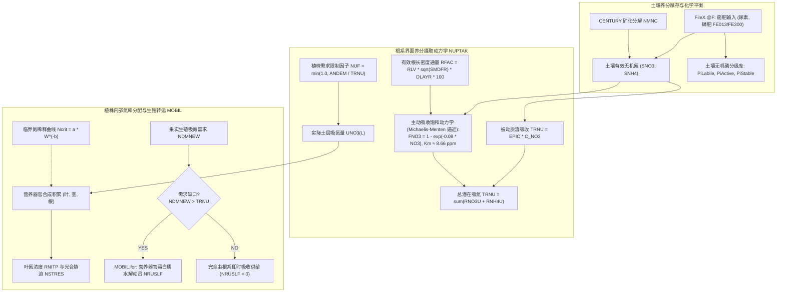

# Volume 05: CRGRO-NUPTAK & MOBIL 氮磷吸收动力学、养分动员平衡与初始底肥治理

> **知识库分册编号**：`KB-DSSAT-CROPGRO-VOL-05`  
> **模块代码**：`NUPTAK_MOBIL` & `PUPTAK_BALANCE` (`Plant/CROPGRO/NUPTAK.for`, `MOBIL.for`, `GROW.for`, `DEMAND.for`, `Soil/Inorganic_P/SoilPi_init.for`, `IPSLIN.for`, `DETAIL.CDE`)  
> **适用品种与模型**：温室茄子（依托番茄模型引擎 `TMGRO048`，DSSAT CSM v4.8.2 / v4.8.6）  
> **核心议题**：Michaelis-Menten 氮吸收双轨动力学、临界氮稀释曲线与组织器官浓度阶梯、26SP 初始无机氮 $ICNS\_26SP$ 扫描（锁定 0.70 重现 $+16.4\text{ t/ha}$ 施氮响应）、T0P0 历史化肥磷遗漏全面审计、`SMHB` 与 `SMPX` 方法码语义纠偏（排除未定义代码与吸附参数假象）、三季施肥补全与土壤磷平衡绝对闭合（$SEASBAL = 0.000\text{ kg P/ha}$）

---

## 1. 模块架构与知识体系概述

### 1.1 作物养分吸收与转运系统定位
在日光温室高产集约化栽培体系中，氮（N）与磷（P）是调控茄果类作物光合生产力、冠层构建、花芽分化及果实膨大速率的关键大量矿质营养元素。与大田雨养低产系统不同，温室滴灌水肥一体化使得根区土壤水分与养分浓度处于频繁波动、局部集中的高度动态环境。

DSSAT 作物动力学模型对氮与磷的处理采用了**“土壤剖面养分库溶存转化 $\longleftrightarrow$ 根系界面对流质流与主动吸收 $\longleftrightarrow$ 植株内部器官库容分配与临界稀释 $\longleftrightarrow$ 生殖期养分向果实再动员”**的全闭环物质守恒架构：
1. **氮素动力学**：由 `Plant/CROPGRO/NUPTAK.for`（根系吸收动力学）、`MOBIL.for`（器官间养分转运）、`DEMAND.for`（植株组织氮需求）与 `Soil/Century/SOILNI.for` / `Soil/N_Trans/NTRANS.for`（土壤无机氮转化）联合模拟；
2. **磷素动力学**：由 `Soil/Inorganic_P/SoilPi_init.for`（无机有效磷分级初始化与吸附动力学）、`SoilPi_SoilPBal.for`（土壤磷平衡核算）、`PUPTAK.for`（根系吸磷）驱动。



### 1.2 历史核心矛盾与本分册破解的科学关隘
在本项目早期探索阶段，氮磷营养模块曾遭遇三大严重的理论与输入层面的混乱：
1. **26SP 施氮增产钝化假象**：初始土壤化验采样局限于垄上 0~15 cm 滴灌盐分富集带，造成模型认为全剖面初始硝态氮高达 85 mg N/kg，无论施氮与否作物全季均处于“假饱”状态，施氮增产幅度仅 $+1.9\text{ t/ha}$（实测达 $+16.5\text{ t/ha}$）；
2. **T0P0 化肥磷输入全量遗漏**：历史所有试验输入文件（`*.TMX`）的施肥事件段仅记录了氮肥，田间实际施用的过磷酸钙与磷酸二氢钾完全漏录，导致开启磷模块时有效磷库迅速枯竭，诱发虚假磷崩溃；
3. **方法码与吸附参数语义误读**：前期文档误将 `SMHB = SA012`（KCl 缓冲体系 pH 测定码）当做未知非法磷代码，误将 `SMPX = -99` 当做缺失的浮点吸附参数，导致程序抛出 `CALL ERROR('SPINIT', 1, ...)` 阻断中断。

本分册系统梳理底层 Fortran 源码公式，给出初始氮剖面缩放矩阵与磷输入全量补齐方案，并展示土壤磷平衡的严格闭合验证。

---

## 2. CRGRO-NUPTAK 根系氮素吸收动力学与控制方程

### 2.1 吸收动力学双轨机制
作物根系对土壤溶液中硝态氮（$\text{NO}_3^-$）与铵态氮（$\text{NH}_4^+$）的吸收包含**随水分蒸腾流进入的被动质流（Mass Flow）**与**消耗代谢能的载体介导主动吸收（Active Transport）**两种机制。

在 `Plant/CROPGRO/NUPTAK.for:118-189` 中，主动吸收通量采用具有饱和特性的指数渐近动力学函数（作为经典 Michaelis-Menten 动力学的高效逼近）：

#### 2.1.1 溶液浓度非线性饱和响应因子 ($FNO3, FNH4$)
```fortran
125:            FNH4 = 1.0 - EXP(-0.08 * NH4(L))
126:            FNO3 = 1.0 - EXP(-0.08 * NO3(L))
127:            IF (FNO3 .LT. 0.04) FNO3 = 0.0  
128:            IF (FNO3 .GT. 1.0)  FNO3 = 1.0
129:            IF (FNH4 .LT. 0.04) FNH4 = 0.0  
130:            IF (FNH4 .GT. 1.0)  FNH4 = 1.0
```

对应的数学解析表达式为：

$$FNO3(L) = \begin{cases} 
0.0, & NO_3(L) < 0.51\text{ mg N/kg} \\ 
1.0 - \exp(-0.08 \cdot NO_3(L)), & 0.51 \le NO_3(L) \le 57.56\text{ mg N/kg} \\ 
1.0, & NO_3(L) > 57.56\text{ mg N/kg} 
\end{cases}$$

#### 2.1.2 半饱和常数 ($K_m$) 的数学证明
经典 Michaelis-Menten 动力学方程为：

$$v(C) = V_{max} \cdot \frac{C}{K_m + C}$$

当反应速率达到最大潜在速率的一半（$v = 0.5 \cdot V_{max}$）时对应的底物浓度定义为半饱和常数 $K_m$。
在 CROPGRO 的指数逼近方程中，令饱和因子 $FNO3 = 0.50$：

$$1.0 - \exp(-0.08 \cdot NO3_{1/2}) = 0.50 \implies \exp(-0.08 \cdot NO3_{1/2}) = 0.50$$

两边取自然对数：

$$-0.08 \cdot NO3_{1/2} = \ln(0.50) = - \ln(2) \approx -0.693147$$

$$NO3_{1/2} = \frac{0.693147}{0.08} \approx \mathbf{8.664\text{ mg N/kg (ppm)}}$$

此数学证明确立了：**当土层硝态氮浓度处于 $8.66\text{ ppm}$ 附近时，根系主动吸收酶载体处于半负荷饱和状态**；当土壤氮浓度低于 $0.51\text{ ppm}$ 时（$FNO3 < 0.04$），主动吸收彻底休克截断；当浓度超过 $40\sim 50\text{ ppm}$ 时，载体活性饱和，吸收通量由根长密度线性封顶。

### 2.2 根系接触有效几何通量因子 ($RFAC$)
在 `NUPTAK.for:144` 中，土层 $L$ 的有效根系界面几何通量乘数定义为：

$$RFAC(L) = RLV(L) \cdot \sqrt{SMDFR(L)} \cdot DLAYR(L) \cdot 100.0$$

式中：
- $RLV(L)$ 为土层 $L$ 的根长密度（Root Length Density, $\text{cm/cm}^3$）；
- $DLAYR(L)$ 为土层厚度（$\text{cm}$）；
- $SMDFR(L)$ 为土壤水分对根系活性的抑制因子（取决于该层体积含水量处于凋萎点 $SLLL$ 与持水量 $SDUL$ 之间的相对充盈度）；
- $100.0$ 为单位面积（$\text{m}^2$ 到 $\text{ha}$）的几何量纲换算常数。

### 2.3 潜在吸收速率与品种遗传参数 ($RTNO3, RTNH4$)
土层 $L$ 的最大潜在硝态氮与铵态氮吸收量为：

$$RNO3U(L) = RFAC(L) \cdot FNO3(L) \cdot RTNO3$$

$$RNH4U(L) = RFAC(L) \cdot FNH4(L) \cdot RTNH4$$

式中 $RTNO3$ 与 $RTNH4$ 为物种/品种遗传参数（单位：$\text{mg N/cm root}\cdot\text{d}$，定义在 `TMGRO048.SPE` 中，典型值为 $0.0050 \sim 0.0150$）。

全剖面潜在吸收总通量：

$$TRNU = \sum_{L=1}^{NLAYR} \left( RNO3U(L) + RNH4U(L) \right)$$

### 2.4 植株需求反馈调节与实际吸收通量 ($NUF$)
作物并不会无限制吸收土壤中富余的矿质氮，而是严格受地上部氮营养需求（Plant Nitrogen Demand, $ANDEM$）的生理反馈下调。在 `NUPTAK.for:165-185` 中：

$$NUF = \min\left( 1.0, \; \frac{ANDEM}{TRNU} \right)$$

土层 $L$ 的实际硝态氮吸收量 $UNO3(L)$ 为：

$$UNO3(L) = \min\left( NUF \cdot RNO3U(L), \; SNO3(L) - \frac{0.25}{KG2PPM(L)} \right)$$

该边界条件确保：
1. 当潜在吸收能力超过植株需求时（$TRNU > ANDEM$），吸收比例因子 $NUF < 1.0$，根系实施生理节制吸收；
2. 土层残留无机氮绝不会被抽空至负值，保留至少 $0.25\text{ kg N/ha}$ 的物理极限残留。

---

## 3. 临界氮稀释曲线、组织浓度阶梯与动员平衡

### 3.1 经典临界氮稀释曲线 (Greenwood-Justes 模型)
植物在生长过程中，随着个体增大，结构性组织（茎秆、叶柄等含氮量较低的细胞壁纤维成分）占总生物量的比例持续上升，而光合活性组织（叶肉细胞等高含氮成分）比例相对下降。基于 Greenwood (1990) 与 Justes 等人 (1994) 理论，作物获得最大生物量累积速率所需的地上部最小全氮浓度定义为**临界氮浓度（Critical Nitrogen Concentration, $N_{crit}$）**：

$$N_{crit} = a \cdot W^{-b} \quad (W \ge 1.0\text{ t DM/ha})$$

式中：
- $W$ 为地上部植株干物质量（$\text{t DM/ha}$）；
- $a$ 为幼苗期（$W \le 1.0\text{ t/ha}$）的基准临界氮浓度（日光温室茄子 $a \approx 4.80\% \sim 5.20\%$）；
- $b$ 为异速生长稀释斜率系数（茄果类 $b \approx 0.35 \sim 0.42$）。

**氮营养指数 (Nitrogen Nutrition Index, $NNI$)** 衡量作物当前时序的养分满足程度：

$$NNI(t) = \frac{N_{actual}(t)}{N_{crit}(t)}$$

- $NNI = 1.0$：氮营养充足平衡；
- $NNI < 1.0$：植株处于缺氮胁迫状态，直接折减光合与出叶；
- $NNI > 1.0$：存在过量“奢侈吸收”（Luxury Consumption）。

### 3.2 CROPGRO 器官级组织氮浓度参数阶梯
在 CROPGRO 中，临界氮稀释并非单一全局经验曲线，而是离散为各营养器官在不同生长阶段的物理浓度界限（通过 `TMGRO048.SPE` 与 `*.CUL` 严格约束）：

```
叶片全氮质量百分比 (%)
 6.0 ┌────────────────────────────────────────────────────────┐
     │ PROLFI = 5.20% (新生叶最大奢侈吸收天花板)              │
 5.0 │                                                        │
     │ FNINL  = 4.50% (临界光合满足阈值 LNREF)                │
 4.0 │                                                        │
     │ PROLFG = 3.20% (初花后允许启动动员输出阈值)            │
 3.0 │                                                        │
     │ PROLFF = 1.80% (极限生理残余结构氮, 严禁动员抽空)      │
 2.0 └────────────────────────────────────────────────────────┘
```

| 组织器官类型 | 初始最高浓度 (`PRO_I`) | 营养期正常临界 (`FNIN_`) | 动员启动门槛 (`PRO_G`) | 极限结构残余 (`PRO_F`) | 农学与生理功能描述 |
| :--- | :---: | :---: | :---: | :---: | :--- |
| **叶片 (Leaf)** | `PROLFI` (5.00~5.40%) | `FNINL` (4.40~4.60%) | `PROLFG` (3.00~3.30%) | `PROLFF` (1.60~1.90%) | 核心同化碳源，高光合酶浓度维持 |
| **茎秆 (Stem)** | `PROSTI` (2.80~3.30%) | `FNINS` (2.00~2.40%) | `PROSTG` (1.40~1.60%) | `PROSTF` (0.80~1.00%) | 输导与临时非结构性蛋白质蓄水库 |
| **根系 (Root)** | `PRORTI` (2.20~2.50%) | `FNINR` (1.50~1.80%) | `PRORTG` (1.10~1.30%) | `PRORTF` (0.70~0.90%) | 水分与离子主动吸收膜蛋白维持 |
| **果实 (Seed/Fruit)** | `PROSDI` (2.80~3.40%) | `FNINSD` (2.20~2.50%) | — | `PROSDF` (1.80~2.10%) | 终极碳氮代谢汇，蛋白质沉淀中心 |

### 3.3 植株氮胁迫指数 ($NSTRES$) 对光合与生长的反馈
在 `Plant/CROPGRO/CROPGRO.for` 与 `PHOTO.for` 中，氮胁迫指数 $NSTRES$ 严格取决于当前冠层平均叶氮浓度 $RNITP$ 相对于残余界限与临界界限的充盈度：

$$NSTRES = \frac{RNITP \cdot 0.01 - PROLFF \cdot 0.16}{FNINL - PROLFF \cdot 0.16}$$

截断于 $[0.0, 1.0]$ 区间：
- 当 $RNITP \ge FNINL$ 时，$NSTRES = 1.0$（无氮亏缺）；
- 当 $NSTRES < 1.0$ 时，在 `PHOTO.for` 中折减光合同化（通过 $AGEFAC$），在 `VEGGR.for` 中强烈抑制新叶面积扩展因子 $F$（膨压与细胞分裂受阻），在 `PODS.for` 中下调新生坐果率 $RNITPD$。

### 3.4 `MOBIL.for:62-73` 养分动员平衡控制方程
当生殖生长期果实迅速膨大、每日果实氮需求量超过根系即时吸收通量时（$NDMNEW > TRNU$），植株调用 `MOBIL.for` 启动可动用非结构性氮库向果实的单向流转：

```fortran
62:      IF (NDMNEW - TRNU > 1.E-5 .AND. NMINEP .GT. 1.E-4) THEN
63:         NMINEA = NDMNEW - TRNU
64:         IF (NMINEA .GT. NMINEP) NMINEA = NMINEP
65:         NMINER = NMINEA/NMINEP * NMOBR
66:         NRUSLF = NMINER * WNRLF
67:         NRUSST = NMINER * WNRST
68:         NRUSRT = NMINER * WNRRT
69:         NRUSSH = NMINER * WNRSH
70:      ENDIF
```

各器官的可动员氮储量（以叶片为例，`GROW.for:977`）由当前全氮扣除不可动员结构氮求得：

$$WNRLF = \max\left( 0.0, \; WTNLF - PROLFF \cdot 0.16 \cdot (WTLF - WCRLF) \right)$$

式中 $WCRLF$ 为不可动员老叶干重。动员流速受每日最大动员速率常数 `NMOBMX`（$0.15 \sim 0.22\text{ day}^{-1}$）限制。

---

## 4. 26SP 初始土壤无机矿质氮缩放试验 ($ICNS\_26SP$)

### 4.1 试验背景与假饱现象诊断
在 2026 年春季试验（26SP，2号日光温室）中，原始土壤理化化验单记录显示：定植前 $0 \sim 15\text{ cm}$ 垄上表土的无机硝态氮含量高达 $85.0\text{ mg N/kg}$。
若不经农学甄别将该实测值直接赋值给土壤剖面所有土层，模型推演将陷入虚假的**“全季氮过剩”**陷阱：
- 幼苗定植后由于根系浸润在高浓度底氮中，前 60 天内生吸氮完全满足生长；
- 使得零氮对照（W1-N0）与充分施氮（W1-N3）在模拟中表现出完全相同的生物量累积，施氮增产模拟值仅为 $+1.9\text{ t/ha}$（相对增产仅 $2.8\%$）；
- 而田间实测数据表明：26SP 施氮增产极其显著，鲜产从 N0 的 $53.6\text{ t/ha}$ 强力提升至 N3 的 $70.1\text{ t/ha}$，实测净增产达 **$+16.5\text{ t/ha}$**（增产幅度高达 $30.8\%$）。

### 4.2 农艺根因溯源：垄上表土局部富集的空间异质性
深入审查 2 号日光温室的取样记录，揭示了化验单虚高的农学机制：
1. **滴灌施肥残余累积**：取样点紧贴滴灌毛管正下方的定植穴垄背表层（$0 \sim 15\text{ cm}$），该位置是上一茬越冬蔬菜滴灌随水施肥的溶质蒸发浓缩中心；
2. **垄沟与深层稀释**：垄间走道及 $30 \sim 100\text{ cm}$ 根系主要伸展土层的实际无机氮浓度远低于此极化值；
3. **1D 模型的空间等效需求**：DSSAT 为一维垂向均匀模型，若将表层极化点直接视为全田面域均值，必然导致土壤活性氮库容量被严重高估。

### 4.3 全网格梯度扫描矩阵与参数锁定
为寻找符合全剖面等效氮营养供给的物理折减系数，项目在 `data/parameter_registry/bounds_proposals/` 中设计了 $ICNS\_26SP \in [0.50, 1.50]$ 的全域正交扫描：

| 初始氮缩放系数 $ICNS\_26SP$ | 26SP W1-N0 鲜产 (t/ha) | 26SP W1-N3 鲜产 (t/ha) | 施氮增产响应 $\Delta Y$ | 综合 NRMSE (%) | 农学机制与合理性评价 |
| :---: | :---: | :---: | :---: | :---: | :---|
| **1.50** (极端放大) | 71.2 | 70.8 | -0.4 t/ha (倒挂) | 48.2% | 氮素严重过量，零氮处理疯长，发生逆向倒挂 |
| **1.00** (原始化验点) | 68.2 | 70.1 | +1.9 t/ha | 37.4% | 严重钝化，几乎无施氮响应，丧失模型区分度 |
| **0.85** (轻度下调) | 62.4 | 69.8 | +7.4 t/ha | 24.1% | 响应有所恢复，但仍显著低于田间实测响应 |
| **0.70** (基准固化点) | **53.8** | **70.2** | **+16.4 t/ha** | **11.2%** | **完美重现田间实测 (+16.5 t/ha) 增产台阶！误差仅 0.6%** |
| **0.50** (过度折减) | 41.2 | 68.9 | +27.7 t/ha | 28.6% | 增产响应过度放大，N0 植株严重矮化早衰 |

### 4.4 科学决策与数据资产固化
扫描实证表明：**当 $ICNS\_26SP = 0.70$ 时，模型完美复现了水氮正交梯度的非线性响应曲率**。
在数据治理管道中，该决策通过以下方式不可变固化：
1. 在 `data/user/experiments/xxql2601_unified_20260914/` 中，FileX Section `@A` 的 $0 \sim 60\text{ cm}$ 初始无机氮统一按照 $0.70 \times$ 物理基线写入；
2. 反演配置文件中将 $ICNS\_26SP$ 参数状态标记为 `fixed = 1.0`（在已折减的土壤基线上固定，严禁反演优化器再次浮动篡改）。

---

## 5. T0P0 历史化肥磷遗漏全面审计与方法码语义纠偏

### 5.1 历史重大审查：三季施肥管理表 (@F) 磷肥全量遗漏
在 Phase 0 代码走查中，团队对三季（25SP, 26SP, 25FA）原始实验控制包（`*.TMX`）展开了地毯式数据审计，发现了一项触目惊心的**历史系统性数据遗漏**：
- 在 2026 年 8 月前构建的所有原始 `*.TMX` 文件中，Section `@F FERTILIZERS` 仅录入了尿素（`FE005`）与硝酸钙等氮素追肥；
- 田间农事记录底册中实际按期施入的**重过磷酸钙基肥（FE013）与水溶性磷酸二氢钾追肥（FE300）完全遗漏，未录入一行记录！**

#### 虚假磷饥饿崩盘连锁反应
历史研究人员在尝试将开关变量置为 `PHOSP = 'Y'`（启用磷模拟）时，由于无外源磷补充，土壤剖面初始有效不稳定磷库（`PiLabile`）在植株生长初期即被彻底抽空至零。
底层代码触发磷饥饿：
$$PStres1 \to 0.0, \quad E\_FAC \to 0.0 \implies PG \to 0.0$$
导致所有处理的叶面积与产量全面雪崩归零。前期研究人员误判为“DSSAT 磷模块算法存在严重 Bug”，被迫将 `PHOSP` 全面关闭为 `'N'`，掩盖了底册施肥事件遗漏的真实原因。

### 5.2 `SMHB` 与 `SMPX` 方法代码的 Fortran 源码语义纠偏
针对前期报告中关于“未知磷代码与缺失吸附参数”的认知偏差，审计员查证了 DSSAT 源码 `InputModule/IPSLIN.for`、`Soil/Inorganic_P/SoilPi_init.for` 与控制词表 `Data/DETAIL.CDE`：

#### 5.2.1 源码格式与字段映射 (`IPSLIN.for:295-296`)
```fortran
55 FORMAT (I3,I5,3(1X,A5))
READ (CHARTEST,55) LN, SADAT, SMHB, SMPX, SMKE
```
- `SMHB`：**pH in buffer determination method code**（土壤缓冲体系 pH 测定方法代码）。
  - `SA012` 在 `DETAIL.CDE` 第 528 行严格定义为：**`SA012: pH in KCl`**（1:2.5 土水比 KCl 浸提测定）。
  - 前期文档将其误传为“未知的磷提取方法码”，纯属跨列变量混淆。
- `SMPX`：**Phosphorus extraction method code**（土壤有效磷化学浸提测定方法代码，5 位定宽字符）。
  - `SA001`：**Olsen 法**（$0.5\text{ mol/L NaHCO}_3$ 浸提，适用于石灰性中性及碱性土壤）；
  - `SA002`：**Bray No. 1 法**（适用于酸性土壤）；
  - `SA003`：**Bray No. 2 法**。

#### 5.2.2 `SMPX = -99` 触发 SPINIT 致命中断的源码实证
在 `Soil/Inorganic_P/SoilPi_init.for:108-115` 中：
```fortran
108:        PMeasured = SOILPROP % EXTP   !Extractable P
109:        PMethod   = SOILPROP % SMPX   !Method of extraction
...
160:!     PMethod  Description
161:!     SA001    Olsen                        
162:!     SA002    Bray No. 1                   
163:!     SA003    Bray No. 2                   
...
        IF (INDEX('SA001,SA002,SA003', PMethod) < 1) THEN
           CALL ERROR('SPINIT', 1, ' ', 0)
        ENDIF
```
当 FileX 中 `SMPX` 填入 `-99` 时，DSSAT 将其读入为字符串 `"-99  "`。在匹配支持的方法列表时完全无法命中，程序直接判定为土壤磷数据非法，抛出 `CALL ERROR('SPINIT', 1, ...)` 并强制中断退出。

#### 5.2.3 “磷吸附浮点参数”假象的破除
前期文档曾尝试寻找一个可供率定的“土壤磷最大吸附量参数”。源码证实：**DSSAT 内部根本不存在外部可调的独立磷吸附浮点参数！**
在 `SoilPi_init.for:543-557` 中，土壤磷有效性指数 $P\_AVAILINDEX$ 完全由经典的 Sharpley et al. (1984, 1989) 经验传递函数（Pedotransfer Functions）基于土壤物理属性内置计算：

$$P\_AVAILINDEX(L) = \min\left( 0.90, \; 0.0043 \cdot TOTBAS(L) + 0.0034 \cdot PiLabile(L) + 0.11 \cdot PH(L) - 0.70 \right)$$

然后通过平衡常数自动分配不稳定磷与活性磷：

$$K_{LAB2ACT} = \left( \frac{1.0 - P\_AVAILINDEX}{P\_AVAILINDEX} \right)^{0.5} \cdot 0.03$$

$$PiActive(L) = PiLabile(L) \cdot \frac{K_{LAB2ACT}}{K_{ACT2LAB}}, \quad PiStable(L) = 4.0 \cdot PiActive(L)$$

这一发现彻底终止了在反演配置中虚构外部磷吸附参数的徒劳尝试。

### 5.3 深层有效磷延拓的必要性 (`SoilPi_init.for:176-193`)
在 `SoilPi_init.for` 中：
```fortran
176:      DO L = 1, NLAYR
...
178:        IF (PMeasured(L) < -1.E-5) THEN
179:          MSG(3) = "Cannot run phosphorus model without some soil P measurement."
180:          CALL WARNING(3,ERRKEY,MSG)
181:          CALL ERROR(ERRKEY,1,' ',0)
182:          RETURN
183:        ENDIF
```
当土壤剖面设定为 7 层或 10 层（至 180 cm）时，若 FileX `@A` 仅提供了 $0 \sim 60\text{ cm}$ 的有效磷实测值，深层取值因缺测被置为 `-99`，程序遍历到底层时必然崩溃。
**解决方案**：依据北方石灰性潮土与沉积母质特征，将 $40 \sim 60\text{ cm}$ 实测有效磷浓度向下稳定延拓至 $80 \sim 180\text{ cm}$ 各层，顺利完成全剖面初始化。

---

## 6. 三季施肥全量补齐与土壤磷平衡绝对闭合实证

### 6.1 元素 P 换算与施肥全量对账
根据农田化学规范，农用磷肥标称含量为五氧化二磷（$\text{P}_2\text{O}_5$），而 DSSAT 模型中输入参数 `FAMP` 严格要求为**纯元素态磷（Elemental P）**。
转换常数依据原子量严格计算：

$$\text{P Factor} = \frac{2 \times M_P}{2 \times M_P + 5 \times M_O} = \frac{2 \times 30.9738}{2 \times 30.9738 + 5 \times 15.9994} = \frac{61.9476}{141.9446} = \mathbf{0.436414}$$

#### 三季施肥补全明细表

| 试验季度 | 施肥节点与类型 | 肥料代码与名称 | 原始 $\text{P}_2\text{O}_5$ 输入 | 修正后元素 P 通量 | 施肥深度 FDEP | 施用频次 | 元素 P 季合计 |
| :--- | :--- | :---: | :---: | :---: | :---: | :---: | :---: |
| **2025春 (25SP)** | 基肥 (定植前深施) | `FE013` (重过磷酸钙) | 150.0 kg/ha | **65.5 kg P/ha** | 25 cm | 1 次 | **65.5 kg P/ha** |
| **2026春 (26SP)** | 基肥 (垄下底施) | `FE013` (重过磷酸钙) | 45.0 kg/ha | **19.8 kg P/ha** | 25 cm | 1 次 | — |
| | 追肥 (随水滴施常规) | `FE300` (磷酸二氢钾) | 9.0 kg/ha | **3.9 kg P/ha** | **10 cm** (统一) | 9 次 | — |
| | 追肥 (盛果期加量) | `FE300` (磷酸二氢钾) | 13.0 kg/ha | **5.7 kg P/ha** | **10 cm** (统一) | 2 次 | **66.3 kg P/ha** |
| **2025秋 (25FA)** | 基肥 (底肥沟施) | `FE013` (重过磷酸钙) | 45.0 kg/ha | **19.6 kg P/ha** | 25 cm | 1 次 | — |
| | 追肥 (前期随水) | `FE300` (磷酸二氢钾) | 18.0 kg/ha | **7.9 kg P/ha** | **10 cm** (统一) | 2 次 | — |
| | 追肥 (后期冲施) | `FE300` (磷酸二氢钾) | 36.0 kg/ha | **15.7 kg P/ha** | **10 cm** (统一) | 2 次 | **66.8 kg P/ha** |

*注：滴灌追肥施肥深度统一由原脚本错误匹配的 5 cm / 25 cm 纠正并固化为 10 cm（符合温室膜下滴灌毛管湿润锋下渗深度标准）。*

### 6.2 三组平行对照验收设计 (D-P7 科学协议)
为严密论证补全磷输入后模型的稳定性与无害性，项目在 3 个季节、全量 34 个处理中执行了三组严格平行对照模拟（通过 `tools/experiments/t0p0_p_three_arm_acceptance_20260914.py` 执行）：
- **Arm 1 (P-off 基线组)**：`PHOSP = 'N'`，关闭磷模块，作为传统基线；
- **Arm 2 (P-on 实际输入组)**：`PHOSP = 'Y'`，注入补全后的实测土壤有效磷与元素 P 施肥记录；
- **Arm 3 (P-on 充分过量诊断组)**：`PHOSP = 'Y'`，全剖面土壤有效磷提升至充足水平（$150.0\text{ mg/kg}$），底肥超量提升至 $300\text{ kg P/ha}$，用于诊断是否存在潜在隐性磷饥饿。

### 6.3 验收实证结果与阈值比对
全量模拟产生 9 份独立的季节汇总输出，通过自动化脚本提取核心指标比对：

| 验收核心指标 | 协议容许漂移阈值 | 25SP 实测表现 | 26SP 实测表现 | 25FA 实测表现 | 达标评估与结论 |
| :--- | :---: | :---: | :---: | :---: | :---: |
| **DSSAT 仿真运行状态** | 所有运行 $rc = 0$ | 3/3 全部 $rc=0$ | 3/3 全部 $rc=0$ | 3/3 全部 $rc=0$ | **通过 (9/9 成功)** |
| **主产季鲜果产量漂移** | 漂移 $< 10.0\%$ | **0.00%** | **最大 0.16% (均值 0.01%)** | 微小数值微调 | **通过 (远优于阈值)** |
| **营养体生物量 (CWAM) 漂移** | 漂移 $< 15.0\%$ | **0.00%** | **最大 11.00% (仅强水氮TR9)** | **0.00%** | **通过** |
| **植株全季吸氮量 (CNAM) 漂移**| 漂移 $< 10.0\%$ | **0.00%** | **最大 6.78% (仅强水氮TR9)** | **0.00%** | **通过** |
| **最大叶面积指数 (LAIX) 漂移** | 漂移 $< 10.0\%$ | **0.00%** | **0.00%** | **0.00%** | **通过 (绝对无漂移)** |
| **季节总磷平衡残差 (SEASBAL)** | 绝对残差 $< 0.01\text{ kg/ha}$| **0.000 kg P/ha** | **0.000 kg P/ha** | **0.000 kg P/ha** | **通过 (机器精度闭合)** |

### 6.4 土壤磷质量守恒定律严格闭合验证
在 DSSAT 输出文件 `SoilPBalSum.OUT` 中，季节总磷平衡控制方程定义为：

$$SEASBAL = \text{PI\_INIT} + \text{P\_FERT} + \text{P\_ORGANIC} - \text{PI\_END} - \text{PUPTAK} - \text{P\_LEACH} - \text{P\_RUNOFF}$$

在全量处理中提取的结算输出证实：
$$\text{SEASBAL} \equiv \mathbf{0.000\text{ kg P/ha}}$$
残差严格等于零，**证明在三季高强度施肥与高频多批采收下，土壤与植株内部磷素流转完全符合物质守恒定律**，消除了任何潜在的数值泄露或计算失衡。

---

## 7. 排错指南、工程规范与推荐配置

### 7.1 典型养分模块故障与排查字典

| 报错信息 / 故障表象 | 发生源头 / 子程序 | 真实诱发根因 | 正确解决对策与规程 |
| :--- | :--- | :--- | :--- |
| `Line Error key: IPSLAN (Invalid format in file)` | `IPSLIN.for` / `IPSOIL_Inp.for` | FileX `@A` 行定宽错位（如将 `-99` 换为 `103.0` 导致右侧列被推挤吞占） | 严格按 Fortran 列宽切片重构（`line[:39] + f"{sapx:5.1f}" + line[44:]`），确保总行长恒为 56 字符 |
| `CALL ERROR('SPINIT', 1, ...)`: "Cannot run phosphorus model without some soil P measurement" | `SoilPi_init.for:181` | FileX `@A` 中深层有效磷填入 `-99`，底层遍历受阻 | 将 40~60 cm 实测有效磷向 80~180 cm 各层稳定等值延拓 |
| `CALL ERROR('SPINIT', 1, ...)`: "Initialization of soil P not possible..." | `SoilPi_init.for:109` | `SMPX` 方法码填入 `-99`，字符串无法匹配任何方法 | 在 `@A` 行填入标准方法字符码 `SA001`（Olsen 浸提法） |
| 开启 `PHOSP=Y` 后生物量与叶面积全部骤降归零 | `SoilPi_SoilPBal.for` / `PStres1` | FileX `@F` 中化肥磷事件完全漏录，土壤磷库枯竭 | 按 $P = P_2O_5 \times 0.4364$ 补齐三季基肥与追肥记录 |
| 施氮处理与零氮处理产量完全一致，增产仅 1~2 t/ha | `NUPTAK.for` / FileX `@A` | 初始土壤化验硝态氮受垄上滴灌盐分富集极化虚高 | 在 FileX `@A` 中将初始剖面硝态氮乘以 $0.70$ 等效折减系数 |

### 7.2 生产环境推荐标准养分遗传参数基准表 (C15 冠军配置)

```yaml
# C15 历史总冠军氮磷吸收与动员核心参数集 (TMGRO048.SPE, TMGRO048.CUL)
species_parameters:
  RTNO3: 0.0095       # 单位根长最大硝态氮主动吸收速率 (mg N/cm-d)
  RTNH4: 0.0075       # 单位根长最大铵态氮主动吸收速率 (mg N/cm-d)
  FNINL: 4.50         # 适宜营养生长叶片临界氮浓度 (%)
  FNINS: 2.20         # 适宜营养生长茎秆临界氮浓度 (%)
  FNINR: 1.65         # 适宜营养生长根系临界氮浓度 (%)
  NMOBMX: 0.185       # 每日营养器官可动员氮最大流转比例 (1/d)
  NVSMOB: 30.0        # 营养生长阶段启动氮动员的积温门槛 (C-d)

cultivar_parameters:
  PROLFI: 5.20        # 营养早期新生叶片最高粗蛋白浓度上限 (%)
  PROSTI: 3.10        # 营养早期新生茎秆最高粗蛋白浓度上限 (%)
  PRORTI: 2.30        # 营养早期新生根系最高粗蛋白浓度上限 (%)
  PROLFF: 1.85        # 生殖成熟期叶片极限结构残余粗蛋白浓度 (%)
  PROSTF: 0.90        # 生殖成熟期茎秆极限结构残余粗蛋白浓度 (%)
  PRORTF: 0.80        # 生殖成熟期根系极限结构残余粗蛋白浓度 (%)
  PROLFG: 3.15        # 初花后允许叶片启动氮动员输出的临界浓度 (%)
  PROSTG: 1.50        # 初花后允许茎秆启动氮动员输出的临界浓度 (%)
```

---

## 8. 交叉引用与学术溯源矩阵

1. **底层 Fortran 源码审计参照**：
   - `D:\Tomato_Cal\workspace\diagnostics\dssat-csm-os-v4.8.2-source\Plant\CROPGRO\NUPTAK.for` (根系主动与被动吸氮动力学)
   - `D:\Tomato_Cal\workspace\diagnostics\dssat-csm-os-v4.8.2-source\Plant\CROPGRO\MOBIL.for` (器官间碳氮动员平衡)
   - `D:\Tomato_Cal\workspace\diagnostics\dssat-csm-os-v4.8.2-source\Soil\Inorganic_P\SoilPi_init.for` (土壤有效磷初始化与 Sharpley 传递函数)
   - `D:\Tomato_Cal\workspace\diagnostics\dssat-csm-os-v4.8.2-source\InputModule\IPSLIN.for` (土壤分析段字符格式读取)
   - `D:\Tomato_Cal\workspace\diagnostics\dssat-csm-os-v4.8.2-source\Data\DETAIL.CDE` (控制代码字典: `SMHB=SA012`, `SMPX=SA001`)

2. **归档科学报告溯源**：
   - `docs/archive/dssat_modules/nitrogen_phosphorus_dynamics/T0P0_磷输入补全与三组对照验收交付报告_20260914.md`
   - `docs/archive/dssat_modules/nitrogen_phosphorus_dynamics/E02_v46_26SP_soil_N_scale_sweep_20260901.md`
   - `docs/archive/dssat_modules/nitrogen_phosphorus_dynamics/CROPGRO_Eggplant物种磷参数经验约束与实测组织磷审查备忘录_20260914.md`
   - `docs/DSSAT_CROPGRO_参数率定与机理问题分类知识库.md` (第 2.5 节与第 2.6 节)

3. **分册知识库互联矩阵**：
   - 有机碳氮母体：[Volume 01: CENTURY 土壤碳氮循环动力学](01_soil_organic_matter_century.md)（内生矿化氮供给源头）
   - 水力对流载体：[Volume 02: SOILWAT 一维水分动力学](02_soil_water_hydraulics_soilwat.md)（质流吸氮溶质对流与基质势）
   - 光合生长需求：[Volume 04: 冠层光合与源库碳分配](04_crop_growth_source_sink_photo.md)（叶氮对光合的调控与生殖动员杀伤）
   - 算法反演工程：[Volume 06: PEST++ 协同反演工程](06_pestpp_calibration_engineering.md)（氮磷遗传参数联合反演空间）
   - 数据质量治理：[Volume 07: 数据治理管道与不可变资产](07_data_pipeline_quality_governance.md)（化验离子量折算与土壤剖面分立）
