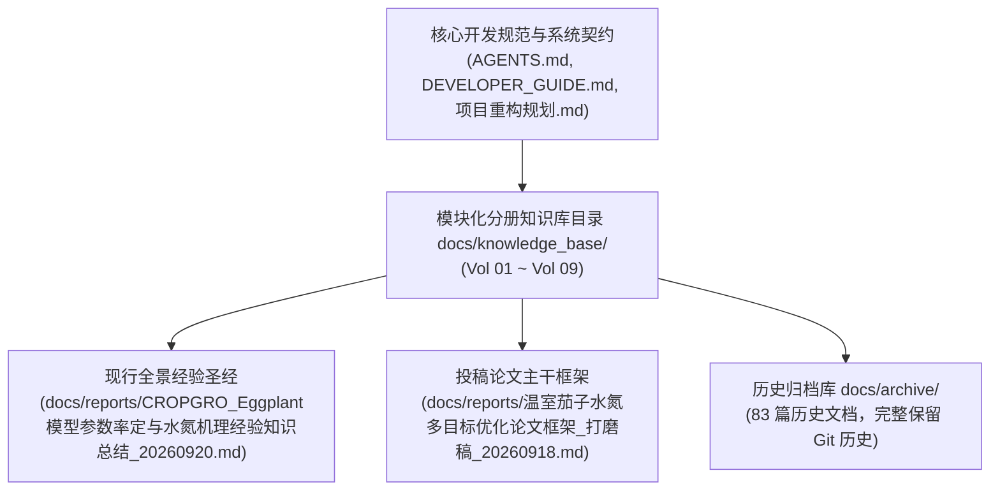

# CROPGRO-Eggplant 作物模型机理与参数率定分册知识库 (`docs/knowledge_base/`)

> **知识库架构编号**：`KB-DSSAT-CROPGRO-MASTER-INDEX`  
> **基准日期**：2026-09-20  
> **定位**：温室茄果类作物模型（TMGRO048）科研与工程团队核心技术资产，全面消费 83 篇历史探索文档后的分册手册体系。

---

## 1. 知识库分册导航矩阵

本知识库按照 **DSSAT 底层核心机理模块** 与 **反演算法工程** 划分为 9 大独立专题分册，各分册均包含完整的微分动力学方程、关键 Fortran 源码路径与行号、具体试验数据矩阵与排错实践：

| 分册编号 | 手册名称 | 核心 DSSAT 模块 / 工程范畴 | 重点解决之机理难题与排错经验 | 核心分册链接 |
| :---: | :--- | :--- | :--- | :--- |
| **Vol 01** | **土壤有机质与 CENTURY 模块** | `CENTURY_SOM` (`CENTURY.for`, `SOMCAS.for`) | 三库碳动力学、`SLNF` 静默重置失效证伪、`SASC_RATIO=0.94` 控矿化解 N0 假饱 | [01_soil_organic_matter_century.md](01_soil_organic_matter_century.md) |
| **Vol 02** | **土壤水分动力学与 SOILWAT 模块** | `SOILWAT_10LB` (`SOILWAT.for`, `ROOTWU.for`) | 10L-B 微网格参数表、100cm 根系物理筑坝、Run 14 蒸发抑制四协同网格数据 | [02_soil_water_hydraulics_soilwat.md](02_soil_water_hydraulics_soilwat.md) |
| **Vol 03** | **物候发育与移栽响应模块** | `PHENOL_TRANS` (`PHENOL.for`, `TRANS.for`) | 光温积温 `DTT` 方程、`PAGE` 7 梯度试验矩阵（22d 对账）、`TB1=9.21℃` 破秋季低温飞车 | [03_crop_phenology_trans.md](03_crop_phenology_trans.md) |
| **Vol 04** | **冠层光合与碳素源库分配模块** | `PHOTO_VEGGR` (`PHOTO.for`, `VEGGR.for`) | 冠层光合方程、`SENES.for` 衰老杀伤公式、V5 修复（SENRTE=4.4, FL-LF=512）解零氮早衰 | [04_crop_growth_source_sink_photo.md](04_crop_growth_source_sink_photo.md) |
| **Vol 05** | **氮磷养分动力学与平衡模块** | `NUPTAK_MOBIL_PUPTAK` (`NUPTAK.for`, `PUPTAK.for`) | 根系主动吸收动力学、初始氮 `ICNS_26SP=0.70` 扫描实据、T0P0 化肥磷施肥补全与闭合 | [05_nitrogen_phosphorus_dynamics.md](05_nitrogen_phosphorus_dynamics.md) |
| **Vol 06** | **PEST++ IES 算法与率定工程** | `PESTPP_ENGINEERING` (`build_pest.py`, IES v5.2) | 串行分步法 70% 边界死锁剖析、全量 70 参数协同反演、13 处理扩容曲率锁定、四大门禁 | [06_pestpp_calibration_engineering.md](06_pestpp_calibration_engineering.md) |
| **Vol 07** | **数据治理管道与不可变资产** | `DATA_PIPELINE` (`tools/experiments/`) | 26122 苗期 LAID 笔误纠偏、化验纯氮分子折算消除 4.4 倍虚高、XXSL2501/2601 双剖面 | [07_data_pipeline_quality_governance.md](07_data_pipeline_quality_governance.md) |
| **Vol 08** | **参数后验分布与同效异构性** | `POSTERIOR_EQUIFINALITY` | 16 核心参数 0.0% 零触界高斯收敛、Spearman 强代偿网络、同效异构解实证 (real_96 vs 97) | [08_parameter_posterior_equifinality.md](08_parameter_posterior_equifinality.md) |
| **Vol 09** | **历史矛盾裁决与 83 篇全景溯源** | `FORENSIC_RECONCILIATION` | 8 大重大科学矛盾深度对账与源码真相、83 篇已归档历史文档全景索引与溯源矩阵 | [09_historical_contradictions_and_resolution.md](09_historical_contradictions_and_resolution.md) |

---

## 2. 知识库与现行系统的关系拓扑

---
如需查阅主文档导航，请返回 [docs/README.md](../README.md)。