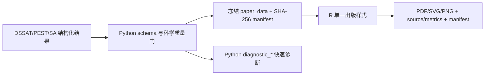

# 科研图表设计与开发计划

> 文档状态：当前专题规范与分阶段开发计划
>
> 版本：1.3
>
> 更新日期：2026-07-16
>
> 实施状态：Fig. 2/3/4 与 Fig. S3/S4 核心 R 图已实现；历史数据 DEMO 已完成渲染 QA，等待正式科研数据替换

## 1. 决策与边界

本项目采用不可混淆的双轨图表体系：

| 体系 | 语言 | 用途 | 允许的输出 |
|---|---|---|---|
| 运行诊断 | Python | SA 轨迹检查、率定进度、失败成员、参数边界和调试 | `diagnostic_*`，不得带 Fig/FigS 编号 |
| 论文出版 | R | 未来可能进入论文、补充材料或正式科研报告的全部图 | Fig/FigS、source CSV、metrics、manifest |

Python 不生成论文候选图；R 不直接读取 DSSAT/PEST++ 临时文件，也不在绘图时重跑模型。两者通过冻结的 tidy 数据包衔接。这样既保留 Python 在运行阶段的快速反馈，又保证论文图只有一个样式系统、一个正式入口和一套审计规则。

历史结果只能用于接口和版式测试。非 `science_validated` 数据必须在 Python 导出和 R 绘图两端显式启用 `--allow-unvalidated-demo`，输出使用 `DEMO_` 前缀并显示水印，不能形成论文结论。

## 2. 项目结构与数据流

```text
src/reporting/
  figure_data.py          tidy schema、历史 wide 数据适配和指标基础函数
  export_paper_data.py    校验并冻结 R 输入包；禁止导入绘图库
  plot_results.py         Python 运行诊断兼容入口
paper/
  R/
    common.R              依赖门、CLI、统一主题、导出与哈希
    make_all.R            唯一论文成图入口
    fig_*.R               单张正式图实现
  README.md               R 依赖、契约和复现命令
configs/figures/
  publication.json        期刊版式 profile
  treatment_metadata_*.csv 试验处理—水氮水平显式映射
  figure_registry.csv     Fig. 1–6 / Fig. S1–S8 注册表
```



## 3. 论文图体系

注册表位于 `configs/figures/figure_registry.csv`。主文建议控制为六类证据图：

| 图 | 科学问题 | 核心内容 | 正式生成前提 |
|---|---|---|---|
| Fig. 1 SA 证据 | 哪些参数稳定影响哪些过程？ | Morris 多种子稳定性、`mu*–sigma`、Sobol `S1/ST` 与 CI | P1 稳定性和收敛门通过 |
| Fig. 2 率定可信度 | 集合是否更新且未被单组支配？ | Phi 中位数/IQR/5–95%、分组 Phi、有效成员数 | P2 IES 更新门通过 |
| Fig. 3 模型性能 | 率定和验证精度如何？ | 多变量等比例 1:1，calibration/validation 双编码 | 独立处理级验证冻结 |
| Fig. 4 动态过程 | 是否重现处理差异与连续采收？ | 日尺度生长轨迹、采收事件、累计采收普通折线及连续平滑备选图 | 日轨迹来源、处理映射、重复误差和区间定义完成 |
| Fig. 5 可辨识性/异参同效 | 好拟合是否对应唯一参数组合？ | 收缩、相关/PCA、远距离等效解预测 | 代表解确定性复跑通过 |
| Fig. 6 管理预测 | 水氮结论和不确定性是什么？ | 响应面、推荐域、外推风险 | 验证与情景范围批准 |

完整 SA 热图、全处理时序、残差、边界命中、相关矩阵和质量门进入 Fig. S1–S8。图表美观不能替代科学质量门；失败运行只生成 Python 诊断或 R 的 `DEMO_` 预览。

## 4. 现有图表取舍

保留但在 R 中重写：多变量 1:1、处理时序、Phi 集合收敛、Morris/Sobol、prior/posterior、相关与等效解对比。1:1 每面板必须保持真实等比例坐标；Phi 不得只显示均值；时序主文仅放预声明代表处理，全处理进入补充材料。

动态过程采用三套不可混淆的图形语法：

1. LAI、叶重、茎重、地上部生物量等连续状态量：模拟值使用 `PlantGro.OUT` 的日尺度实线，实测均值使用点，存在经审核的 SE 时增加误差棒。不得把少量观测日期上的模拟配对值交给 `geom_smooth()` 伪造模型轨迹。
2. 增量采收：按采收事件使用棒棒糖或配对点，不绘制连续平滑线。
3. 累计采收：同时保留两种产物。事件尺度版用普通折线连接观测日期上的模拟累计值；连续展示版对同一组采收日期上的模拟累计值使用保持单调性的三次 Hermite 插值，实测值仍用点。日尺度 `FreshWt.OUT` 作为原始模拟轨迹一并冻结，用于日期对齐和审计。平滑曲线只服务视觉表达，不进入 RMSE、NSE、d-index、Phi 或任何统计检验；若插值节点中的模拟累计值下降则拒绝生成。

累计采收的普通折线版与连续平滑版必须成对保存。图注必须分别说明“连接观测/采收日期的模拟值”和“对相同模拟节点进行单调视觉插值”，不得将后者描述为更高时间分辨率的观测或新的模型输出。

退出正式流程：硬编码路径/迭代/处理映射的旧脚本、自动猜列的 uncertainty 箱线图、无法表达尺度和边界的 parameter-change 散点、全零 SA 排名图、动态 Min–Max 色标、无单位/源数据图，以及把 t-SNE 当作异参同效主证据的设计。

`src/reporting/plot_results.py` 只作为 Python 诊断兼容入口；已删除 Python 的 `paper_figures.py` 与 `figure_style.py`，防止形成两套论文图实现。

## 5. 统一出版样式

`configs/figures/publication.json` 当前声明 R 为渲染器，并采用 89 mm 单栏、183 mm 双栏、最大高度 170 mm、正文 7 pt、面板标签 8 pt、轴线 0.5 pt、数据线 1.0 pt 和 600 dpi 审阅 PNG。正式母版为 PDF/SVG；颜色显式映射且色盲友好，同时用点型、空心/实心、线型、排序或分面保证灰度可辨。

水氮处理图借鉴参考项目的双维编码，但不把它扩展到所有图：氮水平用颜色（N3 深红、N2 橙、N1 蓝、N0 灰），水处理用点符号（W3 圆、W2 方、W1 三角、CK 菱形）。该编码只用于处理间比较、动态过程和管理响应图；Phi、参数后验、敏感性分析等图仍按其科学维度配色，避免过度编码。模拟与观测主要依靠“线/点”区分，不再额外为水处理增加线型。处理映射来自随数据包冻结的 `treatment_metadata.csv`，R 脚本不得按处理号猜测水氮水平。

默认值参考以下出版社通用指南，但目标期刊指南拥有最高优先级：

- [Nature figure panel and export guide](https://research-figure-guide.nature.com/figures/building-and-exporting-figure-panels/)
- [Nature final submission artwork guidance](https://www.nature.com/nature/for-authors/final-submission)
- [Elsevier artwork sizing](https://www.elsevier.com/en-in/about/policies-and-standards/author/artwork-and-media-instructions/artwork-sizing)
- [Elsevier artwork FAQ](https://www.elsevier.com/about/policies-and-standards/author/artwork-and-media-instructions/artwork-faq)

“SCI 一区”不是统一版式标准。投稿前必须按具体期刊新建 profile，并检查字体嵌入、最终尺寸、线宽、色彩空间和 TIFF/EPS 等提交要求。

## 6. 数据契约

观测—模拟配对核心字段为：

```text
run_id,data_status,dataset_role,variable,variable_label,unit,
treatment,time,time_label,observed,simulated,source_file
```

可选但定义固定的观测字段为 `date_code/year/doy/dap/harvest_number/observed_sd/observed_se/n_rep`。只有已知重复数和误差定义时才填写误差字段；仅有处理均值时保持缺失，图中不绘制误差棒。

连续模拟轨迹单独使用：

```text
run_id,data_status,dataset_role,variable,variable_label,unit,treatment,
time,time_label,year,doy,date_code,simulated,statistic,source_file
```

其中正式动态过程的 `time` 为 DAP，`statistic` 当前为 `deterministic`，后续可扩展 `median/q05/q95`。处理元数据使用 `treatment,treatment_label,water_level,nitrogen_level`，与轨迹及配对表分别冻结，避免把试验特定映射硬编码进通用绘图函数。

`dataset_role` 只能是 `calibration`、`validation`、`diagnostic` 或历史适配用 `legacy_unsplit`。Phi 使用 `run_id,data_status,iteration,realization,phi,source_file`。后续接口分别扩展：

- SA：`method/seed/parameter/output/index/estimate/ci_low/ci_high/n_valid`；
- 参数集合：`iteration/realization/parameter/value/lower/upper/status`；
- 预测集合：`realization/q05/q25/median/q75/q95`；
- 异参同效：`phi_total/phi_group/parameter_distance/prediction_distance/pair_id`。

扩展不得改变核心字段含义。绘图函数不猜单位、处理角色、误差定义或数据用途。

## 7. 复现命令与产物

```powershell
python -m src.reporting.export_paper_data --run-id <run_id> `
  --comparison-csv <comparison.csv> --phi-csv <case.phi.actual.csv> `
  --trajectory-run-dir workspace/runs/<run_id> `
  --treatment-metadata-csv configs/figures/treatment_metadata_xxql2501.csv `
  --out-dir workspace/runs/<run_id>/paper_data

Rscript paper/R/make_all.R `
  --input-dir workspace/runs/<run_id>/paper_data `
  --out-dir workspace/runs/<run_id>/paper_figures
```

每张图输出 PDF、SVG、PNG、source CSV，适用时另有 metrics/summary CSV；`figure_manifest.json` 记录 R/包版本、Git commit/dirty 状态、profile 与上游数据清单哈希，以及所有产物 SHA-256。当前 R 依赖为 R 4.3+、`ggplot2`、`patchwork`、`jsonlite`、`svglite`；Windows 哈希使用系统 `certutil`。

## 8. 开发阶段

- V0（已完成）：冻结 Python/R 边界；实现导出器、R 主题、Fig. 2/3/4 核心图和双重 DEMO 门。动态过程从配对表升级为“观测配对 + 日尺度模拟轨迹 + 水氮元数据”三接口；Fig. 4 拆分为连续生长过程、采收事件与累计采收连续平滑备选图。
- V1（Morris DEMO 核心已完成）：已接入三季域内排名、过程组效应、逐 seed 排名、Spearman 与 Top-15 Jaccard；输出级 `mu*–sigma` 因三季原始长表未完整保留而暂缓，Sobol CI 与收敛仍待正式证据。
- V2（部分完成）：残差—拟合值、残差—DAP、标准化 Q–Q 及残差摘要已实现为 Fig. S3；分组 Phi、失败成员、参数更新、校准/验证正式划分和预测区间仍待上游结果冻结。
- V3（最小 DEMO 核心已完成）：接入参数区间、Spearman 与代表候选对确定性预测距离。MVP 不引入 PCA/VIF、聚类或通用“后验探索平台”；这些并非打通率定工具链的必要条件。
- V4：选择目标期刊 profile，冻结 Fig/FigS、caption registry、Table S 与完整 paper bundle。

## 9. 验收

自动检查包括 schema、有限值、单位、用途、data status、尺寸、字体下限、DPI、矢量格式、源数据、manifest 和哈希。动态图另检查每个连续轨迹至少 8 个日值、增量采收无平滑层、累计平滑输入单调、普通折线和平滑版同时存在、插值数据不参与指标。人工 QA 在实际 R 导出文件上检查最终尺寸可读性、等比例坐标、面板顺序、水氮图例、误差带定义、异常点遮挡、裁切、字体替换和 caption 独立可理解性。

当前开发机的 R 未加入 `PATH`，本轮通过显式 R 4.5.2 路径完成 QA；R 4.6.0 与既有 4.5 用户库二进制不兼容，因此不得混用。正式环境应将选定 R 加入 `PATH` 并固定包版本。历史 DEMO 只证明绘图实现可运行，不证明数据具备科研有效性。

## 10. 当前开发进度

| 图表 | 当前状态 | 已实现内容 | 正式化剩余条件 |
|---|---|---|---|
| Fig. 1 | DEMO 核心完成 | 跨季域内 Morris 得分、季节范围、稳定性状态和过程指纹热图 | XXQL2502/XXQL2601 水氮域补充预设 seed 并通过门禁 |
| Fig. S1 | DEMO 核心完成 | 焦点参数逐 seed 排名、Spearman 与 Top-15 Jaccard 门槛图 | 与 Fig. 1 使用同一完整 `science_validated` bundle；输出级效应待原始表恢复后再评估 |
| Fig. 2 | 核心部分完成 | Phi 中位数、IQR、5–95% 区间 | 分组 Phi 与有效成员数接口 |
| Fig. 3 | 核心完成 | 多变量等比例 1:1、角色区分、指标导出 | 冻结独立校准/验证处理 |
| Fig. 4 | 核心完成 | 日尺度生长曲线、采收事件、累计普通折线与平滑备选图 | 正式重复误差和后验轨迹 |
| Fig. S3 | 核心完成 | 按数据角色拆分的残差—拟合值、残差—DAP、Q–Q 和摘要表 | 正式 calibration/validation 数据 |
| Fig. S4 | 核心完成 | LAI/生物量全处理小多图、增量采收、累计普通与平滑版本 | 代表处理和补充变量最终筛选 |
| Fig. S5 | DEMO 核心完成 | 参数各自尺度的 prior/conditional-ensemble 5–95% 区间与中位数 | 冻结科学验证后替换 DEMO 数据；不称为 Bayesian posterior |
| Fig. S6 | DEMO 核心完成 | 活跃参数 Spearman 矩阵 | 仅在科学验证后解释补偿关系；不扩展 PCA/VIF |
| Fig. S7 | DEMO 核心完成 | 最多三对候选的参数距离与 validation/diagnostic 预测距离 | 科学验证、独立验证与阈值审计后才可讨论异参同效 |

Fig. S3 的残差统一定义为 `simulated - observed`，正值表示高估。Q–Q 图只作分布形态诊断，不输出机械化“通过/失败”的正态性结论。Fig. S4 使用每变量一页的 5×2 小多图，避免把全处理塞入主文 Fig. 4。

## 11. 下一阶段开发任务

按上游科研质量门推进，不为了填满图号制造演示数据：

1. **T1：完成 Fig. 2 率定可信度证据。** 冻结 `group_phi`、有效成员数、失败成员数和阶段边界数据契约；扩展现有收敛图，不另建重复脚本。
2. **T2：正式化 Fig. 1 / Fig. S1，并在 Sobol 证据具备后实现 Fig. S2。** 当前 Morris R 核心与冻结数据契约已通过 DEMO QA；下一步是补齐未稳定水氮域的预设 seed。输出级 `mu*–sigma` 只接受完整审计长表，Fig. S2 只接受 Sobol CI 与预算收敛证据，禁止使用占位数据或跨输出最大值替代。
3. **T3：完成参数后验与异参同效图的科学替换。** Fig. S5–S7 的 R 核心已由严格 DEMO bundle 验证；下一步是用 `science_validated` 的冻结数据替换，而不是增加 PCA/VIF/t-SNE/聚类。之后再评估 Fig. 5 主图是否有足够独立证据。
4. **T4：正式论文包冻结。** 用通过质量门的数据替换 DEMO，完成 caption registry、目标期刊 profile、字体嵌入和最终 Fig/FigS 取舍。

### 11.1 复杂度与清理约束

- 一个科学问题对应一个 R 图族模块；共享主题、校验和导出留在 `common.R`，不建设通用绘图库框架。
- `make_all.R` 只负责编排，不复制统计计算；Python 只生成冻结数据，不新增论文图渲染器。
- 新实现替代旧实现后立即删除旧入口或降级为明确的 `diagnostic_*`，禁止长期维护两套论文图。
- 正式代码不得读取 `workspace/figure_redesign_demo`；该目录仅是可删除的本地 QA 产物并由 Git 忽略。
- 每阶段结束执行未使用函数、重复图层、过期文档和生成物审计；没有正式数据支撑的图只保留契约与计划，不写占位绘图代码。
