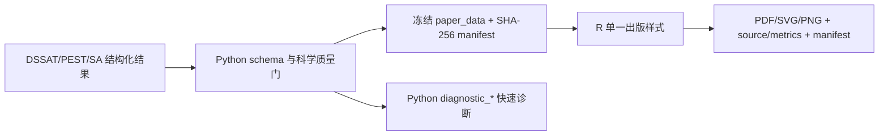

# 科研图表设计与开发计划

> 文档状态：当前专题规范与分阶段开发计划
>
> 版本：1.1
>
> 更新日期：2026-07-16
>
> 实施状态：Python/R 职责已冻结；R 核心入口与 Fig. 2/3/4 DEMO 已完成运行和视觉验收

## 1. 决策与边界

本项目采用不可混淆的双轨图表体系：

| 体系 | 语言 | 用途 | 允许的输出 |
|---|---|---|---|
| 运行诊断 | Python | SA 轨迹检查、率定进度、失败成员、参数边界和调试 | `diagnostic_*`，不得带 Fig/FigS 编号 |
| 论文出版 | R | 未来可能进入论文、补充材料或正式科研报告的全部图 | Fig/FigS、source CSV、metrics、manifest |

Python 不生成论文候选图；R 不直接读取 DSSAT/PEST++ 临时文件，也不在绘图时重跑模型。两者通过冻结的 tidy 数据包衔接。这样既保留 Python 在运行阶段的快速反馈，又保证论文图只有一个样式系统、一个正式入口和一套审计规则。

历史结果只能用于接口和版式测试。非 `science_validated` 数据必须在 Python 导出和 R 绘图两端显式启用 `--allow-unvalidated-demo`，输出使用 `DEMO_` 前缀并显示水印，不能形成论文结论。

## 2. 项目结构与数据流

```text
src/reporting/
  figure_data.py          tidy schema、历史 wide 数据适配和指标基础函数
  export_paper_data.py    校验并冻结 R 输入包；禁止导入绘图库
  plot_results.py         Python 运行诊断兼容入口
paper/
  R/
    common.R              依赖门、CLI、统一主题、导出与哈希
    make_all.R            唯一论文成图入口
    fig_*.R               单张正式图实现
  README.md               R 依赖、契约和复现命令
configs/figures/
  publication.json        期刊版式 profile
  figure_registry.csv     Fig. 1–6 / Fig. S1–S8 注册表
```



## 3. 论文图体系

注册表位于 `configs/figures/figure_registry.csv`。主文建议控制为六类证据图：

| 图 | 科学问题 | 核心内容 | 正式生成前提 |
|---|---|---|---|
| Fig. 1 SA 证据 | 哪些参数稳定影响哪些过程？ | Morris 多种子稳定性、`mu*–sigma`、Sobol `S1/ST` 与 CI | P1 稳定性和收敛门通过 |
| Fig. 2 率定可信度 | 集合是否更新且未被单组支配？ | Phi 中位数/IQR/5–95%、分组 Phi、有效成员数 | P2 IES 更新门通过 |
| Fig. 3 模型性能 | 率定和验证精度如何？ | 多变量等比例 1:1，calibration/validation 双编码 | 独立处理级验证冻结 |
| Fig. 4 动态过程 | 是否重现处理差异与连续采收？ | 代表处理时序、观测误差、模拟区间 | 重复误差和区间定义完成 |
| Fig. 5 可辨识性/异参同效 | 好拟合是否对应唯一参数组合？ | 收缩、相关/PCA、远距离等效解预测 | 代表解确定性复跑通过 |
| Fig. 6 管理预测 | 水氮结论和不确定性是什么？ | 响应面、推荐域、外推风险 | 验证与情景范围批准 |

完整 SA 热图、全处理时序、残差、边界命中、相关矩阵和质量门进入 Fig. S1–S8。图表美观不能替代科学质量门；失败运行只生成 Python 诊断或 R 的 `DEMO_` 预览。

## 4. 现有图表取舍

保留但在 R 中重写：多变量 1:1、处理时序、Phi 集合收敛、Morris/Sobol、prior/posterior、相关与等效解对比。1:1 每面板必须保持真实等比例坐标；Phi 不得只显示均值；时序主文仅放预声明代表处理，全处理进入补充材料。

退出正式流程：硬编码路径/迭代/处理映射的旧脚本、自动猜列的 uncertainty 箱线图、无法表达尺度和边界的 parameter-change 散点、全零 SA 排名图、动态 Min–Max 色标、无单位/源数据图，以及把 t-SNE 当作异参同效主证据的设计。

`src/reporting/plot_results.py` 只作为 Python 诊断兼容入口；已删除 Python 的 `paper_figures.py` 与 `figure_style.py`，防止形成两套论文图实现。

## 5. 统一出版样式

`configs/figures/publication.json` 当前声明 R 为渲染器，并采用 89 mm 单栏、183 mm 双栏、最大高度 170 mm、正文 7 pt、面板标签 8 pt、轴线 0.5 pt、数据线 1.0 pt 和 600 dpi 审阅 PNG。正式母版为 PDF/SVG；颜色显式映射且色盲友好，同时用点型、空心/实心、线型、排序或分面保证灰度可辨。

默认值参考以下出版社通用指南，但目标期刊指南拥有最高优先级：

- [Nature figure panel and export guide](https://research-figure-guide.nature.com/figures/building-and-exporting-figure-panels/)
- [Nature final submission artwork guidance](https://www.nature.com/nature/for-authors/final-submission)
- [Elsevier artwork sizing](https://www.elsevier.com/en-in/about/policies-and-standards/author/artwork-and-media-instructions/artwork-sizing)
- [Elsevier artwork FAQ](https://www.elsevier.com/about/policies-and-standards/author/artwork-and-media-instructions/artwork-faq)

“SCI 一区”不是统一版式标准。投稿前必须按具体期刊新建 profile，并检查字体嵌入、最终尺寸、线宽、色彩空间和 TIFF/EPS 等提交要求。

## 6. 数据契约

观测—模拟核心字段为：

```text
run_id,data_status,dataset_role,variable,variable_label,unit,
treatment,time,time_label,observed,simulated,source_file
```

`dataset_role` 只能是 `calibration`、`validation`、`diagnostic` 或历史适配用 `legacy_unsplit`。Phi 使用 `run_id,data_status,iteration,realization,phi,source_file`。后续接口分别扩展：

- SA：`method/seed/parameter/output/index/estimate/ci_low/ci_high/n_valid`；
- 参数集合：`iteration/realization/parameter/value/lower/upper/status`；
- 预测集合：`realization/q05/q25/median/q75/q95`；
- 异参同效：`phi_total/phi_group/parameter_distance/prediction_distance/pair_id`。

扩展不得改变核心字段含义。绘图函数不猜单位、处理角色、误差定义或数据用途。

## 7. 复现命令与产物

```powershell
python -m src.reporting.export_paper_data --run-id <run_id> `
  --comparison-csv <comparison.csv> --phi-csv <case.phi.actual.csv> `
  --out-dir workspace/runs/<run_id>/paper_data

Rscript paper/R/make_all.R `
  --input-dir workspace/runs/<run_id>/paper_data `
  --out-dir workspace/runs/<run_id>/paper_figures
```

每张图输出 PDF、SVG、PNG、source CSV，适用时另有 metrics/summary CSV；`figure_manifest.json` 记录 R/包版本、Git commit/dirty 状态、profile 与上游数据清单哈希，以及所有产物 SHA-256。当前 R 依赖为 R 4.3+、`ggplot2`、`patchwork`、`jsonlite`、`svglite`；Windows 哈希使用系统 `certutil`。

## 8. 开发阶段

- V0（本轮）：冻结 Python/R 边界；实现导出器、R 主题、Fig. 2/3/4 核心图和双重 DEMO 门。已使用 R 4.5.2 完成 PDF/SVG/600 dpi PNG 渲染与视觉 QA；正式 Fig 编号仍等待通过质量门的新数据。
- V1：接入 Morris 多种子稳定性、`mu*–sigma`、Sobol CI 与收敛；Python 同步提供轨迹失败诊断。
- V2：接入分组 Phi、失败成员、参数更新、校准/验证、预测区间和残差诊断。
- V3：接入参数区间森林图、密度、边界命中、Spearman/PCA/VIF 和代表等效解复跑。
- V4：选择目标期刊 profile，冻结 Fig/FigS、caption registry、Table S 与完整 paper bundle。

## 9. 验收

自动检查包括 schema、有限值、单位、用途、data status、尺寸、字体下限、DPI、矢量格式、源数据、manifest 和哈希。人工 QA 在实际 R 导出文件上检查最终尺寸可读性、等比例坐标、面板顺序、色盲/灰度辨识、误差带定义、异常点遮挡、裁切、字体替换和 caption 独立可理解性。

当前开发机的 R 未加入 `PATH`，本轮通过显式 R 4.5.2 路径完成 QA；R 4.6.0 与既有 4.5 用户库二进制不兼容，因此不得混用。正式环境应将选定 R 加入 `PATH` 并固定包版本。历史 DEMO 只证明绘图实现可运行，不证明数据具备科研有效性。
