# 设施茄子模型率定、水氮响应与条件不确定性评价（C31审阅修订稿）

# 3 结果 (Results)

> 修订稿的数据口径说明（2026-10-05）：表2–4使用C31候选文件的季末产量，表5采收指标由同一确定性运行的 `PestHarvest.OUT` 复算，均遵循现有率定程序的观测当天读出规则；表5营养生长指标仅使用严格同日配对。此处统一的是现有运行的统计口径，尚未完成田间采收日与DSSAT日输出更新顺序的科学核定。现存部分图件使用观测日期加一天的报告提取规则，已在图注注明，不能作为修订表格的数值复核依据。现有冻结图形数据尚未通过 `science_validated` 质量门，因此本稿保留为供审阅的修订草稿，图件仅作为待同步更新的预览，不用于正式论文结论。

## 3.1 设施茄子模型参数化与C31代表方案

本研究利用DSSAT v4.8的CROPGRO-Tomato模型文件（TMGRO048.CUL/ECO/SPE）表征设施茄子（*Solanum melongena* L.）的物候、生长和连续采收过程。茄子与番茄共享模型文件结构，作物身份通过参数配置区分。参数化采用PEST++ IES（迭代集合平滑器），联合调整作物参数、土壤参数及初始条件，并设置物理硬边界和冻结的工作范围。

C31（`c28_scheme1_tb1_92`）由2026-09-26批次的C28 real105参数组合进行TB1定值调整后构造，TB1由9.94272°C改为9.20°C，再在Scheme1输入下进行确定性前向模拟。它不是从09/27最终条件集合直接导出的最优成员，现有构造记录也不支持将其描述为多目标Pareto优化选出的解。09/27批次的条件参数集合另用于第3.5节的诊断。

Scheme1设置包括 `SLPF_25SP=0.88`、`SLPF_26SP=0.89`、`SASC_RATIO=0.92`、`SOIL_SLDR=0.40 d⁻¹` 和 `SOIL_SLU1=2.50 mm`，并包含初始水分缩放和根区截断设置。SLPF为土壤肥力因子，SLDR为排水率常数，SLU1为第一阶段累计土壤蒸发上限；这些设置包含经验调整，不能统称为实测土壤物理属性。

与后续09/27批次对应的冻结表共168个参数条目：67个active、99个fixed、2个disabled。其中，作物文件参数124个（SPE 94、CUL 16、ECO 14），土壤参数37个，初始条件参数7个。PST中67个参数可调整，其余101个为固定条目；168不是遗传参数或活跃率定参数的数量。表1给出C31的24个作物参数取值，并分别列出09/27批次的原始冻结范围和收紧后的实际PST域。

**表1. C31关键作物参数取值及09/27条件集合批次的参数约束**

| 参数 | 文件层级 | 含义 | 单位 | C31取值 | 09/27冻结范围 | 09/27实际PST域 | 09/27状态 |
| --- | ---: | ---: | ---: | ---: | ---: | ---: | ---: |
| TB1 | SPE | 发育温度响应的基温参数 | °C | 9.2 | 8–9.6 | 8.45131–9.6 | active |
| EM-FL | CUL | 出苗至始花光温时间 | 光温日 | 25.1716 | 20–28 | 21.3959–28 | active |
| FL-SH | CUL | 始花至始荚光温时间 | 光温日 | 3.178 | 1–4 | 2.7013–3.6547 | active |
| FL-SD | CUL | 始花至始粒光温时间 | 光温日 | 22.3743 | 8.85–25.85 | 19.0182–25.7304 | active |
| FL-VS | ECO | 主茎始花至最后一片叶出现的光温时间 | 光温日 | 100 | 100 | 100 | 固定 |
| SD-PM | CUL | 始粒至生理成熟光温时间 | 光温日 | 400 | 400 | 400 | 固定 |
| PODUR | CUL | 最适条件下品种达到最终荚果负载所需光温时间 | 光温日 | 12.5693 | 6–22 | 10.6839–14.4547 | active |
| LNGSH | ECO | 单个荚壳生长所需光温时间 | 光温日 | 18 | 18–40 | 18–20.7 | active |
| LFMAX | CUL | 参考温度、CO₂和光照下最大叶片光合速率 | mg CO₂ m⁻² s⁻¹ | 2.8 | 1.8–2.8 | 2.38–2.8 | active |
| SLAVR | CUL | 参考比叶面积 | cm² g⁻¹ | 203.228 | 115–260 | 172.744–233.712 | active |
| SIZLF | CUL | 最大单叶面积 | cm² | 290.261 | 260–300 | 260–300 | active |
| KCAN | SPE | 冠层消光系数 | 无量纲 | 0.547134 | 0.5–0.75 | 0.5–0.629204 | active |
| XFRT | CUL | 每日生长向种子及荚壳分配的最大比例 | g g⁻¹ | 0.916849 | 0.78–0.95 | 0.78–0.95 | active |
| SFDUR | CUL | 种子充实所需光温时间（果实适配参数） | 光温日 | 20 | 20–65 | 20–23 | active |
| XMAGE | ECO | 多次采收判定光温时间参数 | 光温日 | 13.3802 | 5–18 | 11.3732–15.3872 | active |
| DSWBAR | SPE | 水分胁迫相关根区深度参数 | cm | 5.64643 | 5–8 | 5–6.49339 | active |
| RWUMX | SPE | 单位根长最大吸水速率 | cm³ cm⁻¹ d⁻¹ | 0.0556735 | 0.02–0.06 | 0.0473225–0.06 | active |
| RWDTH | ECO | 相对于标准生态型的冠层相对宽度 | 无量纲 | 0.625 | 0.625–2.125 | 0.625–0.71875 | active |
| FRLFF | SPE | 叶片干物质分配函数参数 | g g⁻¹ | 0.286802 | 0.08–0.45 | 0.243782–0.329822 | active |
| FNPGN1 | SPE | 叶氮—光合响应函数第1控制点 | g N (100 g DM)⁻¹ | 3.10359 | 2.4–3.5 | 2.63805–3.5 | active |
| FNPGN2 | SPE | 叶氮—光合响应函数第2控制点 | g N (100 g DM)⁻¹ | 5.73949 | 5.5–6.5 | 5.5–6.5 | active |
| LNREF | SPE | 参考叶片氮浓度 | g N (100 g DM)⁻¹ | 6.20432 | 5.5–6.5 | 5.5–6.5 | active |
| FNPGN3 | SPE | 叶氮—光合响应函数第3控制点 | g N (100 g DM)⁻¹ | 20 | 20 | 20 | 固定 |
| FNPGN4 | SPE | 叶氮—光合响应函数第4控制点 | g N (100 g DM)⁻¹ | 20 | 20 | 20 | 固定 |

注：CUL、ECO、SPE分别为品种、生态型和物种文件。active/fixed描述09/27批次参数状态；C31取值来自其独立参数文件，其中TB1=9.20°C为定值调整，不能称为该批次直接率定得到的值。两列范围均为工作约束，不是实测生理范围；TB1原始冻结域为8.0–9.6°C，实际PST域为8.451312–9.6°C。光温日不等同于日历天。PODUR、LNGSH和SFDUR沿用CROPGRO荚果/种子模型语义，用于茄子果实过程适配，不能仅凭参数数值解释田间商品果采收周期。

在C31中，EM-FL=25.172、FL-SD=22.374、PODUR=12.569光温日；FL-VS=100、SD-PM=400光温日保持固定。SLAVR=203.228 cm² g⁻¹、SIZLF=290.261 cm²、KCAN=0.547134描述参考叶面积与冠层光能截获；RWDTH=0.625是冠层相对宽度，不是根系扩展阻力。RWUMX=0.055674 cm³ cm⁻¹ d⁻¹和DSWBAR=5.64643 cm参与水分吸收及胁迫计算。这些值是当前方案的模型参数，尚不能作为实测解剖学或根系动力学特征的证据。

FNPGN1–4为叶氮—光合响应函数控制点，LNREF为参考叶氮浓度。当前数值满足 FNPGN1 < FNPGN2 ≤ LNREF ≤ FNPGN3 ≤ FNPGN4，即3.104 < 5.740 ≤ 6.204 ≤ 20.0 ≤ 20.0。该数值次序约束不等于已验证的临界氮稀释曲线，也不能把FNPGN4=20解释为真实叶片奢侈吸收上限；组织氮模拟须依据实际观测另行评价。

评价数据包括25SP的11个、26SP的12个和25FA的12个季节—处理组合，共35个处理配对。两春季中13个处理进入本轮目标函数，10个为本轮目标函数外的留出处理，秋冬茬用于跨季诊断。已有候选筛选过程曾计算这些子集的表现，尚缺少完整的数据隔离记录，因此不将其称为完全独立盲验。

## 3.2 季末累计鲜果产量的分层评价

按观测当天读出的现有率定口径，C31两春季23个处理的实测、模拟均值分别为64.42、64.14 t ha⁻¹，RMSE为3.59 t ha⁻¹，NRMSE为5.57%，r²为0.7246，NSE为0.5721，d为0.9084（表2）。25SP与26SP的NRMSE分别为6.24%和4.89%，但NSE分别为0.3726和0.7011，处理间差异的再现能力仍有季节差别。

**表2. C31季末累计鲜果产量在不同评价子集中的统计性能（观测当天读出口径，待日期科学核定）**

| 评价子集 | 处理配对数n | 实测均值 | 模拟均值 | RMSE | NRMSE (%) | Bias | r² | NSE | d |
| --- | ---: | ---: | ---: | ---: | ---: | ---: | ---: | ---: | ---: |
| 本轮率定处理 (Calibration) | 13 | 64.88 | 63.31 | 3.53 | 5.44 | -1.57 | 0.820 | +0.706 | 0.934 |
| 本轮留出处理 (Holdout) | 10 | 63.81 | 65.22 | 3.66 | 5.74 | +1.41 | 0.678 | +0.006 | 0.837 |
| 2025春茬全处理 (25SP) | 11 | 63.83 | 63.35 | 3.98 | 6.24 | -0.48 | 0.880 | +0.373 | 0.908 |
| 2026春茬全处理 (26SP) | 12 | 64.96 | 64.87 | 3.18 | 4.89 | -0.08 | 0.702 | +0.701 | 0.907 |
| 2025秋冬茬诊断 (25FA) | 12 | 16.79 | 13.41 | 3.87 | 23.07 | -3.38 | 0.060 | -3.247 | 0.422 |
| 两春季合并 | 23 | 64.42 | 64.14 | 3.59 | 5.57 | -0.27 | 0.725 | +0.572 | 0.908 |
| 三季全处理合并 | 35 | 48.09 | 46.75 | 3.69 | 7.67 | -1.34 | 0.984 | +0.974 | 0.994 |

注：均值、RMSE和Bias单位为t ha⁻¹。Bias为平均偏差，即平均(simulated−observed)，不同于MAE；NRMSE=100×RMSE/观测均值。r²为Pearson相关系数平方，NSE以对应子集的观测均值为基准，d为Willmott一致性指数。n为季节—处理配对数，不是独立田间重复数。数值由C31候选季末产量复算，并与同一运行 `PestHarvest.OUT` 最后一个真实采收节点逐处理核对一致；不同采收日期提取规则仍可能改变结果。

率定和留出处理的NRMSE接近（5.44%和5.74%），但NSE由率定的0.7060降至留出的0.0060，且Bias由−1.57变为+1.41 t ha⁻¹。留出相对误差较小并不能证明过拟合已被排除，留出处理间差异的预测仍需改进。25FA模拟均值13.41 t ha⁻¹低于实测16.79 t ha⁻¹，NRMSE为23.07%、Bias为−3.38 t ha⁻¹、r²为0.0603、NSE为−3.2474，显示明显的外推局限。

三季合并r²=0.9840、NSE=0.9745，但实测产量总平方和中约96.10%来自季节均值差异。该合并指标主要包含春秋产量尺度的区分，不能替代同季处理排序、水氮响应及留出表现的评价。

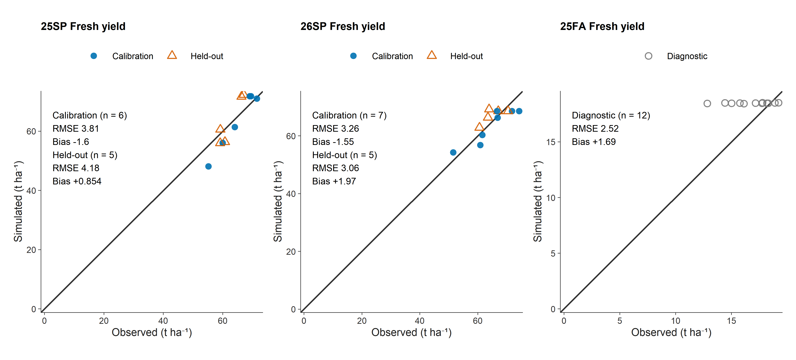

*图3 (Fig.3). 现存C31季末累计鲜果产量分季1:1比较预览。蓝色实心圆为率定处理，橙色空心三角为本轮留出处理，灰色空心圆为秋季诊断处理；实线为1:1线，图中未绘制±10%误差带。现存冻结图源使用观测日期加一天的报告提取规则，与表2的当天读出口径不同；25FA模拟均值为18.48 t ha⁻¹而非13.41 t ha⁻¹。该图保留用于日期核查，待统一规则后更新，不据此验证表2。*

## 3.3 离散水氮处理的产量响应

以同水分水平下N3与N0的季末鲜果产量差表征施氮响应，以同施氮水平下W2、W3分别相对W1的产量差表征水分响应（表3、表4）。观测与模拟采用相同处理配对及表2的当天采收读出口径，共获得9个施氮端点对比、10个W2−W1对比和12个W3−W1对比。处理分组使用当前显式季节—水氮元数据；各差值描述已设置处理间的响应，不用于估计连续响应面的偏导数。

### 3.3.1 施氮响应方向与幅度

**表3. 相同水分水平下N3−N0季末鲜果产量差及C31响应评价**

| 季节茬口 | 水分水平 | 实测ΔY | C31模拟ΔY | 响应偏差 | 模拟/实测响应比 (%) |
| --- | ---: | ---: | ---: | ---: | ---: |
| 25SP | W3 | 4.980 | 10.445 | +5.465 | 209.7 |
| 25SP | W2 | 12.315 | 10.407 | -1.908 | 84.5 |
| 25SP | W1 | 4.751 | 7.940 | +3.189 | 167.1 |
| 26SP | W3 | 5.789 | 11.776 | +5.987 | 203.4 |
| 26SP | W2 | 10.238 | 8.291 | -1.947 | 81.0 |
| 26SP | W1 | 15.334 | 12.047 | -3.287 | 78.6 |
| 25FA | W3 | 1.609 | 0.142 | -1.467 | 8.8 |
| 25FA | W2 | 4.464 | -0.021 | -4.485 | -0.5 |
| 25FA | W1 | 2.920 | 0.025 | -2.895 | 0.9 |

注：前三个数值列单位为t ha⁻¹。响应偏差=模拟ΔY−实测ΔY；模拟/实测响应比=100×模拟ΔY/实测ΔY，不是模型“恢复程度”。实测差接近零或为负时，该比值不宜单独用于评价。25FA映射采用当前显式元数据：TN4=W1N2、TN6=W3N2、TN7=W1N1、TN10=W3N1、TN9=W1N0、TN12=W3N0。采收日期口径仍待科学核定。

25SP三个水分水平下的实测N3−N0增产量为4.751–12.315 t ha⁻¹，26SP为5.789–15.334 t ha⁻¹；C31对应为7.940–10.445和8.291–12.047 t ha⁻¹。两春季六个端点对比的模拟增产均为正，与实测方向一致，但模型对水分水平之间的增产幅度差异再现不足。25SP实测施氮响应在W2下最大，模拟W2与W3响应接近；26SP实测响应从W1向W3减小，而模拟W3响应仍接近W1。

两春季W3下的施氮增产均被高估：25SP、26SP响应偏差分别为+5.465、+5.987 t ha⁻¹，模拟/实测响应比分别为209.7%、203.4%。W2下则分别低估1.908、1.947 t ha⁻¹；W1下25SP高估3.189 t ha⁻¹，26SP低估3.287 t ha⁻¹。三个水分水平的施氮响应差值RMSE在25SP、26SP分别为3.816、4.100 t ha⁻¹，显示端点方向再现与增产幅度拟合存在区别。

25FA三个水分水平下实测施氮增产量为1.609–4.464 t ha⁻¹，模拟仅为−0.021至+0.142 t ha⁻¹，其中W2的模拟响应略为负。秋季施氮响应整体接近零，其差值RMSE为3.196 t ha⁻¹，表明当前方案未能充分再现实测施氮增产幅度。

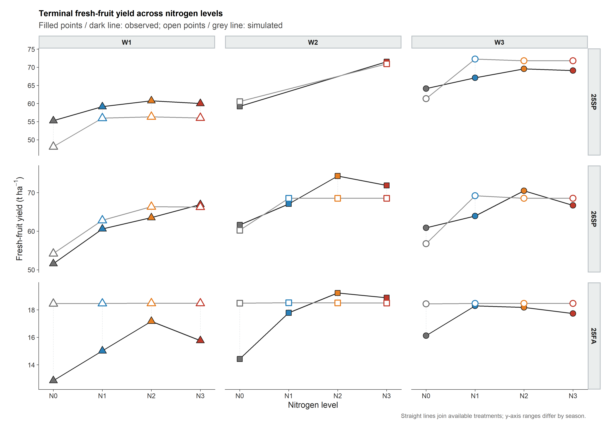

*图6 (Fig.6). 不同季节（行）及水分梯度（列）下，季末鲜果产量随离散氮水平N0–N3的变化。实心点与深色线表示实测值，空心点与灰色线表示模拟值；同一处理的两点共用横坐标，浅灰竖直虚线标示配对差异。点颜色表示氮水平，点型表示水分梯度；两条折线分别连接同一季节、同一水分梯度内的现有实测或模拟处理值，未对缺失处理补值，也不表示连续响应面的拟合。纵轴按各季节的数据范围调整，不强制从零起始，同一季节三个水分面板采用相同尺度。该图沿用现有报告采收提取口径与处理映射，尚未与按当天读出并修正映射后的表3统一，不能作逐值对照。*

### 3.3.2 水分响应方向、幅度与排序

**表4. 相同施氮水平下W2−W1及W3−W1季末鲜果产量差**

| 季节茬口 | 施氮水平 | 实测W2−W1 | 模拟W2−W1 | 响应偏差 | 实测W3−W1 | 模拟W3−W1 | 响应偏差 |
| --- | ---: | ---: | ---: | ---: | ---: | ---: | ---: |
| 25SP | N0 | 3.964 | 12.446 | +8.482 | 8.873 | 13.259 | +4.386 |
| 25SP | N1 | — | — | — | 7.956 | 16.327 | +8.371 |
| 25SP | N2 | — | — | — | 8.812 | 15.469 | +6.657 |
| 25SP | N3 | 11.528 | 14.913 | +3.385 | 9.102 | 15.763 | +6.661 |
| 26SP | N0 | 10.053 | 6.032 | -4.021 | 9.313 | 2.543 | -6.770 |
| 26SP | N1 | 6.475 | 5.713 | -0.762 | 3.325 | 6.397 | +3.072 |
| 26SP | N2 | 10.802 | 2.185 | -8.617 | 6.973 | 2.184 | -4.789 |
| 26SP | N3 | 4.957 | 2.276 | -2.681 | -0.232 | 2.272 | +2.504 |
| 25FA | N0 | 1.579 | -0.102 | -1.681 | 3.282 | -0.167 | -3.449 |
| 25FA | N1 | 2.772 | -0.038 | -2.810 | 3.277 | -0.079 | -3.356 |
| 25FA | N2 | 2.064 | -0.113 | -2.177 | 1.018 | -0.112 | -1.130 |
| 25FA | N3 | 3.123 | -0.149 | -3.272 | 1.971 | -0.050 | -2.022 |
| **有效对比数n** | — | 10 | 10 | 10 | 12 | 12 | 12 |
| **全样本均值** | — | 5.732 | 4.316 | -1.415 | 5.306 | 6.151 | +0.845 |
| **RMSE** | — | — | — | 4.558 | — | — | 4.924 |
| **MAE** | — | — | — | 3.789 | — | — | 4.430 |

注：数值单位均为t ha⁻¹，n除外。响应偏差=模拟差值−实测差值。25SP中W2N1、W2N2未纳入当前可执行模型输入，原因为TN7、TN8缺少FileX管理/初始条件定义；“—”不代表田间未设置处理。汇总分别使用10个W2−W1和12个W3−W1有效对比，多项差值共享W1参照，不应视为相互独立的重复。秋季映射已按表3说明修正，采收日期规则仍待核定。

25SP实测W2−W1增产量在N0、N3下分别为3.964、11.528 t ha⁻¹，模拟分别为12.446、14.913 t ha⁻¹；四个施氮水平下的实测W3−W1增产量为7.956–9.102 t ha⁻¹，模拟为13.259–16.327 t ha⁻¹。该季模型对现有水分增产方向均有再现，但六个有效对比的增产量全部偏高，特别是N0的W2−W1和N1的W3−W1，分别高估8.482和8.371 t ha⁻¹。

26SP模拟W2−W1增产量为2.185–6.032 t ha⁻¹，低于对应实测值4.957–10.802 t ha⁻¹，四个对比均为低估。W3−W1的偏差随施氮水平变化：N0、N2分别低估6.770、4.789 t ha⁻¹，N1高估3.072 t ha⁻¹；N3实测差值为−0.232 t ha⁻¹，而模拟为+2.272 t ha⁻¹。两春14个有效水分对比中有13个方向一致，未吻合者为26SP N3的W3−W1，且该实测差值接近零。

响应排序也随水氮组合变化。26SP N0的模拟W2、W3产量分别为60.239、56.750 t ha⁻¹，W3较W2低3.489 t ha⁻¹；N2和N3的W3也略低于W2。因而W2、W3相对W1的模拟增产均为正，并不表示模拟产量随水分水平严格递增。

25FA八个水分对比的实测增产均为正，而模拟均为负：W2−W1模拟为−0.149至−0.038 t ha⁻¹，W3−W1为−0.167至−0.050 t ha⁻¹。模型既未再现该季实测响应方向，模拟差值的绝对幅度也较小。三季合并W2−W1的Bias、RMSE和MAE分别为−1.415、4.558和3.789 t ha⁻¹；W3−W1分别为+0.845、4.924和4.430 t ha⁻¹（表4）。春季高估与低估、秋季方向偏差同时存在，因此合并Bias较小并不代表各季水氮响应均被准确再现。

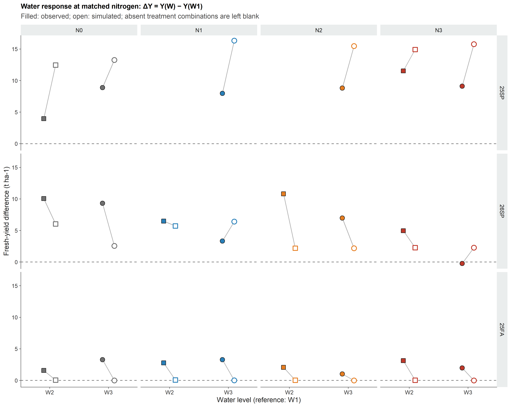

*图6a (Fig.6a). 现存预览采用配对点和连线：实心为观测差值、空心为模拟差值，方形表示W2−W1，圆形表示W3−W1，连线连接同一对比的观测与模拟。该图不是柱形图。现存图源与修订表4的采收提取口径尚未统一，待同步更新后再用于逐值比较。*

## 3.4 观测日期上的营养生长与采收事件评价

表5使用当前C31确定性产物重算，不再沿用C23过程指标。营养生长仅保留观测与模拟日期一致的节点；25FA最后一组观测与模拟相差4天的过程配对未纳入统计。模型轨迹是日尺度输出，评价节点则是分期观测与离散采收事件，不能称为每日观测评价。

**表5. C31三季营养生长与采收事件的配对评价（采收采用当天读出口径，待日期科学核定）**

| 季节茬口 | 生长/采收变量 | 配对节点数n | RMSE | NRMSE (%) | Bias | r² | NSE | d |
| --- | ---: | ---: | ---: | ---: | ---: | ---: | ---: | ---: |
| 25SP | LAI (m² m⁻²) | 44 | 0.620 | 27.40 | -0.193 | 0.842 | 0.825 | 0.952 |
| 25SP | 叶干重 (kg ha⁻¹) | 44 | 168.801 | 21.58 | +92.545 | 0.935 | 0.878 | 0.972 |
| 25SP | 茎干重 (kg ha⁻¹) | 44 | 333.008 | 29.11 | +102.727 | 0.870 | 0.852 | 0.962 |
| 25SP | 单次采收鲜重 (t ha⁻¹) | 99 | 2.699 | 38.06 | -0.054 | 0.434 | -0.030 | 0.791 |
| 25SP | 事件累计鲜重 (t ha⁻¹) | 99 | 4.729 | 12.98 | -3.167 | 0.976 | 0.944 | 0.987 |
| 26SP | LAI (m² m⁻²) | 48 | 0.643 | 35.81 | +0.335 | 0.810 | 0.604 | 0.918 |
| 26SP | 叶干重 (kg ha⁻¹) | 48 | 187.537 | 21.17 | -83.521 | 0.891 | 0.859 | 0.959 |
| 26SP | 茎干重 (kg ha⁻¹) | 48 | 265.461 | 21.55 | -16.646 | 0.896 | 0.895 | 0.971 |
| 26SP | 单次采收鲜重 (t ha⁻¹) | 60 | 2.872 | 22.11 | -0.017 | 0.508 | 0.492 | 0.831 |
| 26SP | 事件累计鲜重 (t ha⁻¹) | 60 | 3.663 | 9.82 | +0.984 | 0.972 | 0.970 | 0.992 |
| 25FA | LAI (m² m⁻²) | 24 | 1.237 | 95.20 | -1.094 | 0.880 | -2.769 | 0.475 |
| 25FA | 叶干重 (kg ha⁻¹) | 24 | 609.230 | 104.90 | -512.250 | 0.930 | -1.989 | 0.495 |
| 25FA | 茎干重 (kg ha⁻¹) | 24 | 581.231 | 98.33 | -470.167 | 0.939 | -1.137 | 0.546 |
| 25FA | 单次采收鲜重 (t ha⁻¹) | 36 | 4.270 | 76.30 | -1.126 | 0.479 | -11.499 | 0.056 |
| 25FA | 事件累计鲜重 (t ha⁻¹) | 36 | 5.333 | 45.33 | -4.896 | 0.870 | -0.495 | 0.766 |

注：RMSE和Bias使用各变量所列单位。n为观测配对节点数，包含同处理多时点，不是独立实验重复；累计产量节点存在时序相关。25SP有11处理×9个真实采收节点，共99个配对，不包含虚拟末次采收。营养生长取当前冻结比较表的严格同日节点；单次及累计采收分别取同一运行 `PestHarvest.OUT` 的HFPOWS和CHFPWS。所有变量均报告RMSE、NRMSE、Bias、r²、NSE和d，不因NSE低而弱化或删除该指标。日期读出规则的最终科学核定仍未完成。

两春季营养生长具有一定配对吻合度，但并非各变量均达到同一水平。25SP的LAI、叶干重、茎干重NRMSE分别为27.40%、21.58%、29.11%；26SP分别为35.81%、21.17%、21.55%。25FA三项NRMSE分别为95.20%、104.90%、98.33%，NSE均为负且Bias均为负，说明秋季营养器官生物量明显低估。其相关系数平方较高并不能抵消系统偏差。

按现有当天读出口径，25SP累计鲜重NRMSE为12.98%、NSE为0.944，单次鲜重分别为38.06%、−0.030；26SP累计鲜重为9.82%、0.970，单次鲜重为22.11%、0.492。25FA累计鲜重NRMSE为45.33%、NSE为−0.495，单次鲜重为76.30%、−11.499。累计干重NRMSE在25SP、26SP、25FA分别为14.79%、13.37%、44.02%，NSE分别为0.926、0.946、−0.410。日期口径对秋季采收评价影响很大：现存加一天比较表的累计鲜重NRMSE为17.79%、NSE为0.770，不能与当天读出指标混用。

累计量通常比事件增量平滑，并可能包含相邻差分误差抵消，但这不单独证明物质守恒或源库机制正确。当前模型采用输入采收日期，事件鲜重由相邻累计输出差分得到；尚无记录支持人为2–4天采收扰动是误差的已确认根因。应先核对日期映射，再结合在株果实、营养器官、呼吸及胁迫输出解释偏差。现有叶氮资料也不足以支持三季35处理的组织氮浓度均已验证。

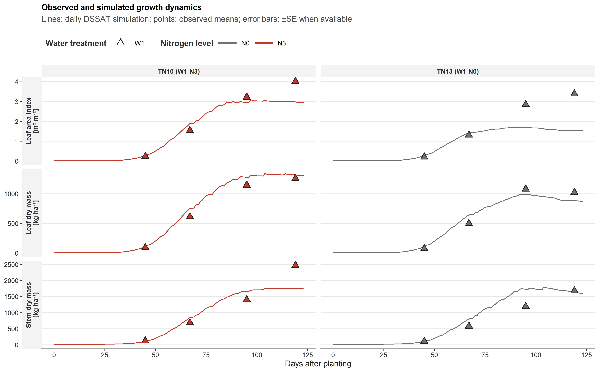

*图4a (Fig.4a). 25SP的TN10（W1N3）与TN13（W1N0）营养生长动态预览。实线为日尺度模拟轨迹，点为观测均值；变量为LAI、叶干重LWAD与茎干重SWAD。该图仅展示两个代表处理，不能代替三季全处理评价。*

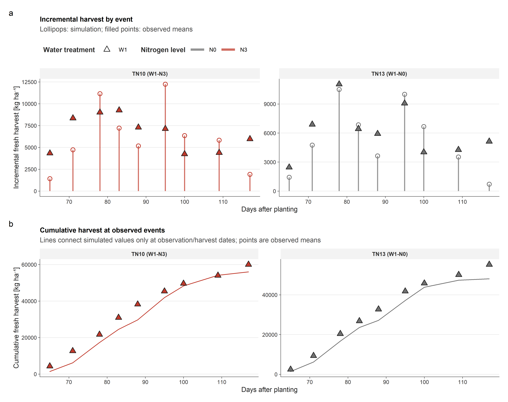

*图4b (Fig.4b). 25SP TN10（W1N3）与TN13（W1N0）采收动态预览。上部以模拟棒棒糖和观测点表示单次采收鲜重，不跨事件平滑；下部折线仅连接采收日期上的模拟累计值，点为观测。现存图采用报告采收提取规则，待与表5统一；图形本身不证明时序错位的原因或累计物质守恒。*

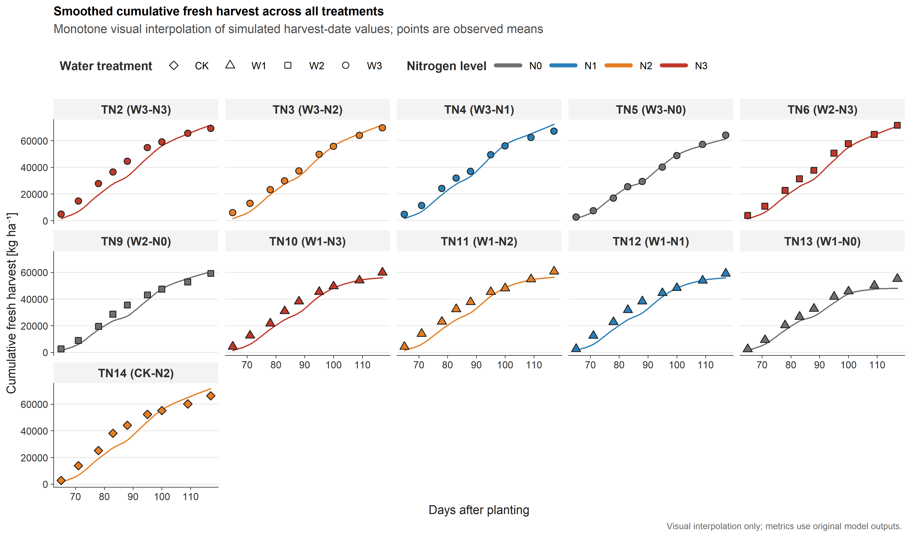

*图S4 (Fig.S4). 所链接预览仅包含25SP的11个处理和99个观测采收节点。曲线为对模拟采收节点作单调三次Hermite视觉插值，点为观测均值；插值不进入RMSE、NSE、d或目标函数。该文件未同时展示事件普通折线版，也不包含三季35处理；原始事件版与插值版应成对保存。采收日期提取口径仍待统一。*

## 3.5 条件参数集合分布、多解性与条件预测区间

本节诊断来自09/27批次 `full_gen_13trt_final_scheme1_tb1_tighten_200x6_20260927` 的第6次迭代，与第3.1节构造C31的09/26批次来源不同。现存参数密度、IQR收缩及相关图使用200行初始集合（199成员加base）和142行最终集合（141成员加base）；条件前向重放使用141个非base成员。二者成员口径不同，以下按已有产物说明，正式重导出时应统一规则。

集合图源状态为 `tooling_demo`，条件数据仍为未科学验证状态。条件重放质量记录保留 `scientific_status=not_assessed`、`engineering_status=engineering_failed` 及成员对齐/有限值相关问题。以下为现存产物的描述性诊断，不将其称为已通过质量门的完整贝叶斯后验或C31的不确定性保证。

### 3.5.1 条件集合收缩与边界诊断

图S5与图S6统一选取16个在本轮率定中参与更新且最终集合具有变异的作物参数；固定THRSH以可采收光温果龄参数XMAGE替换。所选参数的最终集合相对初始集合呈不同程度IQR缩窄。SLAVR、XFRT、FL-SD、EM-FL、PODUR、RTNO3的IQR收缩率分别为81.5%、79.8%、79.1%、72.1%、51.3%、46.3%。SLAVR最终中位数为212.18 cm² g⁻¹，XFRT为0.877 g g⁻¹；FL-SD、EM-FL、PODUR分别为25.07、27.58、12.35光温日。XMAGE的IQR收缩率为78.4%，最终5%–95%区间为12.114–12.929光温日，中位数为12.543光温日。IQR缩窄只描述当前条件集合，不等同于方差收敛、唯一可辨识性或实测生理真实性。

TB1初始集合5%–95%分位区间为8.5065–9.5396°C，最终为8.6095–9.4475°C，中位数为9.0253°C，IQR收缩率20.9%。这两个区间均不是物理边界，也不是成员完整取值域；09/27实际PST工作域为8.451312–9.6°C。不能凭这些分位数推断茄子真实基温高于番茄。

本次图源按09/27实际PST工作域重算边界命中，容差取参数域宽度的0.01%。SIZLF上界命中16.20%，EM-FL上界1.41%，SFDUR下界7.75%，RWUMX上界0.70%，DSWBAR下界2.82%；TB1、XMAGE两侧均为0%。图中“Interior”表示两侧命中比例均不超过10%，并不表示完全没有成员接近边界。

KCAN在当前PHOTO=L配置下仍有非零但很弱的前向响应，因此保留在诊断图中。在其他输入与参数固定时，将模型可读KCAN由0.547改为工作域内的0.500或0.620，两春日尺度累计鲜重的最大绝对变化不超过1.6 kg ha⁻¹，LAI最大绝对变化为0.001；对应边界内扰动对秋季累计鲜重的最大变化为0.1 kg ha⁻¹。其IQR收缩率为20.4%，但该收缩不能据此解释为较强的输出敏感性或充分的参数辨识。

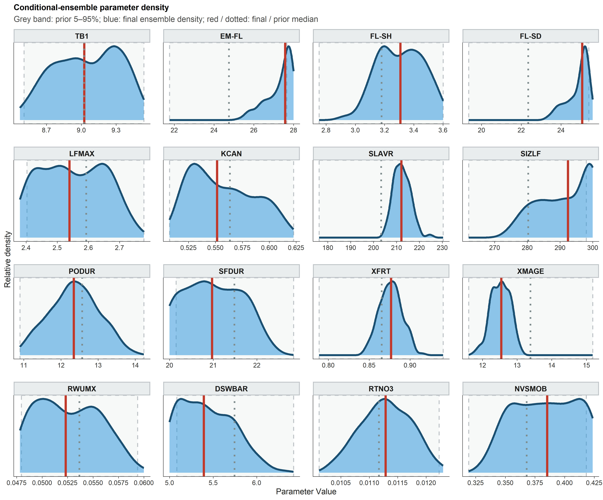

*图S5(a) (Fig.S5a). 所选作物参数分布预览，不代表全部67个活跃参数或全部土壤参数。灰带为初始集合5%–95%区间，灰虚线为初始中位数；蓝色密度为最终集合，红竖线为最终中位数。16个参数均为非恒定参数，XMAGE替换固定THRSH，KCAN保留。初始集合含base共200行，最终集合含base共142行；核密度按各面板峰值归一化，仅展示分布形状。*

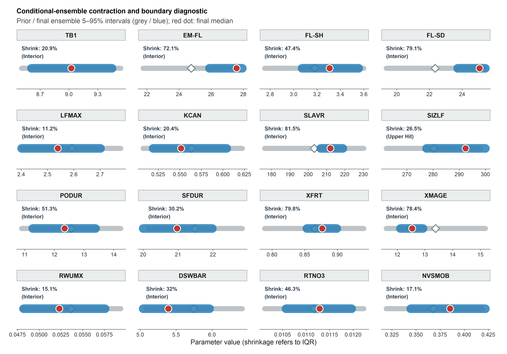

*图S5(b) (Fig.S5 contraction panel). 灰色、蓝色区间分别为初始与最终集合5%–95%区间，红点为最终中位数，百分比为IQR收缩率；边界命中超过10%时显示相应分类，不是完整边界命中曲线。此处为图S5的收缩面板，避免与注册表中另用于在株果实平衡的FigS5b混用。成员及边界统计口径同第3.5.1节。*

### 3.5.2 参数秩相关结构与候选预测相似性

基于含base的142行最终条件集合，对图S5相同的16个非恒定参数进行Spearman秩相关分析（图S6），共形成120个不重复非对角参数对。其中112对（93.3%）的相关系数绝对值小于0.20，绝对值中位数为0.044，未出现｜ρ｜≥0.50的参数对，表明多数参数对的单调关联较弱。

绝对值最大的关联为FL-SD与XMAGE的正相关（ρ=+0.492）。其后为FL-SD与XFRT的负相关（ρ=−0.379）、PODUR与SFDUR的正相关（ρ=+0.368），以及XFRT与XMAGE的负相关（ρ=−0.318）。另外四对｜ρ｜≥0.20的关联为FL-SD–FL-SH（+0.266）、EM-FL–XMAGE（+0.243）、PODUR–TB1（+0.224）及SIZLF–XFRT（+0.212）。新增XMAGE后，较大的秩关联集中于生殖发育时间、可采收果龄与生殖分配参数之间。

TB1与EM-FL、XFRT与SFDUR的相关系数分别为+0.045和−0.032，仍接近零。上述结果是当前条件集合的描述性关联，未作显著性推断；较弱的两两相关不等同于参数相互独立或已被唯一辨识，FL-SD、XMAGE与XFRT之间的关联也不能直接解释为已证实的生理代偿机制。

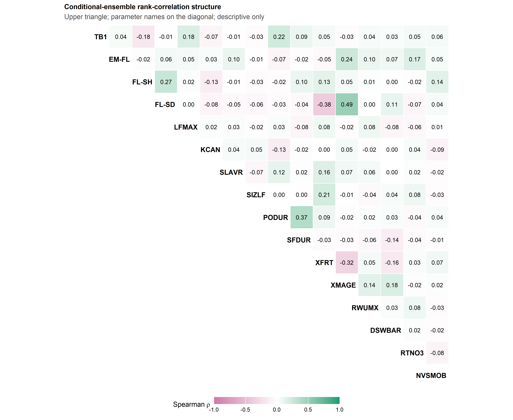

*图S6 (Fig.S6). 16个非恒定参数在含base的142行最终条件集合中的Spearman秩相关上三角图。THRSH以XMAGE替换，参数集合与图S5相同；上三角展示120个不重复参数对，对角线上水平标注参数名，不绘制自相关色块或倾斜坐标轴标签。颜色范围固定为−1至+1，格内为相关系数；数值仅描述条件集合的秩关联，不表示显著性或因果关系。*

目标函数相近、参数距离较大的三对候选为154/155、18/19、140/141。它们的标准化参数距离分别为17.567、16.976、16.744；validation汇总预测距离为0.1735、0.2549、0.4344，diagnostic为0.1666、0.2012、0.0858，按现有距离规则均为 `prediction_similar`。该诊断说明参数分离与汇总预测相似可以并存，不包含极端处理时序曲线，不能换算为98%重合度或10%–18%轨迹发散。

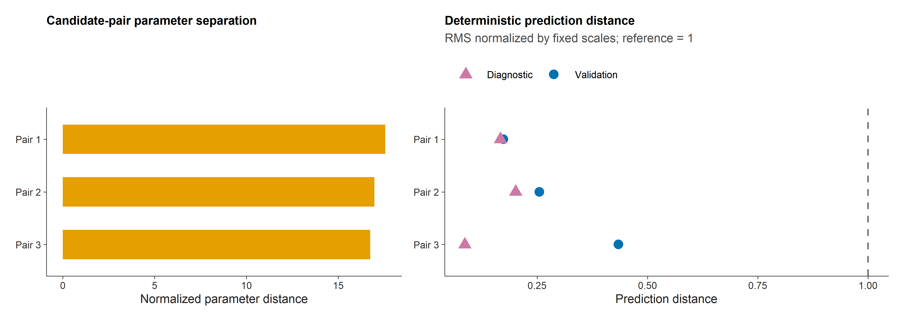

*图S7 (Fig.S7). 三对相近Phi候选的标准化参数距离柱图及按validation/diagnostic汇总的确定性预测距离点图。参数距离按最终集合参数标准差标准化，预测距离按固定变量尺度归一化；参考线为距离1。图中没有极端处理时序轴，不能据此宣称极端观测已破除多解性。*

### 3.5.3 条件成员分位区间及观测覆盖

141个非base成员对两春季23处理进行条件重放。现存图源以多个采收观测节点统计累计鲜重，不是仅23个季末值；95%和50%区间分别为成员预测的2.5%–97.5%及25%–75%分位区间，尚未涵盖观测、气象与模型结构等全部误差。它们不直接等同于完整预测区间或统计置信带。

现存累计鲜重图源的四个季节×数据角色子集结果为：

- 25SP率定：6处理、54节点，PICP95=72.22%，RMPIW95=28.78%，中位预测r²=0.98232，Bias=−1.027 t ha⁻¹。
- 25SP留出：5处理、45节点，PICP95=77.78%，RMPIW95=29.35%，中位预测r²=0.97866，Bias=−0.853 t ha⁻¹。
- 26SP率定：7处理、35节点，PICP95=62.86%，RMPIW95=20.56%，中位预测r²=0.97142，Bias=+3.795 t ha⁻¹。
- 26SP留出：5处理、25节点，PICP95=20.00%，RMPIW95=21.87%，中位预测r²=0.98471，Bias=+6.760 t ha⁻¹。

其中26SP留出仅5/25个观测节点落入95%成员区间，显示较明显的覆盖不足。26SP各处理相对残差中位数均为正，约+2.61%至+21.66%，不能称为残差围绕零线对称且无系统偏差。26SP LAI覆盖率在率定、留出子集中约为10.7%、10.0%；LWAD为叶片干重而非地上部总干重。区间较窄和合并r²较高均不能单独证明可靠泛化。

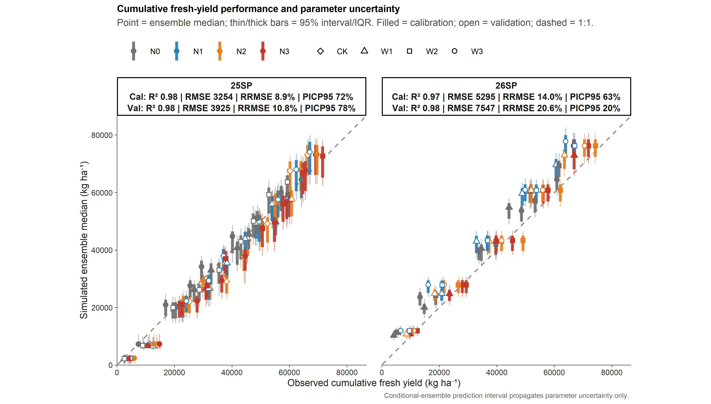

*FigCondPerf. 两春季23处理多个观测采收节点的观测—中位预测比较预览，显示95%与50%成员分位区间及PICP/RMPIW。指标按季节×率定/留出四组计算；成员数为141，不含base。该图源保持原条件重放口径，须完成日期及工程质量核验后再正式引用，不能视为C31确定性方案的同源区间。*

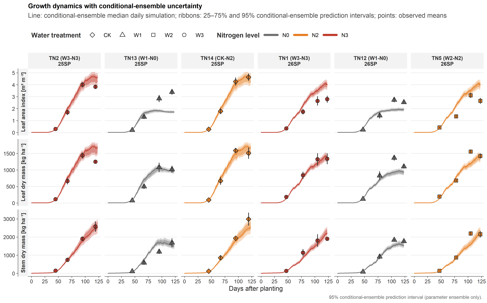

*Fig4Cond Process. 所选水氮处理LAI、叶片干重LWAD及茎干重SWAD的条件集合动态预览。线为成员中位数，浅带为2.5%–97.5%分位，深带为25%–75%分位；点为观测。仅表示所选处理及当前集合口径，不表示全部观测高覆盖或全部误差均已纳入。*

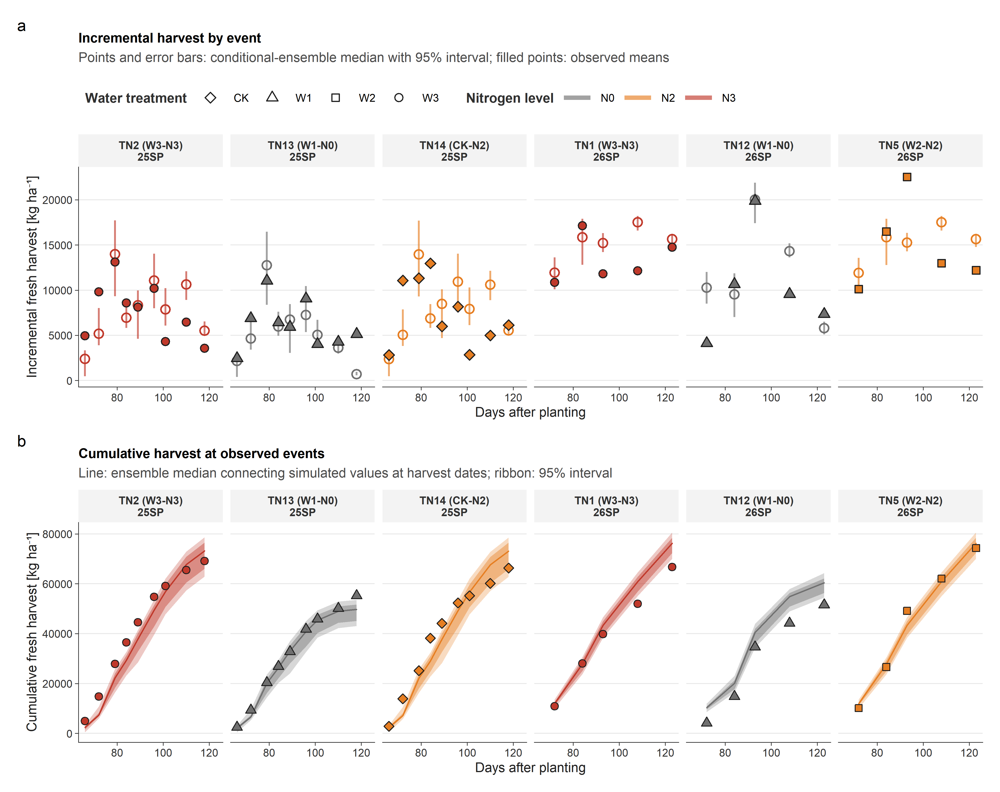

*Fig4Cond Harvest. 所选处理的采收条件集合预览：单次采收面板为中位数点与95%成员分位误差线；累计采收面板为中位线、外层95%和内层50%分位带。两面板区间形式不同，不能均称双层Ribbon。区间不包含全部误差来源，采收日期口径及质量门待核验。*

---

# 4 讨论 (Discussion)

> 本节讨论以第3节明确的数据口径为前提。C31确定性结果与09/27条件参数集合来源不同；采收日期科学核定、现存图件同步更新和质量门通过仍是正式论文使用这些结果的前提。

## 4.1 分层评价与代表方案的适用范围

作物模型参数化需要同时关注平均误差、处理差异及跨季预测，而不宜仅凭一个合并指标判断模型可靠性（Wallach et al., 2021）。当前C31是基于C28参数组合进行TB1定值调整后的方案；现有记录不支持把它解释为09/27条件集合直接导出的最优成员或已验证的Pareto最优解。历史候选在输入版本、参数域和提取规则上存在差异，未统一这些条件前，不宜将其指标串联为等条件的改进幅度。

按现有观测当天读出口径，C31在25SP、26SP的季末产量NRMSE分别为6.24%、4.89%，两春合并为5.57%，说明当前春季产量尺度上的相对误差较小。但25SP NSE为0.3726、26SP为0.7011，不能称各季表现完全一致。更重要的是，本轮率定NSE为0.7060，留出为0.0060；留出NRMSE接近率定只能反映相对于产量均值的误差比例，不能排除过拟合，也不能证明处理排序充分再现。

三季合并r²=0.9840主要包含春秋产量水平的差异，约96.10%的实测总平方和来自季节均值之间。因此，同季处理排序、水氮有限差值和留出表现应与合并统计并列报告。25FA的NSE为−3.2474、r²为0.0603，且平均低估3.38 t ha⁻¹，表明秋季外推受限；模拟未崩溃不能替代预测准确性检验。

目前13率定、10留出的划分描述的是本轮目标函数，已有候选筛选曾计算留出及秋季表现。缺少预先封存的选解规则和数据访问记录时，应称本轮目标函数外评价，避免将其包装为完全独立盲验。未来应预先固定输入、参数域、选解准则和评价子集，再实施独立验证。

## 4.2 水氮响应幅度与土壤过程解释的证据边界

DSSAT–CROPGRO通过土壤水分平衡、土壤氮转化、根系吸收、冠层光合和生长分配等过程连接管理措施与产量（Boote et al., 1998; Jones et al., 2003）。当前项目土壤水分说明采用tipping-bucket框架，不应将其笼统描述为完整求解Richards方程的一维非饱和水流模型。

Scheme1包含SLPF肥力因子、SASC_RATIO修正系数、SLDR排水率常数、SLU1累计蒸发上限，以及初始水分缩放和根区截断。SOIL_SLU1=2.50的单位为mm，SOIL_SLDR=0.40的单位为d⁻¹；DSWBAR=5.64643 cm为水分胁迫相关深度参数，不是干旱响应陡度。这些设置应区分实测输入和经验调谐，不能全部称为实测物理校正。

两春季当前有效对比的模拟W2−W1、W3−W1均为正，可保留为响应方向的描述。但25SP N0的W3−W1模拟值13.259 t ha⁻¹高于实测8.873，26SP模拟2.543低于实测9.313；春季W3下N3−N0模拟/实测响应比约为209.7%和203.4%。这些结果显示方向再现与幅度再现并不等价。26SP N3实测W3−W1略为负而模拟为正，也不支持所有处理的方向完全吻合。

此外，W2、W3均高于W1不意味着W3高于W2。26SP N0的模拟W3−W2为−3.489 t ha⁻¹，三个离散水分水平不能证明严格单调响应、连续偏导数或最佳灌溉拐点。对管理用途，应报告响应差值误差、排序及适用处理范围，不能仅以“正响应”判断方案可信。

修正25FA显式处理映射后，秋季模拟施氮响应接近零，而实测N3−N0仍为1.609–4.464 t ha⁻¹；秋季模拟水分响应也与实测方向不一致。温度限制、土壤供氮和根系吸收均可能参与这些偏差，但目前没有足够的过程输出判定其贡献。将旧方案负响应归因于硝态氮过度淋洗，或将当前变化归因于毛细上升与微区扩散的纠正，都应作为待检验解释。验证需要逐层水分、矿质氮、排水与淋失、根长分布及胁迫因子的对照，而不是只比较产量符号。

## 4.3 多次采收评价、日期对齐与源库过程

连续结实作物需要分别评价单次采收、累计采收及营养生长。番茄和黄瓜源库研究可为过程解释提供背景（Heuvelink, 1996; Marcelis, 1996），但不能替代本试验茄子采收频率、在株果数和商品标准的观测记录。CROPGRO-Strawberry的研究也支持发展多次采收过程的评价思路（Hopf et al., 2022），并不直接证明本试验存在已量化的2–4天人为采收扰动。

修订表5不再引用旧C23结果。两春季当前累计鲜重NRMSE为12.98%和9.82%，NSE为0.944和0.970；对应单次鲜重NRMSE为38.06%和22.11%，NSE为−0.030和0.492。秋季按当天读出的累计鲜重NRMSE为45.33%、NSE为−0.495，单次鲜重为76.30%、−11.499。因此，不能继续表述“三季累计量均高精度”。同时，25FA LAI、叶干重及茎干重NRMSE接近或超过100%，显示秋季营养器官过程偏差需要正面讨论。

*图4b (Fig.4b). 25SP TN10（W1N3）和TN13（W1N0）的单次与累计采收预览。单次采收使用模拟棒棒糖和观测点；累计面板以普通折线连接模拟采收节点。现存图采用报告提取口径，待与修订表5统一；该图不能单独证明采收错位原因或物质守恒。*

当前率定程序取观测当天CHFPW，而报告程序取DATE+1并允许向前最近日期；25FA TN1末次累计鲜重分别为13.4308和18.4689 t ha⁻¹。此差异会改变偏差方向和评价结论，必须结合FileX采收日、FileT观测日和日输出更新顺序审计。统一到现有当天读出规则可避免修订表格内部混用，但仍不等于已确认最终科学配对日期。

模型使用输入采收日期，单次鲜重由相邻累计输出差分得到，不能将其描写为只由XMAGE控制的自由成熟释放试验。PODUR是最适条件下达到最终荚果负载的光温时间，并非单果充实期。采收商品标准或人工调度可能影响观测，但现有记录不足以将其认定为低NSE的确定原因。所有指标应完整保留，结合日期审计解释，不应因NSE较低而选择性弱化它。

累计量的上升趋势与误差抵消可以提高相关和效率指标，但光合同化物还进入呼吸、营养器官、衰老组织及未采收果实。XFRT为每日生长向种子和荚壳分配的最大比例，不能推出所有未败育同化物最终均进入采收果实。物质平衡判断应同时核对器官生物量、在株果实、采收量和呼吸。组织氮结果也应限定于实际具有观测的季节与处理，而非宣称全样本均严格验证。

## 4.4 条件集合收缩、多解性与覆盖不足

PEST++ IES条件集合可用于描述当前参数域和观测约束下的分布变化，但不能仅凭集合收缩认定已获得完整、校准良好的贝叶斯后验（Beven & Freer, 2001; Wallach et al., 2021）。09/27参数诊断含base共142行，条件预测重放为141个非base成员；两者应分开说明，也不能与C31确定性方案的来源混同。

SLAVR、XFRT、FL-SD和EM-FL的IQR收缩率分别为81.5%、79.8%、79.1%、72.1%，描述当前所选参数集合的缩窄。TB1最终中央90%区间为8.6095–9.4475°C，中位数9.0253°C，IQR收缩率20.9%；这些不是物理边界，也不构成茄子真实基温高于番茄的证据。更新后的图源按09/27实际PST域计算命中率；除SIZLF外，EM-FL、SFDUR、RWUMX、DSWBAR也有非零命中。固定THRSH已从分布与相关诊断中移除，由本轮具有变异的XMAGE替代；XMAGE的集合收缩与其同FL-SD、XFRT的关联，仍需独立果龄和采收观测检验。

EM-FL–TB1及XFRT–SFDUR的Spearman系数分别为+0.04498和−0.03214，均接近零，原先据此建立的负相关代偿解释应撤回。即使其他参数存在相关，也需要独立过程观测区分统计关联与机制。

*图S7 (Fig.S7). 三对相近Phi候选的标准化参数距离柱图及按validation/diagnostic汇总的预测距离点图。该图不包含极端处理时序，不能换算为模拟轨迹百分比差异，也不能证明极端观测已消除多解性。*

三对候选154/155、18/19、140/141在参数距离较大时仍被现有汇总规则归为预测相似，提示多解性尚需进一步检验。未来可以设计具有过程辨识力的温度、水氮和器官观测，但“极端处理已揭示10%–18%时序发散”的结论没有当前图源支持。

条件累计鲜重95%成员区间的PICP在25SP率定、留出组为72.22%、77.78%，26SP率定、留出组为62.86%、20.00%，RMPIW为20.56%–29.35%。26SP留出仅5/25节点入带且Bias达+6.760 t ha⁻¹，26SP各处理相对残差中位数均为正。区间较窄不能抵消覆盖不足，也不能表述为无系统偏离的可靠泛化。26SP LAI覆盖约10%进一步提示营养过程的条件集合不足以涵盖观测。

成员分位区间主要反映当前参数集合在给定输入下的输出差异，没有完整纳入观测、气象、土壤输入和模型结构误差。条件重放质量记录仍有工程失败及科学状态未评估标记；正式引用前应修复成员对齐等问题、统一采收规则、重冻结并核验覆盖。图名取消DEMO或水印并不提升科学验证状态。

## 4.5 秋冬温度敏感性、输入版本与后续应用

秋季TB1扫描是在其余参数和已有运行输入保持不变时的单参数情景，不是重新率定或逆向证明物候机理。TB1从9.20°C降至8.5、7.5、7.0°C时，均产分别为13.4094、13.3155、13.1975、11.9505 t ha⁻¹，NRMSE分别为23.073%、23.563%、24.183%、30.958%。降低TB1没有改善该组秋季产量偏差；LAI最大值约由0.281降至0.242，但结果仅适用于这些固定输入情景。

运行文件显示上述情景全部12处理的ADAPS仍为37天，PD1PS=44、PDFPS=66亦未变，不支持“基温下降使初花急剧提前、营养期压缩”的因果链。CROPGRO物候推进采用逐小时温度分段响应并结合光周期和胁迫，不宜用简单max(0,T−Tbase)线性积温式代替。因此，产量和LAI下降可以报告为数值事实，其根因仍需诊断温度响应、叶龄、光合、胁迫及果实队列输出。

还应区分输入版本：现存C31秋季确定性运行和TB1扫描天气头为TAV=22.7°C、AMP=21.7°C；当前源实验bundle于9月30日才改为20.0°C、6.0°C。后来的设置不能用于解释9月27日结果。若评价新热边界，需另行冻结输入并复跑；单独改变TAV/AMP也不能证明10–30 cm根区每日低温底线得到保护，更不能替代实测地温。

根区温度、低温呼吸及光合适应、覆盖措施和生物刺激素均可作为后续研究因素。但缺少本试验施用记录、地温和气体交换测定时，不能将海藻酸类处理、20 cm地温维持12–15°C或XXFTEM曲线钝化写成本研究已证实的机制。未来宜通过地上气温—根区地温配对观测及控制温度试验检验这些假说。

C31可以作为后续水氮情景探索的候选模型，当前证据尚不足以支持安全的管理决策。接入NSGA-III或强化学习前，应先完成独立验证、响应幅度及排序检验，并对参数、输入和结构不确定性进行传播。能与优化算法连接不等于优化推荐已获得科学验证；外推应用应限制在经过检验的气候、管理与参数范围内。

## 4.6 XFINT与XFPHT对无限生长型作物源库协调的意义

无限生长型果菜在进入生殖阶段后仍持续形成叶片、茎和新的果实队列，因而模型既需要描述可采收果实的移除，也需要合理分配营养生长与生殖生长之间的同化物。Hopf et al.（2022）在CROPGRO-Strawberry中发现，较高且恒定的XFRUIT会造成前期果实生产偏多，而后期因叶面积和花量不足难以再现产量增加；其改进是使生殖分配随累积光温时间逐步提高。这一动态分配思想源于草莓研究，后续CROPGRO代码通过生态型参数XFINT与XFPHT将其表达为可配置过程（DSSAT Development Team, 2026）。

XFINT规定早期生殖分配相对于最大潜在分配的起始比例，XFPHT规定向最大分配过渡的光温时间尺度。在动态调整阶段，其分配基准可表示为$f_{rep}(h)=f_{max}[XFINT+(1-XFINT)h/XFPHT]$，其中$h$为模型生殖发育时钟中的累积光温时间，$0\leq h\leq XFPHT$，$f_{max}$对应品种文件XFRT给出的最大潜在分配比例；实际生长分配还受温度、水分及器官需求等过程影响。较低的XFINT或较长的XFPHT可减缓早期生殖分配，为营养器官生长保留更多资源，但也可能延缓采收产量形成。因此，两者分别提供了起始分配和分配转换速度的调节，并不直接规定单果成熟或采收时间。

XMAGE则是果实队列达到可采收状态的果龄阈值；在所核查的FreshWt实现中，比较的是由PHTIM计算的光温果龄，不能简单等同于日历日（DSSAT Development Team, 2026）。该阈值与输入采收安排共同影响果实移除，却不能替代早期源库分配的调节。DSSAT v4.8.2发布说明将XMAGE列为使用鲜重输出作物的CROPGRO新增参数，其适用范围包含多种鲜重作物（DSSAT Development Team, 2023）。Boote et al.（2025）将多次采收功能追溯至草莓适配，并指出其可用于长周期无限生长型温室番茄，但截至该文发表尚未完成这一生产情景的测试。采收功能的扩展为无限生长型果菜提供了模拟基础，而动态分配仍需在具体作物的持续结实过程中进行评价。

为检验动态分配在当前茄子参数化中的作用，本研究对归档C31输入进行固定参数的前向消融对照，保持天气、土壤、管理、XMAGE及其余参数不变，不重新率定。模型实际读入的基线为XFINT=0.3799、XFPHT=43.7光温日及XMAGE=13.4光温日，这些是候选参数经固定宽度写入后的数值。将XFINT设为1，使分配基准从生殖阶段开始即取最大值；另以XFPHT=0关闭动态调整分支，进行等价性核验，两种关闭方式在三季均得到完全一致的逐日输出。与基线相比，关闭动态分配后，25SP和26SP累计鲜重NRMSE分别由12.98%、9.82%增至35.70%、19.12%，两春季末产量NRMSE由5.57%增至16.84%；两春的这一比较在观测当天与DATE+1提取下相同。保留XMAGE仍出现明显的采收预测变化，直接说明可采收果龄阈值不能替代动态同化物分配在当前方案中的作用。

进一步保留动态调整、仅将XFINT设为0时，两春季末产量NRMSE升至29.57%；保持XFINT不变，将XFPHT约减半至21.9或加倍至87.4光温日，该指标分别升至16.57%和26.65%。这些对照表明，当前方案同时依赖非零的起始生殖分配与适当的分配转换时间，而不是一味减少早期果实投入即可改善预测。不过，动态分配并未使所有过程指标同步改善：关闭该机制后，26SP的LAI NRMSE由35.81%降至26.24%，而叶、茎干重误差均增大，说明冠层面积、器官生物量和采收量之间仍存在拟合权衡。草莓研究也报告动态分配调整后需要继续修正营养器官与衰老过程（Hopf et al., 2022），因此应以多器官时序观测共同约束分配参数。

这些结果支持将草莓开发的动态分配机制作为Tomato模板构建无限生长型茄子模型时的重要过程，而其可迁移意义在于协调持续营养生长与连续结实，并不要求直接沿用草莓的参数值。当前证据仍属于给定C31参数组合的过程诊断：秋季拟合与采收日期对齐问题尚未解决，固定参数消融也不能证明关闭该机制的模型经重新率定后必然无法达到相近精度，更不能证明XFINT与XFPHT已被独立辨识或对所有无限生长型作物均不可替代。后续宜结合初始果实生长、叶茎增量、在株果数和连续采收观测，比较保留与关闭动态分配的模型在同等率定条件及独立季节下的表现，以检验这一机制的适用范围。

## 参考文献 (References)

1. Beven, K., Freer, J., 2001. Equifinality, data assimilation, and uncertainty estimation in environmental modelling of anomalous pathways: the GLUE methodology. *Journal of Hydrology* 249, 11–29. [DOI: 10.1016/S0022-1694(01)00421-8](https://doi.org/10.1016/S0022-1694(01)00421-8).
2. Boote, K.J., Jones, J.W., Hoogenboom, G., 1998. Simulation of crop growth: CROPGRO model. In: Peart, R.M., Curry, R.B. (Eds.), *Agricultural Systems Modeling and Simulation*. Marcel Dekker, New York, pp. 651–692.
3. Dias, H.B., Boote, K.J., Zotarelli, L., Hoogenboom, G., 2026. Modeling nitrogen effects on field-grown fresh-market tomato using the CROPGRO-Tomato model. *Scientia Horticulturae* 363, 114900. [DOI: 10.1016/j.scienta.2026.114900](https://doi.org/10.1016/j.scienta.2026.114900).
4. Heuvelink, E., 1996. Dry matter partitioning in tomato: validation of a dynamic simulation model. *Annals of Botany* 77, 71–80. [DOI: 10.1006/anbo.1996.0009](https://doi.org/10.1006/anbo.1996.0009).
5. Hopf, A., Boote, K.J., Oh, J., Guan, Z., Agehara, S., Shelia, V., Whitaker, V.M., Asseng, S., Zhao, X., Hoogenboom, G., 2022. Development and improvement of the CROPGRO-Strawberry model. *Scientia Horticulturae* 291, 110538. [DOI: 10.1016/j.scienta.2021.110538](https://doi.org/10.1016/j.scienta.2021.110538).
6. Jones, J.W., Hoogenboom, G., Porter, C.H., Boote, K.J., Batchelor, W.D., Hunt, L.A., Wilkens, P.W., Singh, U., Gijsman, A.J., Ritchie, J.T., 2003. The DSSAT cropping system model. *European Journal of Agronomy* 18, 235–265. [DOI: 10.1016/S1161-0301(02)00107-7](https://doi.org/10.1016/S1161-0301(02)00107-7).
7. Lemaire, G., Jeuffroy, M.H., Gastal, F., 2008. Diagnosis tool for plant and crop N status in vegetative stage: Theory and practices for crop N management. *European Journal of Agronomy* 28, 614–624. [DOI: 10.1016/j.eja.2008.01.004](https://doi.org/10.1016/j.eja.2008.01.004).
8. Marcelis, L.F.M., 1996. Assessment of the growth potential of individual cucumber fruits. *Annals of Botany* 77, 321–327. [DOI: 10.1006/anbo.1996.0039](https://doi.org/10.1006/anbo.1996.0039).
9. Wallach, D., Palosuo, T., Thorburn, P., Hochman, Z., Gourdain, E., Andrianasolo, F., Asseng, S., Basso, B., Bindi, M., Boote, K.J., Cammarano, D., Crout, N., De Sanctis, G., Dumont, B., Ewert, F., Ferrise, R., Gaiser, T., Gao, Y., Garcia, C., Gayler, S., Giglio, L., Hiremath, S., Hoogenboom, G., Huang, M., Izaurralde, R.C., Jabloun, M., Jing, Q., Justes, E., Kersebaum, K.C., Kumar, S., Lebas, E., Lecharpentier, P., Liu, B., Long, M., Louarn, G., Luo, Q., Maestrini, B., Miguez, F.E., Nendel, C., Olesen, J.E., Padovan, G., Poyda, A., Priesack, E., Pullens, J.W.M., Qian, B., Ruane, A.C., Schütze, N., Srivastava, A.K., Stella, T., Tao, F., Thorburn, P., Wang, E., Weber, T.K.D., Weihermüller, I., Xiong, W., Yin, X., Zhao, Z., Zhu, Y., 2021. The chaos in calibrating crop models: Lessons learned from a multi-model calibration exercise. *Environmental Modelling & Software* 145, 105206. [DOI: 10.1016/j.envsoft.2021.105206](https://doi.org/10.1016/j.envsoft.2021.105206).
10. Boote, K.J., Hoogenboom, G., Porter, C.H., Pavan, W., Shelia, V., Singh, U., White, J.W., Asseng, S., Lizaso, J.I., Moreno, L.P., Cuadra, S., Kimball, B., Hopf, A., Oliveira, F.A.A., Ferreira, T.B., Dias, H.B., Alderman, P., Batchelor, W.D., Pequeno, D., Thorp, K.R., Jones, J.W., Ogoshi, R., Hunt, L.A., Tsuji, G.Y., 2025. The Decision Support System for Agrotechnology Transfer (DSSAT) crop modeling ecosystem: evolution and advances. In: Hoogenboom, G. (Ed.), *Current Crop Models: State-of-the-Art and Future Developments*. Burleigh Dodds Science Publishing, Cambridge, UK, pp. 3–63. [DOI: 10.19103/AS.2025.0155.01](https://doi.org/10.19103/AS.2025.0155.01).
11. DSSAT Development Team, 2023. DSSAT v4.8.2.0 release notes (3 August 2023). [DSSAT release notes](https://dssat.net/release-notes/) (accessed 5 October 2026).
12. DSSAT Development Team, 2026. DSSAT Cropping System Model open-source code: CROPGRO DEMAND and FreshWt modules. GitHub, develop branch. [DEMAND.for](https://github.com/DSSAT/dssat-csm-os/blob/develop/Plant/CROPGRO/DEMAND.for), [FreshWt.for](https://github.com/DSSAT/dssat-csm-os/blob/develop/Plant/CROPGRO/FreshWt.for) (accessed 5 October 2026).
