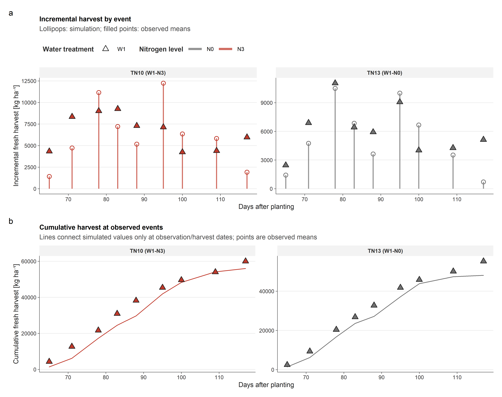
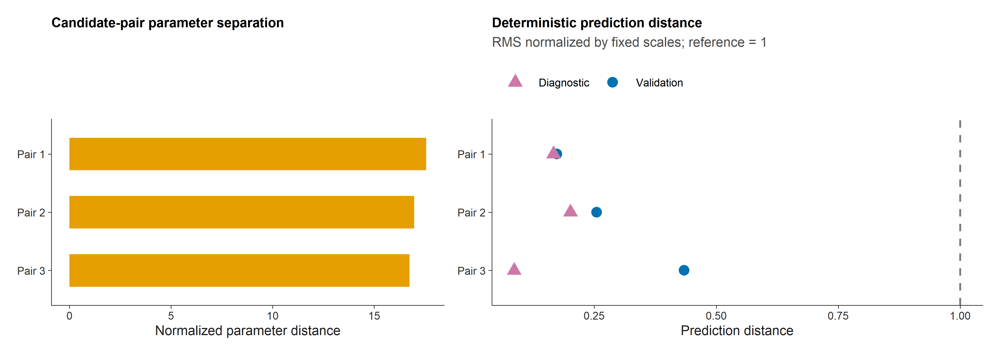

# 4 讨论 (Discussion)

> 本节讨论以第3节明确的数据口径为前提。C31确定性结果与09/27条件参数集合来源不同；采收日期科学核定、现存图件同步更新和质量门通过仍是正式论文使用这些结果的前提。

## 4.1 分层评价与代表方案的适用范围

作物模型参数化需要同时关注平均误差、处理差异及跨季预测，而不宜仅凭一个合并指标判断模型可靠性（Wallach et al., 2021）。当前C31是基于C28参数组合进行TB1定值调整后的方案；现有记录不支持把它解释为09/27条件集合直接导出的最优成员或已验证的Pareto最优解。历史候选在输入版本、参数域和提取规则上存在差异，未统一这些条件前，不宜将其指标串联为等条件的改进幅度。

按现有观测当天读出口径，C31在25SP、26SP的季末产量NRMSE分别为6.24%、4.89%，两春合并为5.57%，说明当前春季产量尺度上的相对误差较小。但25SP NSE为0.3726、26SP为0.7011，不能称各季表现完全一致。更重要的是，本轮率定NSE为0.7060，留出为0.0060；留出NRMSE接近率定只能反映相对于产量均值的误差比例，不能排除过拟合，也不能证明处理排序充分再现。

三季合并r²=0.9840主要包含春秋产量水平的差异，约96.10%的实测总平方和来自季节均值之间。因此，同季处理排序、水氮有限差值和留出表现应与合并统计并列报告。25FA的NSE为−3.2474、r²为0.0603，且平均低估3.38 t ha⁻¹，表明秋季外推受限；模拟未崩溃不能替代预测准确性检验。

目前13率定、10留出的划分描述的是本轮目标函数，已有候选筛选曾计算留出及秋季表现。缺少预先封存的选解规则和数据访问记录时，应称本轮目标函数外评价，避免将其包装为完全独立盲验。未来应预先固定输入、参数域、选解准则和评价子集，再实施独立验证。

## 4.2 水氮响应幅度与土壤过程解释的证据边界

DSSAT–CROPGRO通过土壤水分平衡、土壤氮转化、根系吸收、冠层光合和生长分配等过程连接管理措施与产量（Boote et al., 1998; Jones et al., 2003）。当前项目土壤水分说明采用tipping-bucket框架，不应将其笼统描述为完整求解Richards方程的一维非饱和水流模型。

Scheme1包含SLPF肥力因子、SASC_RATIO修正系数、SLDR排水率常数、SLU1累计蒸发上限，以及初始水分缩放和根区截断。SOIL_SLU1=2.50的单位为mm，SOIL_SLDR=0.40的单位为d⁻¹；DSWBAR=5.64643 cm为水分胁迫相关深度参数，不是干旱响应陡度。这些设置应区分实测输入和经验调谐，不能全部称为实测物理校正。

两春季当前有效对比的模拟W2−W1、W3−W1均为正，可保留为响应方向的描述。但25SP N0的W3−W1模拟值13.259 t ha⁻¹高于实测8.873，26SP模拟2.543低于实测9.313；春季W3下N3−N0模拟/实测响应比约为209.7%和203.4%。这些结果显示方向再现与幅度再现并不等价。26SP N3实测W3−W1略为负而模拟为正，也不支持所有处理的方向完全吻合。

此外，W2、W3均高于W1不意味着W3高于W2。26SP N0的模拟W3−W2为−3.489 t ha⁻¹，三个离散水分水平不能证明严格单调响应、连续偏导数或最佳灌溉拐点。对管理用途，应报告响应差值误差、排序及适用处理范围，不能仅以“正响应”判断方案可信。

修正25FA显式处理映射后，秋季模拟施氮响应接近零，而实测N3−N0仍为1.609–4.464 t ha⁻¹；秋季模拟水分响应也与实测方向不一致。温度限制、土壤供氮和根系吸收均可能参与这些偏差，但目前没有足够的过程输出判定其贡献。将旧方案负响应归因于硝态氮过度淋洗，或将当前变化归因于毛细上升与微区扩散的纠正，都应作为待检验解释。验证需要逐层水分、矿质氮、排水与淋失、根长分布及胁迫因子的对照，而不是只比较产量符号。

## 4.3 多次采收评价、日期对齐与源库过程

连续结实作物需要分别评价单次采收、累计采收及营养生长。番茄和黄瓜源库研究可为过程解释提供背景（Heuvelink, 1996; Marcelis, 1996），但不能替代本试验茄子采收频率、在株果数和商品标准的观测记录。CROPGRO-Strawberry的研究也支持发展多次采收过程的评价思路（Hopf et al., 2022），并不直接证明本试验存在已量化的2–4天人为采收扰动。

修订表5不再引用旧C23结果。两春季当前累计鲜重NRMSE为12.98%和9.82%，NSE为0.944和0.970；对应单次鲜重NRMSE为38.06%和22.11%，NSE为−0.030和0.492。秋季按当天读出的累计鲜重NRMSE为45.33%、NSE为−0.495，单次鲜重为76.30%、−11.499。因此，不能继续表述“三季累计量均高精度”。同时，25FA LAI、叶干重及茎干重NRMSE接近或超过100%，显示秋季营养器官过程偏差需要正面讨论。

*图4b (Fig.4b). 25SP TN10（W1N3）和TN13（W1N0）的单次与累计采收预览。单次采收使用模拟棒棒糖和观测点；累计面板以普通折线连接模拟采收节点。现存图采用报告提取口径，待与修订表5统一；该图不能单独证明采收错位原因或物质守恒。*

当前率定程序取观测当天CHFPW，而报告程序取DATE+1并允许向前最近日期；25FA TN1末次累计鲜重分别为13.4308和18.4689 t ha⁻¹。此差异会改变偏差方向和评价结论，必须结合FileX采收日、FileT观测日和日输出更新顺序审计。统一到现有当天读出规则可避免修订表格内部混用，但仍不等于已确认最终科学配对日期。

模型使用输入采收日期，单次鲜重由相邻累计输出差分得到，不能将其描写为只由XMAGE控制的自由成熟释放试验。PODUR是最适条件下达到最终荚果负载的光温时间，并非单果充实期。采收商品标准或人工调度可能影响观测，但现有记录不足以将其认定为低NSE的确定原因。所有指标应完整保留，结合日期审计解释，不应因NSE较低而选择性弱化它。

累计量的上升趋势与误差抵消可以提高相关和效率指标，但光合同化物还进入呼吸、营养器官、衰老组织及未采收果实。XFRT为每日生长向种子和荚壳分配的最大比例，不能推出所有未败育同化物最终均进入采收果实。物质平衡判断应同时核对器官生物量、在株果实、采收量和呼吸。组织氮结果也应限定于实际具有观测的季节与处理，而非宣称全样本均严格验证。

## 4.4 条件集合收缩、多解性与覆盖不足

PEST++ IES条件集合可用于描述当前参数域和观测约束下的分布变化，但不能仅凭集合收缩认定已获得完整、校准良好的贝叶斯后验（Beven & Freer, 2001; Wallach et al., 2021）。09/27参数诊断含base共142行，条件预测重放为141个非base成员；两者应分开说明，也不能与C31确定性方案的来源混同。

SLAVR、XFRT、FL-SD和EM-FL的IQR收缩率分别为81.5%、79.8%、79.1%、72.1%，描述当前所选参数集合的缩窄。TB1最终中央90%区间为8.6095–9.4475°C，中位数9.0253°C，IQR收缩率20.9%；这些不是物理边界，也不构成茄子真实基温高于番茄的证据。更新后的图源按09/27实际PST域计算命中率；除SIZLF外，EM-FL、SFDUR、RWUMX、DSWBAR也有非零命中。固定THRSH已从分布与相关诊断中移除，由本轮具有变异的XMAGE替代；XMAGE的集合收缩与其同FL-SD、XFRT的关联，仍需独立果龄和采收观测检验。

EM-FL–TB1及XFRT–SFDUR的Spearman系数分别为+0.04498和−0.03214，均接近零，原先据此建立的负相关代偿解释应撤回。即使其他参数存在相关，也需要独立过程观测区分统计关联与机制。

*图S7 (Fig.S7). 三对相近Phi候选的标准化参数距离柱图及按validation/diagnostic汇总的预测距离点图。该图不包含极端处理时序，不能换算为模拟轨迹百分比差异，也不能证明极端观测已消除多解性。*

三对候选154/155、18/19、140/141在参数距离较大时仍被现有汇总规则归为预测相似，提示多解性尚需进一步检验。未来可以设计具有过程辨识力的温度、水氮和器官观测，但“极端处理已揭示10%–18%时序发散”的结论没有当前图源支持。

条件累计鲜重95%成员区间的PICP在25SP率定、留出组为72.22%、77.78%，26SP率定、留出组为62.86%、20.00%，RMPIW为20.56%–29.35%。26SP留出仅5/25节点入带且Bias达+6.760 t ha⁻¹，26SP各处理相对残差中位数均为正。区间较窄不能抵消覆盖不足，也不能表述为无系统偏离的可靠泛化。26SP LAI覆盖约10%进一步提示营养过程的条件集合不足以涵盖观测。

成员分位区间主要反映当前参数集合在给定输入下的输出差异，没有完整纳入观测、气象、土壤输入和模型结构误差。条件重放质量记录仍有工程失败及科学状态未评估标记；正式引用前应修复成员对齐等问题、统一采收规则、重冻结并核验覆盖。图名取消DEMO或水印并不提升科学验证状态。

## 4.5 秋冬温度敏感性、输入版本与后续应用

秋季TB1扫描是在其余参数和已有运行输入保持不变时的单参数情景，不是重新率定或逆向证明物候机理。TB1从9.20°C降至8.5、7.5、7.0°C时，均产分别为13.4094、13.3155、13.1975、11.9505 t ha⁻¹，NRMSE分别为23.073%、23.563%、24.183%、30.958%。降低TB1没有改善该组秋季产量偏差；LAI最大值约由0.281降至0.242，但结果仅适用于这些固定输入情景。

运行文件显示上述情景全部12处理的ADAPS仍为37天，PD1PS=44、PDFPS=66亦未变，不支持“基温下降使初花急剧提前、营养期压缩”的因果链。CROPGRO物候推进采用逐小时温度分段响应并结合光周期和胁迫，不宜用简单max(0,T−Tbase)线性积温式代替。因此，产量和LAI下降可以报告为数值事实，其根因仍需诊断温度响应、叶龄、光合、胁迫及果实队列输出。

还应区分输入版本：现存C31秋季确定性运行和TB1扫描天气头为TAV=22.7°C、AMP=21.7°C；当前源实验bundle于9月30日才改为20.0°C、6.0°C。后来的设置不能用于解释9月27日结果。若评价新热边界，需另行冻结输入并复跑；单独改变TAV/AMP也不能证明10–30 cm根区每日低温底线得到保护，更不能替代实测地温。

根区温度、低温呼吸及光合适应、覆盖措施和生物刺激素均可作为后续研究因素。但缺少本试验施用记录、地温和气体交换测定时，不能将海藻酸类处理、20 cm地温维持12–15°C或XXFTEM曲线钝化写成本研究已证实的机制。未来宜通过地上气温—根区地温配对观测及控制温度试验检验这些假说。

C31可以作为后续水氮情景探索的候选模型，当前证据尚不足以支持安全的管理决策。接入NSGA-III或强化学习前，应先完成独立验证、响应幅度及排序检验，并对参数、输入和结构不确定性进行传播。能与优化算法连接不等于优化推荐已获得科学验证；外推应用应限制在经过检验的气候、管理与参数范围内。

## 4.6 XFINT与XFPHT对无限生长型作物源库协调的意义

无限生长型果菜在进入生殖阶段后仍持续形成叶片、茎和新的果实队列，因而模型既需要描述可采收果实的移除，也需要合理分配营养生长与生殖生长之间的同化物。Hopf et al.（2022）在CROPGRO-Strawberry中发现，较高且恒定的XFRUIT会造成前期果实生产偏多，而后期因叶面积和花量不足难以再现产量增加；其改进是使生殖分配随累积光温时间逐步提高。这一动态分配思想源于草莓研究，后续CROPGRO代码通过生态型参数XFINT与XFPHT将其表达为可配置过程（DSSAT Development Team, 2026）。

XFINT规定早期生殖分配相对于最大潜在分配的起始比例，XFPHT规定向最大分配过渡的光温时间尺度。在动态调整阶段，其分配基准可表示为$f_{rep}(h)=f_{max}[XFINT+(1-XFINT)h/XFPHT]$，其中$h$为模型生殖发育时钟中的累积光温时间，$0\leq h\leq XFPHT$，$f_{max}$对应品种文件XFRT给出的最大潜在分配比例；实际生长分配还受温度、水分及器官需求等过程影响。较低的XFINT或较长的XFPHT可减缓早期生殖分配，为营养器官生长保留更多资源，但也可能延缓采收产量形成。因此，两者分别提供了起始分配和分配转换速度的调节，并不直接规定单果成熟或采收时间。

XMAGE则是果实队列达到可采收状态的果龄阈值；在所核查的FreshWt实现中，比较的是由PHTIM计算的光温果龄，不能简单等同于日历日（DSSAT Development Team, 2026）。该阈值与输入采收安排共同影响果实移除，却不能替代早期源库分配的调节。DSSAT v4.8.2发布说明将XMAGE列为使用鲜重输出作物的CROPGRO新增参数，其适用范围包含多种鲜重作物（DSSAT Development Team, 2023）。Boote et al.（2025）将多次采收功能追溯至草莓适配，并指出其可用于长周期无限生长型温室番茄，但截至该文发表尚未完成这一生产情景的测试。采收功能的扩展为无限生长型果菜提供了模拟基础，而动态分配仍需在具体作物的持续结实过程中进行评价。

为检验动态分配在当前茄子参数化中的作用，本研究对归档C31输入进行固定参数的前向消融对照，保持天气、土壤、管理、XMAGE及其余参数不变，不重新率定。模型实际读入的基线为XFINT=0.3799、XFPHT=43.7光温日及XMAGE=13.4光温日，这些是候选参数经固定宽度写入后的数值。将XFINT设为1，使分配基准从生殖阶段开始即取最大值；另以XFPHT=0关闭动态调整分支，进行等价性核验，两种关闭方式在三季均得到完全一致的逐日输出。与基线相比，关闭动态分配后，25SP和26SP累计鲜重NRMSE分别由12.98%、9.82%增至35.70%、19.12%，两春季末产量NRMSE由5.57%增至16.84%；两春的这一比较在观测当天与DATE+1提取下相同。保留XMAGE仍出现明显的采收预测变化，直接说明可采收果龄阈值不能替代动态同化物分配在当前方案中的作用。

进一步保留动态调整、仅将XFINT设为0时，两春季末产量NRMSE升至29.57%；保持XFINT不变，将XFPHT约减半至21.9或加倍至87.4光温日，该指标分别升至16.57%和26.65%。这些对照表明，当前方案同时依赖非零的起始生殖分配与适当的分配转换时间，而不是一味减少早期果实投入即可改善预测。不过，动态分配并未使所有过程指标同步改善：关闭该机制后，26SP的LAI NRMSE由35.81%降至26.24%，而叶、茎干重误差均增大，说明冠层面积、器官生物量和采收量之间仍存在拟合权衡。草莓研究也报告动态分配调整后需要继续修正营养器官与衰老过程（Hopf et al., 2022），因此应以多器官时序观测共同约束分配参数。

这些结果支持将草莓开发的动态分配机制作为Tomato模板构建无限生长型茄子模型时的重要过程，而其可迁移意义在于协调持续营养生长与连续结实，并不要求直接沿用草莓的参数值。当前证据仍属于给定C31参数组合的过程诊断：秋季拟合与采收日期对齐问题尚未解决，固定参数消融也不能证明关闭该机制的模型经重新率定后必然无法达到相近精度，更不能证明XFINT与XFPHT已被独立辨识或对所有无限生长型作物均不可替代。后续宜结合初始果实生长、叶茎增量、在株果数和连续采收观测，比较保留与关闭动态分配的模型在同等率定条件及独立季节下的表现，以检验这一机制的适用范围。

## 参考文献 (References)

1. Beven, K., Freer, J., 2001. Equifinality, data assimilation, and uncertainty estimation in environmental modelling of anomalous pathways: the GLUE methodology. *Journal of Hydrology* 249, 11–29. [DOI: 10.1016/S0022-1694(01)00421-8](https://doi.org/10.1016/S0022-1694(01)00421-8).
2. Boote, K.J., Jones, J.W., Hoogenboom, G., 1998. Simulation of crop growth: CROPGRO model. In: Peart, R.M., Curry, R.B. (Eds.), *Agricultural Systems Modeling and Simulation*. Marcel Dekker, New York, pp. 651–692.
3. Dias, H.B., Boote, K.J., Zotarelli, L., Hoogenboom, G., 2026. Modeling nitrogen effects on field-grown fresh-market tomato using the CROPGRO-Tomato model. *Scientia Horticulturae* 363, 114900. [DOI: 10.1016/j.scienta.2026.114900](https://doi.org/10.1016/j.scienta.2026.114900).
4. Heuvelink, E., 1996. Dry matter partitioning in tomato: validation of a dynamic simulation model. *Annals of Botany* 77, 71–80. [DOI: 10.1006/anbo.1996.0009](https://doi.org/10.1006/anbo.1996.0009).
5. Hopf, A., Boote, K.J., Oh, J., Guan, Z., Agehara, S., Shelia, V., Whitaker, V.M., Asseng, S., Zhao, X., Hoogenboom, G., 2022. Development and improvement of the CROPGRO-Strawberry model. *Scientia Horticulturae* 291, 110538. [DOI: 10.1016/j.scienta.2021.110538](https://doi.org/10.1016/j.scienta.2021.110538).
6. Jones, J.W., Hoogenboom, G., Porter, C.H., Boote, K.J., Batchelor, W.D., Hunt, L.A., Wilkens, P.W., Singh, U., Gijsman, A.J., Ritchie, J.T., 2003. The DSSAT cropping system model. *European Journal of Agronomy* 18, 235–265. [DOI: 10.1016/S1161-0301(02)00107-7](https://doi.org/10.1016/S1161-0301(02)00107-7).
7. Lemaire, G., Jeuffroy, M.H., Gastal, F., 2008. Diagnosis tool for plant and crop N status in vegetative stage: Theory and practices for crop N management. *European Journal of Agronomy* 28, 614–624. [DOI: 10.1016/j.eja.2008.01.004](https://doi.org/10.1016/j.eja.2008.01.004).
8. Marcelis, L.F.M., 1996. Assessment of the growth potential of individual cucumber fruits. *Annals of Botany* 77, 321–327. [DOI: 10.1006/anbo.1996.0039](https://doi.org/10.1006/anbo.1996.0039).
9. Wallach, D., Palosuo, T., Thorburn, P., Hochman, Z., Gourdain, E., Andrianasolo, F., Asseng, S., Basso, B., Bindi, M., Boote, K.J., Cammarano, D., Crout, N., De Sanctis, G., Dumont, B., Ewert, F., Ferrise, R., Gaiser, T., Gao, Y., Garcia, C., Gayler, S., Giglio, L., Hiremath, S., Hoogenboom, G., Huang, M., Izaurralde, R.C., Jabloun, M., Jing, Q., Justes, E., Kersebaum, K.C., Kumar, S., Lebas, E., Lecharpentier, P., Liu, B., Long, M., Louarn, G., Luo, Q., Maestrini, B., Miguez, F.E., Nendel, C., Olesen, J.E., Padovan, G., Poyda, A., Priesack, E., Pullens, J.W.M., Qian, B., Ruane, A.C., Schütze, N., Srivastava, A.K., Stella, T., Tao, F., Thorburn, P., Wang, E., Weber, T.K.D., Weihermüller, I., Xiong, W., Yin, X., Zhao, Z., Zhu, Y., 2021. The chaos in calibrating crop models: Lessons learned from a multi-model calibration exercise. *Environmental Modelling & Software* 145, 105206. [DOI: 10.1016/j.envsoft.2021.105206](https://doi.org/10.1016/j.envsoft.2021.105206).
10. Boote, K.J., Hoogenboom, G., Porter, C.H., Pavan, W., Shelia, V., Singh, U., White, J.W., Asseng, S., Lizaso, J.I., Moreno, L.P., Cuadra, S., Kimball, B., Hopf, A., Oliveira, F.A.A., Ferreira, T.B., Dias, H.B., Alderman, P., Batchelor, W.D., Pequeno, D., Thorp, K.R., Jones, J.W., Ogoshi, R., Hunt, L.A., Tsuji, G.Y., 2025. The Decision Support System for Agrotechnology Transfer (DSSAT) crop modeling ecosystem: evolution and advances. In: Hoogenboom, G. (Ed.), *Current Crop Models: State-of-the-Art and Future Developments*. Burleigh Dodds Science Publishing, Cambridge, UK, pp. 3–63. [DOI: 10.19103/AS.2025.0155.01](https://doi.org/10.19103/AS.2025.0155.01).
11. DSSAT Development Team, 2023. DSSAT v4.8.2.0 release notes (3 August 2023). [DSSAT release notes](https://dssat.net/release-notes/) (accessed 5 October 2026).
12. DSSAT Development Team, 2026. DSSAT Cropping System Model open-source code: CROPGRO DEMAND and FreshWt modules. GitHub, develop branch. [DEMAND.for](https://github.com/DSSAT/dssat-csm-os/blob/develop/Plant/CROPGRO/DEMAND.for), [FreshWt.for](https://github.com/DSSAT/dssat-csm-os/blob/develop/Plant/CROPGRO/FreshWt.for) (accessed 5 October 2026).
