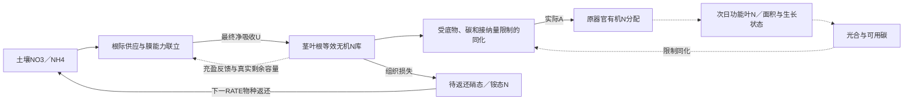

# 4.8.6.4五阶段氮机制：实现规格

状态：原生代码及工程测试已接通，尚未率定。基座为官方 `25c93b9a`；未借用V15 S1机制或最优参数。用户已要求原生bug留账，最后统一核算处理；本实现没有修复L01—L04。

## 模式与输入

无 `NIntegration.nml` 时为官方模式；也可显式设置 `ni_stage=0`。环境变量 `DSSAT_N_CONFIG` 可指定配置路径；显式路径缺失、未知字段或必需参数缺失会报错，不静默回退。

| ni_stage | 接通内容 | root_mode |
|---|---|---|
| 0 | 官方原算法 | 0 |
| 1 | 真实无机N库、物种/容量限幅、瞬时但受碳及实际接纳约束的测试同化 | 0 |
| 2 | 有限同化；旧库与当日输入各半日，统一碳及接受量结算 | 0 |
| 3 | 同上，加实际吸水驱动的独立根吸收 | 0原根对照、1纯质流、2质流+有效扩散 |
| 4 | 同上，加茎叶三条生物量相关软参考曲线 | 0/1/2 |
| 5 | 同上，加替换式功能反馈 | 0/1/2 |

第一版范围为TM代理茄子、启用土壤N、无固氮、关闭虫害。新根吸收要求真实水分模拟且不是Z蒸散路线；新功能反馈仅支持已核查的L光合路线。其他路线不作为已验证功能。果实无新曲线，也无果实无机N库。

## 氮库与收支

新增NO3-N和NH4-N各一个整株共享缓冲，按叶、茎、根三个存储承载量分摊，因此有六个等效器官库存。它们不包含在原WTN*有机/还原态账中；不重复把原WNR当作新增库存。

存储承载量用活体组织代理：随真实组织损失衰减，以当前站存干物质补足；不因单纯内部碳／蛋白动员立即丢失承载空间。该代理具有记忆，不是另一份可加到干重的物质库存。它与下面三条以当前站存茎叶干重驱动的浓度曲线是两个不同定义。

期初无机库存工程初值为0。器官间采用快速混合/按容量分摊的等效假设，不模拟真实液泡、木质部及器官间运输时滞。器官NO3输出需据此解释，不可未经独立数据验证当作真实空间分布。

`U`来自同一组最终UNO3/UNH4，仍按kg N/ha交给下一次SoilNi(RATE)；累计WTNUP收到真实U。`A`来自无机库，只有实际同化供给进入NAVL；MOBIL、VEGGR供给概念与RPROAV来源分母改用A。GROW累计吸氮仍使用U。

暂定同化尚未形成最终有机N：若实际器官名义分配接纳不足，撤回未接纳部分及其成本；退款进入碳储备。对旧库同化暂时腾出的空间，若后来撤回导致库容不足，会在PLANT返回前同比回调各层候选U。没有向已经扣除的土壤作逆向补偿，也没有把原生NAD保留缺口回加NO3。

无机N随真正茎叶根组织损失离开活体，按NO3/NH4分别暂存，下一RATE返回对应土层；表层部分进入第一土层，根部按根死亡分布分摊。原土壤余额增加明确列出的无机组织返还输入，不能冒充施肥或有机矿化。

日末需同时保留：

`soil_book + live_organic_N + live_inorganic_N + pending_inorganic_litter - pending_soil_uptake`。

新Q日账和容量为硬性断言；原有机N残差与生长C超支另外输出，不抵消或豁免。

## 有限同化

各形态采用有效米氏式：`A_pot = v_specific * W_carrier * f_temperature * c/(K+c)`，`c=Q/W_carrier`。温度因子暂复用原生DTX并限于0—1，是开发性代理而非NR/GS酶模型。

共同受真实底物、器官预测接受量和同一可用CH2O预算限制。成本沿用原RNO3C/RNH4C蛋白合成相关口径，除以0.16转换为每g N成本。旧库/新输入使用相同的两半日调度，根模块消融不会同时改变这个调度。

日末根据实际名义器官分配结算；原生GROW对NAD损失的账本差额保留到有机N审计中。本阶段不声称所有有机N都已拆成真实功能蛋白、氨基酸和结构N。

## 新根吸收

使用SPAM保存的实际RWU；运输水分取XTRACT可用水状态加回LL，再减去半日根提取量的日尺度代理。SW_AVAIL原位减过LL，不能当体积含水率直接使用。缓存带运行与日期核对；新模式缺少有效水分数据会报错。

- `Cbulk = NO3[mg/kg] * BD[kg/L] / theta`。
- `MF = 0.01 * RWU[cm/d] * Cbulk[mg N/L]`，得到g N/m²/d。
- `Lroot = 100 * RLV[cm/cm³] * DLAYR[cm]`，得到m root/m²。
- 膜容量先用单支米氏式；没有同时开放两套HATS/LATS的四个难识别参数。
- R1为min(质流候选、膜能力)；R2将膜能力与质流+有效扩散供应联立，二分解潜在根表浓度。**总吸收不是“质流+主动吸收”相加。**
- 根表解算后再受土层可提取N、全株真实接收能力和最终分配结算约束。层配额同比缩放，不按数组顺序抢占库容。
- NH4复用原生RTNH4与浓度响应形式，去除共享ANDEM缩放和旧低浓度截断；没有照搬NO3的溶液质流式。
- 碳对吸收的作用通过有限同化、可用库容和库充盈反馈闭合；未单独声称实现转运ATP、细胞质信号或双向外排。

LayerNIntegration.csv区分MF候选、扩散潜力、膜潜力、候选U及最终U。潜在根表浓度不冒称满足全株限幅后的实际根表平衡。

## 三条软曲线与器官分配

`W=(WTLF+STMWT)/100`，单位t DM/ha，为当前站存营养地上部干重，包含其原生碳储备口径。未将果实或历史累计采果加入该横轴。

分别对叶和茎：`Ncrit_i=a_i*max(1,W)^(-b_i)`；`Nmin_i=r_min*Ncrit_i`；`Nmax_i=r_max*Ncrit_i`。所有浓度为g N/g模型器官干重，小于1 t/ha时平台。

Ncrit用于新生叶/茎的参考需求；Nmax用于旧器官补充的目标。没有对实际WTN或浓度进行min/max投影，实际点可以超过参考带。Nmin用于相对氮状态和功能N代理，并非实际组织必须维持的硬下限。

原新生组织化学最低N要求与这个软下参考分开：保留原SPE的最低/参考蛋白比值，随新生参考目标一致缩放，并使用同一最低蛋白口径计算组成成本。未全局覆盖PROLFI/PROSTI，未修改根的参考曲线，原WNR/MOBIL动员规则仍保留。

输出常规 `N/Ncrit`、扣除Nmin的功能指数、亏缺/富余质量，富余指数不截为1。原生PlantN.OUT中的N仍为有机/还原态口径；新CSV另给器官有机、NO3、NH4及总浓度，浓度列为g/g，乘100才是%。不能未经分析方法核对直接用于现有观测目标。

## 替换式功能反馈

GROW日末状态作用于下一日，避免“同日光合→同化→立刻再增强光合”的循环。

L路线以局部叶N及SLW换算单位叶面积的功能有机N代理，并减去软结构参考部分；用临界功能面积N作参照，得到有界饱和能力。对富余无机N不直接增益，对高于面积功能参照的N不无限增强。

PGLFEQ原AGEMXL被替换；新功能面积N已包含SLW，所以不再额外乘原SLWMAX，防止叶重/N面积效应重复计入。量子效率使用原官方归一化响应形式作用于新功能能力，不再乘旧叶N因子。

营养生长以日初有机N相对状态及明确的时间常数替换旧SUPPN/需求归一化和0.5平均式；DEMAND的相应叶扩展氮因子使用同一状态，不再另加旧的平滑。资源不足时的实际N分配约束仍存在，不能为了反馈平滑而取消物质需求。

果实仍使用原需求、组成、分配、再转运及采收路径。新供给改变可以间接影响果实生长和N，但没有新增果实稀释曲线或覆盖果实N参数。

## 参数与适用限制

当前19个新连续参数全部在工程测试文件中显式给出，未作为公认生理默认值，未注册为PEST活动参数：

| 参数组 | 单位 |
|---|---|
| q_no3_max、q_nh4_max | g N/g存储承载代理干重 |
| assim_no3_v、assim_nh4_v | g N/g承载代理/d |
| assim_no3_k、assim_nh4_k | g N/g承载代理 |
| root_v、root_k | g N/m root/d；mg N/L水 |
| diffusion_k | L水/m root/d，有效导度 |
| pool_beta | 无量纲，充盈抑制系数 |
| leaf_a、stem_a；leaf_b、stem_b | g N/g器官DM；无量纲 |
| min_ratio、max_ratio | 无量纲，软参考带比例 |
| photo_floor、photo_gamma、growth_tau | 无量纲、无量纲、日 |

需进一步验证的假设：承载代理及器官快速混合、期初Q=0、DTX温度代理、日尺度运输、退款储存和两半日调度的时间步敏感性。无机盐及伴随离子质量尚未单独加入原器官干物质；未模拟真实液泡、渗透调节或Rubisco组分。这些限制不能用产量拟合变好来替代检验。

目前仅完成工程接线和边界检查，未形成可直接用于论文预测或水氮管理优化的率定版本。
