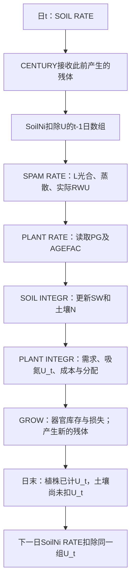

# P0b执行报告：官方4.8.6.4原生通量与日内／跨日预算追踪

日期：2026-11-02。官方起点：`v4.8.6.4`，`25c93b9a2f73f8ec45bf441b198dac5fb7b22849`。诊断实现提交：`16caa847dcea7c68fafb63d7d18c8cdf2cc6c971`。

## 1. 完成情况与判断

**P0b已完成：实现了可关闭的只读追踪，真实编译并执行了26SP十二处理的开关对照，完成吸水、吸氮、跨日扣除、器官氮分配、可用碳支出及L光合路线的运行时核查。**

追踪开关不改变模拟结果：43类具有可提取数值行的原生OUT在关闭/开启之间完全一致；8类核心输出分别与前阶段冻结的官方4.8.6.4参照完全一致。这里比较的是数值记录，版本与执行时间横幅不参与比较。

**审计发现了原生预算和采收去向问题，因此不能把本次结果写成“原生N/C预算无缺陷通过”，也不宜直接接入新的无机氮库。** 建议在P1前先做独立、最小范围的原生账本修复。

本阶段只增加诊断，没有实现R2、HATS/LATS、无机氮库、有限同化、三氮曲线或新NNI反馈；没有率定，也没有替换现有执行体。

## 2. 本次实际完成的代码工作

开发工作树：`D:/Tomato_Cal_worktrees/dssat4864-n-integration-v2-20261102`；分支：`codex/n-integration-v2-20261102`。

| 文件 | 新增的诊断职责 |
|---|---|
| `Utilities/CG_P0Trace.f90` | 统一只读CSV记录器、运行/日期/阶段/顺序标记、开关、变量与逐层数组输出 |
| `SPAM/SPAM.for` | 实际RWU、EP、TRWU、TRWUP、SW及水分增量/根提取量；提供叶片核函数的调用上下文 |
| `SPAM/ETPHOT.for` | L路线使用的RNITP、实际PG/AGEFAC、阳叶/阴叶N与叶重等中间量 |
| `SPAM/ETPHR.for` | 记录实际PGLFEQ调用的叶N、叶重、AGEMXL、AGEQE、LFMAX与QEFF |
| `Plant/CROPGRO/CROPGRO.for` | 真实GET缓存读取；RATE/INTEGR的土壤快照；DEMAND、种子N、吸收、N成本、再转运、固氮、果实、营养生长及日末库存 |
| `Plant/CROPGRO/VEGGR.for` | 缺氮组成修正前后的AGRVG、生长潜力、NRATIO、PGLEFT，定位碳成本交接 |
| `Plant/CROPGRO/GROW.for` | N库存负值保护前/后的日变率、实际损失、补氮保留量、采收前N浓度及采收累计账、残体N输出 |
| `Soil/Inorganic_N/SOILNI.for` | 土壤扣除前/后的逐层库存与吸氮数组、当日过程增量、累计吸氮和季末状态 |
| `Soil/CENTURY_OrganicMatter/CENTURY.for` | 真实接收的凋落/残体N及SENESSUMN增量，核对采收N的下一日去向 |
| `CMakeLists.txt` | 注册新增诊断模块 |

8个原生Fortran文件均只增加诊断调用、模块引用及私有诊断变量，原有生理赋值未删除或替换。已用官方SHA的文件逐一重建这些插入，结果与当前文件一致；新增模块的所有模型输入均为 `INTENT(IN)`。

诊断默认关闭。设置 `DSSAT_P0_TRACE=1` 时输出当前运行目录下的 `P0Trace.csv`；`0`或不设置时不产生该文件。已有同名CSV时明确报错，避免不同运行混写。日志中的顺序号跨同一进程的处理连续，运行号和日期用于分别核查十二处理的初始化及交接。

## 3. 实际编译、运行与证据身份

- 使用CMake、Ninja、GNU Fortran 16.2.0，RELEASE构建成功。
- 最终独立执行体：[dscsm048_p0b.exe](D:/Tomato_Cal/subprojects/critical_n/reports/p0b_trace_4864_20261102/final_run/bin/dscsm048_p0b.exe)。
- 执行体SHA-256：`0a9cf1ec4782c2e1313e12d43b5d5ebaee3c0072f10304062782f9cd992e1aeb`。
- 最终有效运行目录：[final_run](D:/Tomato_Cal/subprojects/critical_n/reports/p0b_trace_4864_20261102/final_run)。
- 调用：独立执行体 `B DSSBatch.v48`；分别设置诊断开关为0与1，各真实执行十二处理。
- 输入为前阶段已经冻结的历史preflight **base** 参数组，不是V15 S1最佳参数；这里只用作官方回归用例，不报告新的拟合成绩。
- 关键profile路径重定向至各自运行副本；原始输入逐文件哈希核对，未写回共享输入。
- 官方安装执行体、官方4.8.6.4原构建、现有正式自定义执行体、V15 S1执行体前后哈希一致。

共记录 **1,471,200行** 原生追踪，覆盖1,536个处理日的水分数据、1,512个生长处理日、19,968个逐层扣除记录，以及41,352次PGLFEQ叶片能力计算。日志约105 MB。

开发中间运行run01—run03保留为记录；最终认定使用 `final_run/run_receipt.json` 与 `final_run/analysis/audit_summary.json`。过程中纠正了分析工具对“未进入PLANT的出苗前零水日”、CSV浮点解析及原生RPROAV小通量回退的处理；没有为让检查通过而修改原生生理算法。

## 4. 核实的真实调用链及跨日交接

### 4.1 吸氮数组确实在下一日扣除

19,968条逐层记录核对中，当天SoilNi接收到的UNO3/UNH4与上一日植株产生的最终数组完全一致。对已记录的单精度库存，扣除结果也与原生单精度减法一致。十二处理开头UNO3/UNH4、累计吸氮与TNLEAK均正确清零，没有继承上一处理库存。

整株累计吸氮与土壤累计扣除量之间的差额，等于尚未结算的当日吸氮；剩余最大误差为 `9.0450×10^-6 g N/m²`，来自累计单精度运算。**季末这笔待结算量真实存在，不能清零，也不能误报为新机制漏氮。**

新氮库接入后应继续保留官方调度，用带日期的pending账本核对，而不是额外手工扣土壤。日末联合库存的接口修正是：

`soil_book_N + plant_N - pending_soil_debit_N`。

### 4.2 实际RWU接口可用，但水分截面不能混用

真实 `GET('SPAM','UH2O',...)` 与SPAM刚保存的实际RWU逐层完全一致；缓存EP也一致。`SUM(RWU)-EP/10`的最大绝对差仅 `4.7311×10^-8 cm/d`，符合单精度求和误差。

RATE与吸氮所在INTEGR阶段的SW最大差达到 **0.231548 cm³/cm³**。不能用读取时刻的SW默认代表先前吸水过程中的浓度分母。

另一个接口细节：XTRACT会将 `SW_AVAIL` 减去LL并原位改为可提取部分，所以其返回值也不能直接当作体积含水率。现已同时记录SW、LL、SW_AVAIL、SWDELTS、SWDELTU、SWDELTX，后续R2必须明确选择运输状态的时间截面及近似，不可只替换变量名。

## 5. 日内氮预算：已定位的问题

### 5.1 老组织补氮的名义分配量与最终保留量不一致

VEGGR分配NADLF/NADST/NADRT后，GROW按组织损失比例减少其实际保留量；减少的部分没有同样完整地进入原有损失账。不能将VEGGR的名义NAD直接视为器官实际接受量。

本批次每处理累计NAD保留缺口为 **0.0240—0.0830 kg N/ha**。同时，在4个处理日，原生器官N日变率因会使库存为负而被夹紧，形成另一项账面调整。两者作用后，原始整株账表现为每处理累计 **0.0240—0.0771 kg N/ha的净缺口**。

将NAD保留缺口、种子N阈值处理、再转运分配和库存夹紧逐项解释后，日残差最大只剩 `3.4738×10^-7 g N/m²`。本批次种子阈值丢弃量为0。

**“能解释缺口”不等于已经修复或满足物理守恒。** 本阶段保留这些缺口原样。新有限同化必须按实际有机N接受量结算，不能照搬名义NAD后再用数值残差填平预算。

官方来源：[GROW原版NAD保留修正](D:/Tomato_Cal/subprojects/critical_n/dssat_csm_os_4864/Plant/CROPGRO/GROW.for:746)、[原版库存负日变率保护](D:/Tomato_Cal/subprojects/critical_n/dssat_csm_os_4864/Plant/CROPGRO/GROW.for:824)。

### 5.2 TNLEAK是累计量，而且本批次实际发生

运行证实TNLEAK在季初清零、随后累加；本批次有882个生长处理日出现新增TNLEAK，每处理累计 **0.8507—5.3043 kg N/ha**。

每日外流必须使用TNLEAK的差分，不能把每日读取的累计量再次累加。原生PlantNBal已将该项作为独立漏出账，所以不能把全部TNLEAK又解释为“不知去向的缺口”。但这个变量不自动等于有实验依据的真实根系排氮；有限同化接入后应优先避免“同化了却无法接纳”的人为丢弃。

## 6. 日内碳预算：不能只检查PGAVL是否非负

### 6.1 存在生长成本重算后的可用碳超支

VEGGR先用原AGRVG计算生长量，随后根据新组织N组成重新计算AGRVG。在部分情况下，新成本增加而生长量没有同步缩减，使 `AGRVG_new × growth` 超出进入VEGGR的PGAVL；PGLEFT的MAX(0,...)掩盖了这一不足。

本次在 **307/1,512个生长处理日**观察到超支，单日最大 **0.163925 g CH₂O/m²**。N0三个处理的累计超支分别约0.792、1.138、1.131 g CH₂O/m²；这些量小于整季碳生产量，不能据此直接断言其是拟合差异的主因，但会影响后续严格有限同化预算的接入。

原生PGAVL日末最低为−0.695741 g CH₂O/m²，**不能把这个负值全部当成真实碳超支**：原算法先预留CSAVEV，又在后续CADLF/CADST中包含该储存。审计使用实际动员CMINEA与最终生长/储存成本重建可用CH₂O分配账，单独识别了上述成本超支。

将已识别的超支计入解释后，剩余分配残差最大 `1.5926×10^-6 g CH₂O/m²`。原始分配账仍不满足无超支条件，尚未修复。

官方来源：[VEGGR原版生长量计算](D:/Tomato_Cal/subprojects/critical_n/dssat_csm_os_4864/Plant/CROPGRO/VEGGR.for:289)、[N组成修正后的成本](D:/Tomato_Cal/subprojects/critical_n/dssat_csm_os_4864/Plant/CROPGRO/VEGGR.for:350)、[PGLEFT截断](D:/Tomato_Cal/subprojects/critical_n/dssat_csm_os_4864/Plant/CROPGRO/VEGGR.for:374)。

### 6.2 吸氮成本与RPROAV的真实语义已核清

本批次原生RSPNO3/RSPNH4按吸收量扣碳，没有出现其请求成本超过当时PGAVL的处理日。再转运的蛋白重合成成本另扣一次。

RPROAV使用吸收、固氮、再转运来源加权；当合计供给≤`1e-4 g N/m²`时使用NO3/NH4成本的均值回退。按这两条真实分支重算，与原值最大差 `3.7045×10^-7`；DEMAND使用前一日生成的RPROAV，经逐日比对完全一致。

后续有限同化需要同时改当日来源成本和次日RPROAV来源分母，但不能把后者再次作为当日现金支出。还需保留原有维护呼吸、再转运、实际碳动员与储存之间的分工。

## 7. 采收氮与残体：本次最需要优先处理的去向问题

### 7.1 商品果采收的壳部／果肉N进入了残体通道

官方GROW把 `HSHELWT` 纳入NSHOFF；后续 `SenE(0,N)` 又包含完整NSHOFF。在本项目番茄模型代理茄子、商品果被移出系统的定义下，HSHELWT对应的采收果肉N不应同时作为留田残体。

追踪证实这不是未使用的中间变量：GROW产生的表层残体N，在下一日被CENTURY逐值接收，SENESSUMN也增加了对应量。与此同时，残体干物质的构造没有相应加入HSHELWT，还会影响返还残体的C:N关系。

本批次每处理累计采收果肉N约 **26.29—43.49 kg N/ha**，其中季内已经进入残体接收端的量约 **21.06—33.16 kg N/ha**。两者差额主要处在最后一日产生、尚未由下一日残体处理接收的交接中；不能将全部采收N都写成“已返田”。

这是按本项目商品果采收定义判定的去向错误，不能推广成所有CROPGRO作物的相同管理错误。土壤自身Balance仍可能闭合，因为它把传入的残体N作为输入；土壤内部闭合不能验证商品果是否被正确移出。

官方来源：[GROW的NSHOFF及采收N](D:/Tomato_Cal/subprojects/critical_n/dssat_csm_os_4864/Plant/CROPGRO/GROW.for:792)、[残体N构造](D:/Tomato_Cal/subprojects/critical_n/dssat_csm_os_4864/Plant/CROPGRO/GROW.for:1048)、[CENTURY残体接收](D:/Tomato_Cal/subprojects/critical_n/dssat_csm_os_4864/Soil/CENTURY_OrganicMatter/CENTURY.for:504)。

### 7.2 内部采收种子N累计式使用了壳部N浓度

原版 `NHSDWT += HSDWT*PCNSH/100`，而同日种子离体NSDOFF使用PCNSD。本次内部采收种子N累计账相对按实际采收前PCNSD计算的值，每处理低约 **0.0109—0.0121 kg N/ha**。

该变量在原版GROW中只是内部累计账；不能把它说成已经改变WTNUP或主输出的同等误差。应在后续修复中一并更正，避免新采收预算误用这个内部变量。

官方来源：[GROW.for:807](D:/Tomato_Cal/subprojects/critical_n/dssat_csm_os_4864/Plant/CROPGRO/GROW.for:807)。

## 8. L光合调用链已核查

本次实际使用 `MEPHO=L`、`MEEVP=R`。调用链为：

`上一日GROW的RNITP → PLANT共享数据 → ETPHOT → CANOPG/PGLFEQ → 阳/阴叶AGEMXL与AGEQE → PG、AGEFAC → CROPGRO读取`。

RNITP的光合口径为 `100*WTNLF/(WTLF-WCRLF)`，不是按整个叶片干重计算的PCNL。ETPHOT读取的RNITP与当日CROPGRO生长计算前的值一致。PGLFEQ的局部叶氮还受冠层阳/阴叶分布处理，不能把所有叶片调用的N都当作全株同一浓度。

实际最大光合能力包含 `SLW/SLWREF × AGEMXL`；量子效率还有独立的AGEQE函数。因此后续新功能叶N反馈应明确替换哪个环节，不能再给PG叠乘一个NNI。

当前R蒸散路线没有调用Z能量平衡路线来让光合叶导度直接决定所有实际吸水。本次只能证明实际所用L/R调用链，未验证Z、C或其他作物路线。后续不得把这次证据扩称为所有光合/蒸散组合均已支持。

## 9. 逐处理核心结果

以下均来自同一冻结base输入，单位为kg N/ha；没有重新率定。

| 处理 | 季末待扣土壤N | TNLEAK累计 | 整株原始N账残差 | 已进入残体端的采收果肉N |
|---|---:|---:|---:|---:|
| W3_N3 | 0.707 | 4.254 | −0.0253 | 32.573 |
| W2_N3 | 0.706 | 4.253 | −0.0252 | 32.468 |
| W1_N3 | 0.647 | 5.238 | −0.0240 | 31.034 |
| W3_N2 | 0.707 | 4.246 | −0.0253 | 32.560 |
| W2_N2 | 0.706 | 4.253 | −0.0252 | 32.454 |
| W1_N2 | 0.664 | 5.304 | −0.0272 | 31.018 |
| W3_N1 | 0.781 | 3.484 | −0.0384 | 33.156 |
| W2_N1 | 0.707 | 4.266 | −0.0261 | 32.521 |
| W3_N0 | 0.886 | 0.851 | −0.0416 | 21.055 |
| W1_N1 | 0.721 | 5.276 | −0.0441 | 31.289 |
| W2_N0 | 1.405 | 1.474 | −0.0771 | 29.108 |
| W1_N0 | 0.876 | 0.857 | −0.0442 | 22.371 |

## 10. 预算判据与验收边界

18项追踪实现检查均通过，包括缓存、逐层交接、单精度原生扣除、重置、RPROAV前后日关系、实际残体接收及碳现金账重建。

本次联合N诊断边界是**土壤NO3/NH4/尿素库存＋活体植株及剩余种子N**，使用原生DLTS作为与土壤其他过程的净交换；土壤有机N在此边界之外。经pending修正并解释已定位的原生N缺口后，最大残差为 `1.4353×10^-6 g N/m²`。这验证了交接与归因，不是独立完成全土壤有机/无机N及整株全部C质量守恒的证明。

浮点检查使用与单精度精度及通量/库存量级相关的32/64倍机器精度；原始N缺口和C超支单独记录为未修复问题，**没有用扩大容差把它们判成通过**。

当前验收状态：

- 诊断实现、官方行为保持及原生调用链追踪：通过。
- 原生物理N/C预算无缺陷：未通过，问题已归因并量化。
- 新根吸收／无机库／有限同化／NNI机制：尚未实现，不作验收结论。
- 轮作、多年度、其他季节与其他光合路线：本次未检验。

## 11. V15 S1审批边界

**本阶段没有借用V15 S1代码、氮库、吸收函数、光合反馈或最优参数组；不需要以“已采用”名义补办审批。** 沿用的是上一阶段已经冻结的回归输入，用于官方构建的数值对照；这项来源已经在运行收据中明确标识。

用户本次新增要求已写入独立工作树AGENTS.md：今后任何V15 S1成功经验或机制的借鉴，先汇报“具体设计、原位置、适用理由、需要保留/修正的假设、拟修改接口及验证办法”，取得用户审批后才实施。当前借鉴登记为零项，不能把本阶段官方诊断当作V15移植批准。

## 12. 建议紧接着做的工作

在P1之前增加一个小范围的**原生预算修复工作包**，每项独立提交、独立对照：

1. 优先厘清并修复商品果采收N进入残体返还的去向；同时保证采收干物质、N与实际留田残体一致。
2. 修复缺氮组成成本重算后生长量与可用碳不一致的问题，联合核对N接受量，避免只给PGAVL加MAX掩盖超支。
3. 补齐NAD保留缩减与器官负日变率保护的N去向；不把已经形成有机N的损失随意退回未来NO3库。
4. 更正内部采收种子N累计浓度口径。
5. 冻结修复后的、可复现的新开发基线，再进入P1无机氮库；原官方参考和本次P0b结果继续保留。修复分支的预期行为变化须单独报告，不能宣称与未修复官方仍完全相同。

这些建议均来自官方源码与本次运行证据，不依赖V15 S1借鉴。至于R2运输状态选择、器官Q映射、实际同化接纳量和L路线替换反馈，仍按v2分阶段处理。

## 13. 证据与复现入口

- [最终运行收据](D:/Tomato_Cal/subprojects/critical_n/reports/p0b_trace_4864_20261102/final_run/run_receipt.json)：执行体/源码/输入哈希、调用及回归比较。
- [最终审计摘要](D:/Tomato_Cal/subprojects/critical_n/reports/p0b_trace_4864_20261102/final_run/analysis/audit_summary.json)：18项检查、缺陷指标与逐处理结果。
- [逐日N/C账](D:/Tomato_Cal/subprojects/critical_n/reports/p0b_trace_4864_20261102/final_run/analysis/daily_N_C_budget.csv)。
- [逐层扣除账](D:/Tomato_Cal/subprojects/critical_n/reports/p0b_trace_4864_20261102/final_run/analysis/layer_debit_ledger.csv)。
- [逐层水分快照](D:/Tomato_Cal/subprojects/critical_n/reports/p0b_trace_4864_20261102/final_run/analysis/layer_water_snapshots.csv)。
- [跨日pending账](D:/Tomato_Cal/subprojects/critical_n/reports/p0b_trace_4864_20261102/final_run/analysis/daily_pending_ledger.csv)。
- [残体接收账](D:/Tomato_Cal/subprojects/critical_n/reports/p0b_trace_4864_20261102/final_run/analysis/residue_consumer_ledger.csv)。
- [逐处理摘要](D:/Tomato_Cal/subprojects/critical_n/reports/p0b_trace_4864_20261102/final_run/analysis/per_treatment_summary.csv)。
- [L光合日调用链](D:/Tomato_Cal/subprojects/critical_n/reports/p0b_trace_4864_20261102/final_run/analysis/daily_L_photosynthesis_chain.csv)及[叶片核函数采样](D:/Tomato_Cal/subprojects/critical_n/reports/p0b_trace_4864_20261102/final_run/analysis/leaf_capacity_samples.csv)。
- [原始追踪CSV](D:/Tomato_Cal/subprojects/critical_n/reports/p0b_trace_4864_20261102/final_run/trace_on/P0Trace.csv)。
- [执行与分析工具说明](D:/Tomato_Cal_worktrees/dssat4864-n-integration-v2-20261102/research/n_integration_v2/README.md)。
