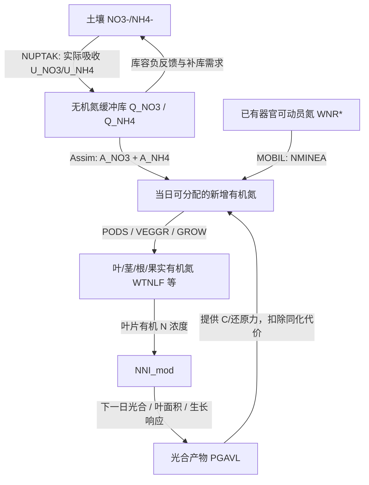
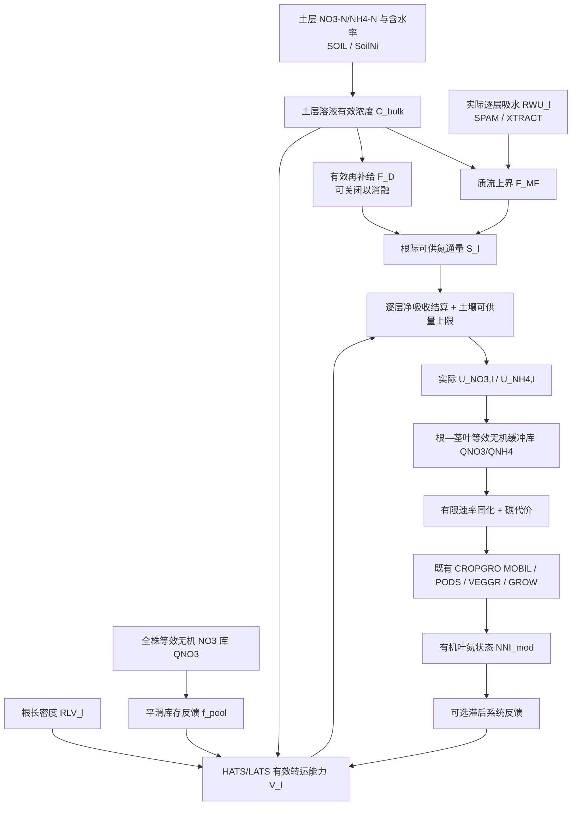

# DSSAT-CSM v4.8.6.4 根系吸收—无机氮储存—有限同化—器官分配—NNI反馈一体化改进方案（修订版 v2.0）

> **定位**：面向 CROPGRO 类型作物（优先以番茄/甜椒作技术验证、以茄子为最终应用对象）的研究型、可逐步实施的模型设计文档。  
> **源码基线**：[`DSSAT/dssat-csm-os` 的 `v4.8.6.4` 标签](https://github.com/DSSAT/dssat-csm-os/tree/v4.8.6.4)，标签对象 `ded1ff4b3130dd834dad24fe3438199bd3c82ea7`，解引用后提交 `25c93b9a2f73f8ec45bf441b198dac5fb7b22849`（标签创建于 2026-10-03，所对应的版本历史记录为 2026-10-02）。  
> **核对时间**：2026-11-02。
> **本次修订**：v2.0，新纳入根际物质供应、逐层根系吸水驱动的硝态氮迁移、HATS/LATS 代理动力学、体内氮状态负反馈、土壤—植株跨边界守恒，以及对应的源码实施与验证；同时修正 v1 中“吸收补库需求即吸收约束”的表达。
> **证据级别**：区分【已查源码】、【有文献支撑】、【建议的模型结构】、【待试验判定】；所有新增公式都属于研发方案，不冒称 DSSAT 已实现。  
> **性质**：设计方案，**不是已经编译通过的补丁**。本文涉及的新增接口、文件名及伪代码均为“建议新增”，不应误认为已存在于 DSSAT 官方源码中。

## 摘要：最终建议

不建议在 DSSAT 中另外构造一个与 CROPGRO 完全平行的“全株有机氮分配系统”，也不建议把液泡硝态氮库直接嵌入现有 `WTNLF`/`WTNST` 等器官氮变量。**最终首选是联动修改两道串联边界：①土壤溶液→根表有效供应→净跨根吸收（不再由当日组织需氮唯一截断）；②进入植株的无机氮→可缓冲储存→有碳成本与容量限制的氮同化→既有 CROPGRO 有机氮分配。**修正氮营养指数仅在独立验证后参与反馈。

推荐两层实现：

- **MVP-R（推荐，日尺度）**：`逐层实际 RWU + NO₃⁻ 质流 + 简化有效扩散/再补给 + 受体内库状态反馈的 HATS/LATS 代理吸收 + NO₃⁻ 缓冲库 + 受碳源约束的同化 + 既有有机氮分配 + 有机氮 NNI 诊断`。同时设置 **MF-only 消融模式**，用数据决定是否可忽略扩散。NH₄⁺ 保留独立的有效根际供应及吸收支路。
- **扩展层（有充分数据后）**：将 NO₃⁻ 库拆分为 `N_cyt`/`N_vac`，显式求解根表边界层、局部外排或空间滴灌几何，并测试昼夜变化、渗透调节及对根系构型的反馈。**根外排、激素调节、固定比例旁路吸收不是 MVP 的默认项。**

**首要判据不是模型变复杂，而是：在与原模型同等校准条件下，是否能同时改进“土壤分层 NO₃⁻、实际逐层吸水、净吸氮、组织 NO₃⁻/有机氮、叶片光合、生物量及果实产量”的动态预测，并严格满足土壤—植株氮质量守恒。**

---

## 1. 版本、研究对象和既有源码的准确边界

### 1.1 版本核验

DSSAT 官方网站在 2026 年 7 月公布的正式版本名称为 **4.8.6**；GitHub 的正式 release 页面突出展示的是 **`v4.8.6.0`**。但公开源码仓库**确实存在 `v4.8.6.4` 标签**。在此标签下：

- 根目录 `CMakeLists.txt` 中 `SET(MAJOR 4)`, `SET(MINOR 8)`, `SET(MODEL 6)`, `SET(BUILD 4)`；
- `Utilities/CSMVersion.for.in` 的版本历史列有 `4.8.6.4`；
- 与 `v4.8.6.0` 相比，`Plant/CROPGRO/CROPGRO.for`、`Plant/CROPGRO/PHOTO.for`、`Plant/CROPGRO/IPPLNT.for`、`Plant/CROPGRO/SENES.for` 已有改动。因此分析与修改均应锁定 `v4.8.6.4`，不能从旧版复制整份子程序覆盖。

**代码冻结要求**：开发仓库从上述 SHA 新建分支；成果报告同时写“DSSAT v4.8.6.4 + 自研模块版本 + Git SHA”，不只写“DSSAT 4.8”。

### 1.2 应优先选择哪个 DSSAT 作物模型？

DSSAT 公布的当前作物清单包括 **CROPGRO-Tomato（番茄，TM）**和 **CROPGRO-Bell Pepper（甜椒，PR）**，**没有列出可直接运行的官方茄子（Solanum melongena）作物模型**。因而“修改 DSSAT 的茄子模块”不能作为已有事实。

建议：

1. **机制研发及回归测试**：先在 `CROPGRO-Tomato` 和/或 `CROPGRO-Bell Pepper` 上做机制正确性验证；保留原品种数据不修改以便对照。
2. **目标作物适配**：建立茄子专用的物候、器官分配、果实库强度、收获习性与参数文件；是否新增 DSSAT 作物代码及通用入口，应在独立任务中完成。
3. **论文归属**：氮机制改进与“茄子作物模型建立”属于两个可以分别评价的研究任务，不要把作物结构误差全部归因于氮模型。

### 1.3 v4.8.6.4 中已实现的氮机制（避免重复造轮子）

| 源文件 / 子程序 | 源码已存在的作用（已核对） | 本方案如何对接 |
|---|---|---|
| [`Plant/CROPGRO/DEMAND.for`](https://github.com/DSSAT/dssat-csm-os/blob/v4.8.6.4/Plant/CROPGRO/DEMAND.for) | 计算新生长、老组织补氮与繁殖生长的需求，例如 `NDMNEW`、`NDMOLD`、`NDMTOT` | 保留潜在需求计算；另算无机储存补库需求 |
| [`Plant/CROPGRO/NUPTAK.for`](https://github.com/DSSAT/dssat-csm-os/blob/v4.8.6.4/Plant/CROPGRO/NUPTAK.for) | 根据 `NDMTOT - NDMSDR` 限制吸收，按土层 `RLV`、经验土壤水因子、NO₃⁻/NH₄⁺因子与可提取量求 `UNO3/UNH4`；**没有使用实际逐层吸水 `RWU(L)`** | Mode 0 保留；新模式另建 `CG_NUptake`，用 `RWU(L)`、浓度、动力学及库容结算 |
| [`Plant/CROPGRO/CROPGRO.for`](https://github.com/DSSAT/dssat-csm-os/blob/v4.8.6.4/Plant/CROPGRO/CROPGRO.for) | 每日调度：`DEMAND → NUPTAK → 扣除 RSPNO3/RSPNH4 → NAVL += TRNU → MOBIL → NFIX → PODS → VEGGR → GROW`（中间含其他模块） | **主要插入点**：把“吸收即当日同化”替换为显式同化适配层 |
| [`Plant/CROPGRO/MOBIL.for`](https://github.com/DSSAT/dssat-csm-os/blob/v4.8.6.4/Plant/CROPGRO/MOBIL.for) | 基于生长需求、`TRNU` 和器官可再转运氮 `WNR*` 计算 `NMINEA`、`NRUS*` | 新模式中计算再转运缺口时使用**可用同化氮**而非土壤吸收氮 |
| [`Plant/CROPGRO/VEGGR.for`](https://github.com/DSSAT/dssat-csm-os/blob/v4.8.6.4/Plant/CROPGRO/VEGGR.for) | 根据 `NAVL` 与最低/最大组织氮需求限制生长、调节新组织氮浓度、储备氮 `NAD*` 与 `NSTRES`；富余氮可能计入 `TNLEAK` | 复用器官分配；不要再人为“调目标氮浓度”；检验氮溢出 |
| [`Plant/CROPGRO/GROW.for`](https://github.com/DSSAT/dssat-csm-os/blob/v4.8.6.4/Plant/CROPGRO/GROW.for) | 更新 `WTNLF`、`WTNST`、`WTNRT`、`WTNSH`、`WTNSD`，计算 `PCNL`、`RNITP`，累加 `WTNUP += TRNU` | 原器官 N 继续表示原模型既有的还原/有机氮账本；`TRNU` 仍表示**实际吸收**以维护累计入流 |
| [`Plant/CROPGRO/PHOTO.for`](https://github.com/DSSAT/dssat-csm-os/blob/v4.8.6.4/Plant/CROPGRO/PHOTO.for) | 由 `RNITP → AGEFAC → AGEFCC` 调节冠层光合；与水分、温度、CO₂、臭氧等因子共同作用 | 新模式下**替换**原叶氮光合反馈或有约束地重映射，不能重复乘氮胁迫 |
| [`Plant/CROPGRO/RESPIR.for`](https://github.com/DSSAT/dssat-csm-os/blob/v4.8.6.4/Plant/CROPGRO/RESPIR.for) | 根据总生物量与光合计算维持呼吸 `MAINR` | 保留维持呼吸，新增同化成本单独扣减一次 |
| [`Plant/CROPGRO/PlantNBal.for`](https://github.com/DSSAT/dssat-csm-os/blob/v4.8.6.4/Plant/CROPGRO/PlantNBal.for) | 输出植株氮平衡（传统器官氮合计） | **必须扩展**：将新增未同化氮库存计入新平衡报表 |
| [`Plant/plant.for`](https://github.com/DSSAT/dssat-csm-os/blob/v4.8.6.4/Plant/plant.for) | 作物模块统一入口；在 CROPGRO 的现有接口中不传逐层 `RWU` | 第一阶段不改；在 CROPGRO 用 `ModuleData/GET` 读取逐层实际水吸收，验证之后再考虑强类型参数化 |
| [`CMakeLists.txt`](https://github.com/DSSAT/dssat-csm-os/blob/v4.8.6.4/CMakeLists.txt) | 显式维护 Fortran `source_list` | 新增模块后必须登记并完成构建 |

**需要纠正的原始表述**：DSSAT/CROPGRO 并不是“只有一个混合氮库”。其原有器官氮、可动员氮和氮再分配已经比较完整。真正要打破的是**吸收通量 `TRNU` 在同一天直接进入可供生长的 `NAVL`，以及硝态氮还原成本按当日吸收量结算**这两个近似。

### 1.4 尤其重要的单位核验

源码 `NUPTAK.for` 中土层 `UNO3(L)`、`UNH4(L)` 为 **kg N ha⁻¹ d⁻¹**，而 `TRNO3U`、`TRNH4U`、`TRNU` 在子程序末尾换算成 **g N m⁻² d⁻¹**（除以 10）；`NAVL`、`WTNLF` 等用 g N m⁻²。换算规则：

\[
1\ \mathrm{g\,N\,m^{-2}}=10\ \mathrm{kg\,N\,ha^{-1}}.
\]

新增子程序内部**统一使用 g N m⁻² 和 g CH₂O m⁻²**；向土壤返回土层吸收数组时仍保留其既有单位。任何对实际吸收量的二次限幅都必须同步调整 `UNO3/UNH4` 与 `TRNO3U/TRNH4U/TRNU`，否则土壤与植株会发生氮收支断裂。

### 1.5 根系吸水、土壤氮状态和真正可用的 v4.8.6.4 接口【已查源码】

此次新增机制的最大源码发现：**DSSAT 已计算逐层实际根系吸水量，不需要自行按 `TRWUP` 或 `RLV` 重新分摊。**

| 原版文件 | 精确查得的实现事实 | 对新版接口的意义 |
|---|---|---|
| [`CSM_Main/LAND.for`](https://github.com/DSSAT/dssat-csm-os/blob/v4.8.6.4/CSM_Main/LAND.for) | 每日 `RATE` 阶段顺序为 `SOIL → SPAM → PLANT`；`SPAM` 向 `LAND` 输出土层 `RWU(NL)`，向 `PLANT` 传的仍是标量 `TRWUP` | 新吸氮计算与水分模块在同日 `RATE` 有现成的数据时序 |
| [`SPAM/SPAM.for`](https://github.com/DSSAT/dssat-csm-os/blob/v4.8.6.4/SPAM/SPAM.for) | `RATE` 中调用 `XTRACT` 更新逐层实际 `RWU`、`SWDELTX`、`TRWU`，随后执行 `CALL PUT('SPAM','UH2O',RWU)` | 只修改 CROPGRO 时可调用 `CALL GET('SPAM','UH2O',RWU_N)`，**该 GET 的值是 SPAM 保存的 `RWU`，并非传入 XTRACT 的原始 `UH2O` 实参** |
| [`SPAM/SPSUBS.for`](https://github.com/DSSAT/dssat-csm-os/blob/v4.8.6.4/SPAM/SPSUBS.for) | `XTRACT` 计算实际吸水，单位 `RWU(L)` 为 **cm water d⁻¹**；`EP=10*TRWU`，其中 `TRWU=SUM(RWU)`；`TRWUP` 是潜在可吸水量 | 质流必须使用实际 `RWU(L)`，不能用潜在 `TRWUP` 或把总 `EP` 任意分摊 |
| [`Utilities/ModuleDefs.for`](https://github.com/DSSAT/dssat-csm-os/blob/v4.8.6.4/Utilities/ModuleDefs.for) | `ModuleData` 的 `SPAMType` 内 `UH2O(NL)` 与 `GET/PUT` 的 `SPAM/UH2O` 数组分支均存在 | 可首选读取已有存储接口，不必改 `LAND→PLANT→CROPGRO` 多级实参表 |
| [`Soil/Inorganic_N/SOILNI.for`](https://github.com/DSSAT/dssat-csm-os/blob/v4.8.6.4/Soil/Inorganic_N/SOILNI.for) | 按 `UNO3(L)`、`UNH4(L)` 从土壤层扣除氮，并累计植物吸收 | 新模型仍必须输出**净吸收**，而非单向内流或根表运抵通量；任何后限幅均要同步修改土层数组 |
| [`Plant/CROPGRO/NUPTAK.for`](https://github.com/DSSAT/dssat-csm-os/blob/v4.8.6.4/Plant/CROPGRO/NUPTAK.for) | `ANDEM=(NDMTOT-NDMSDR)*10`，潜在吸收用 `RLV × SQRT(SMDFR) × DLAYR × RTNO3/RTNH4 × (1-exp(-0.08*NO3/NH4))` 类结构，然后按需求截断 | 这是**经验水分修正 + 需求截断**，不能误称“含有显式质流”；也不能误称该式绝对没有任何物理过程的经验效应 |

**调用顺序与保护条件**：`CALL GET('SPAM','UH2O',RWU_N)` 必须放在已完成 `SPAM(RATE)` 且本季已经初始化之后；读取结果应与 `SWDELTX`、`TRWU`、`EP` 做独立一致性检测。在 `ISWWAT ≠ 'Y'`、作物未出苗、特殊蒸散模型或 SPAM 逐层取水不可用时，不准悄悄把 `TRWUP` 当实际吸水。应明确选择退回 Mode 0、发出警告、或运行标记为“非物理水输入”的诊断模式。

**土壤浓度与时序**：`NO3(L)`/`NH4(L)` 在 CROPGRO 接口上是按土壤质量表达的无机 N 浓度（典型为 µg N g⁻¹ soil，即 mg N kg⁻¹），不是土壤孔隙水的 mg/L；不能直接计算 `RWU(L) * NO3(L)`。新计算需要从 `SOILPROP` 中取 `BD`、`DLAYR` 并用与该日 SOIL/SPAM 阶段一致的 `SW` 将其换成土壤溶液浓度。注意这只是**完全混合的土层溶液代理**，非实测根表浓度。

---

## 2. 模型抽象、状态及系统边界

### 2.1 MVP 的物质流图



注：图中 `C → A` 表示同化存在碳代价与碳源限制，并不意味着该物质流把碳“变成”氮；图中 `Q → S` 表示**吸收调控信息**，不是氮从植株流回土壤。根瘤固氮路径在非豆科作物中关闭，MVP 沿用原 `NFIX` 处理而不重写。

### 2.2 保留与新增的状态变量

| 符号 / 建议程序名 | 类型 | 单位 | 用途 | 是否为新增真实库存 |
|---|---|---|---|---|
| `QNO3` | 状态 | g N m⁻² | 全株可交换 NO₃⁻ 库（包含以液泡储存为主的等效库） | 是 |
| `QNH4` | 状态 | g N m⁻² | 极小的 NH₄⁺ 缓冲库；不能无约束积累 | 是 |
| `WTNLF`, `WTNST`, `WTNRT`, `WTNSH`, `WTNSD` | 既有状态 | g N m⁻² | CROPGRO 已有叶、茎、根、荚壳、籽粒（或对非豆科重新解释相应生殖器官）的氮账本 | 否，保留原有 |
| `WNRLF`, `WNRST`, `WNRRT`, `WNRSH` | 既有派生量 | g N m⁻² | 可从老组织再转运的氮 | **否**，不可重复加到全株 N 中 |
| `ANO3`, `ANH4` | 日通量 | g N m⁻² d⁻¹ | 当日 NO₃⁻ 和 NH₄⁺ 被同化成有机氮的量 | 否 |
| `NASSIMD=ANO3+ANH4` | 日通量 | g N m⁻² d⁻¹ | 供原 `NAVL/MOBIL/VEGGR` 使用的**新同化氮** | 否 |
| `PHI_N` | 诊断量 | 0—1 | 无机氮库相对充盈度 | 否 |
| `NNI_MOD` | 诊断量 | 无量纲 | 有机/功能氮充盈指标，可能超过 1 | 否 |
| `F_N_PHOTO`、`F_N_GROW` | 调控因子 | 0—1 | 有机氮反馈到不同生理过程 | 否 |
| `C_NASS` | 日碳开销 | g CH₂O m⁻² d⁻¹ | 同化的碳当量开销 | 否 |

**解释限度**：MVP 的 `QNO3` 是**全株等效未同化硝态氮库**，不是可据此断言已经模拟了细胞质、液泡、根茎叶空间分布的“真实液泡浓度”。`WTNLF` 等近似为有机/还原态氮账本是模块设计上的解释，并不等价于 Rubisco-N 或所有功能蛋白-N；如果已有模块中包含更复杂组织组分，须保持原来记账定义。

### 2.3 不宜采用的过度简化

- 不把 `QNO3/QNO3_MAX` 直接当作细胞质底物浓度；MVP 只使用**可校准的等效底物可利用函数**。
- 不把 `1-PHI_N` 硬编码为唯一吸收反馈；根系吸收还受局部土壤氮、根系、水分、可动员氨基酸及发育影响。
- 不定义“缺 NO₃⁻ 导致未利用 ATP 全部逸散”；这需要显式叶绿体电子传递模型，超出日尺度 CROPGRO 的识别能力。
- 不因为某天 `A_N>D_N` 就修改临界稀释曲线；**临界线是参照，实际器官氮量是状态**。

---


## R. 根系吸氮动力学与地上部双氮库的一体化设计（v2.0 新增核心章）

> 本章替代 v1 中“在原 `NUPTAK` 上只改变需求上限”的建议，成为 Mode 1/2/3 新吸收路径的首选设计。传统 `NUPTAK` 仅留在完全回归基线 Mode 0。下面所有函数及参数是【建议新增】，不是 v4.8.6.4 官方既有实现。

### R.1 先澄清哪些外来论断值得保留、哪些必须降级为假设

| 用户材料中的论断 | 评估 | 最终处理 |
|---|---|---|
| “质流/扩散是土体到根表；主动转运是跨膜过程” | **正确的层级区分** | 分开建立根际供应能力 `S_l` 与跨膜吸收能力 `V_l`；禁止简单加 `J_MF + J_active` |
| “茄科 80–95% 的土壤至根表供氮必由质流，>95% 都是主动跨膜吸收” | **具体百分比缺少与本研究一致的土壤、盐浓度、蒸腾、采样尺度及示踪证据**；不能从其他物种直接外推 | 不写入默认参数或论文已知结论，以过程消融与示踪验证 |
| “滴灌高 NO₃⁻ 环境可以完全忽略扩散” | **可作为极简工况假设，不能默认为严格物理机制**；低蒸腾夜间、阴天、非稳态、施肥后根际耗竭、NH₄⁺ 利用等场景可能失败 | 构建 `MF-only` 消融模型，但**推荐默认 `MF + 有效再补给/扩散`**；不强求求解三维 Barber–Cushman |
| “液泡库满使吸收按 `1-Φ` 必然归零” | 库容量提供上界，但系统信号与硝酸盐转运不是单一线性阀门；严格归零过硬 | 使用平滑抑制 `f_pool`，再以真实的无机库空余容量进行**硬质量约束** |
| “NAXT1 外排使极高 N 时 70–90% 内流重新外排” | 外排存在，但给定数值范围、触发条件及物种普适性无充分证据；外排不仅由充盈决定 | **不纳入默认状态**；若有 `¹⁵N` 内流/外排分离资料，再做 `J_in-J_out` 研究扩展 |
| “某物种跨膜 2H⁺:NO₃⁻ 是唯一固定化学计量；有确定 Nernst 浓度阈值” | 转运蛋白类型、化学计量、细胞电位和质外体环境均可能变化；不能据单一数值推定田间所有情形 | 仅用 HATS/LATS **有效吸收动力学**，不模拟离子层面的 ATP 计数 |
| “高氮不吸收的 NO₃⁻ 自动在根际富集” | 一维土层模型只能证明“未从该层扣除”；**无法由此推断根际富集的空间图像** | 输出“土层剩余 N”，不输出未求解的根表富集 |
| “低氮时侧根一定减少，高氮时侧根必然受抑” | 根系构型对局部 NO₃⁻ 和整体 N 状态可呈现复杂、时变的双向响应 | MVP 保留原 `ROOTS.for`；只有独立根长/根系图像数据才加构型反馈 |
| “Seginer 双库等于温室茄果类现成框架” | 可核实的典型论文是 **NiCoLet 生菜模型**，含液泡/结构/富余碳三个区室；并非可直接转用茄子参数的现成 DSSAT 代码 | 借鉴概念，**不作为茄子已证实动力学参数** |

关键文献：Oyewole 等（2014）直接研究 N 的质流与扩散贡献；McMurtrie 等（2018）将根际质流、扩散与米氏吸收组合；Le Deunff 等（2014）指出整根米氏拟合是有效经验描述，不是对全部细胞电化学的严格同一；Seginer（2003）研究对象为温室生菜。完整链接见文末 [R-N1]–[R-N6]。

### R.2 模型分层及最少新增状态



- **保留原状态**：`RLV(L)`、`SW(L)`、`BD(L)`、`DLAYR(L)`、`NO3(L)`、`NH4(L)`、`WTNLF/WTNST/...`；`RWU(L)` 由 SPAM 已算。
- **新增必要日通量**：`UMF_NO3(L)`、`UDIFF_NO3(L)`（根表再补给**能力**，不是已吸收氮）、`UPOT_NO3(L)`、`UNO3(L)`、`UNH4(L)`、`U_NO3_TOT`、`U_NH4_TOT`、`FPOOL`、`F_SYS`、`NASSIMD`。
- **MVP 不新增真实根际溶质库存**：使用“准稳态根表边界”，即在同一个土层质量库存上对质流、扩散与膜运输进行联立分配。**如果输出‘根际 N 储量’，必须真的增加根际体积与日初/日末结算，不可仅把通量改名为氮库。**
- **等效无机库不等于叶片液泡库**：将体内状态明确定义为 `QNO3`（全株可交换缓冲），`Φ_eq=QNO3/QMAX`。只有升级为根/叶区室之后，才能对比局部液泡充盈度。

### R.3 把 DSSAT 的真实逐层吸水与土层 NO₃⁻ 换算为量纲正确的质流通量

对土层 `l`，定义：

- `RWU_l`：来自 `SPAM/XTRACT` 的**实际**吸水，单位 cm water d⁻¹（注意不是 `TRWUP`）；
- `C_NO3,soil,l`：DSSAT 提供的土壤 NO₃⁻-N，通常是 mg N kg⁻¹ dry soil；
- `BD_l`：土壤容重 kg dry soil L⁻¹ soil；`θ_l=SW_l`：体积含水率 L water L⁻¹ soil；
- `C_bulk,l`：等效土壤溶液 NO₃⁻-N 浓度，单位 mg N L⁻¹ water；
- `d_l=DLAYR_l`：该土层厚度，单位 cm。

在 NO₃⁻ 近似全部处于可移动孔隙水、土层均匀混合时：

\[
C_{bulk,l}^{NO3}=\frac{\max(0,NO3_l)BD_l}{\max(\theta_l,\theta_{min})}\quad [\mathrm{mg\ N\ L^{-1}\ water}].
\]

`θ_min` **只是数值保护，不可假装极干土壤中高浓度溶液仍能完全送到根表**：必须另乘 `f_water` 或使用 `D_eff(θ)`，并遵守土层可提取氮质量上限。若实验中有孔隙水 NO₃⁻ 实测，应优先校准上述浓度代理，必要时引入可移动比例 `f_mobile`，而不是把模型土壤总 NO₃⁻ 直接当根表真实浓度。

以 g N m⁻² d⁻¹ 表示质流到达的**最大候选通量**：

\[
F_{MF,l}=0.01\, RWU_l\, C_{bulk,l}^{NO3}.
\]

**量纲核对**：`1 cm water over 1 m² = 10 L`；`10 L × 1 mg/L = 10 mg = 0.01 g`。例如实际 `RWU=0.3 cm/d`、等效 `C_bulk=72.8 mg N/L`，`F_MF=0.2184 g N m⁻² d⁻¹`，而不是 `0.3×72.8=21.84` 或 `218.4`。

土层库存上限由 `KG2PPM` 路径或以下等价式核对：

\[
M_{NO3,l}^{avail}\approx 0.01\,BD_l\,d_l\,NO3_l\quad [\mathrm{g\ N\ m^{-2}}],
\]

再扣除原 `NUPTAK` 的最低保留浓度、同一步其他已预留耗竭以及溶质不可提取部分。若 `NO3=14 mg/kg`、`BD=1.3 kg/L`、`d=20 cm`、`θ=0.25`：`C_bulk=72.8 mg/L`，`M_avail=3.64 g/m²`，`Wsoil=50 L/m²`，二者乘积正好一致。

**不能把 `RWU=0` 等同土壤无法吸氮**：它只意味着本设计的**质流项为零**。根际扩散/接触和非蒸腾时段的吸收是否仍可发生，是应通过消融实验判断的问题。

### R.4 根长与 HATS/LATS 的有效跨膜能力：选“可识别”而非过度生理化

对 `RLV_l [cm root cm⁻³ soil]`、`DLAYR_l [cm]`，每 m² 地表的土层根长：

\[
L_{root,l}=100\,RLV_l\,DLAYR_l\qquad[\mathrm{m\ root\ m^{-2}\ ground}].
\]

若 `V_H,V_L` 定义为每米根长每天吸收的 g N，则候选**单位根长有效净内流容量**为：

\[
V_{mem,l}(C_r)=L_{root,l}\left[V_H\frac{C_r}{K_H+C_r}+V_L\frac{C_r}{K_L+C_r}\right]f_T(T_{soil,l})f_{root}(\theta_l,\mathrm{O_2})f_{pool}(\Phi_{eq,t})f_{sys}(\mathrm{NNI}_{t-1}).
\]

- `V_H,V_L`：g N m_root⁻¹ d⁻¹，**不是 g N m⁻² d⁻¹**；`K_H,K_L` 为 mg N L⁻¹；所有参数都应带明确单位，不能复制未换算的 STICS/小麦参数。
- HATS/LATS 之和只是**两个有效动力学分量**；并不表示某一 `NRT` 家族一定独占某个分量，或两支一定都可独立辨识。
- 第一轮数据不足时，先用**单支米氏式** `Vmax*C/(Km+C)`，HATS+LATS 作为可识别性得到证明后的模型扩展。对浓度接近单一高氮水平的数据硬拟合四个参数会出现明显共线性。
- `C_r` 应是根表溶液浓度；若采用简化通量截断式，用 `C_bulk` 代替 `C_r` 必须标注为**有效动力学近似**，不可宣称严格根际求解。

### R.5 根际供氮的三个层级：不把“忽略扩散”设为不可动摇前提

**R0（实验基线，原版）**：原 `NUPTAK` 经验容量 + 生长需求截断。用于回归测试。

**R1（MF-only 简化消融）**：只使用 `F_MF`，可做快速可用版，但不能作为本研究默认物理判据：

\[
U_{NO3,l}=\min\Big(F_{MF,l},\;V_{mem,l}(C_{bulk,l}),\;M_{NO3,l}^{avail},\;H_{store,l}\Big).
\]

这里 `H_store,l` 是从**全株**剩余库容分配到土层的请求配额，不是每层各有一个可独立用满的全株库容。`MF-only` 的明确预测是：**任何层 `RWU_l=0` 则该层 NO₃⁻ 吸收为0**。如果独立观测不支持，必须升级。

**R2（首选，MF + 有效扩散/再补给）**：不求解三维偏微分方程，保留根表准稳态浓度 `C_r`。设简化扩散/接触导度 `K_D,l`，使：

\[
F_{D,l}(C_r)=0.001\,K_{D,l}\,L_{root,l}\,\max(0,C_{bulk,l}-C_r).
\]

其中 `K_D,l` 单位 L water m_root⁻¹ d⁻¹，`L_root,l` 单位 m root m⁻²；`0.001` 把 mg 转为 g；`K_D,l` 是包含土壤水分依赖、根际扩散距离和几何信息的**有效传质参数**，**不等于**可从外部直接照抄的自由水分子扩散系数。可设：

\[
K_{D,l}=K_{D,ref}\,g_D(\theta_l)\,f_{contact}(RLV_l),\qquad 0\le g_D\le1.
\]

为防止因 `K_D` 与 `RLV` 重复建模，第一版本先设 `f_contact=1`，只让土壤湿度控制导度；之后经试验验证再放开额外根密度函数。

当净跨膜能力不足以消纳全部质流到达的溶质时，并非强制吸收剩余部分。推荐一个质量守恒的**代数根表边界**：

\[
\begin{cases}
C_r=C_{bulk},\;U=V_{mem}(C_{bulk}), & V_{mem}(C_{bulk})\le F_{MF},\\
V_{mem}(C_r)=F_{MF}+F_D(C_r),\;U=V_{mem}(C_r), & V_{mem}(C_{bulk})>F_{MF}.
\end{cases}
\]

第二支中 `C_r∈[0,C_bulk]`，可用二分法求解。第一支的“剩余质流氮”依然留在**土壤库存**，而不是被无条件吸入液泡。此边界是日尺度简化求解，不显式记录根际溶质积累、土层内水流路径及浓度变化；仍须再执行 `U≤M_avail` 与全株无机库容限制。低水分、`K_D=0`、`C_bulk=0`、`RLV=0` 时必须返回有界值。

**R3（研究扩展）**：显式根际微区库存、真实土壤溶液对流–扩散/盐分输运、径向流或滴灌二维/三维几何。只有当一维 R2 无法解释田间/温室梯度数据时再考虑，不能把 R3 的过程描述冒称 R2 已具有的能力。

**为什么 R2 比“MF + Root_Intercept 常数”更适合？** `Root_Intercept` 每天加上一个所谓“根系截留氮”若没有明确对应的有限土壤库存和补给机制，可能在低蒸腾连续多日高估吸氮；有效扩散至少与外部浓度差、土壤含水和根长联系，能设定清晰的可证伪预测。R1/R2 都只在**一个** `UNO3` 净吸收数组上扣土壤氮，不双重计提。

### R.6 NH₄⁺ 是并行的化学形态，不是把 NO₃⁻ 的质流参数照搬一次

- 根表 NH₄⁺ 的可利用性受交换性吸附、局部解吸、微生物固定、硝化、溶液浓度、pH、根际氧与 AMT 相关转运约束。**“NH₄⁺ 和 NO₃⁻ 均按相同的 `RWU*C` 唯一供给”在土壤系统中风险较高**。
- MVP 可保留原 CROPGRO 的 NH₄⁺ 潜在吸收为**单独支路**，仅增加植物无机氮缓冲/同化库容反馈及一致的净吸收账本；或添加经过数据标定的 `K_D,NH4` 与单米氏/AMT 代理动力学。
- 不得在同一计算日既把 NH₄⁺ 以传统 `NUPTAK` 扣一次，又以新动力学扣一次。`UNO3` 与 `UNH4` 进入 `SoilNi` 前必须是各自**最终**扣除量。
- 弱光时的 NH₄⁺ 同化通常不宜仿照 NO₃⁻ 的还原步骤同样强制用 PAR 限速；应单设碳骨架/能量限制、有限缓冲能力，避免持续自由 NH₄⁺ 大量积累。

### R.7 体内库存负反馈、系统性信号及真实库容约束

建议先把负反馈作为经验层面的**平滑生理抑制**，而不是宣称拟合到特定基因的表达倍数：

\[
\Phi_t=\mathrm{clip}\!\left(\frac{QNO3_t}{\max(QMAX_t,\varepsilon)},0,1\right),\qquad
f_{pool}(\Phi_t)=\frac{1}{1+(\Phi_t/\Phi_{50})^h}.
\]

其中 `Φ50>0,h>0`，二者应有独立先验或试验支持；若参数不足，改用**单参数形式** `f_pool=exp(-βΦ)`，优先参数简约。`Φ→1` 时不一定严格为零，**无机氮真实剩余库容**在质量结算阶段提供严格上限：

\[
H_t=\max\big(0,QMAX_t-QNO3_t+A_{NO3,t}^{planned}\big).
\]

`A_planned` 为当天可从旧库存中同化、从而释放的容量；若不知道当日同化结果，不得预先把全部理论同化潜力作为必定释放的库存空间。可采用“先旧库同化，再吸收后本日再次同化”的算子分裂，或者先预测、最后逐层回调真实吸收数组进行库容限幅，两者需在测试中保持守恒。

可选系统性响应：

\[
f_{sys,t}=\frac{1}{1+\alpha\max(0,NNI_{org,t-1}-1)};
\quad f_{active}=f_{pool,t}f_{sys,t}.
\]

但 `NNI` 是叶片有机 N 状态的**替代指标**，不是实际测到的韧皮部 Gln/Asn；若无氨基酸动态数据，不能宣称模拟了 NIGT1、磷酸化或细胞分裂素的分子机制。**MVP 先令 `α=0`**，以避免池充盈度和有机氮富余度调节吸收能力的不可辨识叠加；有独立证据时才开启。

**关于外排**：`J_net=J_in-J_out` 在生理上成立，但若要显式输出 `J_in` 与 `J_out`，需根系无机氮库存、根际回排到对应土层、单向通量试验与跨膜额外碳/能量成本。默认只模拟已扣除外排效应的**净有效吸收**，不设从“吸收”之外再产生未经追踪的氮源。否则 `SoilNi` 与植物库总 N 立刻失衡。

### R.8 删除“当日需氮唯一截断”，但不能删除需求信号和吸收库容上限

现行 `NUPTAK` 按 `ANDEM=10*(NDMTOT-NDMSDR)` 调整层吸收。新模式中：

1. **物理/生理潜在吸收**由逐层水通量、浓度、有效扩散、根长度、载体能力及体内反馈决定，与当日新生长需求不强制相等；
2. **实际净吸收**受每层可提取土壤 N、等效无机库库存容量和必要的安全控制限制；
3. **器官需求**继续用于从有机氮供给中分配氮、指导储存目标及可选的长期系统反馈，但不再作为原 `ANDEM` 式当日严格断流阀。

如果保留“补库目标”，它是吸收反馈的一个**目标信号**，不能在已经采用 `f_pool` 的情况下又把 `D_org + k_refill*(QMAX-Q)` 当成独立的硬上限，否则会重新回到“需求截断”，并且重复压制吸收。可用 `D_upt_target` 作为诊断/对照；默认净吸收真正由 `S_l, V_l, M_avail, H_t` 约束。

推荐在主架构中建立单一合法收支：

\[
\begin{aligned}
U_{soil,t}&=\sum_l(U_{NO3,l}+U_{NH4,l}),\\
\Delta(QNO3+QNH4)&=U_{soil,t}-A_{NO3,t}-A_{NH4,t}-L_{inorg,t},\\
\Delta N_{org}&=A_{NO3,t}+A_{NH4,t}+NFIX_t-\text{收获/凋落等外流}.
\end{aligned}
\]

其中已经计入器官有机 N 账本的 `NMINEA`、`NRUS*` **只是内部转移**，不得在全株质量平衡当新氮源。根际运输通量 `F_MF,F_D` 也不是新的质量来源，不能与净吸收 `U` 相加！

### R.9 与氮同化的耦合不能出现代数循环与“抢占库容”的假信号

每天 `RATE` 完成实际 `RWU` 后，`CROPGRO(INTEGR)` 建议按以下**显示、守恒、可回滚**步骤运行：

1. `GROW` 上日末 `WTN*`、`QNO3/QNH4`、`NNI_mod(t-1)` 作为日初状态；当天光合和潜在氮需求先算，**不立刻改日初叶氮反馈**。
2. 利用日初 `Q` 与当天可用碳做一轮**保守的旧库同化预测** `A_old≤Q_old`，不预先对储量作最终提交。
3. 通过 `GET('SPAM','UH2O',RWU)` 获取实际逐层水吸收，建立 `F_MF`、`F_D` 与膜能力，算土层 `U` 候选；根据 `QMAX - (Q_old-A_old)` 限制**全株总吸收**（包括 NO₃⁻/NH₄⁺ 分别的约束）。
4. 采用**统一调度器**分配剩余库容：同一土层形态上限、全株库容上限、各层真实库存上限依次协调；如果全株希望吸收量大于库容，按层潜力比例分配，并迭代回填有剩余容量的层，避免“土层编号越靠前越容易占满库存”的伪效应。
5. 在最终 `U` 确认后，将新入根 NO₃⁻ 与旧库一起结算本日同化 `A_NO3`，总同化不超过实际体内可用无机氮及碳预算；禁止同一个 `A_old` 被第二次扣除。
6. 将 `A_NO3+A_NH4` 作为可用新增有机氮注入原 `NAVL`，`MOBIL/PODS/VEGGR/GROW` 按原供给逻辑结算；`GROW` 仍以 `TRNU=SUM(U)` 累计真实吸收总量，且需修正 `RPROAV` 的供给类型分母。
7. 最后一次性提交 `QNO3/QNH4`、器官 `WTN*`、`NNI_mod` 与**同一组** `UNO3/UNH4`。从 `PLANT(INTEGR)` 返回给 `SoilNi(INTEGR)` 的只能是最终净通量，不再进行后续单方面更改。

在不需要分子过程的日尺度 CROPGRO 中，**“吸收后再同化”的算子分裂配合 1–4 个内部子步**通常比同时求隐式耦合的大方程更容易做 Fortran 测试。子步数不是固定生理常数；首先保证以 1/2/4 子步计算的状态接近，防止数值积分造成假滞后或超库容量。

### R.10 给 Fortran 开发的接口改造地图（明确保留 Mode 0）

| 文件 | Mode 0：官方回归 | Mode R1/R2：新增模式 | 必测内容 |
|---|---|---|---|
| `Plant/CROPGRO/CROPGRO.for` | 原样走 `NUPTAK → RSP → NAVL` | 读取实际土层 `RWU`、调用新根吸收与有限同化，向下游明确提供 `TRNU_SOIL` 与 `NASSIMD` | `RUNINIT/SEASINIT/EMERG/INTEGR` 多季重置；不能混用 `TRNU` 与有机氮供给 |
| `Plant/CROPGRO/NUPTAK.for` | 旧方法**不改计算分支** | 推荐保留原子程序，新增 `CG_NUptake.for` 并由 CROPGRO 的开关选择 | 基线逐日位级或容差一致 |
| `Plant/CROPGRO/CG_NUptake.for`（新增） | 不调用 | 实际 `RWU`、`NO3/NH4`、`RLV/SW/BD/DLAYR`、`Q/NNI` → `UNO3/UNH4` | 量纲、空根、零水、低氮、库容、土层比例分配 |
| `SPAM/SPAM.for` 与 `SPAM/SPSUBS.for` | 不改 | 起步通过 `GET('SPAM','UH2O',...)` 读现成的逐层 `RWU`；必要时才改强类型接口 | `SUM(RWU)=TRWU=EP/10`；节水/非水胁迫模式保护 |
| `Utilities/ModuleDefs.for` | 不改 | 先复用 `SPAM/UH2O` 数组存取接口，不新增全局共享类型 | 不改变其他作物调用链 |
| `Soil/Inorganic_N/SOILNI.for` | 原样 | 不新增吸收算法；只接受最终净 `UNO3/UNH4`，核查扣除账本 | 土壤扣减 = 植株增加，整体平衡 |
| `CMakeLists.txt` | 官方文件列表 | 加入 `CG_NUptake.for`、`CG_NAssim.for`、相关输入输出模块 | Linux/Windows、编译器与运行模式一致 |

`CG_NUptake` 建议 API（**设计伪签名**）：

```fortran
! All calculations in g N m-2 d-1 except layer UNO3/UNH4 (kg N ha-1 d-1).
CALL GET('SPAM', 'UH2O', RWU_ACT)  ! Existing saved actual layer RWU, cm d-1

CALL CG_NUptake(DYNAMIC, NLAYR, DLAYR, BD, SW, RLV, &
                RWU_ACT, NO3, NH4, QNO3, QNH4, QMAX_NO3, &
                NNI_YEST, ROOT_PAR, METHOD_NROOT, &
                UNO3, UNH4, TRNO3U, TRNH4U, TRNU, DIAG)

! UNO3/UNH4: kg N ha-1 d-1, the SAME vectors SoilNi will subtract.
! TRNO3U/TRNH4U/TRNU: g N m-2 d-1, aggregates of final net uptake.
! DIAG: MF capacities, diffusion capacities, active potentials, feedback,
!       uptake demand diagnostics, residuals and all edge-case flags.
```

**实施前必做调用链断言**：在日 `RATE` 收尾检查 `GET` 数组的合计与 `LAND`/SPAM 的 `TRWU` 和 `EP/10` 一致。若因为模型选项导致 `RWU_ACT` 未刷新、无效或全零，而 `EP>0`，应显式报错或回退 Mode 0，不能默默模拟为“夜间零质流”。源码中 `XTRACT` 也允许使用植物子程序提供的 `UH2O` 路径，因此不能将这个名称一概当成潜在水吸收。

### R.11 准稳态根表解算与全株约束的伪代码

```text
For each day after SPAM(RATE):
  obtain actual RWU_l, RLV_l, layer NO3/NH4, BD_l, theta_l, layer size
  compute predicted carbon-constrained assimilation from OLD buffer
  available_storage = Qmax - (Qold - Aold_pred)

  For each soil layer l:
    Cbulk = soil_NO3_mgkg * BD / max(theta, epsilon)
    Lroot = 100 * RLV_l * DLAYR_l
    Fmf   = 0.01 * RWU_l * Cbulk               [g N/m2/day]
    V(Cr) = Lroot * (HATS(Cr)+LATS(Cr)) * f_pool * f_T * f_root
    If method = MF_only:
       pot_l = min(Fmf, V(Cbulk))
    Else:
       If V(Cbulk) <= Fmf:
         pot_l = V(Cbulk)
       Else:
         bisection for Cr in [0,Cbulk] with V(Cr) = Fmf + Fdiff(Cr)
         pot_l = V(Cr)
    pot_l = min(pot_l, available_layer_NO3)
  End for

  allocate root uptake against whole-plant remaining NO3 buffer capacity
  likewise handle NH4 with its own capacity/kinetic route
  convert actual U_l[g N/m2] to UNO3/UNH4[kg N/ha] by multiplying 10
  aggregate TRNO3U, TRNH4U, TRNU in g N/m2, with TRNU = sum(U_l)
  finalize inorganic assimilation and once-only carbon cost
  update NAVL with NASSIMD, not with TRNU
  finalize, record diagnostic fluxes and mass balance
```

**不允许把代码框直接作为已可编译子程序**：实际接口应遵循仓库固定格式 Fortran、`NL` 常量、子程序 `DYNAMIC` 分支、编译源列表与参数文件解析规则；上述 `BD` 从 `SOILPROP` 中按确认过的容重字段取得，而不是凭空新增同名全局变量。

### R.12 参数化路线：避免“两个米氏系统+库反馈+扩散”参数互相抵消

| 新参数 | 单位 | 首轮建议 | 可识别数据 |
|---|---|---|---|
| `KMF` | 1，理想为 1 | 先固定 1，用 `RWU*C` 量纲严格计算，**不得把人为拟合系数与真质量流混淆** | 逐层实际吸水、土壤溶液 NO₃⁻ |
| `V_NO3_MAX`、`K_NO3` | g N/m root/d；mg N/L | **优先单支米氏**；范围来自根长归一化短期吸收试验 | 多浓度短期溶液净吸收 + 根系总长 |
| `V_H,V_L,K_H,K_L` | 同上 | 仅在有多个低/高浓度阶梯后启用 | 同一个物种/品种的 HATS/LATS 曲线 |
| `K_D_REF` | L/(m root d) | R1=0；R2>0 且需可识别性检验 | 高/低蒸腾交叉 × 多 NO₃⁻ 浓度；日间/夜间净吸收 |
| `theta_D` / `g_D` | 无量纲 | 尽量从已有水力状态取 1 个形状参数 | 不同含水率条件下的吸氮响应 |
| `phi50`、`h` 或 `beta` | 无量纲 | 只选**一种**反馈形式；必要时先仅调 1 个参数 | 断氮—复氮与组织 NO₃⁻ 动态 |
| `alpha_sys` | 无量纲 | 首版固定 0 | 独立氨基酸或前后处理同化氮信号 |
| `QNO3_MAX` | g N/g ref DW | 与原 v1 库容参数共用，**只存在一个真实库存约束** | 叶/茎/根 NO₃⁻ 与干重 |
| `V_NH4_MAX` / `K_NH4` | 见定式 | 不以 NO₃⁻ 参数替代 | NH₄⁺ 浓度及吸收试验 |
| `J_EFFLUX` 相关参数 | 另定 | 首版**不启用** | 有标记的单向流入/流出测量 |

不可识别情况下推荐严格比较：**原版 R0 → R1 单米氏纯质流 → R2 单米氏+有效扩散 → R2+库存反馈 → R2+有限同化 → R2+NNI 反馈**。不要一次引入所有参数后只报告产量 RMSE 下降。

### R.13 分阶段的设计验证与否证标准

1. **水分接口**：每日逐层 `RWU>=0`，`abs(SUM(RWU)-EP/10)` 小于浮点容差；若是无水模拟，则标为不可解释质量流。
2. **守恒与限幅**：各层 `UNO3<=可提取 NO3`、`UNH4<=可提取 NH4`，`U>=0`，总 N 外部入流与土层扣除一致；全株 `QNO3<=QMAX+tol`，`QNH4<=QNH4MAX+tol`。
3. **零水测试**：`RWU=0`、`Cbulk>0`、`RLV>0`：R1 必须 `UNO3=0`；R2 可因有效扩散产生正吸收，但仍必须有湿度约束且不超过膜容量与土壤库存。
4. **零根/零 N 测试**：`RLV=0` 或 `Cbulk=0` 时该层吸收应为0；不能让扩散模块凭空创造无机 N。
5. **高氮低光**：根际供应可很高但同化受碳源限制，`QNO3` 可先增加，然后受库容/反馈限制，不能将 `TRNU` 直接写入器官有机 N。
6. **断氮复供**：暂停供氮、土壤 N 耗尽后，根系净吸收趋近0，但储存 NO₃⁻ 可继续同化；复供时 NO₃⁻ 库先恢复，器官有机 N 随后变化；**这是待验证方向，不强求所有处理滞后相同**。
7. **扩散是否必要**：在不同蒸腾/NO₃⁻ 双因素数据上，若 R1 系统性低估低水流时吸氮而 R2 明显改善，不能将扩散忽略；若 R2 参数始终归零且外部验证无优势，则保留 R1 的简约性。
8. **高 N 反馈**：同土壤、根长、蒸腾条件下，人为提高 `QNO3` 时潜在膜吸收不应增加；但实际吸收仍应受土层可提取量和库容量约束，而非只由反馈决定。
9. **全季 N 账本**：植株总库存应为 `原有器官有机 N + QNO3 + QNH4`；原有 `WTNUP` 只记入土壤净吸收一次，外排若未来启用还要回加土壤相应层。
10. **参数外部验证**：至少一个处理（最好同时包含低蒸腾与低 NO₃⁻）不参与拟合；在温室滴灌的水平空间异质性显著时，应明确一维土层结构不能识别滴头到根系的二维梯度。

### R.14 水肥耦合的实验矩阵与最低测量集

**推荐 2×2×2 最小因子实验**：两级供氮（低/高）× 两级蒸腾驱动（高/低 VPD 或遮光，但需控制遮光对碳同化的影响）× 两级土壤水分（稳定湿润/受限）或用实际蒸腾连续梯度建模；此外至少做一次断氮—复氮事件。若条件不足，优先 **供氮×蒸腾** + 逐层吸水/蒸腾与叶片 NO₃⁻ 时序，再验证低水分外推。遮光会同时改变氮同化、蒸腾和光合，因此用遮光单一处理区分根际质流与地上同化效应会产生不可辨识；推荐同时测叶片光合、土壤溶液 NO₃⁻、实际蒸腾与组织无机/有机 N。

最低同步观测：土壤分层含水率 `θ`、容重/层厚、孔隙水 NO₃⁻/NH₄⁺ 或可换算的土壤无机 N、蒸腾量（称重/蒸散分离）、根长密度或根系图像、叶/茎/根硝态氮、经验证的有机氮浓度、器官干重、LAI、果实干重与采收。若无法获得逐层实际吸水的观测，至少应先验证水模块的蒸腾合计及根分布，否则 `RWU` 数组可在错误根结构上给出看似合理的氮通量。

**关于滴灌空间边界**：DSSAT 现有层状土壤在**水平方向均匀**的结构下，可以用“同层平均 NO₃⁻ 与实际吸水”模拟滴灌情景的等效过程，但不能宣称预测滴头附近湿润锋、局部盐浓度和根际富集；若目标是滴灌空间优化，需要外部二维水肥模型耦合而非仅修改 `NUPTAK`。


## 3. 数学设计：建议先实现的方程

### 3.1 库容量与底物浓度代理

用当前植物可储存无机氮的组织参考质量 `W_ref`（建议先用叶+茎+根活体干质量，需检查原模块中具体对应的碳储备扣除口径）定义：

\[
W_{ref}=\max(W_{leaf}+W_{stem}+W_{root},W_\varepsilon),
\]
\[
Q_{NO3,max}=q_{NO3,max}(s)W_{ref},\qquad
\phi_N=\mathrm{clip}\left(\frac{Q_{NO3}}{\max(Q_{NO3,max},\epsilon)},0,1\right),
\]
\[
c_{NO3}^{*}=\frac{Q_{NO3}}{W_{ref}}.
\]

其中 `q_NO3,max` 和 `c_NO3*` 用 **g N / g 参考干物质**表示。星号表示“等效浓度代理”，不是实测细胞质浓度。初期 `q_NO3,max` 可先固定或按物候分段，后续在有硝态氮实测数据后拟合。`W_ε` 仅用于防止出苗初期分母为零，不能代替生理标定。

### 3.2 吸收需求作为系统信号，而非实际净吸收的硬截断（v2 修订说明）

原 `NUPTAK` 受 `NDMTOT-NDMSDR` 当天需求约束，无法自然产生“生长需求较低时仍储存一定 NO₃⁻”。新模式建议在保留原土壤吸收能力的前提下引入：

\[
D_{upt,req}=\max(0,D_{org}-N_{seed}-M_{pot}-A_{old,pot})
+k_{refill}\max(0,Q_{NO3,target}-Q_{NO3}),
\]

其中：

- `D_org`：原 `DEMAND` 计算的有机氮需求，使用与 `NDMSDR` 一致的供需扣减口径；
- `N_seed`：当天种子可释放氮，不能再次作为新增吸收；
- `M_pot`：当天可动员的老组织氮潜力；
- `A_old,pot`：仅由已有无机氮库存可实现的当日同化潜力（考虑碳限制）；
- `Q_NO3,target`：可储存的目标硝态氮库存，取值不得超过容量；
- `k_refill`：0—1 d⁻¹，控制补库速度。

**实现注意**：这是一个吸收请求上限，不是把 `NUPTAK` 原返回值强行改大。应在新模式里把 `D_upt,req` 传给保留土层竞争、根长、水分和土壤 NO₃⁻/NH₄⁺约束的 `NUPTAK`。随后逐物种按可存储容量限幅；如调整土层数组，必须重新汇总总吸收和土壤扣除量。

可选择的弱反馈式为：

\[
f_{upt}=\mathrm{clip}\left[\big(1-\alpha_v\phi_N\big)
\big(1-\alpha_o h(NNI_{org})\big),f_{min},1\right].
\]

取 `h(x)=clip((x-1)/h_s,0,1)` 可表示有机氮富余时的附加下调。**不推荐第一版使用强制 `(1-φ_N)`**，因为这在库满时使根系绝对停止吸收，而且忽略“今天一边同化一边腾空库容”的情况。第一版更建议通过补库需求和硬库容限制完成保守反馈；`α_v/α_o` 在证据充分后才开放标定。


> **v2.0 优先级声明**：本节此前的 `D_upt_req=D_org+K_refill(QMAX-Q)` 是从生长缺口出发建立储存目标的早期方案，可用于参数探索或计算“植株期望吸收”；**不再作为新 Mode R1/R2 的净吸收截断公式**。真正的净吸收采用新增 R 章所述 `质流/有效扩散→根表→膜运输→土壤可提取量/库存容量`。若代码继续同时以 `D_upt_req` 和 `f_pool` 截断，二者容易重复抑制且掩盖高氮奢侈吸收。

### 3.3 无机氮状态的离散质量守恒

用 `t→t+1` 日步长表示：

\[
Q_{NO3,t+1}=Q_{NO3,t}+U_{NO3,t}-A_{NO3,t}-L_{NO3,t},
\]
\[
Q_{NH4,t+1}=Q_{NH4,t}+U_{NH4,t}-A_{NH4,t}-L_{NH4,t}.
\]

`L` 为确有模型定义的外流（例如衰老脱落组织带走的无机氮），正常情况下不得设置为“为了保持非负而丢弃的数值残差”。`U_NO3`/`U_NH4` 是真实从土壤扣除的吸收量；`A_NO3`/`A_NH4` 是进入有机氮账户的同化量，二者明确不再相等。

硬约束：

\[
0\le A_{NO3}\le Q_{NO3,t}+U_{NO3,t},\quad
0\le A_{NH4}\le Q_{NH4,t}+U_{NH4,t};
\]
\[
0\le Q_{NO3,t+1}\le Q_{NO3,max,t+1},\qquad
0\le Q_{NH4,t+1}\le Q_{NH4,max,t+1}.
\]

若库容因衰老或收获而缩小，**先释放可同化部分、再让其随被收获/脱落组织离开系统或进入残体**；绝不能静默截断库存值。为简化调试，可在 MVP 暂时固定库容于“当日生长/衰老计算之前”，日末记录容量变化的潜在超额，并明确处理。

### 3.4 碳—底物双限制的氮同化

建议先使用**可识别、非微观酶层级**的动力学：

\[
A_{NO3,pot}=V_{NO3,max}(s)\,f_T(T)\,f_C(C_{av})\,
\frac{c_{NO3}^{*}}{K_{NO3}+c_{NO3}^{*}},
\]

\[
A_{NH4,pot}=V_{NH4,max}(s)\,f_T(T)\,f_C(C_{av})\,
\frac{c_{NH4}^{*}}{K_{NH4}+c_{NH4}^{*}}.
\]

建议 `V_max` 单位 g N m⁻² d⁻¹，`K` 为 g N g⁻¹ 参考干物质；`f_T`、`f_C` 取 0—1。`f_C(C_av)` 优先用已有的 `PGAVL` 或可利用糖的代理，若模型没有独立碳储存测量，避免并行引入多个无法辨识的碳池。

**同化—生长的有机氮需求约束**：

\[
A_{sum}\le D_{org,capacity}=D_{new}+D_{old}+D_{reserve,free}-N_{seed}-M_{act},
\]

这里的“容量”是器官可接纳**新增有机氮**的容量，不应只限于临界氮需求（高于临界值的有机储备仍可增加），但不能无限制令同化后的氮进入 `VEGGR` 的 `TNLEAK`。`D_reserve,free` 可从 `NAD*` 允许的剩余储备空间近似求得；有必要时先使用预测值再与实际 `NAD*` 进行结算。

**碳预算约束**：保留 CROPGRO 的既有成本量纲。原程序的计算形式为：

\[
RSPNO3=\frac{TRNO3U}{0.16}\,RNO3C,\qquad
RSPNH4=\frac{TRNH4U}{0.16}\,RNH4C.
\]

其中 `0.16` 是既有蛋白质氮质量分数近似；`RNO3C`/`RNH4C` 是原模型的蛋白质合成相关碳成本参数，**不能未经核对直接解释为纯硝酸还原的 ATP 化学计量系数**。在新模式中替换为：

\[
C_{Nass}=\frac{A_{NO3}}{0.16}RNO3C
+\frac{A_{NH4}}{0.16}RNH4C,
\]
\[
C_{Nass}\le C_{av}\equiv PGAVL\ \text{（维持呼吸和既有损害扣除之后）}.
\]

应按成本线性规划比例或优先级将 `A_NO3`/`A_NH4` 限制到可用碳预算，然后执行 `PGAVL ← PGAVL-C_Nass` **一次**。原 `RSPNO3/RSPNH4` 按“吸收量”扣除的分支在新模式中不得再执行。保留 `RSPNO3`、`RSPNH4` 输出或改名时，应使其反映实际同化通量成本，以免影响 `RPROAV` 以及既有生长成本记账。

**NH₄⁺ 特别处理**：NH₄⁺ 不宜与 NO₃⁻ 使用相同大库容。首选设置很小的 `QNH4,max`，且根系 NH₄⁺实际吸收受当日可同化能力与剩余缓冲容量约束；若不准备增加 NH₄⁺库存，则应把 NH₄⁺吸收设为同化能力约束的当天同化输入，而不是不受限直接加到 `NAVL`。

### 3.5 器官有机氮分配：最小修改优先

保留 CROPGRO 的 `DEMAND`、`PODS`、`VEGGR`、`GROW` 的既有器官分配算法：

\[
NAVL_{new}=N_{seed}+A_{NO3}+A_{NH4}+NMINEA+NFIXN.
\]

这里表达的是当天各来源可分配氮的总和，**实际程序中应按原调用顺序分段加到 `NAVL`，而不是在单一位置重复加总**。`TRNU` 是吸收量，不能再作为有机氮进入 `NAVL`。

- 调用 `MOBIL` 的供给实参应使用 `NASSIMD`（并考虑种子氮是否已计入需求缺口），因为它现在依据 `NDMNEW-TRNU` 判断再转运；
- 调用 `VEGGR` 的生长可用氮相关逻辑也应使用同化后的供给通量（仔细处理其 `SUPPN=NFIXN+TRNU+NMINEA`）；
- **调用 `GROW` 时仍将原 `TRNU` 传入**，因为 `GROW` 内 `WTNUP += TRNU` 是累计真实吸氮的外部入流账本；若改成 `NASSIMD`，会在存在前期库存时把昨日吸收的氮误当今日吸收。

避免“供给一次、库存又加一次”：新有机氮通过原有 `NGR*`/`NAD*` 路径进入 `WTNLF` 等器官账户，**不允许**再执行 `WTNLF += NASSIMD` 之类的额外累加。

### 3.6 叶片浓度与临界氮曲线：保留“参照”，更新“实际”

对茄子的建模目标可写为：

\[
N_{org,leaf}=\frac{WTNLF}{\max(WTLF,\epsilon)}\quad[\mathrm{g\,N/g\,leaf\,DW}],
\]
\[
N_{crit,leaf}=g(W_{leaf},\mathrm{LAI},s)\quad
\text{（单独标定的叶片有机氮临界参照）},
\]
\[
NNI_{mod}=\frac{N_{org,leaf}-N_{min,leaf}}
{N_{crit,leaf}-N_{min,leaf}}.
\]

- `N_min,leaf` 应与同一浓度分母及生育期匹配；可参考 `PROLFF×0.16` 作为初始约束线索，但不能未经校准将其直接视为实测叶片的固定生理下限。
- 如使用 **CROPGRO 的 `RNITP=100·WTNLF/(WTLF-WCRLF)`**作为光合有效叶氮代理，其分母扣除了叶片非结构性碳储备，**与实验叶片整干重浓度不同**；需建立映射或将 `NNI_mod` 与 `RNITP` 分别用于对应任务，不能混用。
- 经典**全地上部临界氮稀释曲线**不等于“叶片有机氮临界曲线”，也不等于 `PROLFI` 的经验组织蛋白上限。须在相同氮分析口径与生物量定义下进行拟合。
- 分母需满足 `N_crit>N_min+ε`；当小生物量或曲线外推不可靠时，启用阶段性边界或缺失诊断，不得让除零被偷偷变成生理意义上的 NNI=1。

定义两个分离的诊断：

\[
NNI_{raw}=\frac{N_{org,leaf}-N_{min}}{N_{crit}-N_{min}},
\qquad
F_{N,def}=\mathrm{clip}(NNI_{raw},0,1).
\]

`NNI_raw>1` 可用于表示高于临界参照的有机氮富余，但**不能直接用作无界增强的光合乘数**。`F_N,def` 仅用于缺氮胁迫，光合、叶面积及分配可采用不同的形状/滞后函数。

### 3.7 反馈时序与重复胁迫防范

原 `PHOTO.for` 已有 `RNITP → AGEFAC → AGEFCC` 氮调节；原 `VEGGR.for` 已有基于供需的 `NSTRES` 与根冠分配响应。**若新模型再次乘上 `NNI_mod`，将造成氮胁迫重复计算。**

建议采用三个可切换实验模式：

1. **Mode 0：原模型**。全部原逻辑不变，运行结果必须与官方版本逐日一致。
2. **Mode 1：仅新增未同化氮缓冲 + 有限同化**。保留原 `PHOTO` 氮响应、`VEGGR` 的既有氮胁迫，但把其中“当日可利用氮”语义修正为新同化氮。`NNI_mod` 只输出诊断，不参与反馈。这是科学实验的**首选首个增量**。
3. **Mode 2：Mode 1 + `NNI_mod` 生理反馈**。在冠层照片合成 `MEPHO='C'` 情况下，用标定的 `F_N_PHOTO(NNI_mod)` **替换** `AGEFCC` 在氮响应中的位置；在生长/叶面积环节选择性替换或修正原 `NSTRES` 影响（而非无条件叠乘）。对 `MEPHO='L'` 的 ETPHOT 叶片模式先禁止启用或显式保持 Mode 1，待完成另一条光合调用链的验证后才支持。

最安全的时序是：**以日初有机氮状态决定当天光合潜力；当天实际吸收与同化影响日末有机氮；日末 `NNI_mod` 主要反馈到下一天**。这样避免同一天“光合先决定同化、同化反过来即时改变光合”形成隐式代数循环。

---

## 4. Fortran 改造：最小侵入的实现接口

### 4.1 推荐的新增文件

**v2.0 新增**：`Plant/CROPGRO/CG_NUptake.for`（根际物理供应+主动转运+库存反馈）；`Plant/CROPGRO/CG_NUptakeIO.for`（可选，根吸收参数与诊断）。它们与旧 `NUPTAK.for` 采用开关分流，而不是同时对同一层计算净吸收。

| 建议新增路径 | 内容 | 与原源码关系 |
|---|---|---|
| `Plant/CROPGRO/CG_NUptake.for` | 新根吸收子程序：实际逐层 `RWU`、质流/有效扩散、米氏吸收、反馈和净通量 | **新增**；旧 `NUPTAK` 留做回归基线 |
| `Plant/CROPGRO/CG_NAssim.for` | `MODULE CG_NAssim` 或 Fortran 90+ module：状态、参数、初始化、每日同化求解、平衡诊断 | **新增，不存在于原版** |
| `Plant/CROPGRO/CG_NAssimIO.for` | 可选配置文件读取、参数校验、输出 `PlantNAssim.OUT` | 建议新增 |
| `Tests/NAssim/` | 三类理想工况、回归与账本测试 | 建议新增目录；具体测试框架以仓库既有 CTest/批处理方式适配 |

第一阶段尽量**不修改**全局 `ModuleDefs.for` 的 `ControlType`/`SwitchType`、`Plant/plant.for`、土壤 N 引擎和所有其他作物模块。让改造范围集中在 CROPGRO 入口，并用本地 `NAssimState` 派生类型或显式模块变量存放新库。所有新增状态必须支持 `RUNINIT`、`SEASINIT`、`EMERG`、`INTEGR`、`OUTPUT`、`SEASEND` 和连续轮作/多年度重复运行，不可仅依赖未重置的 `SAVE` 变量。

### 4.2 推荐 API（设计签名，不是官方既有函数）

```fortran
TYPE :: NAssimState
  REAL :: qno3 = 0.0          ! g N m-2
  REAL :: qnh4 = 0.0          ! g N m-2
  REAL :: ano3 = 0.0          ! g N m-2 d-1
  REAL :: anh4 = 0.0
  REAL :: cass = 0.0          ! g CH2O m-2 d-1
  REAL :: nni_raw = 1.0
  REAL :: phi_no3 = 0.0
  REAL :: balance_resid = 0.0
END TYPE

! 仅说明职责；真实实现应遵循项目现有接口惯例
CALL NASS_INIT(...)                ! 初始化状态、读配置、校验
CALL NASS_UPTAKE_REQUEST(...)      ! D_org + 补库需求 -> D_upt_req
CALL NASS_LIMIT_UPTAKE(...)        ! 库容量限制；同步修订土层 UNO3/UNH4
CALL NASS_ASSIMILATE(...)          ! Q + U + PGAVL -> ANO3, ANH4, C_NASS
CALL NASS_COMMIT(...)              ! 日末入库、计入损失、N balance
CALL NASS_DIAGNOSTIC(...)          ! 有机叶 N 与 NNI、输出
```

**输出参数与来源必须明确拆开**：

- `TRNU_SOIL`：土壤真实吸收的总氮（=原 `TRNU`）；
- `NASSIMD`：实际在当日发生的无机氮同化量；
- `N_MOBIL`：旧器官有机氮再转运；
- `N_SEED`：种子 N 释放；
- `NFIXN`：固氮，仅在对应作物/开关上存在。

不建议把不同生理意义的量都继续命名 `TRNU`，否则改一个实参可能破坏另一处氮平衡。

### 4.3 主程序插入位置及调用顺序

**官方现行片段的事实**：`CROPGRO.for` 的每日 `INTEGR` 流程中，`DEMAND` 后调用 `NUPTAK`，直接算 `RSPNO3 = TRNO3U/0.16*RNO3C`、`RSPNH4 = TRNH4U/0.16*RNH4C`，再 `NAVL = NAVL+TRNU`；紧接着调用 `MOBIL`，随后 `NFIX`、`PODS`、`VEGGR`、`GROW`。

**建议的 Mode 1/2 概念伪代码**：

```fortran
! 1. PHOTO/RESPIR/DEMAND 沿用原日循环；PGAVL 已扣维持呼吸
!    对同日根吸收与同化库容相互作用，按 R.9 的有界两阶段结算
CALL DEMAND(...)

IF (.NOT. NASS_ENABLED) THEN
  ! 保留原有 NUPTAK、RSPNO3/RSPNH4、NAVL 与 MOBIL 调用，
  ! 不能为了统一接口而影响 Mode 0 结果。
ELSE
  CALL GET('SPAM', 'UH2O', RWU_ACT)  ! RATE 阶段的逐层实际水吸收
  CALL CG_NUptake(..., RWU_ACT, RLV, NO3, NH4, ...,
 &                 UNO3, UNH4, TRNO3U, TRNH4U, TRNU)
  ! 在 CG_NUptake 内完成逐层库存和全株库容的最终净吸收限幅
  CALL NASS_ASSIMILATE(..., PGAVL, TRNO3U, TRNH4U,
 &                    NASSIMD, RSPNO3, RSPNH4, C_NASS)
  PGAVL = MAX(0.0, PGAVL-C_NASS)
  NAVL  = NAVL + NASSIMD           ! 不再 NAVL += TRNU
ENDIF

! 对 MOBIL 的供给输入，Mode 1/2 使用可同化氮而不是吸收氮
N_FOR_MOBIL = MERGE(NASSIMD, TRNU, NASS_ENABLED)
CALL MOBIL(..., N_FOR_MOBIL, ..., NMINEA, ...)

! NFIX / PODS：保留原来源合并与器官优先次序
! VEGGR：相应使用可分配供给的供需概念（不可仅换主调度一处）
! GROW：仍收到原 TRNU，保证 WTNUP 累计真实吸收
CALL GROW(..., TRNO3U, TRNH4U, TRNU, ...)

! GROW 更新实际器官氮之后，再更新有机 NNI 供下一日使用
CALL NASS_COMMIT(...)
CALL NASS_DIAGNOSTIC(...)
```

伪代码中 `N_DEMAND_REQUEST` 所需的 `NUPTAK` 传参适配、`MERGE` 类型/格式、动态控制状态及完整参数顺序都需在开发时按源码实现；**不能按上述省略号直接编译**。

**执行顺序风险**：在当前 `CROPGRO.for` 中 `PHOTO` 对 `RNITP` 的调用发生在当日 `GROW` 更新之前；新 NNI 必须明确滞后时序。另有 `MEPHO='L'` 会从 `SPAM/ETPHOT` 读取 `AGEFAC`、`PG`，本研究第一阶段不得宣称已覆盖该路线。

### 4.4 根系 `NUPTAK` 的新推荐实现（覆盖 v1 的“只改需求接口”）

**重要修订**：v1 建议把 `NDMTOT-NDMSDR` 换成 `D_UPT_REQ` 再调用原 `NUPTAK`。这种方法只解开了部分需求上限，却仍保留无显式 `RWU` 的经验吸收能力，**不足以落实本次的水—氮根际耦合目标**。

- Mode 0：原 `CALL NUPTAK` 和对应 `RSP` 扣减路径保持**完全不变**，供回归对照。
- Mode R1/R2：新增 `CG_NUptake.for`，调用 `CALL GET('SPAM','UH2O',RWU_ACT)` 获取 SPAM 保存的逐层真实 `RWU`；读取 `RLV`、`SW`、`NO3/NH4`、`SOILPROP` 的 `DLAYR/BD/KG2PPM`，计算分层质流/有效扩散/根膜吸收/库存反馈并输出 `UNO3/UNH4`，**不再调用旧 `NUPTAK` 去限制同一股 N**。
- 对这一路径，`D_UPT_REQ` 可作为诊断/辅助信号，不是独立的每日硬吸收上限；真实硬上限是土层可提取量与无机库剩余容量。
- 最终向土壤返回 `UNO3/UNH4 [kg N ha⁻¹ d⁻¹]`，向 CROPGRO 传 `TRNO3U/TRNH4U/TRNU [g N m⁻² d⁻¹]`，并与 `SoilNi` 同日扣除核对。
- 对水分不开启、读取根水数据失效、逐层取水/实际蒸腾不一致的情形，启动显式保护或回退，不得无声退化成 `TRWUP` 对根长的加权分配。

根际物理与各层求解公式详见新增 **R.3–R.11**；第一阶段不重写土壤硝化、矿化、反硝化和水分模块。

### 4.5 `RPROAV` 及碳代价的一致性

在 `CROPGRO.for` 后段，`RPROAV` 的现行计算利用 `RSPNO3 + RSPNH4`、`TRNU`、固氮及再转运。这使 `RSP*` 不只是当日现金流，还被用于预测后续组织生产成本。

新模式须区分：

- `C_NASS`：**当日**实际同化氮的碳成本（一次扣除）；
- `RPROAV_source`：用于之后生长组成方程的有效每单位有机氮成本，需要按 `NASSIMD + NFIXN + NMINEA` 进行加权，而不再无条件以 `TRNU` 做分母；
- `TRNU`：仍保留给土壤入流/累计吸收账本。

先通过单元测试证明“库存 NO₃⁻ 在断氮日继续同化时，既发生了应有的同化成本，也没有被误记成新增土壤吸收”。

### 4.6 原 `TNLEAK` 和植物 N 平衡

`VEGGR.for` 可能把无法进入器官氮库的 `NLEFT-NDMOLD` 记入 `TNLEAK`。这个路径在原模型中成立，但新增无机缓冲池后，若大量同化氮最后仅进入 `TNLEAK`，会掩盖“有机氮库容量没有建好”的问题。

推荐：**同化通量先受有机氮接纳容量约束**，以便 NO₃⁻ 留在缓冲库，而不是同化之后被模型无条件扔掉。若 `TNLEAK` 仍产生，明确作为独立氮外流项写入平衡文件；不得把它隐式重新加回无机库，也不得从平衡中遗漏。

新质量平衡至少满足：

\[
\Delta (N_{org,plant}+Q_{NO3}+Q_{NH4})
=U_{NO3}+U_{NH4}+N_{fix}+N_{seed,external}
-N_{harvest}-N_{litter}-N_{other\,loss}
\]

其中 `N_seed,external` 仅在分析系统边界把种子初始氮当作本季输入时计入；若种子氮已经在期初植物总库存中，**不能再次作为外部输入**。日内有机氮再转运不属于整株总氮的外部净输入。`N_org,plant` 的原模型器官合计应与种子/凋落/已收获组分边界保持一致。

---

## 5. 修正氮营养指数及生理反馈的具体方案

### 5.1 两个氮状态的严格定义

\[
\phi_{vac,eq}=\frac{Q_{NO3}}{Q_{NO3,max}},\qquad
NNI_{org,mod}=\frac{N_{org,leaf}-N_{min,leaf}}
{N_{crit,leaf}-N_{min,leaf}}.
\]

二者分别用于：

| 指标 | 主要表征 | 建议控制的过程 | 不应直接控制 |
|---|---|---|---|
| `φ_vac,eq` | 无机氮缓冲能力及储存库占用 | 吸收补库需求、库容限制、同化底物可利用性 | 直接充当 Rubisco 含量、直接决定 `Pmax` |
| `NNI_org,mod` | 有机氮相对临界参照的充盈 | 光合氮响应、叶面积扩展、老叶氮再转运的诊断与经验反馈 | 直接取代土层氮吸收能力、无上界放大光合作用 |

### 5.2 叶片光合响应

方案 A（**最小变更，推荐先做**）：Mode 1 继续使用源码 `PHOTO.for` 的 `AGEFAC(RNITP)`。该路线已经体现叶 N 对冠层光合的作用；此时新增 `NNI_org,mod` 只做诊断，以验证“延迟同化”是否本身足以解释观测。

方案 B（Mode 2）：将已有 `AGEFCC` 中的氮响应部分替换为：

\[
f_{N,photo}=f_{floor}+(1-f_{floor})\,[\mathrm{clip}(NNI_{org,mod},0,1)]^{\gamma_p}.
\]

`f_floor`、`γ_p` 由独立光合测定标定。高于 1 的 NNI 不额外增强光合，除非另有经数据验证的饱和函数。保留原水分/温度/CO₂/臭氧作用路径；不能在 `PG` 上同时乘原 `AGEFCC` 与新增 `f_N,photo`。

### 5.3 叶面积、器官分配和再转运

- **叶面积**：起步先使用原 `NSTRES` 或已有叶片 N/LAI 反馈，不要同时新增独立的 SLA 缺氮函数。待 `LAI` 时序数据充足时，再将 `NNI` 引入叶面积增长潜力。
- **根冠比**：原 `VEGGR` 通过 `NSTRES` 已调整 `FRRT`，并非完全缺失；Mode 1 应因 `NASSIMD` 替代吸收供给而自然产生响应。Mode 2 若新增根冠比函数，应**替换**现有 N 分配调控项或重标定，不是再叠加一个“缺氮促进生根”。
- **再转运**：原 `MOBIL` 使用 `WNR*` 与 `NDMNEW` 判断可动员氮。先观察改为真实有机氮供给后的表现，再决定是否需要更复杂的器官氨基酸运输库。
- **果实退出/停果**：仅在茄子作物模型已经正确描述“果实生长停止/停止采收/保留生长”的源—库变化时，才根据果实需氮下降解释茎叶 NNI 回升。不能直接用 `NNI` 反推“必然发生停果后回弹”。

---

## 6. 初始值、参数、数据来源及可识别性

### 6.1 第一阶段参数建议

| 参数 | 符号 | 单位 | 初始处理 | 数据识别优先级 |
|---|---|---|---|---|
| NO₃⁻ 库最大比例 | `q_no3_max` | g N/g 参考 DW | 文献先验范围 + 实测 NO₃⁻ 约束；不要凭空定单一值 | 高 |
| NO₃⁻ 补库时间常数 | `k_refill` | d⁻¹ | 断氮/复氮动态试验标定 | 中 |
| NO₃⁻ 最大同化能力 | `V_no3_max` | g N m⁻² d⁻¹ | 结合 ^15NO₃⁻ 或时间序列 N 库估计 | 高 |
| 底物半饱和常数 | `K_no3` | g N/g 参考 DW | 先验 + 强度差异明显的 NO₃⁻ 梯度 | 高但难辨识 |
| 温度响应 | `f_T` | 无量纲 | 复用或参考 CROPGRO 现有温度函数，避免重复拟合 | 中 |
| 碳供应响应 | `f_C` | 无量纲 | 优先采用简约单参数函数，弱光事件识别 | 高 |
| NH₄⁺ 缓冲容量及能力 | `q_nh4_max`, `V_nh4_max` | 与上同 | 先保持低自由度；只在 NH₄⁺ 占比变化明显时独立拟合 | 中 |
| 叶有机氮临界曲线 | `N_crit,leaf` | g N/g DW | 同一分析方法下拟合，按生育期检验 | 高 |
| 叶最低有机氮曲线 | `N_min,leaf` | g N/g DW | 避免把零施氮处理观测直接当作硬下限 | 高 |
| 光合 NNI 响应 | `γ_p`, `f_floor` | 无量纲 | 仅在 Mode 2、且有独立光合数据时拟合 | 中 |

**不提供臆造数值**：上述新增参数不是原 DSSAT 公认默认参数。实际初值必须通过单位、量级、物种、生育期及数据确定；先在参数文件中标识为“待标定”并在启用前校验，不能用未经证实的统一经验常数冒充已知生理量。

### 6.2 观测算子：不能把硫酸—双氧水消煮结果自动判定为纯有机氮

这是实验—模型连接中的**关键风险**。常规 Kjeldahl/硫酸消煮通常不能保证定量回收 NO₃⁻/NO₂⁻，但对硝态氮的回收率也不必然严格等于零，可能与消煮体系、温度、前处理、基体和测定方法有关。已有植物组织研究显示，Kjeldahl 消煮中一部分 NO₃⁻ 可能被还原并进入测得的还原态氮，造成对真实硝态氮同化量的高估。

因此不能写“硫酸—双氧水测出来的氮 **完美等于** `N_org`”。建议观测方程为：

\[
N_{digest,obs}=N_{org}+r_{NO3}N_{NO3}+r_{NH4}N_{NH4}+\varepsilon,
\]

其中 `r_NO3`、`r_NH4` 必须用与你实际方法一致的**加标回收试验**确定；或独立测量硝态氮、铵态氮与燃烧法全氮，推算还原态有机氮。尤其在强硝态氮储存处理下，应同时保存：

- 植物组织 NO₃⁻-N（按组织干重）；
- 植物组织 NH₄⁺-N（如果具有足够检出率）；
- 经过方法验证的 organic/reduced N；
- 全 N（推荐燃烧法与消煮法对照）；
- 叶/茎/根/果实对应干重，明确采样部位和分母。

文献依据见文末 [R4]—[R6]。

### 6.3 缺什么数据就做不到什么

- **仅有产量、生物量与全 N**：很难区分“吸收不足”还是“吸收后同化不足”；`V_max`、`K_m`、储存容量可能相互补偿，结果不可辨识。
- **有连续叶 NO₃⁻ + 有机 N + 弱光/断氮试验**：可以初步识别缓冲库大小、同化滞后、N 态转换和反馈时滞。
- **有 ^15N 同位素示踪、可溶性糖、NR 酶活与叶片光合参数**：才值得考虑将等效库进一步拆成细胞质与液泡，并增加真正的同化动力学。

---

## 7. MVP 扩展为细胞质—液泡双库的条件与方程

当独立测定显示单一等效库不能重现硝态氮累积/释放时，再升级：

\[
\begin{aligned}
Q_{cyt,t+1}&=Q_{cyt,t}+U_{NO3,t}+J_{release,t}-J_{store,t}-A_{NO3,t},\\
Q_{vac,t+1}&=Q_{vac,t}+J_{store,t}-J_{release,t}.
\end{aligned}
\]

\[
J_{store}=k_s\,Q_{cyt}\left(1-\frac{Q_{vac}}{Q_{vac,max}}\right),\qquad
J_{release}=k_r\,Q_{vac}\,f_{depletion}(Q_{cyt}).
\]

此时硝酸盐还原的底物函数应使用 `Q_cyt/V_cyt` 或可靠的细胞质有效浓度代理，不能把 `Q_vac` 直接塞进 NR 的米氏式；日步长下须使用有界通量或子步长，避免细胞质小池出现负值、同日储存释放数值振荡。器官分区（根/叶/茎）、木质部运输及夜间同化需要独立资料；不能仅靠全株 NO₃⁻ 日测量反演出各区室动力学。

“液泡 NO₃⁻ 与可溶性糖渗透调节互补”可列为**可验证的后续假设**：需要叶片/叶柄汁液渗透势、含水量、可溶性糖和 NO₃⁻ 等资料，不建议 MVP 中直接设定“库越满必然徒长”。

---

## 8. 输入/输出及兼容性约定

### 8.1 第一阶段开关

建议使用**可选、独立、文本型**的实验参数文件（如 `NASSIM.CFG`，为**新增建议文件**），在 CROPGRO `RUNINIT` 读取。文件缺失或 `mode=0` 时走完全独立的原始调用路径，保证既有 `.X`、`.SPE`、`.ECO` 文件及其他作物不受影响。文件路径、运行目录及实际生效参数应写入输出头；未知模式值直接终止并报错。

参数配置可以采用下列**设计示意**，不是现有 DSSAT 输入语法：

```ini
[NROOT]
root_mode = 2             ; 0 legacy / 1 MF-only / 2 MF + effective diffusion
root_kinetics = 1         ; 1 single Michaelis-Menten / 2 HATS+LATS (experimental)
root_feedback = 1         ; 0 off / 1 smooth pool feedback
v_no3_root = REQUIRED     ; g N / m root / d
k_no3_root = REQUIRED     ; mg N / L of soil water
k_diff_eff = REQUIRED     ; L water / (m root d); mode 1 forces this to 0

[NASSIM]
assim_mode = 1            ; 0 legacy uptake-as-organic / 1 buffering / 2 + NNI feedback
crop_scope = CROPGRO
photo_scope = canopy     ; assimilation mode 2 initially only MEPHO='C'
q_no3_max = REQUIRED     ; g N / g reference dry matter
v_no3_max = REQUIRED     ; g N / m2 / d (state capacity function may vary)
k_no3 = REQUIRED         ; same unit as Q-state or concentration proxy
q_nh4_max = REQUIRED
v_nh4_max = REQUIRED
# Required values need independent calibration and unit validation.
```

**双轴模式矩阵**：为了避免文中旧版 `Mode 1/2` 和新根模块 `R1/R2` 混淆，实际程序必须使用两个不同开关：`root_mode`（0=原根系吸收；1=纯质流；2=质流+有效扩散）及 `assim_mode`（0=原同日吸收即供给；1=有限同化；2=有限同化+替换式 NNI 生理反馈）。**有效试验组合**：`(0,0)` 必须完全回归原版；`(0,1)` 隔离验证单改氮库；`(1,1)` 为纯质流消融；`(2,1)` 为水氮耦合主候选；`(2,2)` 为经独立数据验证后的最终反馈模式。`(1,0)` 和 `(2,0)` 在本研究中不作为正式模式，因为新吸收缺乏无机缓冲会人为造成当日吸收即有机可用，削弱根模块的主要机制解释。参数文件需显式报错禁用不支持组合。

正式集成时再考虑在 FileX 管理开关、`.SPE/.ECO` 增设相关参数及更新 `Data.CDE/DETAIL.CDE`，以免研究原型先改变 DSSAT 核心文件格式。

### 8.2 输出变量与诊断

新建 `PlantNAssim.OUT` 和可选 `.csv`，建议最低字段：

| 输出字段 | 单位 | 用途 |
|---|---|---|
| `DATE`, `DAS`, `STAGE`, `MODE` | — | 版本/时序追踪 |
| `QNO3`, `QNH4`, `QNO3CAP`, `PHINO3` | g N m⁻²、— | 无机缓冲库状态 |
| `UNO3D`, `UNH4D`, `TRNU` | g N m⁻² d⁻¹ | 土壤真实净吸收，不等于质流候选供应 |
| `RWU_L`, `NO3SOL_L`, `MF_CAP_L`, `DIF_CAP_L`, `MEM_CAP_L`, `UPTAKE_L` | cm/d；mg N/L；g N m⁻² d⁻¹ | 逐层水氮耦合、根际传质与跨膜限速诊断（可输出单独 `RootNUptake.csv`） |
| `ROOT_MODE`, `ASSIM_MODE`, `F_POOL`, `F_SYS`, `CAP_REMAIN` | —；g N m⁻² | 追踪吸收机制、负反馈和剩余库容 |
| `ANO3D`, `ANH4D`, `NASSIMD` | g N m⁻² d⁻¹ | 有机氮生成 |
| `NSEED`, `NMINEA`, `NFIXN` | g N m⁻² d⁻¹ | 其他供氮来源 |
| `C_NASS`, `PGAVL_BEFORE`, `PGAVL_AFTER` | g CH₂O m⁻² d⁻¹ | 同化碳成本 |
| `WTNLF`, `NORG_LEAF`, `NCRIT_LEAF`, `NMIN_LEAF`, `NNI_RAW` | g N m⁻²、g/g、— | 有机氮诊断 |
| `F_N_PHOTO`, `NSTRES`, `TNLEAK` | —、g N m⁻² d⁻¹ | 反馈与外流监测 |
| `NBAL_RESID`, `CBUDGET_RESID` | g N m⁻²、g CH₂O m⁻² | 质量守恒自检 |

**重要**：`WTNTOT/WTNCAN` 在 `GROW.for` 中原本由器官 N 合计得来；首版不随意改变其旧输出语义。另增加 `PLANT_N_TOTAL_NEW = N_org + QNO3 + QNH4` 供新的全株 N 收支和观测比较，并将无机库与收获/凋落对应的外流纳入扩展 `PlantNBal.OUT` 或新平衡输出。必要时标出 `WTNTOT` 在不同模式下的语义，避免用户把其误当成新模型的全 N。

---

## 9. 验证体系：优先测试逻辑，其次追求拟合

### 9.1 代码级硬性测试

1. **原模型回归**：`mode=0` 与 `v4.8.6.4` 原始版本同一编译器/选项、同一实验输入逐日对比 `PlantGro.OUT`、`PlantN.OUT`、`Summary.OUT`；除有意新增文件外，关键指标应达到浮点容差范围内一致。严格位级一致取决于编译器及构建设置。
2. **非负性**：`QNO3,QNH4,ANO3,ANH4,PGAVL` 不为负；所有同化通量均不大于可用库存和物质来源。
3. **土壤—植株一致性**：所有层 `UNO3/UNH4` 之和（÷10）等于 `TRNO3U/TRNH4U`；真正被土壤扣除的 N 等于入植物无机库的 N。
4. **整株氮守恒**：在无收获、无凋落、无固氮的封闭测试中，`Δ(N_org+QNO3+QNH4)=U_NO3+U_NH4`；每日日平衡残差应小于可解释的数值容差。
5. **碳成本一次性**：一个氮同化事件只产生一次 `C_NASS`；无机库中保留的硝态氮不应在未同化时付费。
6. **轮作/重复运行**：新季节状态按指定初始化；不发生上一轮试验的静态变量泄漏。
7. **多模式**：`mode=2` 且 `MEPHO='L'` 先给清晰错误或限制为已实现路径，不允许静默声称使用了 NNI 新反馈。

### 9.2 理想事件测试与应有方向（方向不等于必然数值）

| 场景 | 受控输入 | 应重点观察的量 | 必须排查的假解释 |
|---|---|---|---|
| 高氮 + 连阴天 | 土壤供氮充分，PAR 降低 | `QNO3` 相对升高、`A_NO3/U_NO3` 降低是否出现；叶有机 N 可滞后 | 低光同时降低生长需求，不能预设 NNI 一定下降 |
| 停止施氮 | 将土壤可供 N 约束到近零 | `QNO3` 耗竭先于有机 N 的衰退；光合可能延迟下降 | 土壤残留氮、原有可动员有机 N 也会提供缓冲 |
| 恢复供氮 | 从断氮转为足量供 N | `U_NO3` 回升、无机库回填、有机 N 恢复滞后 | 并非所有复氮都应先高库后恢复，取决于光/碳状态 |
| 高 N / 高光 | 充分氮、良好天气 | `A_NO3` 增长后受 `Vmax` 与 C 限制；有机 N 不超过合理储备上限 | 不应出现 Q 库无界积累或超额氮“凭空消失” |
| 停果/去果 | 明确改变果实库强而不改变氮供应 | 果实需氮下降、茎叶有机 N 可能回补 | 去果也可能改变叶片光合和植株总生长，不能固定回弹结论 |

### 9.3 一个可手算的氮守恒单元测试

令日初 `QNO3=0.80`、`QNH4=0.05` g N m⁻²；当天土壤吸收 `U_NO3=0.30`、`U_NH4=0.05`；实际同化 `A_NO3=0.50`、`A_NH4=0.07`；无损失、无固氮：

- 日末 `QNO3=0.80+0.30−0.50=0.60`；
- 日末 `QNH4=0.05+0.05−0.07=0.03`；
- 无机库由 `0.85` 降为 `0.63`；有机氮总量增加 `0.57`；外部净吸收为 `0.35`；
- `Δ(N_org+Q_inorg)=0.57−0.22=0.35`，与外部吸收完全一致。

这类小测试须在接入 `GROW` 前后都执行，以防 `TRNU` 与 `NASSIMD` 混用造成隐藏双计。

### 9.4 统计验证与消融试验

比较以下嵌套模型：

- `M0`：官方 `v4.8.6.4`，只校准必要的基础作物参数；
- `M1`：M0 + NO₃⁻缓冲库 + 同化能力，使用旧光合氮反馈；
- `M2`：M1 + NNI 有机氮新反馈；
- `M3`：有足够数据时，M2 + 细胞质/液泡拆分。

统一训练/测试划分：至少按**独立试验批次或种植季节**留出验证；不得在所有处理的叶 N/产量上先联合拟合，再用同一处理宣称外部预测成功。分别报告无机 N、有机 N、叶面积、干物质、器官 N、果实生物量/产量、光合指标的 RMSE、nRMSE、Bias、时间滞后误差和守恒残差。使用敏感性/可识别性分析，若新增参数高度相关且改善不稳定，优先退回更简单模型。

---

## 10. 实施路线、优先级与停止条件

### P0：源码映射与基线冻结（必须先完成；增加 `SPAM→RWU→GET` 的接口断言）

- 固定 `v4.8.6.4` SHA；记录编译器、操作系统、CMake 参数、样例实验和基线输出。
- 对 `CROPGRO.for → DEMAND/NUPTAK/MOBIL/VEGGR/GROW/PHOTO/RESPIR` 绘制实际调用与单位表，特别审查 `RPROAV` 和 `TNLEAK`。
- 确定采用番茄或甜椒做原型；在开发日志中单独列出茄子作物适配依赖。

**交付**：源码调用图、变量字典、基线回归结果。

### P1：只新增无机氮库存与守恒（先不引入氮反馈变化；同时记录逐层实际 `RWU`/NO₃⁻ 诊断）

- 建立 `QNO3`、`QNH4`、物种分流及库容；启用 `mode=1`。
- 先让同化速率等于可用且可接纳的量，验证所有账本与土壤数组严格相容，再开启有限 `Vmax/K`。
- 加入日报表和质量平衡自动断言。

**通过条件**：连续季节运行稳定；无负库/隐性损失；Mode 0 不变；N/碳质量平衡通过。

### P2：引入有限同化能力与碳成本（与新根吸收模式分开验证）

- 将当日吸收与当日同化解耦；使用 `NASSIMD` 驱动 `NAVL/MOBIL/VEGGR`，保持 `TRNU` 驱动土壤与累计吸收。
- 将 `RSP*` 从吸收量结算转为同化量结算，修正 `RPROAV` 的分子分母语义。
- 处理有机氮接纳容量与 `TNLEAK`；开展断氮、复氮和弱光试验。

**通过条件**：库存缓冲与响应滞后可出现且守恒；至少对一个独立动态处理取得可解释的预测改善。


### P2R：独立根系吸收模块及其物理边界（新增，建议优先于全面 NNI 反馈）

1. 仅实现 `RWU × Cbulk` 质流和一支米氏能力，生成 Mode R1；逐层验证 `UNO3/UNH4` 与 `SoilNi` 收支一致。
2. 实现有效扩散准稳态求解与水分调节，生成 Mode R2；用低/高蒸腾交叉处理验证其必要性。
3. 只在验证后启用平滑 `f_pool`，同时落实真实库容量硬上限；`f_sys/efflux` 默认关闭。
4. 与有限同化库组合后运行断氮—复供、连续阴天、高肥低水流和多季复位试验。
5. 对 `ISWWAT='N'` 或不支持根水数组的模式设“明确不支持/回退”规则。

**停机门槛**：Mode R2 在外部验证中不能改善吸氮、土壤分层 N 或组织 NO₃⁻，或者引入不可识别参数时，保留 R1 或回到原版，不应为了机制叙述增加参数。

### P3：NNI 诊断与反馈（分开实施）

- 独立标定叶有机 N 的 `N_min/N_crit`；输出 `NNI_raw`，暂不反馈。
- 比较 `RNITP/AGEFCC` 与 `NNI` 对光合的解释力；仅在证明增益后启用 Mode 2 替换式反馈。
- 按需扩展至叶面积、根冠分配；每次只改一种反馈机制并做消融验证。

**通过条件**：相对 M1 的性能提升可归因、可复现；不存在双重 N 胁迫；气象/氮状态外推稳定。

### P4：茄子本地化与扩展细胞区室（非 MVP 前置）

- 建立茄子品种/生态型/物种参数和果实连续采收规则，并单独验证产量、花果生长及去果源—库效应。
- 在确有独立数据时再拆 `Q_cyt/Q_vac`，否则保持日尺度等效库。

**停止/回退条件**：仅增加参数、无稳定独立验证增益；无机库无法被独立观测约束；存在非物理负值、无记录 N 损失、显著改变 Mode 0；或改进主要依赖对原作物参数的过度重标定。

---

## 11. 五个需要明确写入论文的创新点与限制

1. **创新点不是发明“临界氮浓度/器官分配”**：CROPGRO 本就具有最低—最大组织氮、储备与再转运；贡献是**分离土壤吸收与有机氮供给，并显式模拟中间缓冲库存**。
2. **创新点是可检验的时间滞后**：对脉冲施肥、断氮—复氮、弱光变化，分别预测 NO₃⁻ 库与有机 N/光合能力的不同步。
3. **`NNI_mod` 属于既有思想的拓展而非全新指标**：最低—临界浓度归一化在其他作物模型已有类似结构；应强调在 CROPGRO 和茄子上对“有机氮”的定义、校准、反馈路径及预测效果。
4. **“能量耦合”在 MVP 是碳预算与有效同化能力，不是光合电子流损失模型**：不要据 `A_N` 下降直接得出具体 NPQ、ROS 或电子流耗散通量。
5. **“无机 N 储备”与“液泡 NO₃⁻”有抽象层级差别**：第一版只能称“液泡主导的全株等效无机硝态氮缓冲库”；只有显式区室和独立观测才能声称模拟真实液泡浓度。

---

## 12. 源码与文献索引（可追溯）

### 12.1 官方版本及源码（精确到 `v4.8.6.4`）

- [S1] DSSAT CSM v4.8.6.4 Git 标签：<https://github.com/DSSAT/dssat-csm-os/tree/v4.8.6.4>；对应 SHA `25c93b9a2f73f8ec45bf441b198dac5fb7b22849`。标签信息：<https://github.com/DSSAT/dssat-csm-os/releases>（注意独立 release 列表主要显示 `v4.8.6.0`；`.4` 可以直接用 tag/commit 引用）。
- [S2] 版本文件：<https://github.com/DSSAT/dssat-csm-os/blob/v4.8.6.4/Utilities/CSMVersion.for.in>；构建文件：<https://github.com/DSSAT/dssat-csm-os/blob/v4.8.6.4/CMakeLists.txt>。
- [S3] 主调度：<https://github.com/DSSAT/dssat-csm-os/blob/v4.8.6.4/Plant/CROPGRO/CROPGRO.for>。特别检查每日 `NUPTAK → RSPNO3/RSPNH4 → NAVL → MOBIL → NFIX → PODS → VEGGR → GROW` 片段。
- [S4] 吸收：<https://github.com/DSSAT/dssat-csm-os/blob/v4.8.6.4/Plant/CROPGRO/NUPTAK.for>。特别检查 `ANDEM=(NDMTOT-NDMSDR)*10`、`UNO3/UNH4`、`TRNU` 的单位转换。
- [S5] 需求：<https://github.com/DSSAT/dssat-csm-os/blob/v4.8.6.4/Plant/CROPGRO/DEMAND.for>。
- [S6] 再转运：<https://github.com/DSSAT/dssat-csm-os/blob/v4.8.6.4/Plant/CROPGRO/MOBIL.for>。
- [S7] 植物生长和 N 库：<https://github.com/DSSAT/dssat-csm-os/blob/v4.8.6.4/Plant/CROPGRO/GROW.for>。
- [S8] 器官分配/氮胁迫：<https://github.com/DSSAT/dssat-csm-os/blob/v4.8.6.4/Plant/CROPGRO/VEGGR.for>。
- [S9] 光合反馈：<https://github.com/DSSAT/dssat-csm-os/blob/v4.8.6.4/Plant/CROPGRO/PHOTO.for>。
- [S10] 碳维持成本：<https://github.com/DSSAT/dssat-csm-os/blob/v4.8.6.4/Plant/CROPGRO/RESPIR.for>。
- [S11] 氮平衡：<https://github.com/DSSAT/dssat-csm-os/blob/v4.8.6.4/Plant/CROPGRO/PlantNBal.for>。
- [S12] DSSAT 官方作物模块清单：<https://dssat.net/plant-growth-modules-in-dssat-csm/>；官方 4.8.6 版本通知：<https://dssat.net/documentation/>。

### 12.2 支持机制与实验方法的文献

- [R1] Seginer, I. (2003). **A dynamic model for nitrogen-stressed lettuce**. *Annals of Botany*, 91, 623–635. <https://doi.org/10.1093/aob/mcg069>。其液泡—结构—超额碳区室是**可借鉴的理论原型**，但不是 DSSAT 已有实现。
- [R2] Linker, R., Seginer, I., & Buwalda, F. (2004). **Description and calibration of a dynamic model for lettuce grown in a nitrate-limiting environment**. *Mathematical and Computer Modelling*, 40, 1009–1024. <https://doi.org/10.1016/j.mcm.2004.12.001>。用于理解 N 不足时 NO₃⁻ 与 reduced-N 的不同步响应。
- [R3] Barillot, R., Chambon, C., & Andrieu, B. (2016). **CN-Wheat, a functional–structural model of carbon and nitrogen metabolism in wheat culms after anthesis. I. Model description**. *Annals of Botany*, 118, 997–1013. <https://doi.org/10.1093/aob/mcw143>。用于高复杂度碳氮耦合与可移动代谢池扩展。
- [R4] University of Florida IFAS, **Total Kjeldahl Nitrogen in Plant Tissue**. <https://ask.ifas.ufl.edu/publication/SS312>。指出常规 TKN 测定一般不包含硝态氮/亚硝态氮。
- [R5] UC Davis Analytical Laboratory, **Total Kjeldahl Nitrogen (Plant Method 515)**. <https://anlaborders.ucdavis.edu/analysis/Plant/515>。明确氧化态 N 的非定量回收问题。
- [R6] Pace, G. M., MacKown, C. T., & Volk, R. J. (1982). **Minimizing nitrate reduction during Kjeldahl digestion of plant tissue extracts and stem exudates**. *Plant Physiology*, 69, 32–36. <https://doi.org/10.1104/pp.69.1.32>。实验发现某些消煮条件下 10%—60% 的硝态氮可转化成被统计的还原态氮；**这不是你的具体硫酸—双氧水流程的实测回收率，只能说明必须做方法验证**。

---


### 12.3 v2.0 新增：逐层吸水、质流/扩散、硝酸盐转运文献（均有可访问来源）

| 编号 | 可核查资料 | 对本方案实际支持的内容 |
|---|---|---|
| [R-N1] | [DSSAT `LAND.for` v4.8.6.4](https://github.com/DSSAT/dssat-csm-os/blob/v4.8.6.4/CSM_Main/LAND.for)、[`SPAM.for`](https://github.com/DSSAT/dssat-csm-os/blob/v4.8.6.4/SPAM/SPAM.for)、[`SPSUBS.for`](https://github.com/DSSAT/dssat-csm-os/blob/v4.8.6.4/SPAM/SPSUBS.for)、[`ModuleDefs.for`](https://github.com/DSSAT/dssat-csm-os/blob/v4.8.6.4/Utilities/ModuleDefs.for) | `RATE` 调用链，实际逐层 `RWU`，`XTRACT`，`SPAM/UH2O` 存取，cm/d 与 mm/d 换算 |
| [R-N2] | [DSSAT `NUPTAK.for`](https://github.com/DSSAT/dssat-csm-os/blob/v4.8.6.4/Plant/CROPGRO/NUPTAK.for)、[`SOILNI.for`](https://github.com/DSSAT/dssat-csm-os/blob/v4.8.6.4/Soil/Inorganic_N/SOILNI.for) | 原根系氮吸收式、需求截断、土层 `UNO3/UNH4` 账本 |
| [R-N3] | [Oyewole, Inselsbacher & Näsholm (2014), *New Phytologist*, DOI:10.1111/nph.12553](https://doi.org/10.1111/nph.12553) | 比较土壤中 N 化合物的质流与扩散；说明具体贡献依赖体系，不支持统一百分比 |
| [R-N4] | [McMurtrie & Näsholm (2018), *New Phytologist*, DOI:10.1111/nph.14927](https://doi.org/10.1111/nph.14927) | 将根际质流、扩散、浓度依赖吸收与土壤微生物竞争纳入概念框架 |
| [R-N5] | [Le Deunff et al. (2014), *Annals of Botany* / PMC3997639](https://pmc.ncbi.nlm.nih.gov/articles/PMC3997639/) | 米氏式是根吸收的有效表征，不应当作严格全根电化学机理 |
| [R-N6] | [Seginer (2003), *Annals of Botany*, DOI:10.1093/aob/mcg069](https://doi.org/10.1093/aob/mcg069) | NiCoLet 温室**生菜**液泡、结构、富余碳的模型框架；非茄子代码/参数 |
| [R-N7] | [Tsay et al. (2018), *Annual Review of Plant Biology*, DOI:10.1146/annurev-arplant-042817-040056](https://doi.org/10.1146/annurev-arplant-042817-040056) | NRT1/NPF、NRT2、信号与组织分配的分子基础，不能直接映射成固定日尺度系数 |
| [R-N8] | [From the soil to the seeds: the long journey of nitrate in plants (2011), *J Exp Bot*](https://academic.oup.com/jxb/article/62/4/1349/463855) | 硝酸盐膜转运、液泡储存、净吸收 = 内流 − 外排以及 NAXT 的特定条件；不支持把固定外排占比设为默认 |
| [R-N9] | [Integrated physiological and agronomic modelling of N capture and use within the plant, *J Exp Bot*](https://academic.oup.com/jxb/article/53/370/809/537176) | Devienne-Barret 系双米氏系统作为根吸收模型思路、参数存在作物/品种差异 |
| [R-N10] | [Pace et al. (1982), *Plant Physiology*, DOI:10.1104/pp.69.1.32](https://doi.org/10.1104/pp.69.1.32) | 消煮法可能将部分硝态氮回收到还原态 N，需做方法加标回收 |

**出处核验纪律**：本文可验证的源码路径和具体变量来自 `v4.8.6.4` 标签；前述参考论文只支持研究机制的存在与建模思路，不意味着它们已经提供可无修改复制到 DSSAT 的茄子参数。特别是 STICS 文献中的双米氏机制不等同“DSSAT 已具有 STICS 同一根际解算器”，Seginer/NiCoLet 不应被误描述为“茄果类模型已直接验证”。

## 13. 开发所需最少修改的三个核心边界（v2.0 总结）

1. **`SPAM→CROPGRO` 的水—氮交界**：`SPAM(RATE)` 已把逐层实际 `RWU` 存在 `SPAM/UH2O`；新 `CG_NUptake` 直接读取它，按 `NO3/NH4` 的真实单位换算土层溶液浓度，提供“质流 + 可选有效扩散 → 受反馈的跨根净吸收”。`NUPTAK.for` 只在根模式 0 执行。
2. **`CG_NUptake→CG_NAssim→NAVL` 的氮形态交界**：`TRNU` 仅代表当天净吸收；先进入 `QNO3/QNH4`，有限同化量 `NASSIMD` 才能进入 `NAVL`，并按实际同化支付一次碳成本。必须同步适配 `MOBIL`、`VEGGR`、`RPROAV` 的氮来源语义。
3. **`GROW/SoilNi/PlantNBal` 的守恒与反馈交界**：同一组 `UNO3/UNH4` 必须恰好被土壤扣一次、植株加一次；`WTNUP` 继续累计外部净吸收；`WTNTOT` 旧器官 N 语义不变，新增含无机库的 `PLANT_N_TOTAL_NEW`。日末 `NNI_mod` 反馈下一日、以替换式进入光合和生长函数。

**延后扩展**：根际空间富集、显式外排/双向膜通量、分子信号、液泡—细胞质区室、NPQ 与渗透调节，这些必须在拥有对应独立数据后才能进入正式版本。

---

## 14. v2.0 的最终实施决策（覆盖原第 13 章中仅考虑地上氮库的优先级）

**唯一推荐的最终方案：R2 + 有界无机氮库 + 有限同化 + 复用器官有机氮分配 + 延迟 NNI 反馈。** R2 保留显式质流并用一个有效扩散/再补给项代表非蒸腾条件下的根际输送，但**不**引入三维根际、直接 NPQ 耗散、外排基因网络、NRT 亲和力磷酸化或完整液泡—细胞质—木质部模型。

开发分支实现优先级按“可证伪、可守恒、可回退”排序：

1. **底层水肥接口打通**：核对 `SPAM/XTRACT` 实际 `RWU(L)`、土层 `NO3(L)` 溶液浓度换算及 `SoilNi` 土层扣减；只做诊断输出，不改变原模拟。
2. **根系动态吸收与守恒**：保留官方 `NUPTAK` 为 Mode 0；新增 R1（质流）和 R2（质流 + 有效扩散）两路，并验证外部净吸氮数据。
3. **已有 v1 的无机缓冲与有限同化**：在新净吸收的基础上计算 `QNO3/QNH4`、`NASSIMD` 与真实碳代价，纠正 `NAVL`, `MOBIL`, `RPROAV`, `VEGGR`, `PlantNBal` 的账本与时序。
4. **库存反馈、NNI 及生理作用**：先单独验证库容与 `f_pool`，然后把 `NNI_mod` 从诊断升级成**替代式**光合/生长反馈，避免二次乘法胁迫。
5. **茄子适配与论文验证**：在 CROPGRO 参考作物完成代码回归和功能验证后，独立开发茄子物候、器官果实库与参数体系；用施氮×蒸腾及断氮复供数据做模型比较。

**核心“不能做”清单**：不能把 `TRWUP` 当 `RWU`，不能将 `RWU[cm]×NO3[mg/kg]` 不经换算直接当 N 通量，不能让未同化 N 直接加入 `NAVL`，不能同时执行旧 `NUPTAK` 和新 `CG_NUptake` 扣土壤，不能把 `F_MF+F_D+V_active` 三项相加当总吸收，不能让 `NNI_mod` 与原叶氮抑制重复相乘，不能将硫酸—双氧水消煮结果未经验证直接称作纯有机氮。

**交付状态声明**：此文件属于针对 DSSAT v4.8.6.4 已核对源代码的**集成改进方案**，不是可直接编译、运行的已完成补丁。`CG_NUptake`、`CG_NAssim`、根际准稳态求解器及测试目录均为建议新增实现。
