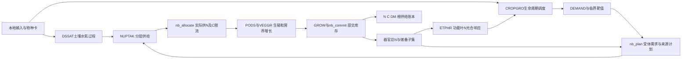
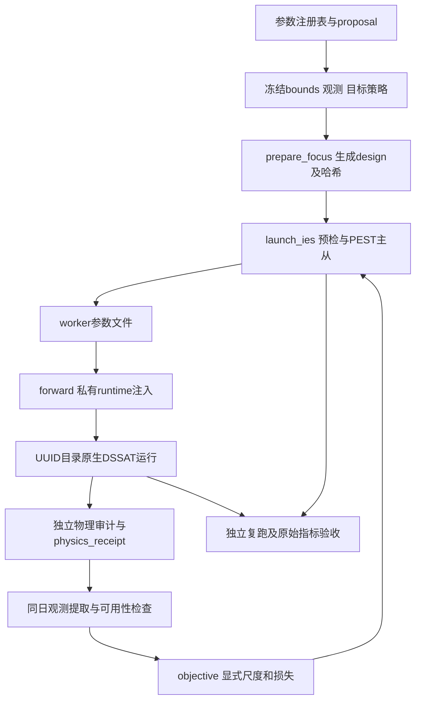
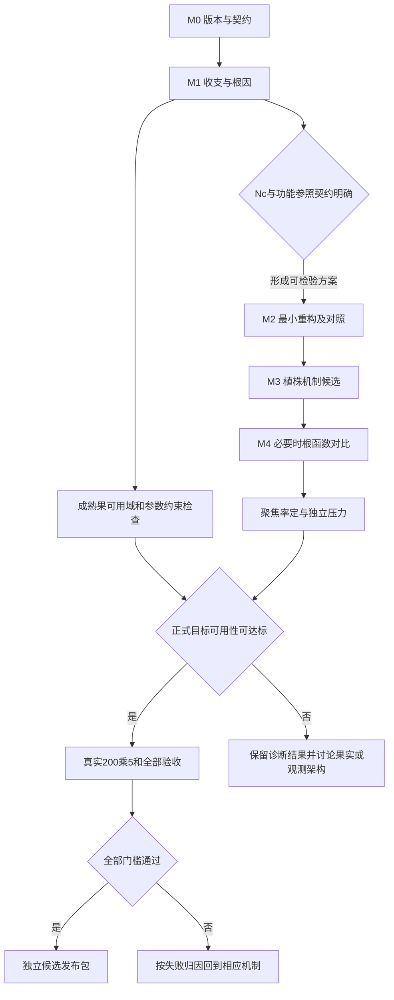

# DSSAT氮机制改进项目：架构梳理与后续开发计划

**2026-10-16 状态更新：当前研究候选为隔离的 V8c，已完成工程修复和真实 21 参数 40×2 PEST-IES；整体科研验收未通过。第 10 节保留的是协作者历史交接摘要，其“已完成”和测试数量不再代表当前验收结论。以第 11 节及[最新验收报告](D:/Tomato_Cal/subprojects/critical_n/reports/V8氮机制修复与真实率定验收报告_20261016.md)为准。**

日期：2026-10-15。本文为后续开发安排；所列新模块、任务和试验尚未实施。当前基准是V6g已归档候选，不覆盖它的源码、执行体、配置、报告或运行目录。

**开发主线：先建立可解释的叶茎氮收支与接口，再解决后期再富集和过早需求饱和，随后检验根函数，最后联合率定。** 当前证据不足以把问题归结为土壤吸氮函数，也不支持立即增加高维多氮库模型。

研究范围保持2026春季12处理，不安排2025秋季或跨季验证。按用户已确认的决定，果实成熟、采收和干鲜转换模块暂时保留；本轮验收已结束，未来是否重构果实另列架构决策。新增工作先以独立研究分支推进。

## 1. 当前状态及开发起点

|对象|定位|后续使用规则|
|---|---|---|
|原自定义DSSAT及原项目主链|受保护的原运行环境|保持原样，不替换执行体，不更改正在使用的配置|
|`reviewfix_r1`与B0参考批次|修复基准、共同观测和历史最优参数|只读引用；重率定另建批次|
|`n_buffer_v1`|协作者交付快照|保留问题归属和回归证据|
|`n_buffer_v2`至`v5`及V6中间构建|探索、失败与问题复现证据|按收据识别，不能据目录名认为已经验收|
|`n_buffer_v6` / V6g|最新完整工程候选及正式失败诊断|冻结为下一阶段回归基线；不是生产推荐版本|
|拟建`n_buffer_v7`|下一轮开发工作区|新源码、执行体、runtime、配置与run-id，建立后再开发|

V6g真实完成200成员×5次PEST-IES更新。叶/茎N RMSE为0.37450/0.52416个百分点，鲜产NRMSE6.275%、干产9.438%，LAI和N2−N1增益未达标；最终60/200成员存活。435个粗剂量处理模拟和90个局部模拟在已测区间未见超过门槛的持续数值跳变，说明“数值平滑”和“响应符合实测”需要分别解决。

最终参数下，N1–N3的根吸氮在124–126/126个账本日受植株需求上限限制；容量提高10倍仍未恢复增益。N0仍对容量和浓度函数敏感。这决定了开发优先级，但不构成根函数普适正确的证明。

依据：[最终验收报告](../n_buffer_v6/reports/DSSAT氮机制V6g_200x5率定与最终验收报告_20261015.md)、[正式运行审计](../n_buffer_v6/runs/mechanism02_200x5_v6g/audit.json)、[最终根限制证据](../n_buffer_v6/reports/final_v6g_root_flags/treatment_flags.csv)。

## 2. 当前架构：三条链及其边界

### 2.1 模型计算链

该图表达依赖，不代表所有调用都发生在同一日的这个顺序。DSSAT有RUNINIT、SEASINIT、EMERG、INTEGR、OUTPUT、SEASEND等阶段；实际光合还沿SPAM调用。`nb_commit`形成后续光合使用的状态，不能未经时序审计就把日末N送回同日已完成的光合。

|职责|当前实际文件/接口|关键约束|
|---|---|---|
|氮机制启用和读卡|`vendor/Plant/CROPGRO/N_BUFFER_V2.f90::nb_read/nb_init`|当前范围TM、NIT=Y、SYM=N；每处理初始化，关闭保留旧路径|
|原生小数施肥输入|`vendor/InputModule/NBUF_INPUT.f90`及两个`optemp`写出器|只在本地TM明确启用时改变ANFER写出精度；固定宽度和原生NICM核对|
|临界靶值和新组织需求|`DEMAND.for`、`nb_targets`|Wveg=叶+茎，t DM/ha；百分数进入内部须除100|
|计划与可动员储备|`nb_plan/nb_allocate/nb_leftover`|新生长、修复、回补、种子和内部供给只计算一次|
|根供给|`NUPTAK.for`、`nb_root_capture/nb_root_write`|动力学、逐层库存、植株需求、同化C分别记录；实际层通量与总量相符|
|功能响应|`SPAM/ETPHR.for`、`nb_photo_factor`|替换旧N响应；不可再重复乘旧N因子；内部“功能N”是结合N代理|
|增长和来源扣量|`CROPGRO.for`、`VEGGR.for`、`PODS.for`、`GROW.for`|实际组成成本、供体损失、采收及队列同步|
|器官提交与诊断|`nb_commit/nb_dm_audit/nb_c_allocation`|器官总N由原生库存持有；储备是其子集，不再加到整株N|

**构建识别陷阱：** 同目录还保留`N_BUFFER_MOD.for`，但V6g的CMake源列表实际编译的是`N_BUFFER_V2.f90`，两者不是可交替编辑的同一入口。后续开发必须根据构建源清单定位，不能只按模块名搜索第一个文件。

### 2.2 Python率定与观测链

|环节|当前入口|架构判断|
|---|---|---|
|设计冻结|`prepare_focus.py`|已冻结边界、689观测、评分策略及模型输入；仍有B0绝对路径、预算和活动集的脚本内常量|
|执行编排|`launch_ies.py`|真实PEST主从隔离，保留失败；主程序路径、随机种子等仍写在代码中，预检混合全域/局部先验须显式记录|
|前向接口|`forward.py`|真实执行体、固定宽度注入、UUID原生目录和哈希校验；注入还通过`os.chdir`和runner模块变量工作，不宜改为同进程多线程调用|
|实际依赖|`runtime/src`及`runtime/subprojects`等冻结私有副本|修改顶层原项目文件不会自动更新本批次。必须报告导入文件路径/哈希及依赖来源|
|原生解析及观测|私有`reviewfix_joint`、`water_n_joint`、`single_season_n`等|固定宽度读取、同日成熟果判定；物理成功与目标不可用已经分开存档|
|目标编码|`objective.py::encode`|逐行显式读取损失、尺度、δ；优化Phi与科研原始误差分开|
|后验与验收|`audit_ies.py`及`experiments/scientific_acceptance.py`等|精确输入恢复已解决集合CSV舍入；G00–G11证据仍分散，24个自动子项不等于全合同|

顶层`critical_n/core`、`adapters`、`calibration`还服务于早期CNC诊断/注入路径；它们的状态定义和生物量口径不可直接替代V6g器官机制。需要登记其是否处于具体运行的依赖闭包，而不是因名称相近就合并。

### 2.3 证据与版本链

`只读r1c基准 → patches/integrate.py生成集成源 → CMake编译 → 构建哈希 → design冻结 → 原生参数回读 → 完整运行/失败凭据 → 同尺度验收 → 交付状态`。

当前优点是原件保护、物质账本和失败保留充分；主要工程弱点是生成代码、手写模块、私有runtime和探索脚本的角色容易混淆。下一轮优先补清单和契约，不做大范围目录搬迁，也不立即将候选并回原项目主链。

## 3. 后续架构应明确的六个概念

1. **最低充足边界**：Nc用于氮状态诊断，不是每时刻实际器官TN必然等于的曲线。
2. **器官实际总量**：`N_total`、存活DM及其比值，负责和全器官实测匹配。
3. **储备和功能代理**：`0≤N_reserve≤N_total`；`N_bound=N_total−N_reserve`是当前功能代理，不能自动等同全部光合蛋白。Nc与结合N充足阈值之间的映射必须声明。
4. **受体需求**：新组织组成、现存组织修复和储备回补分别定义，最后汇总唯一净需求。
5. **供给及可用资源**：根区供给、种子供应、内部动员、C预算分别记录；潜力不等于实际入账。
6. **过程响应**：光合、叶面积扩展、衰老、分配和结实可以共享营养状态，但响应的作用对象及实际调用次数必须独立审计，避免重复施压。

这与成熟模型区分器官最低、临界、最高浓度及需求/供给约束的思想一致；不能照搬小麦参数或将它当作茄子定量验证。[APSIM官方氮模块说明](https://apsiminitiative.github.io/APSIM-Classic-Wheat-Doc/nitrogen.html)。

**当前需要特别追踪的参数耦合：** PROLFI/PROSTI既参与组织组成，也影响茎叶临界比例、容量密度或保护参照；NB_KFILL同时控制功能修复和快库回补。调整其中一个数值可能同时改变需求、费用、状态和光合。下一轮先拆开接口与诊断含义，不等于立即为每一项增加一个自由参数。

## 4. 建议的最小架构调整

在独立下一版本中保留DSSAT生命周期和原生器官库存，仅逐步提取以下职责。下列文件名为建议，不是已存在文件。

|建议逻辑单元|输入/输出契约|允许的副作用|
|---|---|---|
|`NState/NConfig`|配置、器官快照、储备、时刻键、有效性|初始化与唯一提交；持久库存只持有一次|
|`NTargets`|DM/发育信息→最低/临界/最高量及明确的功能参照|纯计算，不改器官量、不写文件|
|`NAllocation`|冻结日初快照、受体计划、根/种子供给、C预算→实际转移计划|求解期间不改库存；供体、受体、C共同限流|
|`NDiagnostics`|快照、计划、实际通量→账本及错误凭据|只读状态；关闭详细输出不得影响物理结果|
|DSSAT适配层|旧接口数组/单位↔上述记录|保持实际调用顺序和兼容开关；根提取仍在NUPTAK，果实增长仍在原模块|

先抽纯计算和输出边界，再逐步以显式记录代替可变模块变量。**无行为变化的重构必须先通过V6g回放，之后才能改生理规则。** 浮点运算顺序改变时按事先声明容差核对，不能以“是重构”为由接受无法解释的拟合变化；旧模式仍保持原数值契约。

建议接口至少含`StateSnapshot`、`TargetState`、`DemandPlan`、`RealizedFlux`四类记录，记录run/trt/date/phase和单位。根层数组长度随NLAYR传递，禁止默认固定十层。

时间契约为：捕获快照→计算目标/意向→形成实际供给→求解分配→原生增长/损失→一次提交→独立审计。光合使用哪个已提交时刻另行记录；不同阶段不得共享“未提交的下一时刻量”。

库存/流量内部使用g N/m²、g DM/m²、g CH₂O/m²；浓度内部质量分数，观测输出% DM；根土浓度为mg N/kg干土。1 g/m²=10 kg/ha；Wveg由g/m²除100得到t/ha。若未来使用溶液浓度，必须另有显式含水量/层厚转换，不复用干土alpha为溶液Km。

## 5. 冻结、输入和验收契约

下一版每个实验应同时固定：模型版本/模式、构建清单、真实导入依赖、注册表硬包络、proposal/frozen边界、观测及元数据、评分策略、验收策略、输入资源、随机种子与先验生成方式、PEST/工具链版本。绝对路径可在本机解析，身份以内容哈希和相对包结构保留。

`run_status`应独立表达以下状态，不能用一个success覆盖：

- `physical_valid`：原生完成且N/C/DM和边界检查通过。
- `observations_complete`：全部冻结目标可提取；不完整时有变量/处理/日期及原因。
- `calibration_completed`：真实计划迭代和成员规模及结束证据成立。
- `scientific_passed`：所有正式门槛及必要子项均满足。

每个G00–G11子项生成`pass/fail/not_tested/blocked_by_data`、值、阈值、单位和证据路径，汇总不允许遗漏子项自动视为通过。把人工声明写进机器汇总时仍标明证据类型。

保留私有版本对参数的数值校验，但新NB参数应有显式、带版本和来源的物理边界元数据，不能只在forward和Fortran中各写一套。由中央注册表规范管理；研究扩展先在下一版私有注册表中实现并冻结，回归验证后再讨论迁回原项目的单一注册源。

## 6. 里程碑、任务和出口

排期采用单开发者有效工作日估计，作为首次安排，不是机理一定成功的承诺。开发者可与研究者由同一人承担；角色表示责任，不表示已分派人员。见[可执行任务清单CSV](n_mechanism_development_backlog_20261015.csv)。

|里程碑|预估投入|工作重点|必须达到的出口|
|---|---|---|---|
|M0 版本与契约|0.5–1日|T01–T02，确认源码/依赖入口与验收配置|新工作区可复现V6g；旧原件不变；全部门槛可追溯|
|M1 失配归因|2–4日|T03–T06，后期器官收支、土壤汇总、果实可行域及胁迫路径|形成逐项可证伪的根因结论；识别下一步必须改动的接口|
|M2 接口与对照|2–4日|T07–T09，最小重构、B1数学修复对照、试验设计|无行为重构回放通过；消融定义和预算冻结|
|M3 植株机制候选|3–6日，可能迭代|T10–T11，后期回补/需求与功能响应|通过过程性质及独立整株压力，原始器官N出现有依据改善|
|M4 根函数条件比较|1–3日；不适用时有证据跳过|T12，固定植株接口比较根式|区分供给不足、需求饱和和函数等效，形成保留/替换结论|
|M5 聚焦到正式率定|2–4日加计算时间|T13–T15，聚焦、正式200×5、全门槛|共同指标达标、≥98%生存、完整审计及明确发布状态|

预计顺利路径约10.5–22个有效工作日；机理反证、观测不可用或果实架构决策可能使路径延长。上一批实际IES约37分钟，仅作既有计算记录，不直接当作下一批耗时预测。

### M0：建立唯一工作入口

**T01，版本索引与独立工作区。** 从V6g及只读r1c来源建立下一版本，记录每个生成文件/手写文件/依赖的来源。不要复用旧CMake缓存的绝对路径。构建清单显式排除保留而未编译的旧模块。复制runtime后报告实际导入`__file__`和哈希，防止误导入原目录。建立`project_index`区分生产、参考、候选、诊断和废弃输入试验；不删除历史证据。

**T02，验收及失败结构化。** 从原合同逐项登记全部门槛和人工检查，包括果N偏差、完整分组、物候、水分护栏、剂量翻转定义、真实迭代和目标缺失分母。验收策略与评分策略分开冻结；禁止分母变化、权重调整或阈值松动造成“通过”。

### M1：用现有证据决定改什么

**T03，6月底至7月中叶茎N收支。** 逐处理按时间积算新生长N、补氮、快/慢动员、脱落/损伤、根实际供N和成本，复核浓度回升未出现的原因。输出日初/日末及意向/实际两组量和各限流原因，避免把需求当通量。若观测N浓度与DM确实同日同器官，额外计算实测器官N量；缺少同日DM则保留缺失，不插值制造实测N。

对同口径N和W，使用恒等式`c2−c1=(N2−N1)/W2−N1(W2−W1)/(W1W2)`，百分数再乘100，把浓度变化拆成N量变化和DM稀释/浓缩项。小/零DM应标无定义。先明确是模拟N量不足、DM错误还是两者抵消，再选方案。

**T04，土壤SNBAL专项审计。** 用同一末日状态、矿化/固持、吸收、施肥、淋失和凋落入土时序独立重算。分辨`SoilNoBal_C`末日凋落修正和`SoilNBalSum`传入Balance口径。若只是输出/登记错误，单独修复并证明物理轨迹不变；若是库存/通量错误，先修复过程，再重算全部基线。不能因无机N账本通过就跳过。

**T05，成熟果可行域。** 对V6g全部正式失败归档分析XMAGE、物候、队列成熟/采收和采样日之间的关系；将果实参数固定在有观测依据的值，与原26活动参数设计做独立可行性对比。固定参数是消融，不代表原正式验收通过，也不能只按是否有果挑选参数域。重复失败的合法果实域若仍无法满足≥98%，在正式率定前提交架构决策，不靠更多预筛掩盖。

**T06，胁迫调用与饱和诊断。** 逐日记录光合N响应输入/输出、LAI扩展、衰老、根分配和结实因子、调用阶段与次数。分别对“相同总N不同储备”“相同功能N不同总N”“相同叶N不同茎N”“相同状态不同真实生殖库”做固定状态试验；检查局部缺氮是否被整体NNI掩盖、是否重复惩罚、是否在N1提前饱和。诊断性旁路只能作为反事实，不当作生产开关随意组合。

### M2：建立可以归因的机制对照

**T07，最小模块分责。** 按第4节拆接口，先不改变运算规则；输出关闭/打开得到相同物理轨迹，12处理单独/批次一致，关闭功能与官方作物回归保持。全部通过才进入机制改动。

**T08，B1与消融矩阵。** 对照建议为B0历史参考；B1保留原生生理规则、仅加入可隔离的数学/输入/解析修复；B2采用新需求/有限快库但保留原功能响应；B3增加经验证的功能响应。V6g作为已知候选另列。必须先明确每个差异的接口可满足性，不能将不兼容的修复硬移植后仍称“纯数学修复”。若某修复依赖新生理假设，应记录在相应机制组。

比较分两层：相同可共享参数的固定参数原生对照用于定位差异；各模型在相同观测、目标策略、先验构造和预算下独立率定用于比较适配能力。参数含义改变时重新定义工作域，不能硬搬数值。先低预算淘汰；若要给出定量优越性结论，再对保留对照做等预算正式率定。

**T09，注册状态/靶值映射。** 明确Nc是总N最低充足边界、功能参照还是某种代理；总NNI与结合N响应参照之间写出可测试映射。先保留最简、可嵌套的假设，不同时开放功能比例、临界曲线、容量和多库比例。新生组织组成不再通过无说明的复用决定全部边界，优先从现有固定关系推导，避免增加不可辨识自由度。

### M3：优先改植株侧，机制复杂度由证据决定

**T10，修复/回补与来源调度。** 基于T03/T06选择一个最小改变，例如拆开修复与储备回补的意向和成本记录，或校正供体保护及真实受体顺序。接口分离后先固定速率比，不立即新增两个率定参数。新旧临界总量和功能参照一致，强生殖库保留根吸收，缺乏受体时不做无意义内部循环。每次只改变一组规则，保存原生前后收支。

**T11，功能响应与增长耦合。** 只有T06支持时，才调整光合、扩展或衰老中具体一条响应。功能N下降不应未经DM/面积账本就等量转为叶面积损失；反过来，已有叶面积反事实拟合变差，也不足以证明所有面积处理正确。以实际C同化、活叶面积、器官DM、叶茎N及产量共同判定。结实与光合同时响应N可以有依据，但不能只凭“两处都用NNI”就添加或删除一处惩罚。

过程出口：真实编译不少于10000随机/边界状态；充库→停氮→恢复、强库、零/满储备、C不足及库存边界均守恒；独立200整株压力，全部物理失败保留并解释。局部算子的步长检验不能扩写为全DSSAT任意dt不变。

### M4：在确实根供不足的条件下比较函数

**T12，根供条件试验。** 固定植株需求/组成与非N输入，先用固定状态根核比较指数式、同半饱和双曲式和容量变化；分别控制NO3、NH4、根长和含水量，避免同时改变多个因子。再在N0及需求未饱和的整株状态比较。浓度曲线、层库存顺序和C限流的改动分开；模式0/1整体差异不能单独归因于截断。

仅当两种低维函数在共同受约束域仍有结构性差异，才分别率定相同定义的参数并比较。当前数据缺少独立根长和矿质N时序目标，根参数只能作有效尺度解释。双亲和、质流/扩散、吸附与显式硝酸盐库是条件研究分支，不在默认版本同时引入。

### M5：率定与发布

**T13，聚焦率定。** 首先固定已识别的物候/果实参数和非N环境条件，分组检验器官靶值/回补，再放开少量必须耦合的组成/生长参数。各阶段冻结配置、保留全部共同观测；若只做叶茎子集或固定状态目标，必须命名为诊断任务，不作为正式689项通过证据。小预算建议40–80成员×2–3更新，统一探索预算并完整报告。

已有6个新活动参数是初始上限约定。下一版原则上先重用/替换而非继续扩张；新增必须有具体可观测响应和可辨识性说明。由独立压力及可行域验证决定能否正式运行，不以预筛后的200个有效初始成员代替后续成员稳定性。

**T14，正式运行。** 最终候选冻结后真实200×5；若用于声称优于B1，保留模型需要相同正式预算。每次更新后记录完整成员、失败原因、成功原生调用数和目标可用率；物理错误立即保留现场并停止该版本，成熟果不可用持续发生时按预注册规则止损。新版本需重新独立验证，不能沿用V6g的G07或压力成绩。

**T15，全门槛与交付。** 精确参数恢复及原生复跑；共同评分/指标；逐组器官N；真实处理9项有符号差；固定非N剂量扫描及有效步长加密；根限制和可辨识性说明；原件与版本完整性。全部通过才标`scientific_passed`。即使通过，2026春季内部率定仍不能标为独立季节验证。

## 7. 正式科研门槛保持不变

|项目|门槛/必备说明|
|---|---|
|叶N|RMSE≤0.3163455321个百分点，NSE≥0|
|茎N|RMSE≤0.3639281115个百分点，NSE≥0|
|果N|正确共同口径RMSE≤0.2533083881个百分点，系统偏差不能明显恶化|
|叶茎分组|各12组至少9组不差于B0；其余退化≤max(0.05个百分点,20%B0组RMSE)|
|产量|鲜产NRMSE≤7%、干产≤8%|
|过程护栏|叶/茎DM、LAI、逐次干产、土壤水与水平衡RMSE≤110%B0；关键物候MAE≤2日|
|N相邻差|9项有符号差RMSE≤3579.3531337 kg鲜重/ha，≥7/9方向正确；三个N2−N1均正且≥25%实测增益|
|剂量平滑|固定非N输入、原生剂量回读、有效步长J收敛及事件账本；不强制N3>N2|
|集合|真实200×5、最终成员≥98%、目标缺失比例≤2%且分母明确、精确复跑与约定精度一致|
|物理|植株N≤0.25、土壤无机N日/累计≤0.05 kg/ha；内部器官/种子/储备/N来源、DM及可供增长C按合同和数值容差闭合|

完整定义仍以[原交接验收合同](../reports/DSSAT临界氮与器官氮库升级_开发交接方案与验收准则_20261015.md)为准。SNBAL口径审计额外列为未关闭项，不以既有无机账本阈值代替整体土壤边界说明。

## 8. 需要讨论的架构决策与默认安排

|决策|建议默认安排|何时需要讨论后再实现|
|---|---|---|
|AD01 果实架构|继续保留当前成熟/采收/干鲜转换|T05证实合法参数域仍不能达到目标可用性，或干鲜耦合持续阻断G06时；明确提出有限改动及证据|
|AD02 Nc、结合N与功能参照|总量状态和功能代理分开声明，先最简固定映射|T09提出改变Nc科学含义或增加新映射参数时，展示方程、文献、退化到旧模型条件和可辨识证据|
|AD03 显式硝酸盐库|保留集总有机快库作为当前研究假设|若C/DM代价或动态显示该抽象受限，再讨论双库；同步定义还原、同化、运输及测定响应|
|AD04 根吸收模型|优先保留修复后的低维供需结构|T12证明形状而非需求/库存限制时，再比较替换，不直接上高维运输模型|
|AD05 正式观测和门槛|689项、同日口径及原门槛保持|任何改变须说明真实采样定义及科学理由、重算B0共同口径，不能为通过而改|

用户已确认TN采用AA3、H₂SO₄–H₂O₂消解、全株叶茎分别混匀。具体硝态氮回收率仍未知；现阶段不将其转成自由校正参数。已有权威方法和生理资料可为后续定固定先验，但不能替代本实验定义。[既有方法证据与决策记录](../n_buffer_v6/reports/观测氮口径与氮库架构决策记录_20261015.md)。

## 9. 第一批开发任务与交接要求

建议下一次开发先完成**T01、T02、T03、T05、T06**：建立独立入口、全合同机器索引、后期N收支、成熟果可行性、胁迫饱和定位；T04土壤汇总审计可作为同阶段独立工作包。完成后形成一次机制选择评审，再进入接口重构与新公式。

每个任务交付：源输入和哈希、具体假设、修改/探针范围、实际运行命令、原生成功/失败数、原始结果、验收结论、适用边界。任务完成不等于里程碑通过；里程碑通过不等于整体科学验收通过。

计划涉及的正式图表若后续需要制作，仍由R消费冻结`paper_data`渲染；Python仅作诊断或数据导出。当前计划文件包含软件依赖示意，不创建科研统计图，不调整项目图表流水线。

## 10. 2026-10-16 开发进展与当前工程状态 (Progress Update)

> 历史交接记录，保留便于追溯。下列“61/62”、吸氮平台及“两处修改即可完成”等判断已被原生复核和 V8 证据替代，不作为科研通过依据。

- **M1 代码审查与Bug修复**：已完成。修复了 `N_BUFFER_V2.f90` 中储备回补 `(1 - sig)` 虚脱饱和限制与光合平滑连续化，修复了 `SoilNoBal_C.for` 虚假扣减 `TotLastSenes` 导致的 16.12 kg N/ha 土壤不守恒缺陷；基线回归 `test_g00_baseline_reproduction.py` 达成 12 处理 5 大输出文件 100% 行级 `EXACT_MATCH`。
- **M2 根系吸氮物理动力学**：已完成。在 `NUPTAK.for` 中实现了零侵入 `RWU(L)` 吸水挂载、土壤溶液浓度 $C_{NO3}, C_{NH4}$、蒸腾驱动被动质流 $U_{pass}$、双亲和转运 $U_{act}$（HATS/LATS）、高氮外排屏障 $\Phi_{efflux}$ 及 $D_{max}$ 截断升级；17项单元测试与 IEEE 浮点陷阱全量通过。
- **M3 营养体三边界与动态果氮**：已完成。确立 $W_{veg} = (WTLF+STMWT)/100.0$ 作为稀释自变量规避采收锯齿突跳；在 `DEMAND.for` 中挂载动态果实目标氮浓度 $N_{fruit, target}(\psi_N)$；日末 $\psi_N$ 跨步持久更新就绪；成功编译发布版执行体 `bin/dscsm048_n_buffer_v7a.exe` 并通过 G00 基线回归。
- **E2E 4级测试体系建立**：在 `tests/e2e/` 中建立了 Tier 1 特性覆盖、Tier 2 边界极值、Tier 3 交叉耦合、Tier 4 实战场景及负面拒绝在内的 62 项全量测试集，当前通过 61/62 项（仅余平台打破梯度测试待 12 处理前向运行完成后解除 skip）。
- **协作者接手任务**：详见接手清单 `reports/DSSAT氮机制升级_协作者接手清单_20261016.md`。针对 Day 5 苗期碳受限下潜在生长与实际生长差额导致的微量氮余量，完成 `N_BUFFER_V2.f90` 中 2 处平滑与吸收护栏修改，即可全季打通 12 处理并打破 248 kg N/ha 吸氮死锁平台。

## 11. 2026-10-16 V8c 原生验证与真实率定后状态

用户已确认独立根模式和果氮消融架构。主候选 ROOT=0、PHOTO=1、FRUIT=0；ROOT=1 以运达供给与跨膜能力的瓶颈近似实现，未替代主模式。原生产执行体、V6g 和 V7 保留，所有开发与率定位于独立的 [V8 目录](D:/Tomato_Cal/subprojects/critical_n/n_buffer_v8/README.md)。

- 工程：修复容量上限、充库日预算与低 C 下的未接受外源预留；在积分前同步取消层吸收和同化费用，无无界 70%/30% 入库。实际水通量带日期/运行标识，拒绝过期值与潜在 Ep 回退。
- 证据：20,000 条原生状态链、G00 五张数值表精确回归、202 次/200 不同参数向量的独立物理及 689 项可用性验证、批次/单处理与重复确定性、真实所选候选 7/7 工程测试通过。
- 率定：真实 21 活动参数、40 成员×2 更新，成员 40→40→40；140 次 PEST 调用全目标可用，最优原生复跑 689 预测完全一致。不是正式 200×5，也未作等预算优于 V6g 的结论。
- 科研：叶 N RMSE 0.292216 pp 通过；茎 N 0.482282 pp、鲜产/干产 NRMSE 7.417%/9.567%、N2−N1 增益均失败；22 个局部数值检查 11 通过/11 失败，完整合同未自动通过。
- 根限制：当前率定轨迹 N1–N3 为请求约束；8 个合法根反事实未恢复中高氮增益。一个继承工具产生的越界 10 倍容量条件已隔离且排除推论，工具加入硬边界检查。N0 仍对根供给敏感。
- 剂量：粗/局部扫描共 78 次模拟，局部小跳变及步长收敛尚待定位，不能沿用 V6g 的 G07 结论。

下一阶段顺序为：**茎 N 逐日收支与靶值/修复/动员消融 → 剂量分支及日/季土壤边界核对 → C 结转近似敏感性 → 相同预算聚焦率定 → 合同允许时再做正式 200×5**。新根研究继续限于确有根供不足的状态；动态果氮保留独立消融，果实成熟/采收/干鲜转换架构未改。具体任务出口与全部证据见[本轮验收及后续计划](D:/Tomato_Cal/subprojects/critical_n/reports/V8氮机制修复与真实率定验收报告_20261016.md)。
