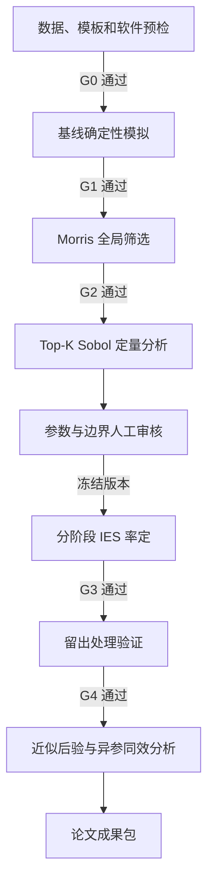

# Tomato_Cal 产品定义与系统设计

> 文档状态：当前规范（Canonical）
> 版本：2.4
> 更新日期：2026-07-15
> 实施状态：P0 已加固；XXQL2501 P1 已批准；科研图表核心骨架已落实

本文取代此前以目录迁移和脚本整理为中心的“项目重构规划”。旧方案中仍有价值的工程经验保留在归档文档，但不再作为产品和科研流程的依据。

## 1. 产品定义

### 1.1 使命

构建一套可信、有效且易用的 DSSAT 参数敏感性分析与参数率定工具，使研究者能够：

- 判断哪些参数真正影响目标观测；
- 在明确边界、观测误差和验证规则下率定参数；
- 评估参数不确定性、相关性与异参同效；
- 形成可复核、可复现、适合 SCI 论文的指标、图表和方法材料。

“可信”指每个结论都有输入、配置、版本和质量证据；“有效”指算法得到非退化且可验证的数值结果；“易用”指常用流程有统一入口、可理解的失败提示和有限的必要配置。

### 1.2 目标用户与主要场景

主要用户是熟悉作物试验或 DSSAT、但不希望手工维护 PEST++ 中间文件的研究人员。首要场景是 Windows 本地环境下，使用 DSSAT 4.8 的番茄模型表示茄子，对遗传参数进行 SA、率定和论文分析。

近期只对当前茄子/番茄案例负责。多作物、云计算、GUI 和通用工作流平台不属于当前范围。

### 1.3 成功标准

项目达到“可服务科研”至少需要同时满足：

1. 相同输入、配置、随机种子和软件版本可重现关键结果；
2. 参数扰动能够改变预期模型输出，失败和缺失值不会被当成正常结果；
3. SA 排名经过重复种子、稳定性或收敛检查；
4. 率定目标函数确实变化，参数集合确实更新，且无未解释的异常边界命中；
5. 留出处理上的预测性能与不确定性得到报告；
6. 图、表、指标和方法说明可由运行产物重新生成；
7. 任何用于论文的结论均关联唯一 `run_id` 和通过的质量报告。

## 2. 当前问题与设计取舍

历史代码具备较完整的流程外形，但一次进程成功不等于科学计算成功。现状审计发现：

- 冻结边界存在跨参数关系不满足的记录，且率定参数维度偏高；
- 已有 Morris 运行虽然完成 408 次模拟，但敏感性全为零；
- 已有 IES 运行中观测集合缺少有效变异、目标函数近似恒定、参数没有实质更新；
- PEST 权重、变换和组权重存在语义或实现不一致风险；
- 多个入口和路径依赖运行位置，单元测试无法覆盖端到端数值失效。

因此，后续设计不以增加更多算法为先，而以修复证据链和最小可信闭环为先。

本版明确摒弃以下旧设计：

- 不把某个导出 CSV 或历史 SA 排名设为跨阶段“唯一真源”；代码参数登记和经审核的冻结文件各自承担明确职责；
- 不允许 SA 结果自动进入率定，也不自动选择“最新”边界；
- 不把 `1/sigma²` 直接作为 PEST 权重；
- 不把基于观测和候选模拟共同范围的 Min–Max 归一化设为必需步骤；
- 不默认同时率定遗传、土壤、初始条件等全部参数；
- 不把累计采收序列当作彼此独立观测重复加权；
- 不把 IES 参数集合表述为严格贝叶斯后验；
- 不以固定前缀、散落目录或退出码作为运行身份和有效性依据。

## 3. 设计原则

### 3.1 科学质量门优先

系统区分两个状态：

- `process_completed`：命令正常结束，预期文件已写出；
- `science_validated`：数值变化、失败率、边界、收敛和验证规则均通过。

只有第二个状态允许产出“可用于结论”的标记。

### 3.2 显式配置优先

作物、参数冻结版本、处理集合、观测用途、误差模型、随机种子和软件位置必须显式记录。禁止依赖“最新文件”、当前工作目录或隐藏默认值决定科学结果。

### 3.3 分阶段、少参数

先进行模型过程对应的分阶段率定，再在必要时做小规模联合更新。参数能否进入率定由物理意义、SA 证据、观测支撑和可辨识性共同决定，而不是只由文件中存在该参数决定。

### 3.4 机器可判定、人工可审核

边界关系、输出变异性、无效值、目标函数变化等由程序强制检查；参数冻结、验证划分和研究解释等科学决策保留人工审批。

### 3.5 最小充分架构

本项目只引入四类核心契约：参数登记、观测规格、运行清单和质量报告。暂不建设复杂对象框架、数据库或服务化平台。

## 4. 目标科研工作流



### 4.1 G0：环境和输入预检

检查 DSSAT/PEST++ 可执行文件、Python 依赖、模板标记、处理文件、参数名、单位、边界关系、输出变量映射和可写运行目录。任何错误都必须在批量运行前失败。

### 4.2 G1：基线与扰动烟雾测试

至少运行基线、一个单参数扰动和一个多参数扰动。要求：

- DSSAT 输出存在且解析完整；
- 目标量为有限数，不出现 `-99`、空列或静默回用旧文件；
- 至少一个预期指标随扰动发生超过数值容差的变化；
- 每次运行使用隔离目录，不读取其他运行残留。

### 4.3 G2：SA 质量门

Morris 用于筛选，Sobol 仅在审核后的 Top-K 参数上运行。通过条件包括：

- 有效运行率满足配置阈值；
- 输出不是常量，敏感性结果不是全零或全缺失；
- 多输出先按预声明尺度处理，再聚合排名；
- Morris 多随机种子排名具有可接受稳定性；
- Sobol 报告样本量、置信区间或收敛诊断；
- 排名变化和参数交互有可解释记录。

SA 的输出是 `bounds_proposal` 和参数选择建议，而不是率定配置。只有人工复核物理边界与观测支撑后，才可生成带版本的 `bounds_frozen`。

### 4.4 G3：率定质量门

IES 运行必须证明：

- 参数先验集合和模拟观测集合具有合理变异；
- 目标函数、参数分布或预测集合发生实质更新；
- 失败成员被识别并报告，未被静默替换；
- 目标函数分组贡献、参数收缩和边界命中可解释；
- 最优或代表参数经过独立确定性复跑；
- 训练结果的改进不是由单个观测组支配或由错误权重制造。

### 4.5 G4：验证质量门

验证按完整处理、地点、季节或独立试验划分，不随机拆分同一处理的观测行。最终划分属于研究设计决策，在 P3 实施前由用户审批。

至少报告率定集与验证集的 RMSE、MAE、偏差、归一化指标及预测区间覆盖。`R²` 或一致性指数只能作为补充，不能替代误差和偏差。

## 5. 最小信息模型

### 5.1 Parameter Registry

参数治理分为四层：

1. `physical hard bounds`：模型数值和物理安全边界，代码中的最终防线；
2. `baseline`：领域知识给出的建议初值和范围；
3. `bounds_proposal`：SA 或研究讨论产生的候选范围；
4. `bounds_frozen`：经人工审核并带版本的率定输入。

冻结文件必须记录来源版本、作物、模式、状态、参数组、位置和审批说明。跨参数关系在预检中校验。土壤和初始条件默认 `fixed`；只有存在直接观测或明确的干扰参数方案时才可释放。

### 5.2 Observation Spec

每个观测变量必须记录：

- 变量名、处理、日期/阶段、单位和来源；
- 观测值与缺失规则；
- 用途：`calibration`、`validation` 或 `diagnostic`；
- 残差尺度或预声明变换；
- 误差标准差来源和组倍率；
- 处理均值对应的重复数、有效独立样本数、重复 SD、模型误差与 sigma 下限；
- 时间或累计相关性处理；
- 对应 DSSAT 输出和解析规则。

观测规格是目标函数的可审计定义，不应散落在 `.pst` 生成逻辑中。

### 5.3 Run Manifest

每次运行使用唯一 `run_id`，并记录：

- 代码提交、脏工作区状态和命令行；
- 数据、模板、配置和冻结边界的路径及哈希；
- DSSAT、PEST++、Python 和依赖版本；
- 随机种子、处理集合和参数集合；
- 开始/结束时间、运行状态和上游 `run_id`；
- 生成的主要产物索引。

`run_id` 是运行身份；文件前缀只用于可读性。

### 5.4 Quality Report

质量报告使用机器可读格式，并配套简短 Markdown 摘要。至少包含：

- 检查项、阈值、实际值、`pass/warn/fail` 和解释；
- 进程成功率、无效输出率和输出变异；
- SA 稳定性/收敛性，或 IES 目标函数/集合变化；
- 边界命中、组贡献、验证指标和已知限制；
- 是否允许进入下一阶段及批准者。

## 6. 模块与目录设计

```text
src/
  common/          参数登记、配置和质量契约
  dssat/           文件注入、隔离运行和输出解析
  sensitivity/     Morris、Sobol、稳定性与结果整理
  calibration/     PEST++ 构建、分阶段 IES 和运行控制
  reporting/       指标、诊断、后验/异参同效和图表
data/
  raw/             不修改的试验、气象、土壤数据
  user/            用户定义且版本化的 FileX/FileA/FileT/SOIL/气象输入包
  templates/       受版本控制的 DSSAT 基线模板
  parameter_registry/
configs/           运行和论文图表配置
workspace/runs/<run_id>/
  inputs/          本次运行输入快照
  control/         PEST/DSSAT 控制文件
  raw/             原始程序输出
  results/         结构化结果
  figures/         图表
  run_manifest.yaml
  quality_report.json
  quality_report.md
tests/
docs/
```

兼容脚本可以短期保留，但必须调用同一实现，不能用 `exec()` 复制执行源文件。所有正式入口应从仓库根目录和任意工作目录得到一致结果。

## 7. 敏感性分析设计

### 7.1 参数与输出选择

SA 参数范围来自基线或已审核提案，并受物理硬边界约束。输出按研究问题选择，如物候日期、LAI、器官生物量、产量和多次采收量；不为追求“全面”而纳入无法解释或无法稳定解析的变量。

多输出聚合必须保留单变量结果。聚合前采用预声明尺度，例如观测误差尺度、稳定基准尺度或无量纲化指标；禁止使用候选模拟共同决定的动态范围。

### 7.2 Morris

Morris 输出至少包括 `mu*`、`sigma`、每个参数—输出组合的有效轨迹数和重复种子排名。Top-K 不是只取固定数量，应结合累计贡献、排名稳定性、物理过程覆盖和后续计算预算确定。

### 7.3 Sobol

Sobol 只对经 Morris 和领域审核筛选的参数运行，报告一阶指数、总效应指数、置信区间/重采样不确定性与收敛证据。总效应较高但一阶效应较低的参数应进入交互解释，而非简单删去。

## 8. 参数率定设计

推荐阶段如下，具体参数清单需结合有效 SA 结果再审批：

- S0：只跑预检和基线，不率定；
- S1：物候参数，使用开花、成熟等直接观测；
- S2：冠层和营养生长参数，使用 LAI 与器官生物量；
- S3：结实、分配和产量参数，优先使用增量采收；
- S4：仅在前述阶段稳定后，对少量强相关参数联合更新。

每阶段固定已稳定参数或使用受控先验，不允许参数数量无依据地膨胀。土壤和初始条件作为干扰参数释放时，必须有相应观测、先验和敏感性说明，并单独报告其对遗传参数的影响。

率定比较的不只是“最佳一组参数”，还包括集合性能、预测性能、参数相关性和边界行为。

## 9. 观测误差与目标函数

PEST 目标函数按下式解释：

```text
Phi = Σ [w_i × (observed_i - simulated_i)]²
```

若 `sigma_i` 表示观测误差标准差，基础权重为 `1 / sigma_i`。统计误差权重和研究目标的组倍率分开保存：

```text
w_i = group_multiplier_g / sigma_i
```

默认在原始物理尺度计算残差。若采用对数等变换，必须同时作用于观测和模拟，并在变换尺度上定义误差；禁止对每个候选模拟重新计算 Min–Max 范围。详细规范见 [观测误差与权重设计](docs/权重设计方案改进提案.md)。

FileA/FileT 保存处理均值和实际值，不把重复作为与同一 DSSAT 处理模拟配对的独立观测。重复原始数据另表保存并用于估计 `sigma_eff = sqrt(SD²/n_eff + sigma_model² + sigma_floor²)`。log 只作用于 `.pst` 观测与 PEST 专用输出，采用显式 `ln((y+offset)/reference)`；常规 DSSAT 输出、图表和指标保持实际尺度。

物候、冠层、生物量和增量采收默认采用相同组倍率 `1.0`；增量采收只允许在预声明敏感性对照中小幅提高。pwtadj1 当前停用，未来若启用需按总组 Phi 平衡并先审核观测数量和时间相关性。

重复测量和累计采收具有相关性。多次采收默认以增量值进入率定，累计值用于诊断；若必须使用累计值，应显式采用协方差或降权方案并说明依据。

## 10. 近似后验与异参同效

PEST++ IES 产生的是在模型、先验、观测和算法设定条件下的参数集合。本项目称其为“条件参数集合”或“近似后验”，避免将其等同于严格 MCMC 贝叶斯后验。

标准分析包括：

- 先验与近似后验边际分布、收缩程度和边界命中；
- 参数相关矩阵、成对分布和高相关参数组；
- 参数集合对应的预测分布、验证覆盖和不确定性分解；
- 在相近目标函数或预测性能下识别多组差异参数；
- 对等效解做稳健聚类并选取代表解，再进行确定性复跑。

聚类只用于解释和选代表解，不制造新的“最优参数”。样本量不足或聚类不稳定时，只报告连续相关结构，不强行分群。

## 11. 论文指标与图表

图表系统采用期刊配置而非写死样式。最低要求：

- 矢量格式优先，照片或栅格热图按目标尺寸输出足够分辨率；
- 单栏/双栏尺寸、字体、线宽和面板标签可配置；
- 色盲友好并在灰度打印时可区分，不只依赖颜色；
- 单位、样本量、处理、误差带含义和统计定义完整；
- 图中数值与导出表来自同一结构化结果；
- 每张图保存数据、脚本、配置和上游 `run_id`。

首批标准图：观测—模拟散点、分处理时间序列、残差诊断、SA 排名与交互、先验—近似后验分布、参数相关/成对图、预测区间覆盖和异参同效代表解对比。

正式主文收敛为六类证据图：SA 稳定性与 Sobol、率定 Φ/组贡献、率定—验证性能、处理动态、可辨识性/异参同效、管理情景预测；完整热图、全处理时序、残差和质量门进入补充材料。每张图必须同时保存 source CSV、指标表、profile 和 manifest；只有 `data_status=science_validated` 才可使用正式 Fig 编号。历史结果只能生成带 `legacy_layout_demo` 标识的版式预览。

统一样式和图表注册表见 [科研图表设计与开发计划](docs/科研图表设计与开发计划.md)。正式入口为 `python -m src.reporting.paper_figures`；旧 `plot_results.py` 仅作历史诊断兼容。

具体尺寸和文件格式遵循投稿期刊最新指南。默认样式可参考 [Elsevier Artwork Sizing](https://www.elsevier.com/en-in/about/policies-and-standards/author/artwork-and-media-instructions/artwork-sizing) 与 [Nature Research Figure Guide](https://research-figure-guide.nature.com/figures/building-and-exporting-figure-panels/)，但投稿前仍需选定目标期刊配置。

## 12. 路线图与审批边界

### P0：科研可信性修复

修复入口和路径、参数边界预检、DSSAT 输出变异性、观测—模拟映射、PEST 权重语义、IES 更新诊断、运行证据链和端到端科学烟雾测试。详见 [P0 开发计划](docs/P0_科研可信性修复开发计划.md)。

实施结果：统一入口、冻结边界硬预检、五类参数注入、隔离 DSSAT、权重语义、SA/IES 质量门和微型 Morris/IES 闭环已完成；证据见 [P0 验证报告](docs/reports/P0_verification_report.md)。后续已增加显式 log 双侧变换、均值 sigma 组成审计和组倍率配置；当前正式 v14 frozen 仍停用，正式 P1 运行仍需审核边界。

退出条件：一个微型案例从构建到 SA/IES/确定性复跑全链路通过，且人为制造的全零输出、恒定目标函数、越界关系和错误权重都能被测试拦截。

### P1：可重复的 SA 工作流

实现 Morris 重复种子、稳定性报告、Top-K 审批产物和 Sobol 收敛诊断。退出条件是当前案例生成首份通过质量门的新 SA 报告。

启动准备状态：V14 历史 frozen 继续停用。用户已批准 `xxql2501_20260715` 输入包；首轮正式预检发现 v1 的 XMAGE/XFPHT 范围可生成非法组合，因此 v1 已取代，当前 frozen 为 `eggplant_p1_xxql2501_v2_20260715`。其中 57 个 CUL/ECO/SPE 参数 active，新 8 层土壤 fixed，50 个处理特异 IC 记录 disabled。正式输出覆盖全部 10 TN、240 项响应，Morris 预算为 5 个种子、每种子 `r=30`。详见 [P1 启动计划](docs/P1_科研分析启动计划.md)。

### P2：可辨识的分阶段率定

确定各阶段参数和观测、建立组贡献与边界诊断，完成小规模 IES。退出条件是参数和目标函数发生可解释更新。

### P3：验证与预测评估

经用户批准后冻结完整处理级率定/验证划分，加入预测区间和验证指标。退出条件是独立验证结果可复现。

### P4：近似后验与异参同效

实现分布、相关性、代表解和预测等效性分析。退出条件是所有代表解经过确定性复跑且图表可追溯。

### P5：论文成果包

按目标期刊配置生成图、表、方法清单、数据字典和复现说明。退出条件是从已冻结运行一键重建全部论文产物。

P5 图表开发允许在前序阶段先建立不依赖正式结果的样式、schema 和核心绘图函数，但不得用历史演示数据形成论文结论。目标期刊选定后必须新增期刊 profile，并以其最新作者指南覆盖通用默认值。

不得因完成某一优先级而自动开始下一优先级；每阶段由用户审核后实施。

## 13. 后续需要用户审批的科学决策

以下问题不会阻塞 P0，但在对应阶段开始前必须审批：

1. Morris Top-K proposal 及进入 Sobol 的参数集合；
2. S1–S4 的正式率定参数清单以及土壤/初始条件是否作为干扰参数释放；
3. 按完整处理划分的率定集、验证集和保留测试集；
4. 各观测组误差标准差的来源及是否采用额外组倍率；
5. 论文目标期刊或至少期刊版式族，用于冻结图表配置。

## 14. 文档权威顺序

发生冲突时，按以下顺序处理：

1. 本文：产品范围、科研流程和系统设计；
2. [P0 开发计划](docs/P0_科研可信性修复开发计划.md)：当前待实施任务与验收；
3. [开发者指南](docs/DEVELOPER_GUIDE.md)：实现约束；
4. 专题规范，如 [观测误差与权重设计](docs/权重设计方案改进提案.md)；
5. 背景、迁移和历史报告：只提供线索，不定义当前行为。

完整分类见 [文档索引](docs/README.md)。
